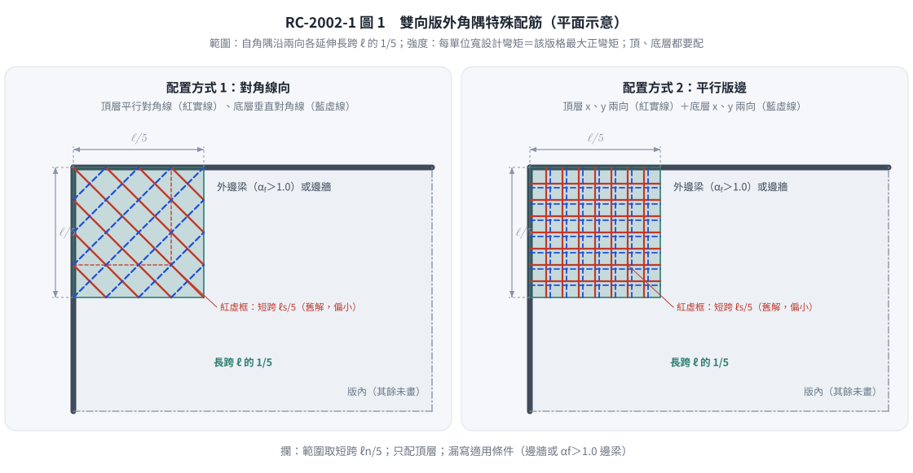

# 考題編號：RC-2002-1

**主分類：** `RC-U3-2` 樓版與基腳設計
**副分類：** 無
**設計法：** 概念題
**標籤：** `雙向版` `角隅配筋` `邊梁` `扭矩效應` `角部特殊配筋` `繪圖說明` `現行規範8.7.3` `αf>1.0` `長跨1/5`

---

## 1. 題目（考卷原文見題目正本）

> 考卷原文、公式／附表、附圖與判讀清單（已確認）見 [`RC-2002-1-problem.md`](RC-2002-1-problem.md)。本節只列解題時最容易讀錯的地方與本解使用的記號；題意以題目正本為準。

### 常見誤讀

| 項目 | 正確判讀 | 常見誤讀 |
|------|---------|---------|
| 角隅 | 兩邊不連續的外角隅（由邊梁支承） | 所有版角一律 |
| 所求 | 說明並**繪圖**：角隅特殊配筋的範圍、方向與上下層 | 只寫文字 |
| 規範版本 | 依現行規範條文說明（8.7.3，舊 ACI 13.3.6 內容相同） | 沿用舊版 ACI 條號 |
| 延伸範圍 | 自角隅沿兩向各延伸**長跨**的 1/5 | 取較短跨度淨跨的 1/5（本庫舊解） |
| 適用條件 | 外角隅由**邊牆**或 $\alpha_f>1.0$ 的**邊梁**支承時 | 未提 $\alpha_f$；稱牆支承時不適用（本庫舊解） |

**本解記號：** $\ell$＝角隅所在版格的長向跨度（特殊配筋範圍 $\ell/5$）；$\alpha_f$＝邊梁與版的撓曲勁度比 $E_{cb}I_b/(E_{cs}I_s)$。

---

## 2. 考題核心精神與出題者意圖 (Core Concepts & Examiner's Intent)

**核心觀念：**
雙向版在均佈載重作用下，版面趨向形成「碟形」（dish shape）向下撓曲。四邊有梁支撐時，梁會抵抗版邊的撓曲，但角隅因兩方向梁的交匯，若梁無法完全阻止，版角隅在版面上的投影呈「翹起」趨勢（corner lifting）。此翹起趨勢會在角隅版面產生：

1. **對角線方向（45°）** 的負彎矩：版角翹起 → 對角線方向上緣受拉
2. **垂直對角線方向（135°）** 的正彎矩：版角翹起 → 上述垂直方向下緣受拉

這兩組彎矩的存在，使角隅版面同時在上下緣都需要配置鋼筋，形成「角隅特殊配筋」的要求。

**出題者意圖：**
- 測驗考生是否理解雙向版角隅「翹起效應」的力學機理
- 測驗是否知道需在角隅同時配置**上層**與**下層**鋼筋
- 測驗鋼筋布置範圍（長跨 $\ell/5$）、適用條件（邊牆或 $\alpha_f>1.0$ 邊梁）與數量的規範規定
- 有繪圖說明要求，需要具體展示配筋細部

---

## 3. 解題戰略地圖與陷阱分析 (Strategic Roadmap & Trap Analysis)

**作戰計畫：**
1. 說明角隅翹起效應的力學原因（2–3 句）
2. 說明角隅彎矩方向（對角線方向的負彎矩 + 垂直方向的正彎矩）
3. 列出現行規範 8.7.3 的角隅配筋要求（適用條件、強度、範圍、配置方式）
4. 繪製角隅配筋示意圖

**關鍵陷阱：**

| # | 陷阱 | 應對 |
|---|------|------|
| ① | 只說「上層加筋」，忘記下層也需要配置 | 角隅翹起同時產生上下緣拉力，上下層都需配筋 |
| ② | 範圍不寫清楚 | 規範要求自角隅各方向延伸**長跨** $\ell$ 的 1/5 |
| ③ | 適用條件不寫 | 外角隅由邊牆或 $\alpha_f>1.0$ 之邊梁支承時才需要 |
| ④ | 配筋量不提 | 數量 = 版面最大正彎矩處鋼筋量（即等量要求）|
| ⑤ | 只畫一個方向 | 兩種配置擇一：頂層平行對角線＋底層垂直對角線，或頂、底層各配 x、y 兩向平行版邊的鋼筋 |

---

## 3.5 變數層次分析 (Variable Hierarchy Analysis)

> 複習提示：第一次解題後，在每個卡住的知識點旁標記 `⚠`；第二次複習時只看有 `⚠` 的項目。

### 最終目標
說明雙向版角隅配筋的力學原因、配筋方式、範圍與數量，並繪圖表示。

### 本題關鍵公式（依說明順序）

$$\text{Step 1：角隅扭矩效應} \quad M_{corner} \neq 0 \Rightarrow \text{需要特殊配筋}$$

$$\text{Step 2：配筋延伸範圍} \quad L_{reinf} = \frac{\ell_{長跨}}{5}\quad(\text{邊牆或 }\alpha_f>1.0\text{ 邊梁})$$

$$\text{Step 3：配筋量} \quad A_{s,corner} = A_{s,max+}$$

### L1：題目直接給定

| 符號 | 數值 | 說明 |
|------|------|------|
| 版型 | 雙向版 | Two-way slab |
| 支撐 | 四週有邊梁 | beams on all four sides |

### L2：需知識點推導

**角隅力學行為**

| 符號 | 公式／來源 | 卡關? |
|------|-----------|-------|
| 翹起趨勢 | 均佈載重使版趨向碟形；角隅因兩方向梁支撐而產生扭矩與翹起傾向 | |
| $M_{diag}^{-}$ | 對角線方向（45°）上緣受拉 → 需上層配筋 | |
| $M_{anti}^{+}$ | 垂直對角線方向（135°）下緣受拉 → 需下層配筋 | |

**規範配筋要求（現行規範 8.7.3；舊 ACI 318 §13.3.6 相同）**

| 符號 | 公式／來源 | 卡關? |
|------|-----------|-------|
| 適用條件 | 外角隅由邊牆支承，或至少一根邊梁 $\alpha_f>1.0$ | |
| 配置方式 ① | 版頂：平行對角線；版底：垂直對角線 | |
| 配置方式 ② | 版頂、版底各配兩層平行版邊（x、y）的鋼筋 | |
| 延伸範圍 | 自角隅沿兩向各延伸**長跨** $\ell$ 的 1/5 | |
| 數量 | 每單位寬設計彎矩＝該版格每單位寬最大正彎矩 | |

### L3：深層知識（不懂就卡住）

| 知識點 | 說明 | 卡關? |
|--------|------|-------|
| 角隅翹起效應 | 雙向版在版角無束制時，扭矩效應使版角上翹；四邊梁會施加向下的扭矩，但仍需配特殊筋以免開裂 | |
| 8.7.3 適用條件 | 外角隅由邊牆或 $\alpha_f>1.0$ 的邊梁支承時才需要；支承愈剛，角隅被壓住而產生的扭矩愈大。版角無支承（自由角）或邊梁很柔時不適用 | |
| 兩種配置取向 | 頂層平行對角線＋底層垂直對角線，或頂、底各兩向平行版邊；兩者均符合規範，平行版邊較易施工 | |
| 配筋量依最大正彎矩 | 數量取版面**跨中最大正彎矩**對應的鋼筋面積，不可任意減少 | |

---

## 4. 步驟化詳細計算過程 (Step-by-Step Detailed Calculation)

### Step 1：角隅翹起效應說明

均佈載重下，雙向版趨向向下撓曲呈碟形。四邊若設有梁支撐，梁提供線支撐力，但**版角隅無直接向下的支撐反力**。分析可知，四邊梁以扭矩（扭轉反力）來維持版角的位置，若無此扭矩（例如角落沒有束制），版角會**上翹**。

當四週均有梁（即角隅上方有梁的束制），版角雖無法自由上翹，但在版角附近仍存在**二維彎矩場**：

- 沿對角線 45° 方向：**負彎矩**（上緣受拉，下緣受壓）
- 垂直對角線方向：**正彎矩**（下緣受拉，上緣受壓）

$$M_{45°}^{-} \text{（上緣拉力）} \qquad M_{135°}^{+} \text{（下緣拉力）}$$

因此，角隅版面同時需要**上層**與**下層**鋼筋。

### Step 2：規範規定（現行規範 8.7.3；舊 ACI 318 §13.3.6 相同）

**(a) 適用條件：**
版的外角隅由**邊牆**支承，或至少一根**邊梁的 $\alpha_f>1.0$**（$\alpha_f=E_{cb}I_b/E_{cs}I_s$）。題目「四週有邊梁」，邊梁勁度一般滿足 $\alpha_f>1.0$，故須配角隅筋。

**(b) 強度：**
版頂與版底的角隅筋，各以「該版格每單位寬最大正彎矩」為每單位寬設計彎矩：

$$M_{corner}=M_{\max}^{+}\ (\text{每單位寬}),\qquad A_{s,corner} = A_{s,\max+}$$

- 版頂：彎矩繞垂直於對角線之軸（負彎矩，頂面沿對角線方向受拉）
- 版底：彎矩繞平行於對角線之軸（正彎矩，底面垂直對角線方向受拉）

**(c) 延伸範圍：**
自角隅沿兩個方向各延伸**長跨**的 1/5：

$$\boxed{L = \frac{\ell_{長跨}}{5}}$$

**(d) 配置方式（擇一）：**
1. 版頂鋼筋**平行對角線**、版底鋼筋**垂直對角線**；
2. 版頂、版底各配**兩層平行版邊**（x、y 兩向）的鋼筋。

### Step 3：角隅配筋示意圖說明



*圖 1　外角隅特殊配筋的範圍與兩種配置方式（考卷要求繪圖）。攔：範圍取短跨 $\ell_n/5$（偏小）；只配頂層；漏寫適用條件（邊牆或 $\alpha_f>1.0$ 邊梁）。*

**平面（外角隅，$\ell/5\times\ell/5$ 方形區）——配置方式 1：**
```
  版邊（邊梁）
  ┌──────────────────────────────
  │╲ ╲ ╲ ╲ ╲│      頂層：平行對角線（╲）
  │ ╲ ╲ ╲ ╲ │      底層：垂直對角線（╱）
  │╱ ╱ ╱ ╱ ╱│
  │ ╱ ╱ ╱ ╱ │ ← ℓ/5 →
  ├─────────┘
  │   ↑ ℓ/5        版內（一般配筋）
  │ 版邊（邊梁）
```

**平面——配置方式 2（兩向平行版邊，頂、底各兩層）：**
```
  ┌──────────────
  │┼┼┼┼┼┼│  頂層 x＋y、底層 x＋y
  │┼┼┼┼┼┼│  範圍 ℓ/5 × ℓ/5
  │┼┼┼┼┼┼│
  ├──────┘
```

**斷面（角隅區，配置方式 2）：**
```
  ═══════════════════════  版頂面
  ─ ─ ─ ─ ─ ─ ─ ─ ─ ─   頂層角隅筋（x 向）
  ─ ─ ─ ─ ─ ─ ─ ─ ─ ─   頂層角隅筋（y 向）
                           版心
  ─ ─ ─ ─ ─ ─ ─ ─ ─ ─   底層筋（y 向）
  ─ ─ ─ ─ ─ ─ ─ ─ ─ ─   底層筋（x 向）
  ═══════════════════════  版底面
```

**裂縫型式（未配角隅筋時）：** 版頂出現垂直對角線的裂縫（頂面沿對角線受拉）；版底出現平行對角線的裂縫。

**結論：**

> 四週有邊梁（$\alpha_f>1.0$）或邊牆支承之雙向版，外角隅受約束不能上翹，在版頂沿對角線方向、版底垂直對角線方向產生拉力。應在角隅自兩向各延伸長跨 $\ell/5$ 的範圍內，於版頂與版底配置角隅筋（頂層平行對角線、底層垂直對角線，或頂、底各兩向平行版邊），其每單位寬強度等於該版格最大正彎矩所需鋼筋。

$$\boxed{L_{延伸} = \frac{\ell_{長跨}}{5},\quad A_{s,corner} = A_{s,\max+},\quad \text{版頂與版底都配}}$$

---

## 5. 關鍵爭議點與進階探討 (Critical Issues & Advanced Discussion)

**1. 邊梁「完全束制」vs「部分束制」：**
若版角上方有梁，但梁的抗扭勁度很低，則版角仍會有部分翹起，此時角隅配筋更顯重要。規範以 $\alpha_f>1.0$ 作為門檻：邊梁夠剛才會把角隅壓住而產生大扭矩；邊梁很柔（$\alpha_f\le1.0$）時角隅可微翹、扭矩小，不強制角隅筋。

**2. 可否用 45° 斜向配筋？**
規範允許採用平行版邊（x/y 方向）配筋或 45°/135° 對角線配筋。
- 45° 對角線配筋：理論上直接對應彎矩方向，鋼筋效率最高
- 平行版邊配筋：施工方便，為實務中常用做法
兩者均符合規範，考場上以「平行版邊 + 說明」最為完整安全。

**3. 角隅特殊配筋範圍是否含頂層普通筋？**
角隅配筋為**附加**配筋，置於一般版筋之上（或合併設計時需確認），不可以一般版筋替代角隅特殊筋的要求。

**4. 支承型式與適用範圍：**
邊牆支承的外角隅同樣適用（條文明列「邊牆」）；版角無支承（自由角，如懸挑版角）或邊梁 $\alpha_f\le1.0$ 時不適用。內角隅（兩邊連續）不需角隅筋。

*修正日期：2026-11-15（§1 改為指向題目正本；舊 §1 重述改寫為常見誤讀與本解記號；本行非答案勘誤）*

*修正日期：2026-11-15（FIX-RC-U3-B1 解析勘誤（觀念），改依現行台灣規範（建築物混凝土結構設計規範 2023）8.7.3：延伸範圍由「較短跨度淨跨 $\ell_n/5$」改為**長跨 $\ell/5$**；補適用條件「邊牆或 $\alpha_f>1.0$ 邊梁」；更正 §5「牆支承時不適用」；配置方式改列兩種（頂平行對角線／底垂直對角線，或頂底各兩向平行版邊）；示意圖重畫。驗證：逐條對照規範條文與盲解紀錄要點）*

*修正日期：2026-11-15（RECHECK-RC-U3-B1 落實檢查輕微殘留修正，非勘誤、答案不變：§3 作戰計畫「ACI 318 規範規定」改「現行規範 8.7.3」；陷阱表編號依序、⑤ 改列兩種配置方式（原只寫 x、y 兩向）)*

*圖解補繪：2026-11-15（DIAG-RC-U3-B1，向量圖，腳本 `figs/gen_RC-2002-1.py`，可重跑；非勘誤、答案不變）*
