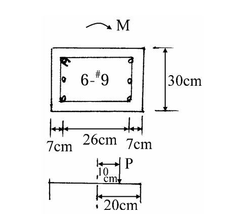

# RC-2002-2 題目正本

> 本檔只記錄**考卷上寫了什麼、圖上畫了什麼**，不含任何解法。解析見同資料夾 `RC-2002-2.md`。
> 判讀清單已經使用者確認（凍結）；本檔原則上不再修改（改動須回考卷原圖並記 log）。

| 項目 | 內容 |
|------|------|
| 考卷 | `raw/exams/RC-2002_鋼筋混凝土設計與預力.pdf` 第 1 頁（正面），第二題 |
| 考年 | 民國 91 年（2002） |
| 配分 | 20 分 |
| 附圖 | `RC-2002-2-fig-1.png`（柱斷面與偏心載重位置） |
| 判讀狀態 | **已確認**（2026-11-14 使用者確認；影響答案項目使用者選擇：#3 6-#9 為左右兩縱列各 3 根（沿彎曲深度兩層，7／33 cm）；轉錄 2026-11-14；PyMuPDF 110 dpi 全頁目視＋抽出文字核對，附圖 400 dpi 放大；盲讀後才比對既有解析） |

## 1. 考卷原文（逐字）

> 二、一柱斷面如圖所示，若作用於此斷面上軸壓力之偏心距e＝10cm，試求此時斷面所能承受之軸力 $P_n$ 及彎矩 $M_n$。$f'_c=280$ kgf/cm²，$f_y=4200$ kgf/cm²，#9 之截面積為 6.47 cm²。（20 分）

照考卷原文註記：「軸力」「彎矩」之後各印有一個小字亂碼（似注音小字，300 dpi 放大可見），不影響題意。

## 2. 考卷給的公式、附表與參數

- 題文數值：$e=10$ cm；$f'_c=280$、$f_y=4200$ kgf/cm²；#9 截面積 6.47 cm²。
- **沒有給**：$E_s$、$\varepsilon_{cu}$、$\beta_1$、強度折減因數 $\phi$（本題只問標稱值 $P_n$、$M_n$）、箍筋號數與間距、鋼筋在 30 cm 方向的位置尺寸。
- 卷首注意事項：㈠可以使用電子計算器，使用電子計算器計算之試題，需詳列解答過程。㈡不必抄題，作答時請將試題題號及答案依照順序寫在試卷上，於本試題上作答者，不予計分。

## 3. 附圖

圖面文字照錄：「M」「6-#9」「30cm」「7cm」「26cm」「7cm」「P」「10 cm」「20cm」。

## 4. 判讀清單

「把握」標**不確定**者請優先確認；解讀類項目（題目用字或圖面的意思）另標「解讀」。

| # | 項目 | 判讀 | 圖上／題文依據 | 把握 |
|---|------|------|---------------|------|
| 1 | 斷面尺寸 | 寬 $7+26+7=40$ cm（彎曲方向），高 30 cm | 400 dpi：下方尺寸線三段 7／26／7，右側 30cm 尺寸線端點對齊斷面上下緣 | 確定 |
| 2 | 彎曲方向 | 繞垂直軸彎曲，斷面深度方向為 40 cm 那一向 | 彎矩 M 箭頭畫在斷面上方、P 偏心沿水平向量測 | 確定 |
| 3 | 鋼筋配置 | 6-#9 分兩排：左排 3 根、右排 3 根；兩排距左右外緣各 7 cm（量至鋼筋中心），兩排中心距 26 cm | 7cm 尺寸線內側端點對齊左右排鋼筋（箍筋）縱線；每排 3 個圓圈 | 確定（解讀）（7 cm 量至鋼筋中心，非淨保護層） |
| 4 | 偏心距量測基準 | $e=10$ cm 自斷面幾何中心線（虛線）量至 P，P 在中心線右側 | 下方小圖：虛線至 P 標 10 cm，虛線至右緣標 20 cm（＝40/2） | 確定 |
| 5 | 受壓側 | P 偏向右側 → 右側受壓、左排為拉力側（或受壓較小側） | 偏心方向 | 確定（解讀） |
| 6 | 柱型式 | 圖上畫有箍筋（含彎鉤）→ 箍筋柱 | 斷面內矩形箍筋線與左上角彎鉤 | 確定 |
| 7 | 鋼筋在 30 cm 方向的位置 | 未標尺寸；各排 3 根在同一彎曲深度，不影響本題 | 圖上無對應尺寸線 | 確定 |
| 8 | 要求的量 | 標稱軸力 $P_n$ 與標稱彎矩 $M_n$（不乘 $\phi$）；$M_n$ 對斷面中心（亦為塑性中心，鋼筋對稱） | 題文「$P_n$ 及 $M_n$」 | 確定（解讀） |
| 9 | 考卷沒有給 | $E_s$、$\varepsilon_{cu}$、$\beta_1$ 需依規範自行採用 | 題文與卷首均無 | 確定 |

---

*轉錄：2026-11-14（RC-U1-2 題目正本推廣・批 1）*

*確認：2026-11-14 使用者確認（RC-U1-2 題目正本推廣・批 1，關卡一）*
