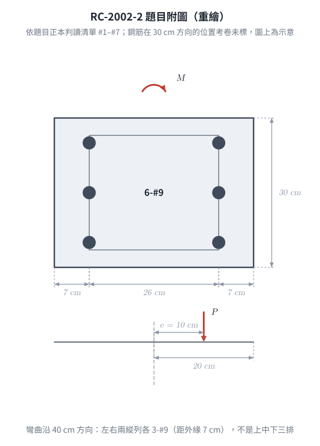
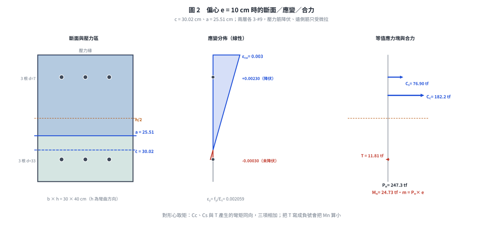

# 考題編號：RC-2002-2

**主分類：** `RC-U1-2` RC 柱強度分析與設計
**副分類：** 無
**設計法：** USD 強度設計法
**標籤：** `偏心受壓` `P-M互制` `6-#9` `e=10cm` `Pn Mn` `應變相容` `壓力控制斷面` `f'c=280` `兩層配筋`

---

## 1. 題目（考卷原文見題目正本）

> 考卷原文、公式／附表、附圖與判讀清單（已確認）見 [`RC-2002-2-problem.md`](RC-2002-2-problem.md)。本節只列解題時最容易讀錯的地方與本解使用的記號；題意以題目正本為準。

*重繪自考卷附圖，依題目正本判讀清單；攔下把左右兩縱列讀成上中下三排（2-2-2、中排在形心）的錯誤。*

### 常見誤讀

| 項目 | 正確判讀 | 常見誤讀 |
|---|---|---|
| 鋼筋配置 | 左右兩縱列各 3-#9（判讀 #3）→ 沿彎曲深度兩層各 3 根，距壓力面 7、33 cm | 讀成上中下三排 2-2-2，中排 2 根在形心 20 cm |
| 彎曲方向 | 沿 40 cm 方向（判讀 #1、#2） | 以 30 cm 為斷面深度 |
| 偏心距基準 | $e=10$ cm 自斷面幾何中心量起（判讀 #4） | 自受壓緣或鋼筋量起 |
| 要求的量 | 標稱 $P_n$、$M_n$，不乘 $\phi$（判讀 #8） | 答成 $\phi P_n$、$\phi M_n$ |
| 對形心取矩的符號 | 拉力筋項 $+T(d-h/2)$，與壓力產生的彎矩同向 | 寫成 $-T(d-h/2)$（舊版解析即此錯，2026-11-14 勘誤） |

**本解記號：** $h=40$ cm（彎曲方向）、$b=30$ cm；$d'=7$ cm、$d=33$ cm；$e$ 自形心（$h/2=20$ cm）量起；#9 $A_b=6.47$ cm²；壓力為正。

---

## 2. 考題核心精神與出題者意圖 (Core Concepts & Examiner's Intent)

**核心觀念：**
給定偏心距 e，在 P-M 互制曲線上找出對應的那一點。e 是已知、c 是未知，所以要用「$M_n(c)=e\cdot P_n(c)$」這個條件反求中性軸深度，再回代得 $P_n$、$M_n$。題目考查：

1. 先以平衡點的偏心距 $e_b$ 判斷壓力控制（$e<e_b$）或拉力控制，決定試算的方向
2. 應變相容：各層鋼筋應變由 $c$ 決定，未降伏者用 $f_s=E_s\varepsilon_s$
3. 壓力筋落在 Whitney 應力塊內時扣除被佔據的混凝土（$f'_s-0.85f'_c$）
4. 對斷面形心（鋼筋對稱＝塑性中心）取矩時，拉力筋與壓力筋的力矩**同號**

**出題者意圖：**
- 測驗能否正確判讀斷面方向（彎曲深度 40 cm、兩層各 3 根）
- 測驗小偏心時「遠側鋼筋可能受微拉或受壓」的處理
- 只問標稱值 $P_n$、$M_n$，不需 $\phi$

---

## 3. 解題戰略地圖與陷阱分析 (Strategic Roadmap & Trap Analysis)

**作戰計畫：**
1. $\beta_1=0.85$（$f'_c=280$）、$\varepsilon_y=0.002059$
2. 平衡點 $c_b$、$P_b$、$M_b$ → $e_b$，與 $e=10$ cm 比較
3. 以 $M_n(c)-10\,P_n(c)=0$ 解 $c$（試算或數值求根）
4. 回代得 $P_n$、$M_n$，並以「對拉力筋取矩」第二條路徑驗算

**關鍵陷阱：**

| # | 陷阱 | 應對 |
|---|------|------|
| ① | 把左右兩縱列讀成上中下三排 2-2-2 | 看尺寸線 7／26／7 標在 40 cm 方向，鋼筋只有兩層 |
| ② | 以 30 cm 當彎曲深度 | 下方小圖：中心線到右緣 20 cm＝40/2 |
| ③ | 對形心取矩時把拉力筋項寫成 $-T(d-h/2)$ | 拉力 $T$ 在形心另一側、方向向外，產生的彎矩與壓力同向：$+T(d-h/2)$ |
| ④ | 壓力筋在應力塊內未扣 $0.85f'_c$ | $C_s=A'_s(f'_s-0.85f'_c)$ |
| ⑤ | 小偏心時仍假設遠側鋼筋降伏 | 由應變算：本題遠側筋只受 $-0.0003$ 微拉 |

---

## 3.5 變數層次分析 (Variable Hierarchy Analysis)

> 複習提示：第一次解題後，在每個卡住的知識點旁標記 `⚠`；第二次複習時只看有 `⚠` 的項目。

### 最終目標
已知偏心距 e = 10 cm，求柱標稱軸力 Pn 與標稱彎矩 Mn。

### 本題關鍵公式（依計算順序）

$$\text{Step 1：} \quad \varepsilon_y = \frac{f_y}{E_s} = \frac{4200}{2{,}040{,}000}$$

$$\text{Step 2：} \quad c_b = \frac{0.003}{0.003+\varepsilon_y}\, d \quad \Rightarrow \quad e_b = \frac{M_{nb}}{P_{nb}}$$

$$\text{Step 3（假設 } \boxed{c} \text{）：} \quad \varepsilon'_s = 0.003\,\frac{\boxed{c} - d'}{\boxed{c}}, \quad \varepsilon_s = 0.003\,\frac{\boxed{c}-d}{\boxed{c}}$$

$$\text{Step 4（力平衡）：} \quad P_n = 0.85f'_c\,\beta_1\boxed{c}\,b + A'_s(f'_s-0.85f'_c) + A_s f_s$$

$$\text{Step 5（對形心）：} \quad M_n = C_c\!\left(\frac{h}{2} - \frac{a}{2}\right) + C_s\!\left(\frac{h}{2} - d'\right) + T\!\left(d - \frac{h}{2}\right)$$

$$\text{Step 6（條件）：} \quad M_n = e\cdot P_n \;\Rightarrow\; \boxed{c}$$

> $f_s$ 以壓為正；$T=-A_sf_s$（受拉時為正值）。

### L1：題目直接給定

| 符號 | 數值 | 說明 |
|------|------|------|
| h | 40 cm | 彎曲方向深度（7+26+7） |
| b | 30 cm | 垂直方向寬度 |
| d' | 7 cm | 壓力側鋼筋層至受壓緣 |
| d | 33 cm | 遠側鋼筋層至受壓緣 |
| e | 10 cm | 軸力偏心距（自形心） |
| f'c | 280 kgf/cm² | 混凝土強度 |
| fy | 4200 kgf/cm² | 鋼筋降伏強度 |
| A#9 | 6.47 cm² | 單根 #9 面積 |
| As' = As | 19.41 cm² | 每層 3 根 × 6.47 |

### L2：需知識點推導

**基本參數**

| 符號 | 公式／來源 | 卡關? |
|------|-----------|-------|
| β₁ | f'c = 280 → β₁ = 0.85（現行規範） | |
| Es | 2.04×10⁶ kgf/cm²（考卷未給，依規範） | |
| εy | 4200 / 2,040,000 = 0.002059 | |
| h/2 | 20 cm（形心＝塑性中心，鋼筋對稱） | |

**平衡點（判斷壓力／拉力控制）**

| 符號 | 公式／來源 | 卡關? |
|------|-----------|-------|
| c_b | 0.003/(0.003+0.002059) × 33 = 19.57 cm | |
| a_b | 0.85 × 19.57 = 16.63 cm | |
| ε'_s,b | 0.003×(19.57−7)/19.57 = 0.001927 < εy → f'_s = 3,931 | |
| P_b | 118,769 + 71,679 − 81,522 = 108,926 kgf ≈ 108.9 tf | |
| e_b | 33.79 tf·m / 108.9 tf = 31.0 cm | |
| 判斷 | e = 10 < e_b = 31.0 → **壓力控制，c > c_b** | |

**解 c（c = 30.02 cm）**

| 符號 | 公式／來源 | 卡關? |
|------|-----------|-------|
| a | 0.85 × 30.02 = 25.51 cm（> d' = 7，壓力筋在應力塊內） | |
| ε'_s | 0.003×(30.02−7)/30.02 = 0.00230 > εy → 4,200 | |
| ε_s | 0.003×(30.02−33)/30.02 = −0.000298（微拉） | |
| f_s | 2,040,000 × 0.000298 = 608 kgf/cm²（拉） | |

### L3：深層知識（不懂就卡住）

| 知識點 | 說明 | 卡關? |
|--------|------|-------|
| 對形心取矩的符號 | 壓力（向內）在受壓側、拉力（向外）在受拉側，兩者對形心產生的彎矩**同向**；寫成相減會把 $M_n$ 算小 | ⚠ |
| 小偏心時遠側鋼筋 | c 接近 d 時遠側筋應變很小，可能受壓也可能微拉，一定要由應變算 | |
| Whitney 應力塊範圍 | 應力塊只到 a = β₁c；鋼筋在 a 內才扣 0.85f'c | |
| e 從哪裡量 | 自塑性中心（本題鋼筋對稱＝形心）量起 | |

---

## 4. 步驟化詳細計算過程 (Step-by-Step Detailed Calculation)

### Step 1：基本材料參數

$$\beta_1 = 0.85 \quad (f'_c = 280 \text{ kgf/cm}^2),\qquad \varepsilon_y = \frac{f_y}{E_s} = \frac{4200}{2{,}040{,}000} = 0.002059$$

$$A'_s = A_s = 3\times6.47 = 19.41 \text{ cm}^2$$

### Step 2：平衡點，判斷壓力控制或拉力控制

$$c_b = \frac{0.003}{0.003 + 0.002059} \times 33 = 0.5930 \times 33 = 19.57 \text{ cm},\qquad a_b = 0.85 \times 19.57 = 16.63 \text{ cm}$$

$$\varepsilon'_{s,b} = 0.003 \times \frac{19.57 - 7}{19.57} = 0.001927 < \varepsilon_y \quad \Rightarrow \quad f'_{s,b} = 3{,}931 \text{ kgf/cm}^2$$

$$C_{c,b} = 0.85 \times 280 \times 16.63 \times 30 = 118{,}769 \text{ kgf}$$
$$C_{s,b} = 19.41 \times (3{,}931 - 238) = 71{,}679 \text{ kgf},\qquad T_b = 19.41 \times 4{,}200 = 81{,}522 \text{ kgf}$$

$$P_{nb} = 118{,}769 + 71{,}679 - 81{,}522 = 108{,}926 \text{ kgf} \approx 108.9 \text{ tf}$$

$$M_{nb} = 118{,}769 \times (20 - 8.32) + 71{,}679 \times 13 + 81{,}522 \times 13 = 3{,}379{,}000 \text{ kgf·cm} = 33.79 \text{ tf·m}$$

$$\boxed{e_b = \frac{33.79}{108.9} = 0.310 \text{ m} = 31.0 \text{ cm}}$$

$e = 10 \text{ cm} < e_b = 31.0 \text{ cm}$ → **壓力控制（小偏心）**，$c > c_b = 19.57$ cm。

### Step 3：以 $M_n = 10\,P_n$ 解 c

試 $c = 30.02$ cm：

$$a = 0.85 \times 30.02 = 25.51 \text{ cm}$$

**壓力側鋼筋（d' = 7 < a，在應力塊內）：**
$$\varepsilon'_s = 0.003 \times \frac{30.02 - 7}{30.02} = 0.00230 > \varepsilon_y \Rightarrow f'_s = 4{,}200$$
$$C_s = 19.41 \times (4{,}200 - 238) = 76{,}902 \text{ kgf}$$

**遠側鋼筋（d = 33 > c，微拉）：**
$$\varepsilon_s = 0.003 \times \frac{30.02 - 33}{30.02} = -0.000298 \Rightarrow f_s = 2{,}040{,}000 \times 0.000298 = 608 \text{ kgf/cm}^2 \text{（拉）}$$
$$T = 19.41 \times 608 = 11{,}807 \text{ kgf}$$

**混凝土：**
$$C_c = 0.85 \times 280 \times 25.51 \times 30 = 182{,}171 \text{ kgf}$$

### Step 4：力平衡求 Pn

$$P_n = C_c + C_s - T = 182{,}171 + 76{,}902 - 11{,}807 = \boxed{247{,}267 \text{ kgf} \approx 247.3 \text{ tf}}$$

### Step 5：對形心取矩求 Mn

$$M_n = C_c\left(20 - \frac{25.51}{2}\right) + C_s(20 - 7) + T(33 - 20)$$

$$= 182{,}171 \times 7.243 + 76{,}902 \times 13 + 11{,}807 \times 13 = 1{,}319{,}500 + 999{,}700 + 153{,}500 = 2{,}472{,}700 \text{ kgf·cm}$$

$$e_{check} = \frac{2{,}472{,}700}{247{,}267} = 10.00 \text{ cm} \checkmark$$

*圖 2　$e=10$ cm 時的斷面／應變／合力。沿彎曲深度只有兩層鋼筋，遠側筋只受微拉；三個力對形心產生的彎矩同向——攔下讀成 2-2-2 三排、把拉力筋項寫成負號、小偏心仍假設遠側筋降伏三種錯。*

### Step 6：第二條路徑驗算（對遠側鋼筋取矩）

軸力作用點到遠側鋼筋的距離 $e' = e + (d - h/2) = 10 + 13 = 23$ cm，遠側鋼筋的力對自己的力矩為零：

$$C_c\left(d - \frac{a}{2}\right) + C_s(d - d') = P_n\, e'$$
$$182{,}171 \times 20.243 + 76{,}902 \times 26 = 3{,}687{,}600 + 1{,}999{,}500 = 5{,}687{,}100 \approx 247{,}267 \times 23 = 5{,}687{,}100 \;\checkmark$$

兩條路徑解出同一個 $c = 30.02$ cm。

### 最終答案

$$\boxed{P_n \approx 247.3 \text{ tf}}\qquad \boxed{M_n = P_n \times e \approx 24.73 \text{ tf·m}}$$

---

## 5. 關鍵爭議點與進階探討 (Critical Issues & Advanced Discussion)

**1. 舊版解析的兩個錯誤（2026-11-14 勘誤）：**
- 鋼筋讀成上中下三排 2-2-2（7／20／33 cm，每排 12.94 cm²），以 c＝22.7 cm 得 $P_n=162.6$ tf、$M_n=16.26$ tf·m。題目正本（關卡一確認）為左右兩縱列各 3 根，沿彎曲深度只有兩層。
- 對形心取矩時把拉力筋寫成 $-T(d-h/2)$。拉力與壓力對形心的力矩同向，應相加；舊解的 $e=10.00$ 驗算是在錯號下湊出的。

**2. 遠側鋼筋只受微拉：**
- $c=30.02$ cm 接近 $d=33$ cm，遠側筋應變只有 $-0.0003$，應力 608 kgf/cm²，遠低於降伏。小偏心題不可直接假設 $f_s=f_y$。
- 若 e 再小一些（e < 7.9 cm），c 會超過 d＝33 cm，遠側筋轉為受壓。

**3. 是否扣除位移混凝土：**
- 本解在應力塊內的壓力筋扣 0.85f'c。不扣時 $c=30.09$、$P_n=252.6$ tf、$M_n=25.26$ tf·m（約 +2%），考場兩者皆常見，扣除較精確。

**4. 規範版本：**
- 依現行建築物混凝土結構設計規範（2023）：$\varepsilon_{cu}=0.003$、$\beta_1=0.85$、$E_s=2.04\times10^6$ kgf/cm²。本題只問標稱值，不涉及 $\phi$，與考試當年的規範結果相同。
- 平衡中性軸寫成 $0.003/(0.003+\varepsilon_y)\cdot d$，與舊式 $6120/(6120+f_y)\cdot d$ 等價（$6120=0.003E_s$）。

*修正日期：2026-11-14（§1 改為指向題目正本，插入重繪附圖 figs/RC-2002-2-fig-1-problem.svg、改寫常見誤讀與本解記號；本行非答案勘誤）*

*修正日期：2026-11-14（解析勘誤：鋼筋由 2-2-2 三排改為兩層各 3-#9〔題目正本判讀 #3〕，並更正對形心取矩時拉力筋項的符號；$P_n$ 162.6 → 247.3 tf、$M_n$ 16.26 → 24.73 tf·m，$e_b$ 11.79 → 31.0 cm；改寫 §2–§5。驗證：Python 重算 MISMATCHES: 0，對形心與對遠側鋼筋取矩兩條路徑解出同一 c＝30.02 cm；依 RC-U1-2 批 1 盲解比對與使用者判定）*

*圖解補繪：2026-11-14（向量圖 1 張〔圖 2 斷面／應變／合力〕，腳本 `gen_RC-2002-2.py`，可重跑；腳本檔尾對 §4 公佈值做 assert）*
