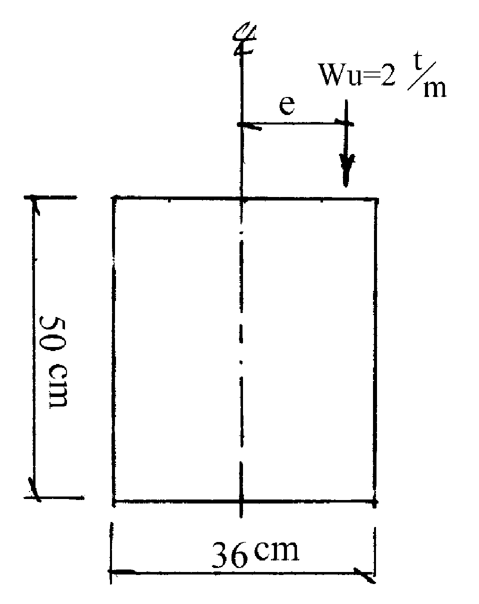

# RC-2002-3 題目正本

> 本檔只記錄**考卷上寫了什麼、圖上畫了什麼**，不含任何解法。解析見同資料夾 `RC-2002-3.md`。
> 判讀清單已經使用者確認（凍結）；本檔原則上不再修改（改動須回考卷原圖並記 log）。

| 項目 | 內容 |
|------|------|
| 考卷 | `raw/exams/RC-2002_鋼筋混凝土設計與預力.pdf` 第 1 頁（正面），第三題 |
| 考年 | 民國 91 年（2002） |
| 配分 | 20 分 |
| 附圖 | `RC-2002-3-fig-2.png`（梁斷面與偏心載重；2026-11-15 由考卷重新擷取 500 dpi）；既有 `RC-2002-3-fig-1.png` 為同一圖，圖左空白處有滑鼠游標，保留不刪 |
| 判讀狀態 | **已確認**（2026-11-15 使用者確認；轉錄 2026-11-15；PyMuPDF 110 dpi 全頁目視，附圖 400 dpi 局部放大（附圖為內嵌點陣手繪影像）；盲讀後才比對既有解析） |

## 1. 考卷原文（逐字）

> 三、有鋼筋混凝土矩形梁，對垂直載重，可假定為跨度＝λ 8 m，二端各為支座支承之簡支梁。對扭轉，在一端支座上，梁完全受拘束，但在另一端支座上，則完全不受拘束。梁自重外，承受偏心均佈設計載重 Wu＝2.0 t/m 如圖所示，試計算說明此梁設計時，在不需考慮扭力影響下之最大偏心量 e 值。（已知 $f'_c$＝210 kgf/cm²，d=45 cm）。（20 分）

註：「跨度＝λ 8 m」照考卷原文（λ 為跨度符號，即 λ＝8 m）。

## 2. 考卷給的公式、附表與參數

- 題文數值：跨度 8 m；偏心均佈設計載重 $W_u$＝2.0 t/m；$f'_c$＝210 kgf/cm²；$d$＝45 cm。
- 圖上數值：斷面寬 36 cm、高 50 cm；`Wu=2 t/m`。
- **沒有給**：公式、$f_y$、混凝土單位重（自重大小）、自重的載重係數、支承寬度、強度折減因數。
- 卷首注意事項：可以使用電子計算器，使用電子計算器計算之試題，需詳列解答過程。不必抄題，作答時請將試題題號及答案依照順序寫在試卷上，於本試題上作答者，不予計分。

## 3. 附圖

圖面文字照錄：`℄`、`Wu=2 t/m`、`e`、`50 cm`、`36 cm`。

## 4. 判讀清單

「把握」標**不確定**者請優先確認；解讀類項目（題目用字的意思）另標「解讀」。

| # | 項目 | 判讀 | 圖上／題文依據 | 把握 |
|---|------|------|---------------|------|
| 1 | 扭轉邊界 | 一端支座扭轉完全拘束（固定）、另一端完全不拘束（自由）：全跨的均佈扭矩 $W_u e$ 全部由拘束端承受，扭矩由自由端的 0 線性增到拘束端的最大 | 題文 | 確定（解讀）（影響答案）；使用者確認 |
| 2 | 撓曲／剪力邊界 | 對垂直載重為簡支梁，跨度 8 m | 題文 | 確定 |
| 3 | 斷面 | $b$＝36 cm、$h$＝50 cm；$d$＝45 cm（題文給） | 圖上 36cm、50cm 尺寸線對齊斷面外緣 | 確定 |
| 4 | 偏心距 $e$ | 由斷面中心線量到 $W_u$ 作用線的水平距離；為所求未知數 | 圖上 e 尺寸線兩端：中心線與載重箭頭 | 確定 |
| 5 | 自重 | 梁自重另計、作用在斷面中心（不偏心）；大小與載重係數未給 | 題文「梁自重外，承受偏心均佈設計載重」 | 確定（解讀） |
| 6 | 載重 | $W_u$＝2.0 t/m 為設計（因數化）載重，全跨均佈 | 題文 | 確定 |
| 7 | 圖上載重位置 | 圖上箭頭畫在斷面寬度內，僅示意，不代表 $e$ 的上限 | 圖面（未依比例） | 確定（解讀） |
| 8 | 所求 | 不需考慮扭力影響時的最大偏心量 $e$ | 題文 | 確定 |
| 9 | 考卷沒有給 | 公式、$f_y$、混凝土單位重、支承寬度、$\phi$、保護層 | 全題 | 確定 |

---

*轉錄：2026-11-15（RC-U2-1／U2-2 題目正本推廣・批 1）*

*確認：2026-11-15 使用者確認（RC-U2-1／U2-2 題目正本推廣・批 1，關卡一）*
