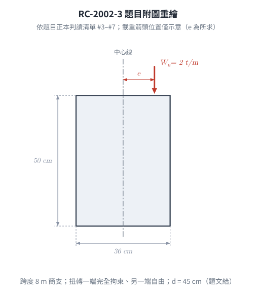
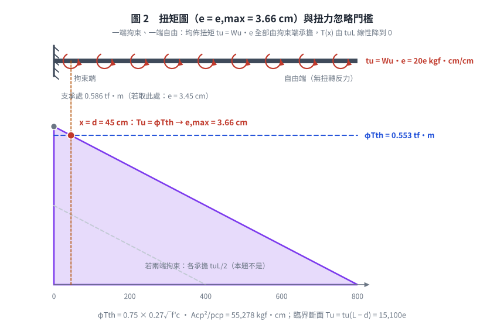

# 考題編號：RC-2002-3

**主分類：** `RC-U2-2` RC 扭力強度設計
**副分類：** 無
**設計法：** USD 強度設計法
**標籤：** `扭力忽略門檻` `偏心均佈載重` `最大偏心量e` `單端拘束` `tu×L扭矩圖` `矩形梁` `f'c=210` `現行規範2023` `ACI 318-89對照`

---

## 1. 題目（考卷原文見題目正本）

> 考卷原文、公式／附表、附圖與判讀清單（已確認）見 [`RC-2002-3-problem.md`](RC-2002-3-problem.md)。本節只列解題時最容易讀錯的地方與本解使用的記號；題意以題目正本為準。


*重繪自考卷附圖，依題目正本判讀清單 #3–#7。本圖攔下的讀錯：$e$ 由斷面中心線量到載重作用線；箭頭位置僅示意。*

### 常見誤讀

| 項目 | 正確判讀 | 常見誤讀 |
|------|---------|---------|
| 扭轉邊界 | 一端完全拘束、另一端自由：扭矩全由拘束端承受，由自由端 0 線性增到拘束端最大 | 兩端各承受一半（當成兩端都拘束） |
| $e$ 的基準 | 斷面中心線至載重作用線 | 量到斷面邊緣 |
| 自重 | 另計、作用在斷面中心（不偏心）；考卷未給單位重 | 漏算或當成偏心載重 |
| 斷面 | $b$＝36、$h$＝50 cm（圖），$d$＝45 cm（題文；用來定臨界斷面） | — |
| 門檻公式 | 現行規範 $\phi T_{th}=\phi\,0.27\lambda\sqrt{f'_c}A_{cp}^2/p_{cp}$，$\phi$＝0.75 | 舊 ACI 318-89 $0.5\phi\sqrt{f'_c}\Sigma x^2y/3$、$\phi$＝0.85（本庫 2026-11-15 前舊解，答 8.31 cm） |
| 臨界斷面 | 距拘束端支承面 $d$：$T_u=W_ue(L-d)$ | 取支承處 $W_ueL$（偏保守） |

**本解記號：** $t_u=W_u\,e$＝均佈扭矩；$T_u$＝臨界斷面設計扭矩；$T_{th}$＝可忽略扭力的門檻扭矩。規範：建築物混凝土結構設計規範（內政部 2023 年版），常重混凝土 $\lambda$＝1、非預力、無軸力。

---

## 2. 考題核心精神與出題者意圖 (Core Concepts & Examiner's Intent)

**核心觀念：**
1. **扭矩圖的建立**：偏心均佈載重在「一端扭轉拘束、一端自由」條件下，扭矩由自由端 0 線性增至拘束端 $t_uL$。
2. **扭力忽略門檻**：$T_u < \phi T_{th}$ 時可忽略扭力效應（$T_{th}$ 約為開裂扭矩的 1/4）。

**出題者意圖：**
- 能否建立非對稱扭轉邊界下的扭矩圖（最大值在拘束端）
- 是否記得扭力門檻公式與臨界斷面規定
- 兩者聯立解出 $e$

---

## 3. 解題戰略地圖與陷阱分析 (Strategic Roadmap & Trap Analysis)

**作戰計畫：**
1. 均佈扭矩 $t_u = W_u e$
2. 扭矩圖：拘束端最大；臨界斷面取距拘束端支承面 $d$ → $T_u = t_u(L-d)$
3. 門檻 $\phi T_{th}=\phi\,0.27\sqrt{f'_c}A_{cp}^2/p_{cp}$
4. 令 $T_u = \phi T_{th}$ 解 $e_{\max}$

**關鍵陷阱：**

| # | 陷阱 | 應對 |
|---|------|------|
| ① | 誤用兩端對稱邊界（$T_u = t_uL/2$） | 一端自由 → 全部扭矩由拘束端承受 |
| ② | 用舊規範 $\Sigma x^2y$ 門檻與 $\phi$＝0.85 | 現行 $A_{cp}^2/p_{cp}$ 式、$\phi$＝0.75 |
| ③ | SI 係數 $\sqrt{f'_c}/12$ 直接代 kgf/cm² | kgf 制係數為 0.27（$=\tfrac{1}{12}\times3.19$） |
| ④ | $W_u$ 單位換算：2 t/m = 20 kgf/cm | 統一 kgf、cm |
| ⑤ | 臨界斷面 | 距支承面 $d$ 起算（無集中扭矩於該段） |

---

## 3.5 變數層次分析 (Variable Hierarchy Analysis)

> 複習提示：第一次解題後，在每個卡住的知識點旁標記 `⚠`；第二次複習時只看有 `⚠` 的項目。

### 最終目標
求偏心均佈載重 $W_u$ = 2 t/m 在一端扭轉拘束、一端自由的梁中，可忽略扭力效應的最大偏心距 $e_{\max}$。

### 本題關鍵公式（依計算順序）

$$\text{Step 1：} \quad t_u = W_u\,e$$

$$\text{Step 2（臨界斷面距拘束端 } d\text{）：} \quad T_u = t_u (L-d)$$

$$\text{Step 3：} \quad \phi T_{th} = \phi\,0.27\sqrt{f'_c}\,\frac{A_{cp}^2}{p_{cp}}$$

$$\text{Step 4：} \quad e_{\max} = \frac{\phi T_{th}}{W_u (L-d)}$$

### L1：題目直接給定

| 符號 | 數值 | 說明 |
|------|------|------|
| L | 8 m = 800 cm | 跨度 |
| Wu | 2.0 t/m = 20 kgf/cm | 偏心均佈設計載重 |
| f'c | 210 kgf/cm² | 混凝土強度 |
| b | 36 cm | 梁寬（圖） |
| h | 50 cm | 梁深（圖） |
| d | 45 cm | 有效深度（題目給定） |
| 扭轉邊界 | 一端拘束，一端自由 | 題目指定 |

### L2：需知識點推導

| 符號 | 公式／來源 | 卡關? |
|------|-----------|-------|
| $t_u$ | $20e$ kgf·cm/cm | |
| $T_u$ | $20e\times(800-45) = 15{,}100e$ kgf·cm | |
| $A_{cp}$ | $36\times50 = 1800$ cm² | |
| $p_{cp}$ | $2(36+50) = 172$ cm | |
| $A_{cp}^2/p_{cp}$ | $1800^2/172 = 18{,}837$ cm³ | |
| $\phi T_{th}$ | $0.75\times0.27\times14.491\times18{,}837 = 55{,}278$ kgf·cm | |

### L3：深層知識（不懂就卡住）

| 知識點 | 說明 | 卡關? |
|--------|------|-------|
| 一端拘束一端自由的扭矩圖 | 拘束端承受全部反力 $t_uL$；自由端 0；中間線性 | |
| 門檻公式的版本差異 | 舊 ACI 318-89：$0.5\phi\sqrt{f'_c}\Sigma x^2y/3$；ACI 318-95 起改為薄壁管理論 $A_{cp}^2/p_{cp}$；現行台灣規範 kgf 制 $0.27\lambda\sqrt{f'_c}A_{cp}^2/p_{cp}$ | |
| 門檻的物理意義 | $T_{th}=T_{cr}/4$；扭矩小於開裂扭矩的 1/4 時，對剪力與彎曲強度的影響可忽略 | |
| 臨界斷面 | 支承面至距 $d$ 處的斷面，可用距支承面 $d$ 處的 $T_u$ 設計 | |

---

## 4. 步驟化詳細計算過程 (Step-by-Step Detailed Calculation)

### Step 1：均佈扭矩 $t_u$

$$t_u = W_u \times e = 20\,\frac{\text{kgf}}{\text{cm}} \times e\,\text{cm} = 20e\ \left[\frac{\text{kgf·cm}}{\text{cm}}\right]$$

（梁自重作用在斷面中心，不產生扭矩。）

### Step 2：扭矩圖與臨界斷面扭矩

```
拘束端 A ←─────────────── L=800 cm ───────────────→ 自由端 B
  T_A = tu×L                                              T_B = 0
T(x) = tu × (L − x)，x 自 A 量起
```

臨界斷面距拘束端支承面 $d$＝45 cm（支承寬度未給，以支承中心計）：

$$T_u = t_u (L-d) = 20e \times (800-45) = \boxed{15{,}100\,e\;\text{kgf·cm}}$$



*圖 2　$e=e_{max}$ 時的扭矩圖與扭力忽略門檻。本圖攔下的錯：誤以為兩端各承擔 $t_uL/2$（自由端沒有扭轉反力），以及臨界斷面位置取錯。*

### Step 3：扭力忽略門檻 $\phi T_{th}$

$$A_{cp} = 36\times50 = 1800\ \text{cm}^2,\qquad p_{cp} = 2(36+50) = 172\ \text{cm},\qquad \frac{A_{cp}^2}{p_{cp}} = \frac{3{,}240{,}000}{172} = 18{,}837\ \text{cm}^3$$

$$T_{th} = 0.27\sqrt{f'_c}\,\frac{A_{cp}^2}{p_{cp}} = 0.27\times14.491\times18{,}837 = 73{,}705\ \text{kgf·cm}$$

$$\phi T_{th} = 0.75\times73{,}705 = \boxed{55{,}278\ \text{kgf·cm} = 0.553\ \text{tf·m}}$$

### Step 4：令 $T_u = \phi T_{th}$，解出 $e_{\max}$

$$15{,}100\,e \le 55{,}278 \quad\Rightarrow\quad e \le 3.66\ \text{cm}$$

$$\boxed{e_{\max} \approx 3.7\;\text{cm}}$$

**結論：** 偏心量 $e \le 3.7$ cm 時，臨界斷面設計扭矩小於 $\phi T_{th}$，設計時可忽略扭力效應。

---

## 5. 關鍵爭議點與進階探討 (Critical Issues & Advanced Discussion)

**1. 為何拘束端承受全部扭矩（$t_uL$），而非 $t_uL/2$？**

一端自由（無扭轉反力），全部均佈扭矩只能由拘束端提供反力。若兩端都拘束，各承受 $t_uL/2$，臨界斷面 $T_u = t_u(L/2-d)$，$e_{\max}$＝7.8 cm。

**2. 臨界斷面取法的影響**

| 取法 | $T_u$ | $e_{\max}$ |
|------|------|------|
| 距拘束端支承面 $d$（本解） | $15{,}100e$ | 3.66 cm |
| 拘束端支承處（保守） | $16{,}000e$ | 3.45 cm |

**3. 考試當年規範（ACI 318-89／舊規範）對照**

舊門檻 $T_u \le \phi\,(0.5\sqrt{f'_c})\,\Sigma x^2y/3$（$\phi$＝0.85）、取支承處扭矩：
$$\phi T_c = 0.5\times0.85\times14.49\times\frac{36^2\times50}{3} = 132{,}978\ \text{kgf·cm}\ \Rightarrow\ e = 132{,}978/16{,}000 = 8.31\ \text{cm}$$

舊式門檻約為現行的 2.4 倍。若沿用現行式但 $\phi$＝0.85：3.92 cm（支承處）／4.15 cm（$d$ 處）。

**4. 若偏心量 $e > 3.7$ cm 需如何處理？**
需進行完整扭力設計：
- 檢核斷面上限 $\sqrt{(V_u/b_wd)^2+(T_up_h/1.7A_{oh}^2)^2}\le\phi(V_c/b_wd+2.12\sqrt{f'_c})$
- 配置閉合箍筋 $A_t/s=T_u/(2\phi A_of_{yt}\cot\theta)$ 與縱向扭力筋 $A_\ell$
- 本題拘束端在另一端不受拘束，屬平衡扭矩，不可依開裂後重分配折減

*修正日期：2026-11-15（§1 改為指向題目正本，插入重繪附圖 figs/RC-2002-3-fig-1-problem.svg；舊 §1 重述改寫為常見誤讀與本解記號；本行非答案勘誤）*

*修正日期：2026-11-15（解析勘誤：改依現行台灣規範（建築物混凝土結構設計規範 2023 年版）扭力門檻 φ0.27√f'c·Acp²/pcp、φ＝0.75，臨界斷面取距拘束端支承面 d；e 8.31 cm → 3.7 cm；舊 ACI 318-89 解法降為 §5 對照，並刪除原 §5 錯誤的「新版 3.28 cm」數值；驗證：盲解比對 + 勘誤腳本重算 MISMATCHES: 0）*

*修正日期：2026-11-15（落實檢查殘留修正（非勘誤）：標籤 `ACI 318-89` 改為 `現行規範2023` `ACI 318-89對照`；答案不變）*

*修正日期：2026-11-15（圖解補繪（非勘誤）：新增 figs/RC-2002-3-fig-2-torque.svg，腳本 figs/gen_RC-2002-3.py，可重跑；答案不變）*
