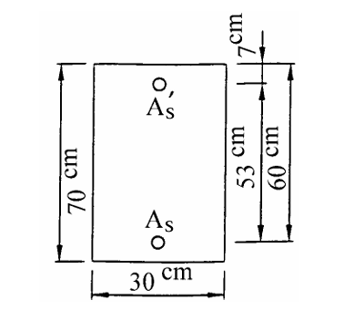

# RC-2002-4 題目正本

> 本檔只記錄**考卷上寫了什麼、圖上畫了什麼**，不含任何解法。解析見同資料夾 `RC-2002-4.md`。
> 判讀清單已經使用者確認（凍結）；本檔原則上不再修改（改動須回考卷原圖並記 log）。

| 項目 | 內容 |
|------|------|
| 考卷 | `raw/exams/RC-2002_鋼筋混凝土設計與預力.pdf` 第 2 頁（全一張之背面），第四題 |
| 考年 | 民國 91 年（2002） |
| 配分 | 20 分 |
| 附圖 | `RC-2002-4-fig-1.png`（梁斷面圖） |
| 判讀狀態 | **已確認**（2026-11-12 使用者確認；影響答案項目 #9 使用者選 φ 依 εt（淨拉應變體系）；轉錄 2026-11-12，PyMuPDF 110 dpi 全頁目視＋抽出文字核對，附圖 450 dpi、「強度」後符號 600 dpi 放大；盲讀後才比對既有解析） |

## 1. 考卷原文（逐字）

> 四、一矩形 RC 梁斷面如圖示，已知寬度 $b=30$ cm，有效深度 $d=60$ cm，$h=70$ cm，$d'=7$ cm，$f'_c=350$ kgf/cm²，$f_y=4200$ kgf/cm²，$A_s=50.70$ cm²，$A'_s=10.14$ cm²，$E_s=2040000$ kgf/cm²，試求此斷面之彎矩設計強度 $\phi M_n$。下列公式可供參考使用，$f'_c, f_y$：kgf/cm²
>
> $\rho_b = 0.85\beta_1 \dfrac{f'_c}{f_y}\dfrac{6120}{6120+f_y}$　　$A_{s,\min}=\dfrac{14}{f_y}b_w d$　　$A_{s,\min}=\dfrac{0.8\sqrt{f'_c}}{f_y}b_w d$
>
> （20 分）

註：「彎矩設計強度」與 $M_n$ 之間的符號在 PDF 中是一個嵌入小點陣圖（Im3），印出來像兩個注音形狀的殘字，是 $\phi$ 字型替代失敗；依「設計強度」判讀為 $\phi M_n$（見判讀清單 #1）。

## 2. 考卷給的公式、附表與參數

- 題文數值：$b=30$、$d=60$、$h=70$、$d'=7$ cm；$f'_c=350$、$f_y=4200$ kgf/cm²；$A_s=50.70$、$A'_s=10.14$ cm²；$E_s=2.04\times10^6$ kgf/cm²。
- 參考公式：$\rho_b$、兩條 $A_{s,\min}$（如上）。
- **沒有給**：$\beta_1$ 的計算式或數值、混凝土極限應變 $\varepsilon_{cu}$、強度折減係數 $\phi$ 值或其與應變的關係、鋼筋根數與號數、設計規範版本。
- 卷首注意事項：㈠可以使用電子計算器，使用電子計算器計算之試題，需詳列解答過程；㈡不必抄題。

## 3. 附圖

圖面文字照錄：`7cm`、`53 cm`、`60 cm`、`70 cm`、`30 cm`、`A's`、`As`。

## 4. 判讀清單

「把握」標**不確定**者請優先確認；解讀類項目（題目用字的意思）另標「解讀」。

| # | 項目 | 判讀 | 圖上／題文依據 | 把握 |
|---|------|------|---------------|------|
| 1 | 所求 | 彎矩**設計**強度 $\phi M_n$（不是標稱強度 $M_n$） | 題文「設計強度」；$M_n$ 前的點陣圖殘字位置與 $\phi$ 一致（600 dpi） | 確定（解讀） |
| 2 | 斷面外形 | 矩形，$b=30$ cm、$h=70$ cm | 題文＋圖底 30 cm、左側 70 cm | 確定 |
| 3 | 拉力筋位置 | $A_s$ 形心距頂面 $d=60$ cm（距底面 10 cm） | 右側「60 cm」尺寸線上端對齊頂面、下端對齊 $A_s$ 圓圈所在水平線 | 確定 |
| 4 | 壓力筋位置 | $A'_s$ 形心距頂面 $d'=7$ cm | 右側「7cm」尺寸線兩箭頭夾頂面與 $A'_s$ 水平線；7＋53＝60 一致 | 確定 |
| 5 | 鋼筋量 | $A_s=50.70$ cm²、$A'_s=10.14$ cm²（總面積）；圖上各只畫一個圓圈，**未給根數、號數、排數** | 題文；圖上各一圈 | 確定 |
| 6 | $E_s$ | $2.04\times10^6$ kgf/cm²（供判斷壓力筋是否降伏） | 題文 | 確定 |
| 7 | 考卷沒有給 | $\beta_1$、$\varepsilon_{cu}$、$\phi$ 值及其適用條件、規範版本，皆須考生自定 | 全題 | 確定 |
| 8 | 參考公式用途 | $\rho_b$、$A_{s,\min}$ 僅「可供參考使用」，單位 kgf/cm² | 題文 | 確定 |
| 9 | $\phi$ 取值 | 考卷沒給。附 $\rho_b$ 公式暗示舊版 ACI（$\rho-\rho' \le 0.75\rho_b$ 即 $\phi=0.90$）；若改用淨拉應變體系，$\phi$ 依 $\varepsilon_t$ 而定，可能小於 0.90（試算見批次報告 題目正本-RC-U1-1-批1-2026-11-12.md） | 題文附 $\rho_b$ 式；民國 91 年 | 確定（使用者選擇：採淨拉應變體系，φ 依 εt 內插） |

---

*轉錄：2026-11-12（RC-U1-1 題目正本推廣・批 1）*

*確認：2026-11-12 使用者確認（RC-U1-1 題目正本推廣・批 1，關卡一）*
