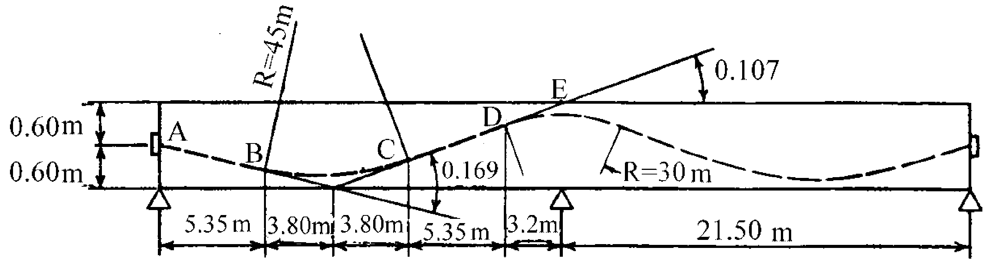

# RC-2002-5 題目正本

> 本檔只記錄**考卷上寫了什麼、圖上畫了什麼**，不含任何解法。解析見同資料夾 `RC-2002-5.md`。
> 判讀清單已經確認（凍結）；本檔原則上不再修改（改動須回考卷原圖並記 log）。

| 項目 | 內容 |
|------|------|
| 考卷 | `raw/exams/RC-2002_鋼筋混凝土設計與預力.pdf` 第 2 頁（背面），第五題 |
| 考年 | 民國 91 年（2002） |
| 配分 | 30 分 |
| 附圖 | `RC-2002-5-fig-2.png`（2026-11-15 由考卷 500 dpi 重新擷取）；`RC-2002-5-fig-1.png`（舊證據圖，左上角空白處有滑鼠游標，保留不刪） |
| 判讀狀態 | **已確認**（2026-11-15 使用者授權依 Claude 建議確認；轉錄 2026-11-15；PyMuPDF 110 dpi 全頁＋500 dpi 附圖（考卷內嵌點陣圖）目視、文字層逐字核對；盲讀後才比對既有解析） |

## 1. 考卷原文（逐字）

> 五、有一後拉法預力混凝土連續梁，如圖，彎曲鋼腱係由兩端拉線，鋼索與套管間之摩擦係數 μ＝0.4，長度方向皺摺摩擦係數 k=0.0026/m。
> 試計算 AE 兩點間，由摩擦所致的預力損失百分率。假設 A 點應力為 $F_1$，則 B、C、D、E 各點之應力為何？（30 分）

## 2. 考卷給的公式、附表與參數

- 後拉法連續梁，鋼腱由兩端張拉。
- 摩擦係數 $\mu=0.4$；皺摺（擺動）摩擦係數 $k=0.0026$/m。
- 附圖幾何（照錄）：梁深 0.60 m＋0.60 m；水平分段 5.35 m｜3.80 m｜3.80 m｜5.35 m｜3.2 m（A 至中間支承），右跨 21.50 m；圓弧半徑 R＝45 m、R＝30 m；角度 0.169、0.107。
- 考卷未印摩擦損失公式。
- **沒有給**：鋼腱高程（各點距梁底）、鋼腱實際曲線長度（只有水平分段）、張拉力數值（以 $F_1$ 表示）。
- 卷首注意事項：可以使用電子計算器，使用電子計算器計算之試題，需詳列解答過程。不必抄題，作答時請將試題題號及答案依照順序寫在試卷上，於本試題上作答者，不予計分。（未指定規範版本。）

## 3. 附圖

圖面文字照錄：0.60m、0.60m、A、B、C、D、E、R=45m、R=30 m、0.169、0.107、5.35 m、3.80m、3.80m、5.35 m、3.2m、21.50 m。

## 4. 判讀清單

| # | 項目 | 判讀 | 圖上／題文依據 | 把握 |
|---|------|------|---------------|------|
| 1 | 梁與支承 | 兩跨連續梁，每跨 21.50 m（左跨 5.35＋3.80＋3.80＋5.35＋3.2＝21.50）；左端、中間、右端各一支承 | 附圖尺寸鏈與三角形支承 | 確定 |
| 2 | 錨碇 | A 在左端，位於梁深中央（0.60＋0.60 m）；右端對稱錨碇；鋼腱由兩端張拉，A→E 為半條鋼腱 | 附圖；題文「由兩端拉線」 | 確定 |
| 3 | A→B | **直線段**，水平長 5.35 m（角變 0）；B 為直線與 R＝45 m 圓弧的切點（B 處畫有半徑線） | 附圖：AB 虛線為直線，延長線穿過梁底；R=45m 的半徑線止於 B | 確定 |
| 4 | B→C | R＝45 m 圓弧，水平長 3.80＋3.80＝7.60 m，角變 0.169 rad（AB 延長線與 CD 線的夾角）；45×0.169＝7.6 與分段長度相符 | 附圖 0.169 標在 AB 延長線與 CD 線之間；C 處亦有半徑線 | 確定 |
| 5 | C→D | **直線段**，水平長 5.35 m（角變 0）；D 為直線與 R＝30 m 圓弧的切點（D 處畫有半徑線） | 附圖 | 確定 |
| 6 | D→E | R＝30 m 圓弧，水平長 3.2 m，角變 0.107 rad（CD 切線與水平的夾角；E 為中間支承正上方的鋼腱頂點，切線水平）；30×0.107＝3.21 與 3.2 m 相符 | 附圖：0.107 標在 CD 延長線與梁頂水平線之間；E 落在中間支承正上方；R=30m 標於支承上方反曲段 | 確定（解讀；2026-11-15 使用者授權依 Claude 建議確認） |
| 7 | A→E 總角變 | 0＋0.169＋0＋0.107＝0.276 rad（只有兩段圓弧有角變） | #3–#6 | 確定 |
| 8 | 長度 | 皺摺摩擦長度以水平投影代替曲線長（考卷只給水平分段，差異可忽略），須明寫 | 附圖只標水平尺寸 | 確定（解讀） |
| 9 | 「應力」與 $F_1$ | 題文寫「A 點應力為 $F_1$」，各點以 $F_1$ 的倍數表示即可（力或應力皆同比例） | 題文 | 確定（解讀） |
| 10 | 考卷沒有給 | 鋼腱高程、曲線實長、張拉值 | 全題 | 確定 |

---

*轉錄：2026-11-15（RC-U4-2+U4-3+U4-4 題目正本推廣・批 1）*

*確認：2026-11-15 使用者授權依 Claude 建議確認（RC-U4-2+U4-3+U4-4 題目正本推廣・批 1，關卡一）*
