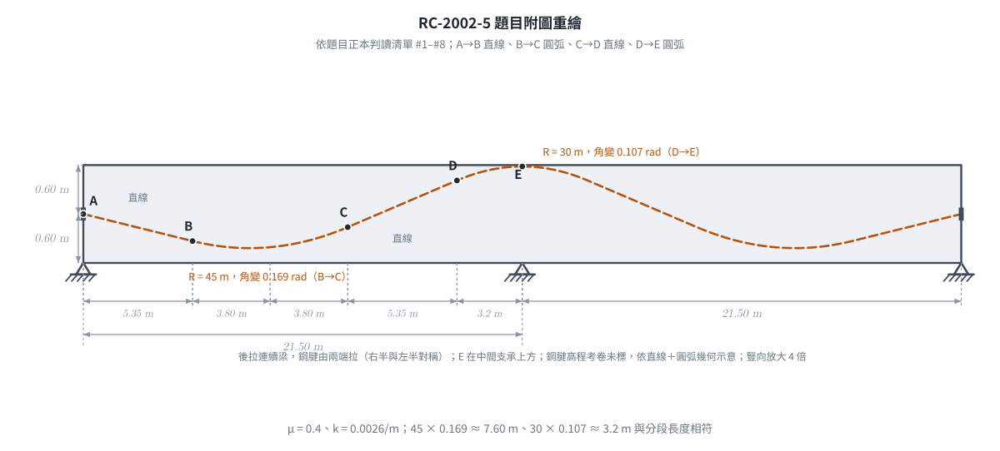
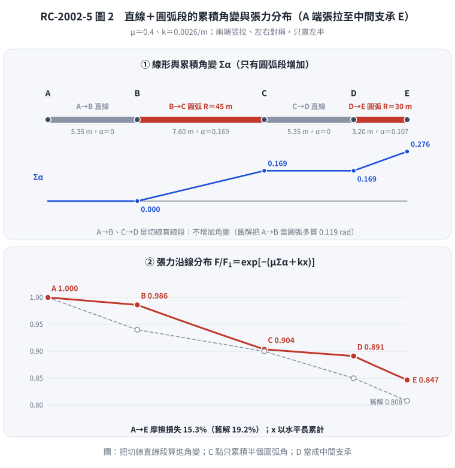

# 考題編號：RC-2002-5

**主分類：** `RC-U4-3` 預力損失
**副分類：** 無
**設計法：** WSD 工作應力法
**標籤：** `後拉法` `摩擦損失` `連續梁` `兩端張拉` `μ=0.4` `k=0.0026` `A-E各點` `角變量累積`

---

## 1. 題目（考卷原文見題目正本）

> 考卷原文、公式／附表、附圖與判讀清單（已確認）見 [`RC-2002-5-problem.md`](RC-2002-5-problem.md)。本節只列解題時最容易讀錯的地方與本解使用的記號；題意以題目正本為準。

*重繪自考卷附圖，依題目正本判讀清單 #1–#7。本圖攔下的讀錯：A→B 讀成圓弧、C→D 併入圓弧、D 當成中間支承。*

### 常見誤讀

| 項目 | 正確判讀 | 常見誤讀 |
|------|---------|---------|
| A→B | 直線段，角變 0 | R＝45 m 圓弧（本庫舊解，多算 0.119 rad） |
| B→C | R＝45 m 圓弧，水平 3.80＋3.80 m，角變 0.169 rad（45×0.169≈7.6） | 拆成兩段、C 點只累積一半角變（本庫舊解） |
| C→D | 直線段，角變 0；D 為 R＝30 m 圓弧起點，在中間支承左側 3.2 m | D 在 B→C 圓弧之後再隔一段直線（本庫舊解的 D'） |
| D→E | R＝30 m 圓弧，角變 0.107 rad；E 為中間支承上方鋼腱頂點 | E 在第二跨內 |
| A→E 總角變 | 0.169＋0.107＝0.276 rad；長度 21.50 m（水平投影） | 0.394 rad（本庫舊解） |

**本解記號：** $\mu$＝0.4；$k$＝0.0026/m；$F_1$＝A 點（張拉端）應力；$x$ 自 A 起算（水平投影）；$\alpha_{BC}$＝0.169、$\alpha_{DE}$＝0.107 rad。

---

## 2. 考題核心精神與出題者意圖 (Core Concepts & Examiner's Intent)

**核心觀念：**
後拉法摩擦損失：鋼腱自張拉端向遠端，受**曲率摩擦**（$\mu\alpha$，只在曲線段累積）與**擺動（皺摺）摩擦**（$kx$，全長累積）而衰減：

$$F_x = F_1 \cdot e^{-(\mu \Sigma\alpha + kx)}$$

**出題者意圖：**
- 從圖面判讀哪幾段是直線、哪幾段是圓弧，並讀出圓弧角變（考卷已標 0.169、0.107，可用 $L/R$ 驗算）
- 逐點累積 $\Sigma\alpha$ 與 $x$；直線段只增加 $kx$
- 兩端張拉：A→E 是半條鋼腱，E（中間支承上方）為最低應力點

---

## 3. 解題戰略地圖與陷阱分析 (Strategic Roadmap & Trap Analysis)

**作戰計畫：**
1. 判讀線形：A→B 直線、B→C 圓弧（R＝45 m）、C→D 直線、D→E 圓弧（R＝30 m）
2. 角變：$\alpha_{BC}=0.169$、$\alpha_{DE}=0.107$（$L/R$ 驗算）
3. 逐點累積 $\Sigma\alpha$、$x$，代入 $F_x=F_1e^{-(\mu\Sigma\alpha+kx)}$
4. A→E 損失百分率

**關鍵陷阱：**

| # | 陷阱 | 應對 |
|---|------|------|
| ① | A→B 當成圓弧 | R＝45 m 的半徑線止於 B（切點），A→B 虛線延長穿過梁底 → 直線 |
| ② | B→C 只算一半角變 | 0.169 標在 AB 延長線與 CD 線之間，是 B→C 整段圓弧的角變；C 處 $\Sigma\alpha=0.169$ |
| ③ | 0.107 當成累積值 | 是 D→E 一段的角變，須加上 0.169 |
| ④ | 直線段 C→D 跳過 | $\Sigma\alpha$ 不變，但 $kx$ 繼續累積 |

---

## 3.5 變數層次分析 (Variable Hierarchy Analysis)

> 複習提示：第一次解題後，在每個卡住的知識點旁標記 `⚠`；第二次複習時只看有 `⚠` 的項目。

### 最終目標
求 A→E 摩擦損失百分率，以及 B、C、D、E 各點之應力（以 $F_1$ 表示）。

### 本題關鍵公式（依計算順序）

$$\text{Step 1（各段角變量）：}\quad \alpha_i = \frac{L_i}{R_i}\ \text{（圓弧段）},\quad \alpha=0\ \text{（直線段）}$$

$$\text{Step 2（累積角變量）：}\quad \Sigma\alpha_x = \sum_{A}^{x} \alpha_i$$

$$\text{Step 3（各點應力）：}\quad F_x = F_1 \cdot e^{-\left(\mu \cdot \boxed{\Sigma\alpha_x} + k \cdot x\right)}$$

$$\text{Step 4（損失百分率）：}\quad \text{Loss}_{AE} = \left(1 - \frac{F_E}{F_1}\right) \times 100\%$$

### L1：題目直接給定

| 符號 | 數值 | 說明 |
|------|------|------|
| μ | 0.4 | 曲率摩擦係數 |
| k | 0.0026/m | 皺摺摩擦係數 |
| F_A | F₁ | A 點張拉應力 |
| R₁ | 45 m | B→C 圓弧半徑 |
| R₂ | 30 m | D→E 圓弧半徑 |
| 水平分段 | 5.35｜3.80＋3.80｜5.35｜3.2 m | A→B｜B→C｜C→D｜D→E |
| 角變標註 | 0.169、0.107 rad | B→C、D→E |

### L2：需知識點推導

| 段 | 線形 | 水平長 (m) | α (rad) |
|----|------|-----------|---------|
| A→B | 直線 | 5.35 | 0 |
| B→C | 圓弧 R＝45 | 7.60 | 7.60/45＝0.1689 ≈ **0.169** |
| C→D | 直線 | 5.35 | 0 |
| D→E | 圓弧 R＝30 | 3.20 | 3.20/30＝0.1067 ≈ **0.107** |

### L3：深層知識（不懂就卡住）

| 知識點 | 說明 | 卡關? |
|--------|------|-------|
| 圓弧角變 α ≈ L/R | 弧長 $R\alpha$ ≈ 水平投影（坡度小）；考卷標註值與 $L/R$ 吻合，用標註值 | |
| 直線段只有 kx | $\mu\Sigma\alpha$ 不增加；$kx$ 全長累積 | |
| 兩端張拉 | 右半對稱，由右端張拉；A→E 為半條鋼腱，E 最低 | |
| 指數 vs 近似 | $e^{-\omega}$ 與 $1-\omega$ 在 $\omega$＝0.17 時差約 1.3%；本解用指數式 | |

---

## 4. 步驟化詳細計算過程 (Step-by-Step Detailed Calculation)

### Step 1：各段角變量（驗算圖中標示值）

$$\alpha_{AB} = 0\ \text{（直線）}$$

$$\alpha_{BC} = \frac{7.60}{45} = 0.1689 \approx \mathbf{0.169 \text{ rad}} \checkmark$$

$$\alpha_{CD} = 0\ \text{（直線）}$$

$$\alpha_{DE} = \frac{3.20}{30} = 0.1067 \approx \mathbf{0.107 \text{ rad}} \checkmark$$

### Step 2：各點累積角變量 Σα 與距離 x

| 點 | x (m) | Σα (rad) |
|----|--------|---------|
| A | 0 | 0 |
| B | 5.35 | 0 |
| C | 5.35＋7.60＝12.95 | 0.169 |
| D | 12.95＋5.35＝18.30 | 0.169 |
| E | 18.30＋3.20＝21.50 | 0.169＋0.107＝**0.276** |

### Step 3：各點應力（$F_x = F_1 e^{-(\mu\Sigma\alpha + kx)}$）

**B（x＝5.35 m，Σα＝0）：**

$$\mu\Sigma\alpha + kx = 0 + 0.0026 \times 5.35 = 0.01391$$

$$\boxed{F_B = F_1 e^{-0.01391} = 0.986\,F_1}$$

**C（x＝12.95 m，Σα＝0.169）：**

$$\mu\Sigma\alpha + kx = 0.4 \times 0.169 + 0.0026 \times 12.95 = 0.06760 + 0.03367 = 0.10127$$

$$\boxed{F_C = F_1 e^{-0.10127} = 0.904\,F_1}$$

**D（x＝18.30 m，Σα＝0.169）：**

$$\mu\Sigma\alpha + kx = 0.06760 + 0.0026 \times 18.30 = 0.06760 + 0.04758 = 0.11518$$

$$\boxed{F_D = F_1 e^{-0.11518} = 0.891\,F_1}$$

**E（x＝21.50 m，Σα＝0.276）：**

$$\mu\Sigma\alpha + kx = 0.4 \times 0.276 + 0.0026 \times 21.50 = 0.11040 + 0.05590 = 0.16630$$

$$\boxed{F_E = F_1 e^{-0.16630} = 0.847\,F_1}$$

### Step 4：A→E 損失百分率

$$\text{Loss}_{AE} = (1 - 0.8468) \times 100\% \Rightarrow \boxed{\text{Loss}_{AE} \approx 15.3\%}$$

### 結果彙整表

| 點 | x (m) | Σα (rad) | 指數 (μΣα+kx) | $F_x / F_1$ | 損失 |
|----|--------|---------|-------------|------------|------|
| A | 0 | 0 | 0 | **1.000** | 0% |
| B | 5.35 | 0 | 0.0139 | **0.986** | 1.4% |
| C | 12.95 | 0.169 | 0.1013 | **0.904** | 9.6% |
| D | 18.30 | 0.169 | 0.1152 | **0.891** | 10.9% |
| E | 21.50 | 0.276 | 0.1663 | **0.847** | **15.3%** |

*圖 2　直線＋圓弧段的累積角變與張力分布。角變只在圓弧段累積，直線段只有擺動摩擦 $kx$；張力曲線在直線段平緩、在圓弧段陡降。本圖攔：把切線直線段算進角變、C 點只累積半個圓弧角、把 D 當成中間支承。*

---

## 5. 關鍵爭議點與進階探討 (Critical Issues & Advanced Discussion)

**1. 舊解（2026-11-15 勘誤前）與差異**

| 項目 | 舊解 | 本解 |
|------|------|------|
| A→B | R＝45 m 圓弧，α＝0.119 | 直線，α＝0 |
| B→C | 拆成 B→C、C→D' 各 0.084 | 一段圓弧 0.169，C 在圓弧終點 |
| C→D | 另設 D'，D'→D 直線 | C→D 直線 5.35 m |
| A→E Σα | 0.394 | **0.276** |
| $F_B$／$F_C$／$F_D$／$F_E$ | 0.940／0.900／0.850／0.808 $F_1$ | **0.986／0.904／0.891／0.847 $F_1$** |
| A→E 損失 | 19.2% | **15.3%** |

舊解把整段 A→C 都當成圓弧，並把圓弧角變一分為二，所以每一點的 $\Sigma\alpha$ 與距離都對不上圖面。

**2. 近似式 $1-\omega$ 對照**

若用一次近似 $F_x\approx F_1(1-\mu\Sigma\alpha-kx)$：B 0.986、C 0.899、D 0.885、E 0.834 $F_1$，A→E 損失 16.6%（比指數式大 1.3 個百分點）。現行規範解說兩式並列；$\omega$ 不大時可用近似式，本解主線用指數式。

**3. 角變量 α = L/R 的精確度**

以水平投影長代替鋼腱實長：鋼腱坡度約 0.1～0.2 rad，實長比水平長多不到 2%，對 A→E 的 $kx$ 影響約 0.001，可忽略（考卷也只給水平分段，判讀清單 #8）。考卷已標 0.169、0.107，直接採用。

**4. 兩端張拉的完整分布**

右端對稱張拉，右半鋼腱的應力分布與左半鏡像；E（中間支承上方）兩側應力相同，為全鋼腱最低點 0.847 $F_1$。若改由一端張拉，遠端錨碇只剩 $F_1e^{-2\times0.1663}=0.717\,F_1$。

**5. 損失組成**

A→E：擺動項 $kx$＝0.0559（約 1/3）、曲率項 $\mu\Sigma\alpha$＝0.1104（約 2/3）。

*修正日期：2026-11-15（§1 改為指向題目正本，插入重繪附圖 figs/RC-2002-5-fig-1-problem.svg；舊 §1 重述改寫為常見誤讀與本解記號；本行非答案勘誤）*

*修正日期：2026-11-15（解析勘誤 FIX-RC-U4-2-B1，改依現行台灣規範（建築物混凝土結構設計規範 2023）：依題目正本 #3–#7 改 A→B、C→D 為直線，只有 B→C（0.169）與 D→E（0.107）兩段圓弧，Σα 0.394 → 0.276：$F_B$／$F_C$／$F_D$／$F_E$＝0.940／0.900／0.850／0.808 → **0.986／0.904／0.891／0.847 $F_1$**，A→E 損失 19.2% → **15.3%**；§5 補近似式對照；撤除 §1 待勘誤提示；驗證：`.work/u4b1c/check_errata_U4_2_B1.py` 重算 MISMATCHES: 0）*

*圖解補繪：2026-11-15（DIAG-RC-U4-2-B1，向量圖 `figs/RC-2002-5-fig-2-friction.svg`，腳本 `figs/gen_RC-2002-5.py`，數值取自本解 §4 並於腳本檔尾 assert，可重跑）*
