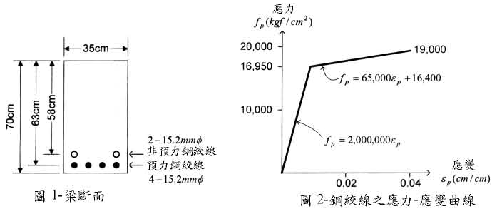

# RC-2003-1 題目正本

> 本檔只記錄**考卷上寫了什麼、圖上畫了什麼**，不含任何解法。解析見同資料夾 `RC-2003-1.md`。
> 判讀清單已經使用者確認（凍結）；本檔原則上不再修改（改動須回考卷原圖並記 log）。

| 項目 | 內容 |
|------|------|
| 考卷 | `raw/exams/RC-2003_鋼筋混凝土設計與預力.pdf`（單頁掃描影像，正面），第一題 |
| 考年 | 民國 92 年（2003） |
| 配分 | 20 分 |
| 附圖 | `RC-2003-1-fig-2.png`（圖 1 梁斷面＋圖 2 鋼絞線應力-應變曲線；2026-11-14 由考卷掃描原生解析度重新擷取，無游標）；既有 `RC-2003-1-fig-1.png` 為同一圖、圖 2 縱軸標題旁壓有滑鼠游標，保留不刪 |
| 判讀狀態 | **已確認**（2026-11-14 使用者確認；轉錄 2026-11-14；考卷為 1246×3676 px 掃描影像，原生解析度目視，放大不增細節；盲讀後才比對既有解析） |

## 1. 考卷原文（逐字）

> 一、有一配置預力(prestressed)暨非預力(nonprestressed)鋼絞線之梁斷面如圖 1 所示，試回答下列問題。（20 分）
> 已知條件：
> ㈠ $f'_c = 350\,kgf/cm^2$
> ㈡標稱直徑 $\phi = 15.2mm$ 預力混凝土用鋼絞線之標稱截面積為 $138.7mm^2$，其 $f_{pu} = 19{,}000kgf/cm^2$，$E_{ps} = 2{,}000{,}000kgf/cm^2$，而鋼絞線之抗拉應力-應變關係曲線如圖 2 所定義
> ㈢千斤頂施加於預力鋼絞線之應力達 $14{,}000kgf/cm^2$
> ㈣預力損失估計為 $2{,}000kgf/cm^2$
> 欲求：限用應變一致性較精確之方式，計算圖 1 梁斷面之標稱彎矩強度 $M_n$ 之值

## 2. 考卷給的公式、附表與參數

- 題文數值：$f'_c=350$；鋼絞線 15.2 mm、$A=138.7$ mm²／根、$f_{pu}=19{,}000$、$E_{ps}=2.0\times10^6$ kgf/cm²；千斤頂應力 14,000；預力損失 2,000 kgf/cm²。
- 圖 2 鋼絞線應力-應變曲線（雙直線）：彈性段 $f_p = 2{,}000{,}000\,\varepsilon_p$；降伏後 $f_p = 65{,}000\,\varepsilon_p + 16{,}400$；轉折點縱座標標 16,950；曲線末端標 19,000（約在 $\varepsilon_p=0.04$）。縱軸刻度 10,000、16,950、20,000；橫軸刻度 0.02、0.04。
- **沒有給**：混凝土極限應變 $\varepsilon_{cu}$、$\beta_1$、$E_c$、是否有握裹（先拉／後拉）、非預力鋼絞線是否用同一條應力-應變曲線、$\phi$（題目只問標稱 $M_n$）。
- 卷首注意事項：㈠不必抄題，作答時請將試題題號及答案依照順序寫在試卷上，於本試題上作答者，不予計分。㈡可以使用電子計算器，但需詳列解答過程。

## 3. 附圖

圖面文字照錄：`35cm`、`70cm`、`63cm`、`58cm`、`2−15.2mmφ`、`非預力鋼絞線`、`預力鋼絞線`、`4−15.2mmφ`、`圖 1-梁斷面`；`應力 f_p(kgf/cm²)`、`20,000`、`16,950`、`10,000`、`19,000`、`f_p = 65,000ε_p +16,400`、`f_p = 2,000,000ε_p`、`0.02`、`0.04`、`應變 ε_p(cm/cm)`、`圖 2-鋼絞線之應力-應變曲線`。

## 4. 判讀清單

「把握」標**不確定**者請優先確認；解讀類項目（題目用字的意思）另標「解讀」。

| # | 項目 | 判讀 | 圖上／題文依據 | 把握 |
|---|------|------|---------------|------|
| 1 | 預力／非預力鋼絞線深度對應 | **預力 4 根（下排實心）$d_p = 63$ cm；非預力 2 根（上排空心）$d = 58$ cm** | 58 cm 尺寸線下端落在上排空心圓列、63 cm 下端落在下排實心圓列（掃描原圖目視）；引線文字對應空心＝非預力、實心＝預力 | 確定 |
| 2 | 斷面 | 矩形 $b = 35$、$h = 70$ cm，三條尺寸線皆由頂面量起 | 尺寸線上端皆對齊頂面 | 確定 |
| 3 | 鋼絞線面積 | 每根 138.7 mm²＝1.387 cm²；$A_{ps} = 4 \times 1.387$、非預力 $2 \times 1.387$ | 題文㈡、圖 1 根數 | 確定 |
| 4 | 有效預應力 | 千斤頂 14,000 減損失 2,000（題目只給這兩個數） | 題文㈢㈣ | 確定（解讀） |
| 5 | 非預力鋼絞線的應力-應變 | 題文「鋼絞線之抗拉應力-應變關係曲線如圖 2 所定義」未限定預力或非預力，解讀為兩者共用圖 2 曲線 | 題文㈡ | 確定（解讀） |
| 6 | 圖 2 轉折點 | 兩直線交點：$2\times10^6\varepsilon = 65{,}000\varepsilon + 16{,}400$ → $\varepsilon \approx 0.00848$、$f \approx 16{,}950$，與圖上標註一致 | 圖 2 兩式與縱軸 16,950 | 確定 |
| 7 | 圖 2 末端 | 標 19,000（＝$f_{pu}$），位置約 $\varepsilon_p = 0.04$；考卷未寫斷裂應變數值 | 圖 2 曲線末端與橫軸刻度 0.04 位置相近 | 確定（解讀） |
| 8 | 問的量 | 標稱彎矩強度 $M_n$（非設計強度），且「限用應變一致性」方法 | 題文欲求 | 確定 |
| 9 | 考卷沒有給 | $\varepsilon_{cu}$、$\beta_1$、$E_c$、握裹與否（先拉／後拉）、$\phi$ | 全題 | 確定（作答須自行假設） |

---

*轉錄：2026-11-14（RC-U4-1 題目正本推廣・批 1）*

*確認：2026-11-14 使用者確認（RC-U4-1 題目正本推廣・批 1，關卡一）*
