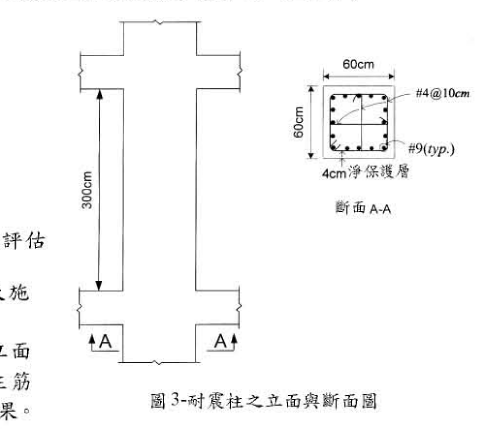

# RC-2003-2 題目正本

> 本檔只記錄**考卷上寫了什麼、圖上畫了什麼**，不含任何解法。解析見同資料夾 `RC-2003-2.md`。
> 判讀清單已經確認（凍結）；本檔原則上不再修改（改動須回考卷原圖並記 log）。

| 項目 | 內容 |
|------|------|
| 考卷 | `raw/exams/RC-2003_鋼筋混凝土設計與預力.pdf` 全一張（考卷為單頁掃描影像，正面），第二題 |
| 考年 | 民國 92 年（2003） |
| 配分 | 20 分 |
| 附圖 | `RC-2003-2-fig-2.png`（圖 3：耐震柱之立面與斷面圖；2026-11-15 由考卷掃描影像重新擷取 288 dpi，考卷原始掃描約 96 dpi）；既有 `RC-2003-2-fig-1.png` 為同一圖，左下梁旁有滑鼠游標，保留不刪；新圖左緣夾帶左欄題文殘字，不影響判讀 |
| 判讀狀態 | **已確認**（2026-11-15 使用者授權依 Claude 建議確認；轉錄 2026-11-15；考卷為掃描影像、無文字層；原始解析度約 96 dpi，全頁與局部 5 倍放大目視；盲讀後才比對既有解析） |

## 1. 考卷原文（逐字）

> 二、有一耐震鋼筋混凝土柱之立面及斷面情況如圖 3 所示，若欲執行柱主筋之搭接設計，試按民國 92 年 1 月 1 日生效，由營建雜誌社發行之「結構混凝土設計規範」設計之。（20 分）
>
> 已知條件：
> ㈠ $f'_c=280kgf/cm^2$，常重混凝土
> ㈡ $f_y=4{,}200kgf/cm^2$，未塗布鋼筋
> ㈢柱配置 16 根 #9 鋼筋，$d_b=2.87cm$，$A_b=6.47cm^2$
> ㈣#4 鋼筋，$d_b=1.27cm$，$A_b=1.27cm^2$
> ㈤限用 $\lambda_d=\dfrac{0.28d_bf_y}{\sqrt{f'_c}}(\alpha\beta\lambda)\dfrac{d_b}{c+K_{tr}}$ 之詳細計算法評估
> ㈥搭接鋼筋組之設計須利於柱穿插繫筋之排置及施工中柱鋼筋籠之剛度考慮。
>
> 試估算柱主筋所需之搭接長度 $\lambda_d$ 之值，並於柱立面圖標示柱主筋之搭接位置及長度，且須繪製柱主筋搭接處之柱斷面圖，以詳示柱主筋搭接之設計結果。

（考卷以 $\lambda_d$ 表示伸展長度與搭接長度，照考卷原文。）

## 2. 考卷給的公式、附表與參數

- 已知條件㈠–㈥：見 §1（照錄）。
- 伸展長度式（照錄，限用）：$\lambda_d=\dfrac{0.28d_bf_y}{\sqrt{f'_c}}(\alpha\beta\lambda)\dfrac{d_b}{c+K_{tr}}$；式中 $\alpha$、$\beta$、$\lambda$、$c$、$K_{tr}$ 定義與上限考卷沒有給。
- 圖 3：柱斷面 60×60 cm；16-#9（typ.）；#4@10 cm；4 cm 淨保護層；立面柱淨高 300 cm（上下梁之間）。
- 指定規範：民國 92 年 1 月 1 日生效之「結構混凝土設計規範」（營建雜誌社發行）。
- **沒有給**：搭接類別（甲／乙級）、搭接處同斷面搭接比例、柱軸力與彎矩、#4 的 $f_{yt}$（題文 $f_y$＝4200 未區分主筋或箍筋）、繫筋實際位置以外的資訊。
- 卷首注意事項：㈠不必抄題，作答時請將試題題號及答案依照順序寫在試卷上，於本試題上作答者，不予計分。㈡可以使用電子計算器，但需詳列解答過程。

## 3. 附圖

圖面文字照錄：`300cm`、`A`、`A`、`60cm`、`60cm`、`#4@10cm`、`#9(typ.)`、`4cm 淨保護層`、`斷面 A-A`、`圖 3-耐震柱之立面與斷面圖`。

## 4. 判讀清單

「把握」標**不確定**者優先列；解讀類項目（題目用字的意思）另標「解讀」。標「依 Claude 建議確認」者，為使用者 2026-11-15 授權「要我確認的請依你建議」後定案。

| # | 項目 | 判讀 | 圖上／題文依據 | 把握 |
|---|------|------|---------------|------|
| 1 | #4 的 $f_{yt}$ | 題文 $f_y$＝4200 未區分，**主筋與 #4 箍筋皆取 4200** | 已知條件㈡只給一個 $f_y$ | 確定（解讀）；依 Claude 建議確認 |
| 2 | 搭接類別 | 考卷沒有給；耐震柱主筋搭接依規範（全數於同一斷面搭接時為乙級），須明列 | 題文未提 | 確定（解讀） |
| 3 | 4 cm 淨保護層 | 量到 #4 箍筋外緣 | 斷面 A-A 引線指向底邊箍筋外側；「淨」保護層 | 確定（解讀） |
| 4 | 繫筋 | #4，一支垂直、一支水平，在斷面中央呈十字，鉤住各面中間筋 | 斷面 A-A 十字線（掃描約 96 dpi，彎鉤細節不清） | 確定（解讀） |
| 5 | 柱淨高 | 300 cm（上方梁底到下方梁頂） | 立面 300cm 尺寸線上下端分別對齊上梁底、下梁頂 | 確定 |
| 6 | 斷面 | 60×60 cm | 斷面 A-A 60cm 水平、垂直尺寸對齊外緣 | 確定 |
| 7 | 主筋 | 16-#9，每面 5 根（含角筋） | 斷面 A-A 數點：上 5、下 5、左右中間各 3；題文「16 根 #9」 | 確定 |
| 8 | 箍筋 | #4@10 cm 閉合箍 | 斷面標註 | 確定 |
| 9 | 所求 | 搭接長度、立面上的搭接位置與長度、搭接處斷面圖 | 題文 | 確定 |
| 10 | 規範版本 | 考卷指定民國 92 年版並限用其詳細式；依根目錄 CLAUDE.md 主線用現行規範，題目印出的式子依現行規範換用並在 §5 對照 | 題文 | 確定 |
| 11 | 考卷沒有給 | 搭接類別、同斷面搭接比例、柱內力 | 全題 | 確定 |

---

*轉錄：2026-11-15（RC-U3-3 批 2＋U1-3＋U2-3 題目正本推廣）*

*確認：2026-11-15 使用者授權依 Claude 建議確認（RC-U3-3 批 2＋U1-3＋U2-3 題目正本推廣，關卡一）*
