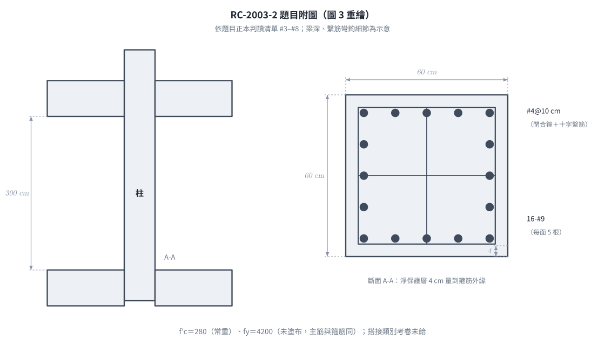
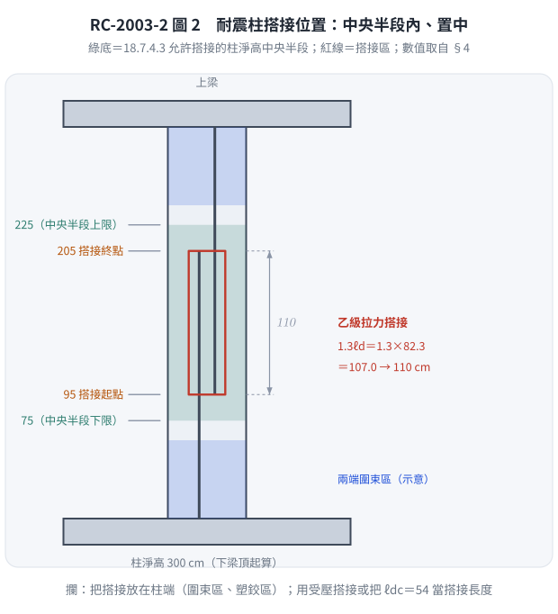

# 考題編號：RC-2003-2

**主分類：** `RC-U2-3` 鋼筋錨定長度與斷點計算  
**副分類：** `RC-U3-3` 韌性要求與耐震設計  
**設計法：** USD  
**標籤：** `耐震柱` `搭接長度` `詳細計算法` `c值計算` `Ktr橫向鋼筋指標` `乙級拉力搭接` `Class B搭接` `中段1/2限制` `方形柱16-#9`

---

## 1. 題目（考卷原文見題目正本）

> 考卷原文、公式／附表、附圖與判讀清單（已確認）見 [`RC-2003-2-problem.md`](RC-2003-2-problem.md)。本節只列解題時最容易讀錯的地方與本解使用的記號；題意以題目正本為準。


*重繪自考卷圖 3，依題目正本判讀清單 #3–#8。本圖攔下的讀錯：保護層量到主筋；300 cm 當層高。*

### 常見誤讀

| 項目 | 正確判讀 | 常見誤讀 |
|------|---------|---------|
| 淨保護層 4 cm | 量到 #4 箍筋外緣 | 量到主筋 |
| #4 的 $f_{yt}$ | 題文只給一個 $f_y$＝4200，主筋與箍筋同 | 箍筋取 2800 |
| 柱淨高 | 300 cm（上梁底至下梁頂） | 樓層高 |
| 搭接類別 | 考卷沒有給，依規範判定並明列（全數同斷面搭接 → 乙級） | 當作題目已知 |
| 指定規範 | 考卷指定民國 92 年版並限用其詳細式（0.28 係數）；主線依現行規範 25.4.2.4 式（$1/3.5$ 係數），舊式降為 §5 對照 | 沿用舊式 |
| $K_{tr}$ | $40A_{tr}/(sn)$（＝$A_{tr}f_{yt}/(105sn)$，$f_{yt}$＝4200 時相同）＝2.03～3.05 | $A_{tr}f_{yt}/(10sn)$＝21.3（本庫舊解，係數錯） |
| 受壓搭接 | $0.0071f_yd_b$＝85.6 cm；54 cm 是受壓伸展長度 $\ell_{dc}$ | 把 $\ell_{dc}$ 當受壓搭接長度（本庫舊解） |

**本解記號：** 60×60 cm；16-#9（$d_b$＝2.87 cm）；#4@10 cm（$d_b$＝1.27 cm）；淨保護層 4 cm；柱淨高 300 cm；$f'_c$＝280、$f_y$＝$f_{yt}$＝4200 kgf/cm²（常重、未塗布）。規範：建築物混凝土結構設計規範（2023 年版，ACI 318-19 世代）25.4.2.4（伸展長度）、25.5.2（拉力搭接）、25.5.5（受壓搭接）、18.7.4.3（耐震柱搭接位置）。

---

## 2. 考題核心精神與出題者意圖

**核心觀念：** 考生必須正確計算 $c_b$（保護層／半中心距取小）與橫向鋼筋指標 $K_{tr}$，判斷 $(c_b+K_{tr})/d_b$ 是否觸及 2.5 上限，才能得到「詳細計算法」的 $\ell_d$。耐震柱的搭接位置限制（柱淨高中央半段）與「須以拉力搭接設計」是另一個考點。

**出題者測驗：**
1. 正確計算 $c_b$（保護層至筋心 vs. 半中心距，取小）
2. 正確計算 $K_{tr}$（橫向鋼筋面積、間距、根數 $n$）
3. 判斷是否觸及 $(c_b+K_{tr})/d_b = 2.5$ 上限
4. 耐震柱搭接：乙級拉力搭接 $1.3\ell_d$，位置在柱淨高中央半段

---

## 3. 解題戰略地圖與陷阱分析

**計算步驟：**
1. 確認柱內鋼筋排列（每面 5 根）→ 計算中心距
2. 計算 $c_b$
3. 計算 $K_{tr}$（確認 $A_{tr}$ 與 $n$ 的意義）
4. 判斷 $(c_b + K_{tr})/d_b \le 2.5$
5. 代入現行式得 $\ell_d$
6. 乙級拉力搭接：$\ell_{st} = 1.3\,\ell_d$
7. 定搭接位置（中央半段）並畫斷面

**關鍵陷阱：**

| # | 陷阱 | 說明 |
|---|------|------|
| ① | 每面幾根鋼筋 | 16 根在 60 cm 柱：每面 5 根（含兩端角筋），中心距 = 46.59/4 = 11.65 cm |
| ② | $c_b$ 取兩者較小值 | 保護層至筋心 6.705 vs. 半中心距 5.824 |
| ③ | $K_{tr}$ 係數 | kgf 制 $A_{tr}f_{yt}/(105sn)$ 或 $40A_{tr}/(sn)$；不是 $/(10sn)$ |
| ④ | 耐震柱搭接必須用拉力搭接 | 規範 18.7.4.3：只准在柱淨高中央半段、以拉力搭接設計 |
| ⑤ | 考卷舊式係數 0.28 | 現行式 $f_y/(3.5\lambda\sqrt{f'_c})$，相當於係數 0.286，結果大 2% |

---

## 3.5 變數層次分析（Variable Hierarchy Analysis）

> 複習提示：第一次解題後，在每個卡住的知識點旁標記 `⚠`；第二次複習時只看有 `⚠` 的項目。

### 最終目標

求耐震柱 16-#9 主筋之**拉力搭接長度 $\ell_{st}$**，並指定搭接位置。

### 本題關鍵公式（依計算順序）

$$\text{Step 1: } c_b = \min\!\left(c_{cover},\ \frac{s_{cc}}{2}\right)$$

$$\text{Step 2: } K_{tr} = \frac{40A_{tr}}{s\,n}$$

$$\text{Step 3: 判斷} \quad \frac{c_b + \boxed{K_{tr}}}{d_b} \le 2.5$$

$$\text{Step 4: } \ell_d = \frac{f_y}{3.5\lambda\sqrt{f'_c}}\cdot\frac{\psi_t\psi_e\psi_s\psi_g}{\boxed{\dfrac{c_b+K_{tr}}{d_b}}}\,d_b \ \ge 30\text{ cm}$$

$$\text{Step 5: } \ell_{st} = 1.3\,\boxed{\ell_d} \quad (\text{乙級拉力搭接})$$

### L1：題目直接給定

| 符號 | 數值 | 說明 |
|------|------|------|
| $b = h$ | 60 cm | 方形柱邊長 |
| $d_b$ | 2.87 cm | #9 主筋 |
| $d_{b,tie}$、$A_{b,tie}$ | 1.27 cm、1.27 cm² | #4 箍筋與繫筋 |
| $s$ | 10 cm | 箍筋間距 |
| 淨保護層 | 4 cm | 至箍筋外緣 |
| $f'_c$ | 280 kgf/cm² | 常重 |
| $f_y = f_{yt}$ | 4,200 kgf/cm² | 未塗布 |
| 柱淨高 | 300 cm | |

### L2：需知識點推導

| 符號 | 公式／來源 | 卡關? |
|------|-----------|-------|
| 每面鋼筋根數 | 16 根 = 4 角 + 每面 3 中間筋 → 每面 5 根 | |
| $c_{cover}$ | $4 + 1.27 + 2.87/2 = 6.705$ cm | |
| $s_{cc}$ | $(60 - 2\times6.705)/4 = 11.65$ cm | |
| $c_b$ | $\min(6.705,\ 5.824) = 5.824$ cm | |
| $A_{tr}$ | 外箍 2 肢＋繫筋 1 肢 = $3\times1.27 = 3.81$ cm²（只計外箍 2.54） | |
| $K_{tr}$ | $40\times3.81/(10\times5) = 3.05$（2 肢 2.03） | |
| $(c_b+K_{tr})/d_b$ | $(5.824+3.05)/2.87 = 3.09 > 2.5$ → 取 2.5（2 肢 2.74，同樣取 2.5） | |
| $\psi_t\psi_e\psi_s\psi_g$ | 垂直筋 1.0、未塗布 1.0、#9 1.0、SD420 1.0 | |
| $\ell_d$ | $4200/(3.5\times16.733)\times2.87/2.5 = 82.3$ cm | |
| $\ell_{st}$（乙級） | $1.3\times82.3 = 107.0$ cm → 取 110 cm | |

### L3：深層知識（不懂就卡住）

| 知識點 | 說明 | 卡關? |
|--------|------|-------|
| $c_b$ 取兩者較小值 | 保護層劈裂與相鄰筋間劈裂，取較弱的一面 | |
| $K_{tr}$ 中的 $A_{tr}$、$n$ | $A_{tr}$：間距 $s$ 內穿越潛在劈裂面的橫向筋總面積；$n$：沿該劈裂面被伸展／搭接的鋼筋根數 | |
| 2.5 上限 | 超過後劈裂不再控制，改由拔出控制，再加橫向筋也無益 | |
| 耐震柱搭接 | 18.7.4.3：搭接只准在柱淨高中央半段，且以拉力搭接設計，並以 18.7.5.2–18.7.5.3 橫向筋包覆 | |
| 甲／乙級 | 同斷面搭接 > 50% 或 $A_{s,prov}/A_{s,req} < 2$ → 乙級 $1.3\ell_d$ | |

---

## 4. 步驟化詳細計算過程

### Step 1　斷面幾何：每面鋼筋根數與中心距

16 根 #9 均佈於 60×60 cm 柱四周：4 角筋 + 每面 3 根中間筋 → **每面 5 根**。

$$c_{cover} = 4 + 1.27 + \frac{2.87}{2} = 6.705\ \text{cm}$$

$$s_{cc} = \frac{60 - 2\times6.705}{5-1} = \frac{46.59}{4} = 11.65\ \text{cm},\qquad \frac{s_{cc}}{2} = 5.824\ \text{cm}$$

$$\boxed{c_b = \min(6.705,\ 5.824) = 5.824\ \text{cm}}\quad\text{（間距控制）}$$

### Step 2　橫向鋼筋指標 $K_{tr}$

潛在劈裂面沿柱的一面（5 根筋），穿越它的橫向筋為垂直該面的外箍 2 肢＋十字繫筋 1 肢：

$$A_{tr} = 3 \times 1.27 = 3.81\ \text{cm}^2,\qquad n = 5$$

$$K_{tr} = \frac{40A_{tr}}{s\,n} = \frac{40\times3.81}{10\times5} = 3.05\ \text{cm}$$

（kgf 制另一寫法 $A_{tr}f_{yt}/(105sn)$＝$3.81\times4200/5250$＝3.05，相同；只計外箍 2 肢時 2.03。）

### Step 3　判斷 $(c_b+K_{tr})/d_b$

$$\frac{c_b+K_{tr}}{d_b} = \frac{5.824+3.05}{2.87} = 3.09 > 2.5 \quad\Rightarrow\quad \boxed{\text{取 } 2.5}$$

（只計外箍 2 肢：$(5.824+2.03)/2.87 = 2.74 > 2.5$，同樣取 2.5。）

### Step 4　修正係數

| 係數 | 意義 | 本題取值 |
|------|------|---------|
| $\psi_t$ | 澆置位置（下方新拌混凝土 > 30 cm 之水平筋） | **1.0**（垂直柱筋） |
| $\psi_e$ | 環氧樹脂塗布 | **1.0**（未塗布） |
| $\psi_s$ | 鋼筋尺寸（D19 以下 0.8） | **1.0**（#9） |
| $\psi_g$ | 鋼筋等級 | **1.0**（SD420） |
| $\lambda$ | 輕質混凝土 | **1.0**（常重） |

### Step 5　伸展長度 $\ell_d$（現行 25.4.2.4）

$$\ell_d = \frac{f_y}{3.5\lambda\sqrt{f'_c}}\cdot\frac{\psi_t\psi_e\psi_s\psi_g}{(c_b+K_{tr})/d_b}\,d_b = \frac{4200}{3.5\times16.733}\times\frac{1.0}{2.5}\times2.87 = 71.71\times\frac{2.87}{2.5} = \boxed{82.3\ \text{cm}}$$

檢核最小值：$82.3 > 30\ \text{cm}$ ✓

### Step 6　搭接長度（乙級拉力搭接）

- 規範 18.7.4.3：耐震柱主筋搭接須以**拉力搭接**設計
- 16 根全部在同一區段搭接（100% > 50%）→ **乙級**，$\ell_{st} = 1.3\ell_d$

$$\boxed{\ell_{st} = 1.3\times82.3 = 107.0\ \text{cm} \to \text{取}\ 110\ \text{cm}}$$

### Step 7　搭接位置（規範 18.7.4.3）

搭接只准在柱淨高**中央半段**：$300/4 = 75$ cm 至 $3\times300/4 = 225$ cm（距下梁頂）。

**採用：搭接置中於柱高中點，95～205 cm**（$150 \pm 55$），兩端距中央半段邊界各 20 cm，亦避開兩端圍束區。

| 位置 | 距下梁頂 |
|------|--------|
| 中央半段下限 | 75 cm |
| 搭接起點 | 95 cm |
| 搭接終點 | 205 cm |
| 中央半段上限 | 225 cm |

**立面圖示意（文字版）：**

```
  ─────── 上梁 ───────
  ┆                 ┆  300 cm 淨高
  ┆                 ┆  ← 225 cm（中央半段上限）
  ┆  ╔═══════════╗ ┆  ← 搭接終點 205 cm
  ┆  ║ ℓst=110cm ║ ┆
  ┆  ╚═══════════╝ ┆  ← 搭接起點 95 cm
  ┆                 ┆  ← 75 cm（中央半段下限）
  ─────── 下梁 ───────
```



*圖 2　搭接只能放在柱淨高中央半段，本題 110 cm 搭接置中後兩端各留 20 cm 餘裕。攔的是把搭接放在柱端（圍束區、塑鉸區）、改用受壓搭接，或把受壓伸展長度 $\ell_{dc}$＝54 cm 當成搭接長度。*

### Step 8　搭接處斷面

於搭接區（95～205 cm），斷面配置：
- 每面 5 根主筋各與一根搭接筋**沿柱面內側並排**（接觸搭接），使中間筋仍位於同一軸線上，十字繫筋可照常鉤住各面中間筋，利於繫筋穿插（已知條件㈥）
- 搭接筋組之間淨距 ≥ $\max(1.5d_b,\ 4\text{ cm},\ \tfrac43d_{agg})$（柱縱筋，25.2.3；接觸搭接組與相鄰鋼筋之淨距亦適用）：每面 5 組、每組寬 $2d_b$＝5.74 cm，中心距 11.65 cm → 淨距 ≈ 11.65 − 5.74 = 5.9 cm ≥ 4.31 ✓
- 箍筋 #4@10 cm 與十字繫筋貫穿全搭接區，維持鋼筋籠剛度

---

## 5. 關鍵爭議點與進階探討

**1. 考卷限用舊式（民國 92 年版）對照**

| 項目 | 考卷舊式 $0.28d_bf_y/\sqrt{f'_c}\cdot\alpha\beta\lambda\cdot d_b/(c+K_{tr})$ | **現行 25.4.2.4（主線）** |
|------|------|------|
| 係數 | 0.28 | $1/3.5 = 0.286$ |
| $\ell_d$ | 80.7 cm | **82.3 cm** |
| 乙級搭接 | 104.9 → 105 cm | **107.0 → 110 cm** |

差 2%。考場若依題目限用舊式，答 105 cm；兩式的 $c$、$K_{tr}$ 定義與 2.5 上限相同。

**2. 舊解的 $K_{tr}$ 係數錯誤（不影響答案）**

舊解寫 $K_{tr}=A_{tr}f_{yt}/(10sn)$＝21.3（係數 10 錯，應為 105；或用 $40A_{tr}/sn$）。正確 $K_{tr}$＝2.03（2 肢）～3.05（3 肢）；因 $(c_b+K_{tr})/d_b$ 已達 2.5 上限，答案不變，但「$K_{tr}$ 遠大於 $c$」的敘述是錯的——本題其實是 $c_b$ 已接近上限、$K_{tr}$ 補足。

**3. 為何不用受壓搭接？**

$$\ell_{sc} = 0.0071f_yd_b = 0.0071\times4200\times2.87 = 85.6\ \text{cm}\ (\ge 30)$$

舊解寫的 54 cm 是受壓**伸展長度** $\ell_{dc}=\max(0.075f_y/\sqrt{f'_c},\ 0.0044f_y)\,d_b$，不是受壓搭接長度。無論如何，規範 18.7.4.3 規定耐震柱須以**拉力搭接**設計，不得採受壓搭接。

**4. 搭接區的橫向鋼筋**

18.7.4.3 要求搭接區以 18.7.5.2–18.7.5.3 的橫向鋼筋包覆；本題 #4@10 cm 閉合箍＋十字繫筋已滿足（$s$＝10 ≤ min(b/4＝15, $6d_b$＝17.2, $s_o$)）。

*修正日期：2026-11-15（§1 改為指向題目正本，插入重繪附圖 figs/RC-2003-2-fig-1-problem.svg；舊 §1 重述改寫為常見誤讀與本解記號；本行非答案勘誤）*

*修正日期：2026-11-15（改依現行台灣規範（建築物混凝土結構設計規範 2023／耐震規範 111）：伸展長度改 25.4.2.4 式 $f_y/(3.5\lambda\sqrt{f'_c})$，$\ell_d$ 80.7 → **82.3 cm**、乙級搭接 104.9（取 105）→ **107.0（取 110）cm**，搭接位置改置中 95～205 cm；$K_{tr}$ 式 $/(10sn)$＝21.3 → $40A_{tr}/(sn)$＝3.05（2 肢 2.03），不影響 2.5 上限；§5 受壓搭接 54 → $0.0071f_yd_b$＝85.6 cm（54 為 $\ell_{dc}$）；考卷 0.28 舊式降為 §5 對照；驗證：`.work/u33b2c/check_errata_U3_3_B2.py` 重算 MISMATCHES: 0）*

*修正日期：2026-11-15（落實檢查 RECHECK-RC-U3-3-B2 輕微殘留修正，非勘誤，數值與答案不變：Step 8 搭接筋組淨距限值由梁的 $\max(d_b, 2.5)$ 更正為柱的 $\max(1.5d_b, 4\text{ cm})$＝4.31 cm，仍符合）*

*圖解補繪：2026-11-15（向量圖 `figs/RC-2003-2-fig-2-lap.svg`，腳本 `figs/gen_RC-2003-2.py`，可重跑；數值由常數現算並於檔尾 assert 對 §4；DIAG-RC-U3-3-B2）*
