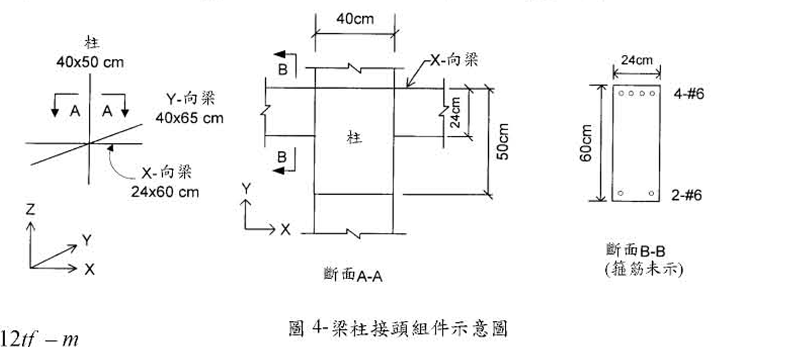

# RC-2003-3 題目正本

> 本檔只記錄**考卷上寫了什麼、圖上畫了什麼**，不含任何解法。解析見同資料夾 `RC-2003-3.md`。
> 判讀清單已經使用者確認（凍結）；本檔原則上不再修改（改動須回考卷原圖並記 log）。

| 項目 | 內容 |
|------|------|
| 考卷 | `raw/exams/RC-2003_鋼筋混凝土設計與預力.pdf` 第 1 頁（掃描影像，正面＋背面同一頁），背面第三題 |
| 考年 | 民國 92 年（2003） |
| 配分 | 20 分 |
| 附圖 | `RC-2003-3-fig-1.png`（圖 4：梁柱接頭組件示意圖） |
| 判讀狀態 | **已確認**（2026-11-14 使用者確認；影響答案項目使用者選擇：#1 柱 X 向 40／Y 向 50、#2 X 向梁上緣與柱面齊平（偏心）；轉錄 2026-11-14；PyMuPDF 110 dpi 全頁目視，附圖 300 dpi 局部放大（掃描原生約 96 dpi，放大不增細節）；盲讀後才比對既有解析） |

## 1. 考卷原文（逐字）

> 三、有一耐震鋼筋混凝土中間層內跨之梁柱接頭組件如圖 4 所示，試按民國 92 年 1 月 1 日生效，由營建雜誌社發行之「結構混凝土設計規範〔掃描疊字，此處缺「」設計之。（」〕20 分）
> 已知條件：
> ㈠ $f'_c = 280\ kgf/cm^2$，常重混凝土
> ㈡ $f_y = 4{,}200\ kgf/cm^2$
> ㈢ 樓層高度 350 cm
> ㈣ 縱向（X-向）梁之尺寸為 $24 \times 60\ cm$，其配置 4 根 #6 頂層鋼筋和 2 根 #6 底層鋼筋，而縱向梁之彎矩標稱計〔照考卷原文〕 $M_n^- \approx 24\ tf-m$，$M_n^+ \approx 12\ tf-m$
> ㈤ 橫向（Y-向）梁之尺寸為 $40 \times 65\ cm$
> ㈥ 柱之尺寸為 $40 \times 50\ cm$
> ㈦ #6 鋼筋，$d_b = 1.91\ cm$，$A_b = 2.87\ cm^2$
> ㈧ 接頭箍筋之配置符合規範要求（柱筋未示）。
> 試估計接頭在 X-向之抗震作用剪力 $V_u$ 之值，及接頭在 X-向之耐震標稱〔強度〕$V_n$ 之值，並據以查驗其是否符合規範對梁柱接頭〔掃描缺字〕耐〔掃描缺字〕

註：掃描件最後一行文字斷裂，只看得到「查驗其是否符合規範對梁柱接頭」與一個「耐」字；「標稱」與 $V_n$ 疊印。題意可讀為：求 $V_u$、求 $V_n$、檢核接頭剪力是否符合耐震規定。

## 2. 考卷給的公式、附表與參數

- 題文數值：見上；規範指定「民國 92 年 1 月 1 日生效、營建雜誌社發行之『結構混凝土設計規範』」。
- 考卷未印任何公式。
- **沒有給**：梁筋拉力用 $f_y$ 或 $1.25f_y$、接頭圍束係數 $\gamma$、$\phi$、柱軸力、梁淨跨、樓層高 350 cm 是否為中心距（題文只寫「樓層高度」）、柱筋配置（「柱筋未示」）、X 向梁 $d$。
- 卷首注意事項：㈠不必抄題，作答時請將試題題號及答案依照順序寫在試卷上，於本試題上作答者，不予計分。㈡可以使用電子計算器，但需詳列解答過程。

## 3. 附圖

圖面文字照錄：`柱 40x50 cm`、`Y-向梁 40x65 cm`、`X-向梁 24x60 cm`、`A`、`A`、`Z`、`Y`、`X`、`40cm`、`X-向梁`、`B`、`B`、`柱`、`24cm`、`50cm`、`斷面A-A`、`24cm`、`60cm`、`4-#6`、`2-#6`、`斷面B-B (箍筋未示)`、`圖 4-梁柱接頭組件示意圖`。

## 4. 判讀清單

「把握」標**不確定**者請優先確認；解讀類項目（題目用字的意思）另標「解讀」。

| # | 項目 | 判讀 | 圖上／題文依據 | 把握 |
|---|------|------|---------------|------|
| 1 | 柱斷面方向 | 柱 **X 向 40 cm、Y 向 50 cm**；X 向剪力的接頭深度 $h = 40$ cm | 斷面 A-A 座標軸 X 向右、Y 向上；`40cm` 尺寸線為水平（量柱左右兩側），`50cm` 尺寸線為垂直（右側）；Y-向梁 40 cm 寬由上下框入、兩側與柱左右緣齊，亦與柱 X 向 40 cm 相符 | 確定（解讀）（影響答案）；使用者確認 |
| 2 | X-向梁平面位置 | X-向梁（寬 24 cm）**上緣與柱上緣（+Y 面）齊平**，不置中；梁軸線距柱近側面 12 cm、距遠側面 38 cm | 斷面 A-A：X-向梁上緣線、`24cm` 尺寸線上端、`50cm` 尺寸線上端三者同一水平線（300 dpi 目視）；`24cm` 下端與梁下緣對齊；左右兩側 X-向梁同一位置 | 確定（解讀）（影響答案）；使用者確認 |
| 3 | 接頭位置 | 中間層、內跨：X 向兩側皆有 X-向梁、Y 向兩側皆有 Y-向梁（四面框梁） | 題文「中間層內跨」；斷面 A-A 四面皆有梁，梁端畫斷線符號 | 確定 |
| 4 | X-向梁斷面 | $24 \times 60$ cm，頂 4-#6、底 2-#6；$A_{s,top}=4 \times 2.87$、$A_{s,bot}=2 \times 2.87$ cm² | 題文㈣㈦；斷面 B-B | 確定 |
| 5 | X-向梁 $d$ | 沒有給；斷面 B-B 未標保護層或筋心位置 | 斷面 B-B 只有 24cm、60cm 兩條尺寸 | 確定 |
| 6 | 梁彎矩 | 「彎矩標稱計」＝彎矩**標稱強度** $M_n^- \approx 24$、$M_n^+ \approx 12$ tf-m（題文給定值） | 題文㈣ | 確定（解讀） |
| 7 | Y-向梁 | $40 \times 65$ cm；不參與 X 向剪力計算，只影響圍束判定 | 題文㈤ | 確定 |
| 8 | 樓層高度 | 350 cm；題文只寫「樓層高度」，未寫中心距或淨高 | 題文㈢ | 確定 |
| 9 | 所求 | ① X 向接頭抗震作用剪力 $V_u$；② X 向接頭耐震標稱強度 $V_n$；③ 據以查驗是否符合規範 | 題文末段（掃描缺字，見 §1 註） | 確定（解讀） |
| 10 | 考卷沒有給 | 梁筋應力取 $f_y$ 或 $1.25f_y$、$\gamma$、$\phi$、柱軸力 | 全題 | 確定 |

---

*轉錄：2026-11-14（RC-U3-3 題目正本推廣・批 1）*

*確認：2026-11-14 使用者確認（RC-U3-3 題目正本推廣・批 1，關卡一）*
