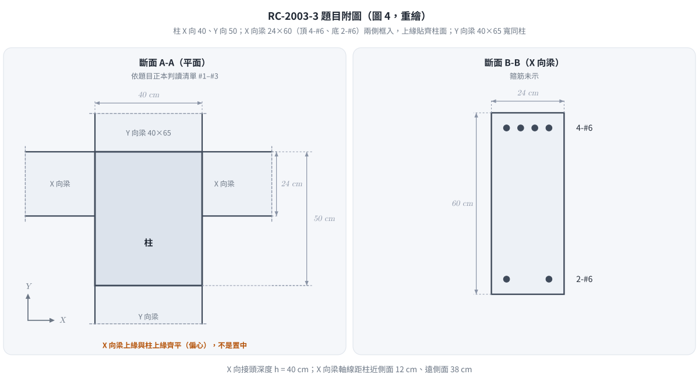
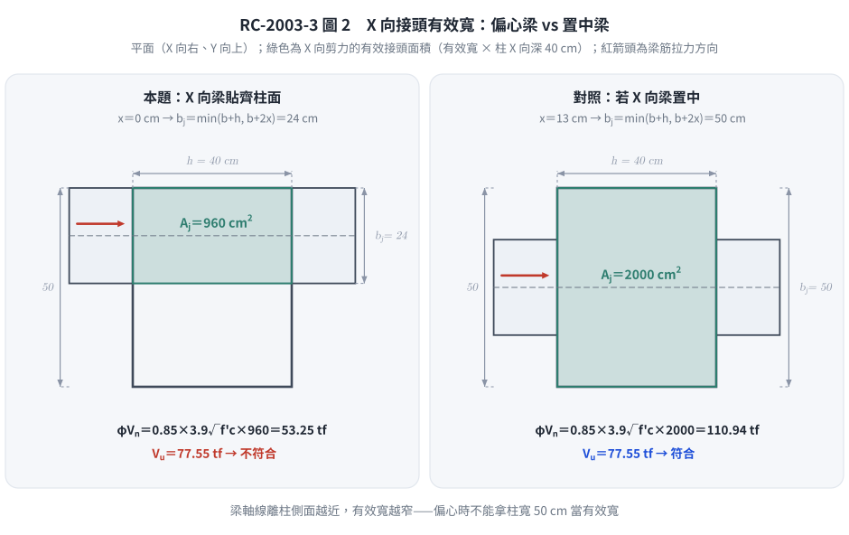

# 考題編號：RC-2003-3

**主分類：** `RC-U3-3` 韌性要求與耐震設計  
**副分類：** 無  
**設計法：** USD  
**標籤：** `梁柱接頭` `內部接頭` `水平剪力Vjh` `有效接頭寬度bj` `接頭剪力強度` `γ係數` `T_top+T_bot-Vcol` `中間層內跨` `偏心梁` `1.25fy` `一雙對面圍束` `柱方向判讀`

---

## 1. 題目（考卷原文見題目正本）

> 考卷原文、公式／附表、附圖與判讀清單（已確認）見 [`RC-2003-3-problem.md`](RC-2003-3-problem.md)。本節只列解題時最容易讀錯的地方與本解使用的記號；題意以題目正本為準。

*重繪自考卷圖 4，依題目正本判讀清單 #1–#4。本圖攔下兩個讀錯：柱的 40 cm 是 **X 向**（A-A 的 X 軸向右，40cm 為水平尺寸），X-向梁**貼齊柱的一側**而非置中。*

### 常見誤讀

| 項目 | 正確判讀 | 常見誤讀 |
|------|---------|---------|
| 柱斷面方向 | X 向 40 cm、Y 向 50 cm → X 向剪力的接頭深度 $h = 40$ cm | 讀成 X 向 50（本庫舊解），接頭深度與 $b_j$ 都算錯 |
| X-向梁平面位置 | 上緣與柱 +Y 面齊平（偏心），梁軸距柱近側面 12 cm | 當成置中，每側延伸 13 cm |
| 梁筋拉力 | 耐震接頭以 $1.25f_y$ 計算（題目沒給，須依規範） | 用 $f_y$（本庫舊解） |
| 「彎矩標稱計」 | 題給梁的標稱彎矩強度 $M_n^-\approx24$、$M_n^+\approx12$ tf-m | 當成設計彎矩或可能強度直接用 |
| 題目所問 | X 向 $V_u$、X 向耐震標稱強度 $V_n$，據以查驗是否符合 | 只求 $b_j$ |
| 規範 | 考卷指定民國 92 年 1 月 1 日生效、營建雜誌社發行之規範；本庫依現行台灣規範解題（差異見 §5） | 寫成營建署頒訂、題目寫成「附裏」 |

**本解記號：** $h$＝柱在 X 向的深度（接頭深度）＝40 cm；$b_c$＝柱在 Y 向的寬度＝50 cm；$b_w$＝X 向梁寬＝24 cm；$x$＝X 向梁軸線到柱近側面的垂直距離＝12 cm；$T_1$、$T_2$＝接頭兩側 X 向梁頂筋、底筋拉力；$H$＝樓層高 350 cm（視為柱反曲點間距）。

---

## 2. 考題核心精神與出題者意圖

**核心觀念：** 梁柱接頭水平剪力 $V_u$ 由接頭兩側梁筋拉力（取 $1.25f_y$）減去柱剪力得到；接頭強度 $V_n=\gamma\sqrt{f'_c}A_j$，其中有效寬度 $b_j$ 受**梁的偏心**限制，$\gamma$ 依**哪幾個面真正被梁圍束**決定。

**出題者測驗：**
1. 讀圖：柱哪一向是 40、X 向梁是否置中
2. 耐震接頭剪力需求的組成（$1.25f_y$、扣柱剪力）
3. 偏心梁的有效接頭寬度 $b_j=\min(b_w+h,\ 2x)$
4. 圍束判定：框入梁寬須 $\ge\frac34$ 該面寬才算圍束

---

## 3. 解題戰略地圖與陷阱分析

**計算步驟：**
1. $T_1=1.25A_{s,top}f_y$、$T_2=1.25A_{s,bot}f_y$
2. $M_{pr}\approx1.25M_n$（題目只給 $M_n$），柱剪力 $V_{col}=\Sigma M_{pr}/H$
3. $V_u=T_1+T_2-V_{col}$
4. $b_j=\min(b_w+h,\ 2x)\le b_c$，$A_j=b_jh$
5. 判定圍束面 → $\gamma$ → $V_n$、$\phi V_n$，與 $V_u$ 比較

**關鍵陷阱：**

| # | 陷阱 | 說明 |
|---|------|------|
| ① | 柱方向讀反 | A-A 的 40cm 尺寸線是水平的、X 軸向右 → X 向 40 |
| ② | 偏心梁的 $b_j$ | 梁貼齊柱面時 $x=b_w/2=12$，$2x=24$，$b_j$ 只剩梁寬 |
| ③ | 四面都有梁 ≠ 四面圍束 | X 向梁 24 cm < $\frac34\times50=37.5$ cm，X 向兩面不算圍束；Y 向梁 40 cm＝面寬 40 cm，算圍束 → 一雙對面 |
| ④ | 拉力用 $f_y$ | 耐震接頭規定用 $1.25f_y$ |
| ⑤ | $V_{col}$ 不扣 | 柱剪力與梁筋拉力方向相反，須扣除 |

---

## 3.5 變數層次分析（Variable Hierarchy Analysis）

> 複習提示：第一次解題後，在每個卡住的知識點旁標記 `⚠`；第二次複習時只看有 `⚠` 的項目。

### 最終目標

X 向接頭剪力 $V_u$、標稱強度 $V_n$，檢核 $V_u\le\phi V_n$。

### 本題關鍵公式（依計算順序）

$$\text{Step 1: } T_1=1.25A_{s,top}f_y,\quad T_2=1.25A_{s,bot}f_y$$

$$\text{Step 2: } V_{col}=\frac{1.25\,(M_n^-+M_n^+)}{H}$$

$$\text{Step 3: } V_u=\boxed{T_1}+\boxed{T_2}-\boxed{V_{col}}$$

$$\text{Step 4: } b_j=\min\!\left(b_w+h,\ 2x\right)\le b_c,\quad A_j=\boxed{b_j}\,h$$

$$\text{Step 5: } V_n=\gamma\sqrt{f'_c}\,A_j,\quad \phi V_n\ \text{vs}\ V_u$$

### L1：題目直接給定

| 符號 | 數值 | 說明 |
|------|------|------|
| $A_{s,top}$ | $4\times2.87=11.48$ cm² | X 向梁頂 4-#6 |
| $A_{s,bot}$ | $2\times2.87=5.74$ cm² | X 向梁底 2-#6 |
| $M_n^-$、$M_n^+$ | 24、12 tf·m | X 向梁標稱彎矩強度 |
| $H$ | 350 cm | 樓層高度 |
| $h$ | 40 cm | 柱 X 向（判讀 #1） |
| $b_c$ | 50 cm | 柱 Y 向（判讀 #1） |
| $b_w$ | 24 cm | X 向梁寬 |
| $x$ | 12 cm | X 向梁貼齊柱面，梁軸距近側面（判讀 #2） |
| $f'_c$、$f_y$ | 280、4,200 kgf/cm² | |

### L2：需知識點推導

| 符號 | 公式／來源 | 卡關? |
|------|-----------|-------|
| $T_1$ | $1.25\times11.48\times4200=60{,}270$ kgf＝60.27 tf | |
| $T_2$ | $1.25\times5.74\times4200=30{,}135$ kgf＝30.14 tf | |
| $V_{col}$ | $1.25\times(24+12)/3.5=12.86$ tf | |
| $V_u$ | $60.27+30.14-12.86=77.55$ tf | |
| $b_j$ | $\min(24+40,\ 2\times12)=24$ cm（$\le50$） | |
| $A_j$ | $24\times40=960$ cm² | |
| $\gamma$ | 3.9（一雙對面受圍束；現行台灣規範） | |
| $V_n$ | $3.9\times\sqrt{280}\times960=62.65$ tf | |
| $\phi V_n$ | $0.85\times62.65=53.25$ tf | |

### L3：深層知識（不懂就卡住）

| 知識點 | 說明 | 卡關? |
|--------|------|-------|
| 為何用 $1.25f_y$ | 梁端塑鉸時鋼筋應變硬化，接頭承受的是可能強度對應的拉力 | |
| $b_j$ 的偏心限制 | 有效寬度不超過「梁寬＋接頭深度」與「梁軸到柱側面較近距離的 2 倍」兩者較小值 | |
| 圍束的定義 | 框入梁寬至少覆蓋該接頭面寬的 3/4 才算該面受圍束 | |
| $\gamma$ 的單位制 | 現行台灣規範（kgf/cm²）5.3／3.9／3.2，對應 SI 制 1.7／1.2／1.0、psi 制 20／15／12 | |

---

## 4. 步驟化詳細計算過程

### Step 1　梁筋拉力（$1.25f_y$）

$$T_1=1.25A_{s,top}f_y=1.25\times11.48\times4{,}200=\boxed{60{,}270\ \text{kgf}=60.27\ \text{tf}}$$

$$T_2=1.25A_{s,bot}f_y=1.25\times5.74\times4{,}200=\boxed{30{,}135\ \text{kgf}=30.14\ \text{tf}}$$

> 一致性核對：由 $M_n^-=A_sf_y(d-a/2)$ 反推 $a=\dfrac{11.48\times4200}{0.85\times280\times24}=8.44$ cm、$d=\dfrac{24\times10^5}{48{,}216}+\dfrac{8.44}{2}=54.0$ cm，與梁高 60 cm 相符。

### Step 2　柱剪力

接頭兩側梁端同時達可能彎矩強度，取 $M_{pr}\approx1.25M_n$（題目只給 $M_n$）；上下柱反曲點在柱中點，柱剪力：

$$V_{col}=\frac{1.25\,(M_n^-+M_n^+)}{H}=\frac{1.25\times(24+12)}{3.5}=\frac{45}{3.5}=\boxed{12.86\ \text{tf}}$$

> 第二路徑：以 $d=54.0$ cm 精算 $M_{pr}^-=60{,}270\times(54.0-10.55/2)=29.36$ tf·m、$M_{pr}^+$（$d$ 同法由 $M_n^+$ 反推）$=14.84$ tf·m，$V_{col}=44.21/3.5=12.63$ tf，$V_u=77.78$ tf，與主線差 0.3%。

### Step 3　接頭水平剪力 $V_u$

$$V_u=T_1+T_2-V_{col}=60.27+30.14-12.86=\boxed{77.55\ \text{tf}}$$

### Step 4　有效接頭寬度與面積

X 向梁貼齊柱的 +Y 面：梁軸線到柱近側面 $x=24/2=12$ cm、到遠側面 $50-12=38$ cm。

$$b_j=\min(b_w+h,\ 2x)=\min(24+40,\ 2\times12)=\min(64,\ 24)=\boxed{24\ \text{cm}}\ (\le b_c=50)$$

$$A_j=b_j\,h=24\times40=\boxed{960\ \text{cm}^2}$$

*圖 2　X 向接頭有效寬：偏心梁 vs 置中梁。同一根梁只因平面位置不同，$A_j$ 差一倍、結論相反；本圖攔下「偏心梁仍拿柱寬 50 cm 當 $b_j$」的錯誤。*

### Step 5　圍束判定與 $\gamma$

| 接頭面 | 面寬 | 框入梁寬 | $\ge\frac34$ 面寬？ |
|--------|------|---------|-------------------|
| 垂直 X 的兩面（X 向梁框入） | 50 cm | 24 cm | $24<37.5$ ✗ |
| 垂直 Y 的兩面（Y 向梁框入） | 40 cm | 40 cm | $40\ge30$ ✓ |

→ 只有一雙對面受圍束，取 $\gamma=3.9$（現行台灣規範，kgf/cm² 制）。

### Step 6　標稱強度與檢核

$$V_n=\gamma\sqrt{f'_c}\,A_j=3.9\times16.733\times960=\boxed{62{,}649\ \text{kgf}=62.65\ \text{tf}}$$

$$\phi V_n=0.85\times62.65=\boxed{53.25\ \text{tf}}$$

$$V_u=77.55\ \text{tf}>\phi V_n=53.25\ \text{tf}\quad\Rightarrow\quad\textbf{不符合規範}\ (V_u/\phi V_n=1.46)$$

連標稱強度 $V_n=62.65$ tf 都小於 $V_u$。

**改善方向：** ① X 向梁改為置中（$x=13$，$b_j=\min(64,\ 50)=50$，$A_j=2{,}000$，$\phi V_n=110.9$ tf，通過）；② X 向梁加寬到 $\ge37.5$ cm 且置中，四面圍束 $\gamma=5.3$；③ 加大柱斷面。

**梁筋穿越接頭：** 柱平行梁筋方向尺寸 $h/d_b=40/1.91=20.9\ge20$ ✓。

---

## 5. 關鍵爭議點與進階探討

**1. 結論對各種讀法都穩定**

| 讀法 | $V_u$ | $\phi V_n$ | 結論 |
|------|------|-----------|------|
| 本解（$1.25f_y$、$\gamma=3.9$） | 77.55 | 53.25 | 不符合 |
| 若 $\gamma$ 誤取 5.3 | 77.55 | 72.37 | 不符合 |
| 若拉力只取 $f_y$ | 62.04 | 53.25 | 不符合 |
| 舊解（柱讀反、梁置中、$\gamma=5.3$、$f_y$） | 62.04 | 150.7 | 符合 ✗ |

依題目正本判讀，任何合理的規範取法都得到「不符合」；舊解的「安全餘裕 2.43」來自讀圖錯誤。

**2. 規範版本與 $\gamma$**

本解依現行**建築物混凝土結構設計規範（2023 年版，土木 401-112／ACI 318-19 體系）**（根目錄 `CLAUDE.md`「規範版本」）；考卷指定的民國 92 年規範不採用，差異如下：

| 項目 | 現行台灣規範（本解） | 民國 92 年規範（考卷指定） |
|------|------------------|----------------------|
| $\gamma$（四面／一雙對面／其他） | 5.3／3.9／3.2 | 5.3／4.0／3.2（psi 制 20／15／12 換算） |
| 一雙對面受圍束時 $\phi V_n$ | 53.25 tf | 54.62 tf |
| 結論 | 不符合 | 不符合 |

**圍束面判定的另一種讀法：** 若以「框入梁寬 $\ge\frac34$ 有效接頭寬 $b_j$」判定（ACI 318-19 的寫法），X 向梁 24 cm $\ge\frac34\times24$，四面都算受圍束，$\gamma=5.3$、$\phi V_n=72.37$ tf，仍小於 $V_u=77.55$ tf，結論相同。本解採較保守的「梁寬 $\ge\frac34$ 柱面寬」；作答時請以 2023 年版條文核對。

**3. 偏心梁在實務上的意義**

外牆側的梁常與柱外面齊平，接頭有效寬度會掉到接近梁寬，這是接頭剪力常不足的原因；設計時應優先讓梁置中或加寬梁。

---

*修正日期：2026-11-14（§1 改為指向題目正本；重繪題目附圖 figs/RC-2003-3-fig-1-problem.svg）*

*修正日期：2026-11-14（題意（判讀）勘誤：柱 X 向 40／Y 向 50、X 向梁與柱面齊平（題目正本 #1、#2，使用者確認）；梁筋拉力改 1.25fy、γ 改一雙對面 4.0；Vu 62.0 → 77.55 tf、φVn 150.7 → 54.62 tf，結論由符合改為不符合；驗證：verify_RC-2003-3.py 重算 13 值 MISMATCHES: 0，柱剪力以由 Mn 反推 d 精算 Mpr 交叉，差 0.3%）*

*修正日期：2026-11-14（改依現行台灣規範（建築物混凝土結構設計規範 2023 年版）：一雙對面圍束 γ 4.0 → 3.9，V_n 64.26 → 62.65 tf、φV_n 54.62 → 53.25 tf，結論不符合不變；§5 補規範版本對照與圍束判定另一讀法（γ＝5.3 時 φV_n 72.37 tf 仍不符合）；驗證：重算 MISMATCHES: 0）*

*修正日期：2026-11-14（圖解補繪：圖 2 接頭有效寬（偏心 vs 置中）；向量圖，腳本 `gen_RC-2003-3.py` 可重跑）*
