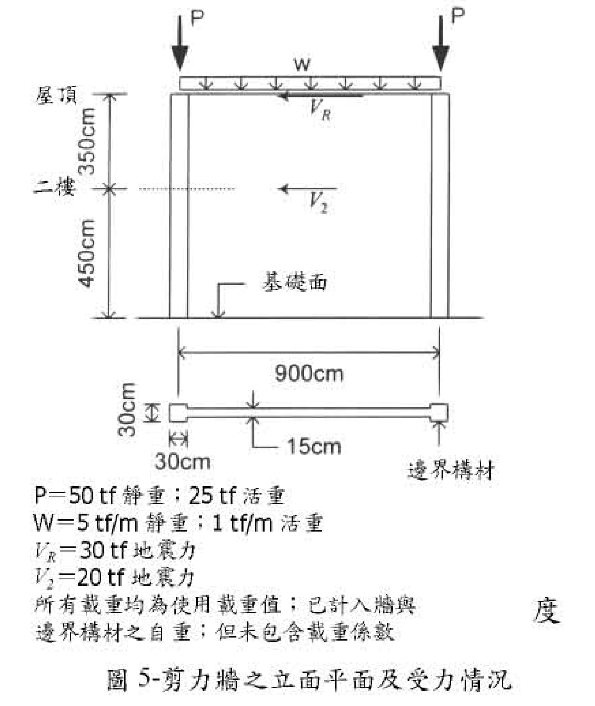

# RC-2003-4 題目正本

> 本檔只記錄**考卷上寫了什麼、圖上畫了什麼**，不含任何解法。解析見同資料夾 `RC-2003-4.md`。
> 判讀清單已經使用者確認（凍結）；本檔原則上不再修改（改動須回考卷原圖並記 log）。

| 項目 | 內容 |
|------|------|
| 考卷 | `raw/exams/RC-2003_鋼筋混凝土設計與預力.pdf` 第 1 頁（掃描影像，正面＋背面同一頁），背面第四題 |
| 考年 | 民國 92 年（2003） |
| 配分 | 40 分 |
| 附圖 | `RC-2003-4-fig-2.png`（圖 5：剪力牆之立面平面及受力情況；2026-11-14 由考卷重新擷取）；既有 `RC-2003-4-fig-1.png` 為同一圖，基礎面附近壓有滑鼠游標，保留不刪 |
| 判讀狀態 | **已確認**（2026-11-14 使用者確認；影響答案項目使用者選擇：#1 900 為邊界構材中心距（l_w＝930）、#4 層高 350＋450、#6 兩端各一 P（50 靜＋25 活）；腹版厚 15、屋頂 w 一併採用；轉錄 2026-11-14；PyMuPDF 110 dpi 全頁目視，附圖 300–400 dpi 局部放大（掃描原生約 96 dpi）；盲讀後才比對既有解析） |

## 1. 考卷原文（逐字）

> 四、有一兩層樓高作耐震用之鋼筋混凝土剪力牆如圖 5 所示，試按民國 92 年 1 月 1 日生效，由營建雜誌社發行之「結構混凝土設計規範」來設計剪力牆之鋼筋配置。（40 分）
> 已知條件：
> ㈠ $f'_c = 280\ kgf/cm^2$，常重混凝土
> ㈡ $f_y = 4{,}200\ kgf/cm^2$
> ㈢ 作用在剪力牆之使用載重如圖 5 所示
> ㈣ 控制設計之載重組合為 $U = 0.9D \pm 1.43E$ 及 $U = 0.75(1.4D + 1.7L \pm 1.87E)$ 兩種
> ㈤ 邊界構材之縱向主筋限用 #8 鋼筋，$d_b = 2.54cm$，$A_b = 5.07cm^2$
> ㈥ 邊界構材之橫向箍筋限用 #4 鋼筋，$d_b = 1.27cm$，$A_b = 1.27cm^2$
> ㈦ 剪力牆之水平暨垂直剪力鋼筋限用 #4 鋼筋，如果規範允許（$V_u \le 0.53\sqrt{f'_c}A_{cv}$），則剪力牆優先採用單層鋼筋網
> ㈧ 剪力牆之剪力設計可採〔掃描缺字〕$\phi = 0.6$ 之值，以求簡便
> 欲求：1. 設計邊界構材之縱向主筋與箍筋之配置；
> 2. 設計剪力牆腹版之水平剪力鋼筋配置，並檢查水平剪力鋼筋在邊界構材內之錨定情況（彎鉤錨定長度 $\lambda_{dh} = 0.06 f_y d_b / \sqrt{f'_c}$）〔照考卷原文，符號印為 λ〕；
> 3. 設計剪力牆腹版之垂直剪力鋼筋配置，並檢查〔掃描缺字〕據以調整之；
> 4. 繪製剪力牆之斷面圖並詳示鋼筋配置之設計結果。

註：㈧與欲求 3. 的行中有字被掃描吃掉；圖 5 右側另有一個孤立的「度」字，應屬缺字的一部分，無法還原。

## 2. 考卷給的公式、附表與參數

- 題文數值：見上；載重組合兩種；剪力 $\phi = 0.6$；單層鋼筋網條件 $V_u \le 0.53\sqrt{f'_c}A_{cv}$；彎鉤錨定長度 $0.06 f_y d_b/\sqrt{f'_c}$。
- 圖 5 載重表（照錄）：`P＝50 tf 靜重；25 tf 活重`、`W＝5 tf/m 靜重；1 tf/m 活重`、`VR＝30 tf 地震力`、`V2＝20 tf 地震力`、`所有載重均為使用載重值；已計入牆與邊界構材之自重；但未包含載重係數`。
- **沒有給**：牆與邊界構材的保護層、邊界構材以外的軸向 $\phi$、牆是否需特殊邊界構材的判定方法（題目直接說有邊界構材）。
- 卷首注意事項：㈠不必抄題，作答時請將試題題號及答案依照順序寫在試卷上，於本試題上作答者，不予計分。㈡可以使用電子計算器，但需詳列解答過程。

## 3. 附圖

圖面文字照錄：`P`、`P`、`w`、`屋頂`、`VR`、`350cm`、`二樓`、`V2`、`450cm`、`基礎面`、`900cm`、`30cm`（邊界構材深）、`30cm`（邊界構材寬）、`15cm`、`邊界構材`、載重表五行（見 §2）、`圖 5-剪力牆之立面平面及受力情況`。

## 4. 判讀清單

「把握」標**不確定**者請優先確認；解讀類項目（題目用字的意思）另標「解讀」。

| # | 項目 | 判讀 | 圖上／題文依據 | 把握 |
|---|------|------|---------------|------|
| 1 | 900 cm 量測基準 | 900 cm 為**兩端邊界構材中心距**；牆全長 $l_w = 900 + 30 = 930$ cm | 平面圖 900cm 尺寸線兩端延伸線分別落在左右邊界構材正中（400 dpi：左邊界構材 x≈388–430、延伸線 x≈408；右邊界構材 x≈990–1028、延伸線 x≈1008）；立面 900 延伸線同樣落在兩根邊界構材柱的中線。圖未依比例（邊界構材畫得偏大），只能看延伸線落點 | 確定（解讀）（影響答案）；使用者確認 |
| 2 | 腹版厚 | $t_w = 15$ cm | 平面圖 `15cm` 兩支箭頭夾腹版上下緣 | 確定 |
| 3 | 邊界構材 | 兩端各一，$30 \times 30$ cm | 平面圖 `30cm`（深）、`30cm`（寬）、`邊界構材` 指示線 | 確定 |
| 4 | 層高 | 屋頂至二樓 **350 cm**、二樓至基礎面 **450 cm**；牆總高 $h_w = 800$ cm | 立面左側兩段尺寸線，`二樓` 標在兩段交點 | 確定（影響答案）；使用者確認 |
| 5 | 地震力 | $V_R = 30$ tf 作用於屋頂（距基礎面 800 cm）、$V_2 = 20$ tf 作用於二樓（450 cm），同向（向左） | 立面箭頭；載重表 | 確定 |
| 6 | 集中載重 P | **兩端各一個** P（作用於邊界構材頂），每個 P＝50 tf 靜重＋25 tf 活重 | 立面兩支 `P` 箭頭各在一端邊界構材上方；載重表 | 確定（解讀）（影響答案）；使用者確認 |
| 7 | 均佈載重 w | 屋頂梁版上全長均佈，$w$＝5 tf/m 靜重＋1 tf/m 活重 | 立面 w 箭頭橫跨兩 P 之間；載重表 | 確定 |
| 8 | 自重 | 載重表聲明已計入牆與邊界構材自重；所有載重為使用載重（未乘係數） | 載重表末兩行 | 確定 |
| 9 | 基礎 | 牆底在「基礎面」，視為固定於基礎 | 立面 `基礎面` 指示線 | 確定（解讀） |
| 10 | 所求 | 1. 邊界構材縱筋與箍筋；2. 腹版水平剪力筋＋其在邊界構材內錨定；3. 腹版垂直剪力筋＋〔缺字〕檢查並調整；4. 斷面配筋圖 | 題文欲求 1–4 | 確定 |
| 11 | 考卷沒有給 | 保護層；欲求 3.「並檢查」的對象（掃描缺字） | 全題 | 確定 |

---

*轉錄：2026-11-14（RC-U3-3 題目正本推廣・批 1）*

*確認：2026-11-14 使用者確認（RC-U3-3 題目正本推廣・批 1，關卡一）*
