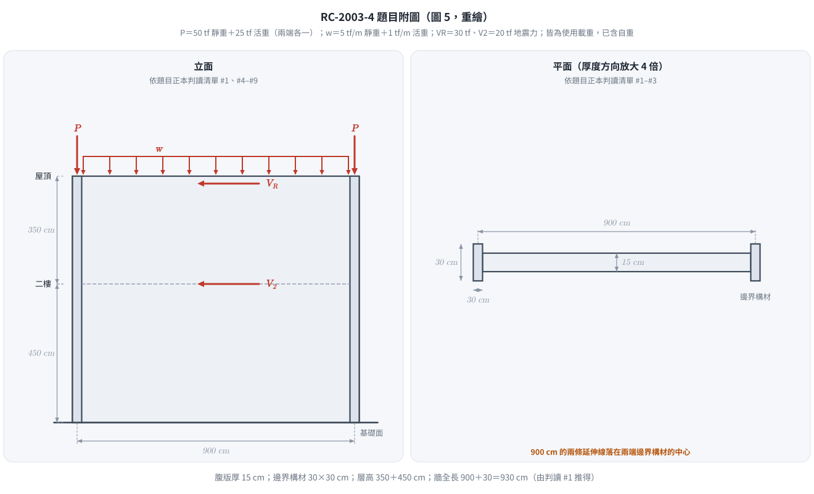
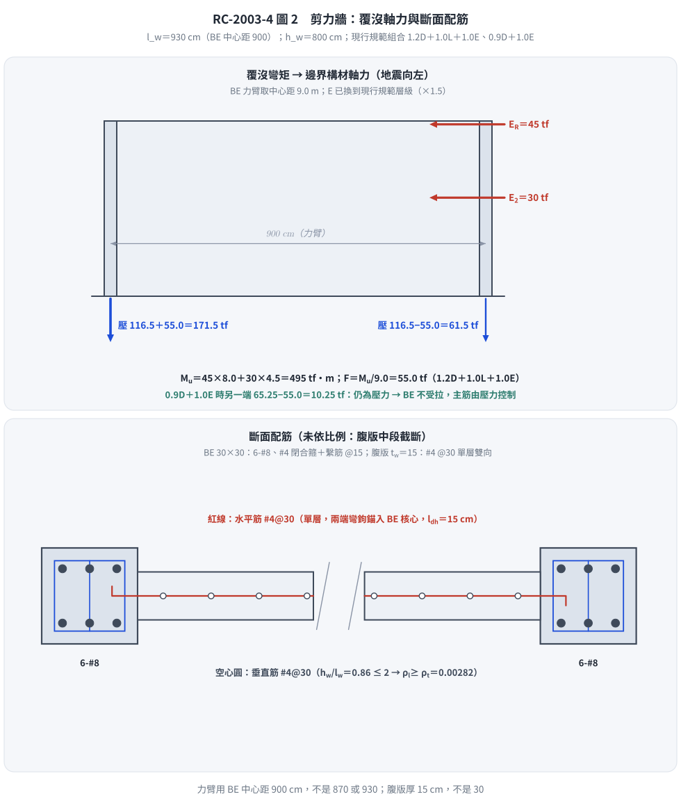

# 考題編號：RC-2003-4

**主分類：** `RC-U3-3` 韌性要求與耐震設計  
**副分類：** `RC-U2-1` RC 剪力強度分析與設計  
**設計法：** USD  
**標籤：** `剪力牆` `邊界構材` `水平剪力筋` `垂直剪力筋` `覆沒力矩` `αc係數` `φ=0.6` `單層配筋` `彎鉤錨定` `兩層樓高` `尺寸鏈判讀` `邊界構材中心距` `腹版厚15` `層高350+450`

---

## 1. 題目（考卷原文見題目正本）

> 考卷原文、公式／附表、附圖與判讀清單（已確認）見 [`RC-2003-4-problem.md`](RC-2003-4-problem.md)。本節只列解題時最容易讀錯的地方與本解使用的記號；題意以題目正本為準。

*重繪自考卷圖 5，依題目正本判讀清單 #1–#8。本圖攔下四個讀錯：腹版厚 15 cm（30 是邊界構材）、上層 350 下層 450、兩端各有一個 P、900 量到邊界構材**中心**。*

### 常見誤讀

| 項目 | 正確判讀 | 常見誤讀 |
|------|---------|---------|
| 腹版厚 | $t_w=15$ cm | 30 cm（把邊界構材尺寸當牆厚；本庫舊解） |
| 層高 | 屋頂–二樓 350、二樓–基礎面 450，$h_w=800$ cm | 每層 450、總高 900（本庫舊解） |
| 900 cm | 兩邊界構材**中心距**（力臂 9.0 m），牆全長 $l_w=930$ cm | 牆全長 900、力臂 870（本庫舊解） |
| 集中載重 P | 兩端**各一個**，每個 50 tf 靜＋25 tf 活 | 合計 50 tf、每端 25 tf，且漏活載（本庫舊解） |
| 均佈載重 w | 屋頂全長 5 tf/m 靜＋1 tf/m 活，要計入 | 忽略（本庫舊解） |
| 用途 | 「作耐震用」 | 「作廚房用」（舊解誤植） |

**本解記號：** 每端邊界構材（BE）承受的使用載重：$D_{BE}$、$L_{BE}$；考卷地震力 $V_R$、$V_2$（使用值）；換算後的現行規範地震力 $E$（$\alpha_y=1.0$ 層級）；$F=M_u/9.0$ 為覆沒彎矩在 BE 引起的軸力；$A_{cv}=t_wl_w$。

**規範（依根目錄 `CLAUDE.md`「規範版本」）：** 一律依現行**建築物混凝土結構設計規範（2023 年版，對應土木 401-112／ACI 318-19 體系）**。考卷印出的舊載重組合 $U=0.9D\pm1.43E$、$U=0.75(1.4D+1.7L\pm1.87E)$、剪力 $\phi=0.6$ 與彎鉤式 $\lambda_{dh}=0.06f_yd_b/\sqrt{f'_c}$ **不照用**，改用現行規範；照考卷式子的結果列於 §5 對照。

| 項目 | 本解採用（現行規範） | 考卷印出（舊規範） |
|------|------------------|----------------|
| 載重組合 | $1.4D$；$1.2D+1.6L$；$1.2D+1.0L+1.0E$；$0.9D+1.0E$ | $0.9D\pm1.43E$；$0.75(1.4D+1.7L\pm1.87E)$ |
| 地震力 E | 考卷值 ×1.5（$\alpha_y$ 1.5 → 1.0）：$V_R=45$、$V_2=30$ tf | $V_R=30$、$V_2=20$ tf |
| 壓力構材 $\phi$ | 0.65（橫箍） | — |
| 剪力 $\phi$ | 0.75（剪力非控制；見 Step 4） | 0.6 |
| 彎鉤伸展長度 | ACI 318-19 式 25.4.3.1 | $0.06f_yd_b/\sqrt{f'_c}$ |

> **地震力讀法（使用者確認，2026-11-14）：** 現行 RC 規範的組合 $1.2D+1.0L+1.0E$ 中，E 為耐震規範設計地震力且起始降伏放大倍數 $\alpha_y$ 取 1.0；考卷給的 30／20 tf 屬舊規範 RC 極限強度設計的層級（$\alpha_y=1.5$，配 1.43／1.87 係數），故換算 $E=1.5\times$ 考卷值。考卷未寫 $\alpha_y$，此為依當年慣例的推論；直接當 E（讀法 A）的結果列於 §5。

---

## 2. 考題核心精神與出題者意圖

**核心觀念：** 耐震剪力牆由三部分組成——邊界構材承擔重力與覆沒彎矩造成的軸力並須圍束，腹版水平筋抵抗剪力且須錨入邊界構材，腹版垂直筋配合水平筋配置。

**出題者測驗：**
1. 讀圖：牆厚、層高、力臂、載重的作用位置
2. 載重組合各自控制什麼（最大壓力、最小壓力或拉力）
3. 邊界構材主筋與箍筋
4. 單層鋼筋網的條件、最小鋼筋比、最大間距
5. 水平筋彎鉤錨定
6. $h_w/l_w\le2$ 時垂直筋比不小於水平筋比

---

## 3. 解題戰略地圖與陷阱分析

**計算步驟：**
1. 幾何：$l_w$、$h_w$、$A_{cv}$、力臂
2. 地震力換到現行規範層級；每端 BE 的使用軸力
3. 現行載重組合下 $V_u$、$M_u$、BE 軸力
4. 特殊邊界構材需求（應力法）→ BE 主筋與箍筋
5. 腹版水平筋：雙層判定 → $\phi$ 判定 → $\phi V_n$、$\rho_{min}$、間距 → 錨定
6. 腹版垂直筋：$\rho_l\ge\rho_t$
7. 斷面配筋圖

**關鍵陷阱：**

| # | 陷阱 | 說明 |
|---|------|------|
| ① | 牆厚讀成 30 | 30×30 是邊界構材；腹版 15 cm |
| ② | 層高讀成 450＋450 | 上層 350，屋頂地震力力臂 8.0 m |
| ③ | 力臂扣兩次 | 900 已經是 BE 中心距 |
| ④ | P 只算一個 | 兩端各一個 P，另有屋頂 w |
| ⑤ | 照抄考卷舊組合 | 現行規範用 $1.2D+1.0L+1.0E$、$0.9D+1.0E$，E 須在 $\alpha_y=1.0$ 層級 |
| ⑥ | 4-#8 看起來夠 | $\phi=0.65$、0.80 上限下 4-#8 只有 153 tf，要 6-#8 |
| ⑦ | 套特殊邊界構材的 $A_{sh}$ | 應力 < $0.2f'_c$，不需特殊邊界構材；改依一般邊界規定（間距 $\le6d_b$、15 cm） |

---

## 3.5 變數層次分析（Variable Hierarchy Analysis）

> 複習提示：第一次解題後，在每個卡住的知識點旁標記 `⚠`；第二次複習時只看有 `⚠` 的項目。

### 最終目標

BE 主筋與箍筋、腹版水平筋（含錨定）、腹版垂直筋、斷面配筋圖。

### 本題關鍵公式（依計算順序）

$$\text{Step 1: } E=1.5\times(V_R,V_2),\quad M_u=E_R\cdot8.0+E_2\cdot4.5,\quad A_{cv}=t_w\,l_w$$

$$\text{Step 2: } P_{BE}=(1.2D_{BE}+1.0L_{BE})\pm\frac{\boxed{M_u}}{9.0},\qquad 0.9D_{BE}-\frac{M_u}{9.0}$$

$$\text{Step 3: } P_{BE,max}\le0.80\phi\left[0.85f'_c(A_g-A_{st})+f_yA_{st}\right],\ \phi=0.65$$

$$\text{Step 4: } \phi V_n=\phi A_{cv}\left(\alpha_c\sqrt{f'_c}+\rho_tf_y\right)\ge V_u,\quad\rho_t\ge0.0025,\ s\le45\text{ cm}$$

$$\text{Step 5: } \rho_l\ge\rho_t\ (h_w/l_w\le2)$$

### L1：題目直接給定

| 符號 | 數值 | 說明 |
|------|------|------|
| $t_w$ | 15 cm | 腹版厚（判讀 #2） |
| BE | 30×30 cm | 兩端（判讀 #3） |
| BE 中心距 | 900 cm | 判讀 #1 → $l_w=930$ |
| 層高 | 350＋450 cm | 判讀 #4 → $h_w=800$ |
| $P$ | 每端 50 tf 靜＋25 tf 活 | 判讀 #6 |
| $w$ | 5 tf/m 靜＋1 tf/m 活 | 判讀 #7 |
| $V_R$、$V_2$ | 30、20 tf（使用值） | 屋頂（800 cm）、二樓（450 cm） |

### L2：需知識點推導

| 符號 | 公式／來源 | 卡關? |
|------|-----------|-------|
| $E_R$、$E_2$ | $1.5\times30=45$、$1.5\times20=30$ tf | |
| $D_{BE}$、$L_{BE}$ | 72.5、29.5 tf | |
| $V_u$、$M_u$ | 75 tf、495 tf·m | |
| $P_{BE}$ | 最大 171.5 tf；最小 10.25 tf（壓，無拉力） | |
| BE 主筋 | 需 $A_{st}\ge29.18$ cm² → 6-#8（30.42 cm²） | |
| BE 箍筋 | #4 閉合箍＋#4 繫筋 @15 cm | |
| $A_{cv}$ | 13,950 cm² | |
| 水平筋 | #4 單層 @30 cm，$\rho_t=0.00282$ | |
| $l_{dh}$ | 15 cm（下限控制）< BE 核心 24.73 cm | |
| 垂直筋 | #4 單層 @30 cm，$\rho_l=0.00282$ | |

### L3：深層知識（不懂就卡住）

| 知識點 | 說明 | 卡關? |
|--------|------|-------|
| E 的層級 | 現行 RC 組合用 1.0E，E 須以 $\alpha_y=1.0$ 計算；舊規範 RC 以 $\alpha_y=1.5$ 配 1.43／1.87 係數 | |
| 特殊邊界構材判定 | 應力法：極端纖維壓應力 $>0.2f'_c$ 才需特殊邊界構材（$h_w/l_w<2$ 不適用位移法） | |
| 剪力 $\phi$ | 0.60 只用於剪力強度低於撓曲強度對應剪力（剪力控制）時；否則 0.75 | |
| 單層網條件 | $V_u\le0.53\sqrt{f'_c}A_{cv}$ 且 $h_w/l_w<2$ 才可單層 | |
| 垂直筋比 | $h_w/l_w\le2$ 時 $\rho_l\ge\rho_t$ | |

---

## 4. 步驟化詳細計算過程

### Step 1　幾何、使用載重與地震力換算

$$l_w=900+30=930\ \text{cm},\qquad h_w=350+450=800\ \text{cm},\qquad \frac{h_w}{l_w}=0.86$$

$$A_{cv}=t_wl_w=15\times930=\boxed{13{,}950\ \text{cm}^2}$$

每端 BE 的使用軸力（P 作用於 BE，w 各分一半；自重已含）：

$$D_{BE}=50+5\times4.5=72.5\ \text{tf},\qquad L_{BE}=25+1\times4.5=29.5\ \text{tf}$$

地震力換到現行規範層級（$\alpha_y$ 1.5 → 1.0）：

$$E_R=1.5\times30=45\ \text{tf},\quad E_2=1.5\times20=30\ \text{tf}$$

$$V_u=45+30=\boxed{75\ \text{tf}},\qquad M_u=45\times8.0+30\times4.5=\boxed{495\ \text{tf·m}}$$

### Step 2　載重組合與 BE 軸力

覆沒軸力 $F=M_u/9.0=495/9.0=55.0$ tf。

| 組合 | 每端 BE 重力軸力 | 加減 $F$ 後 |
|------|----------------|-----------|
| $1.4D$ | 101.5 | — |
| $1.2D+1.6L$ | 134.2 | — |
| $1.2D+1.0L+1.0E$ | 116.5 | **171.5**（最大壓） |
| $0.9D+1.0E$ | 65.25 | **10.25**（最小，仍為壓力） |

→ BE 由壓力控制，**不受拉**。（活載重係數取 1.0；題目未給用途，不採 0.5L 折減。）

### Step 3　邊界構材

**特殊邊界構材需求（應力法）**：全牆斷面 $A=14{,}850$ cm²、$I=1.188\times10^9$ cm⁴，

$$f_c=\frac{2\times116.5\times10^3}{14{,}850}+\frac{495\times10^5\times465}{1.188\times10^9}=35.1\ \text{kgf/cm}^2<0.2f'_c=56$$

→ 不需特殊邊界構材；依一般邊界規定配置。題目已配置 30×30 BE，主筋以「承擔重力＋覆沒軸力的短柱」設計。

**主筋（橫箍，$\phi=0.65$，上限 0.80）：**

$$171{,}500\le0.80\times0.65\left[0.85\times280\times(900-A_{st})+4200A_{st}\right]\ \Rightarrow\ A_{st}\ge29.18\ \text{cm}^2$$

- 4-#8（20.28 cm²）：$\phi P_{n,max}=153.2$ tf < 171.5 ✗
- **6-#8（30.42 cm²）**：$\phi P_{n,max}=\boxed{174.1\ \text{tf}}\ge171.5$ ✓（利用率 0.985），$\rho_g=3.38\%$
- 排列：相對兩面各 3 根，淨距 5.92 cm $\ge1.5d_b$ ✓（保護層 4 cm 為假設）

**橫向鋼筋（一般邊界規定）：** 邊界縱筋比 $3.38\%>2.8/f_y(\text{MPa})=0.67\%$ → 邊界橫向鋼筋須照柱的閉合箍＋繫筋形式配置（$h_x\le35$ cm），間距：

- 臨界範圍 $\max(l_w,\ M_u/4V_u)=\max(930,\ 165)=930$ cm（涵蓋全高 800 cm）內：$s\le\min(6d_b,\ 15)=\min(15.2,\ 15)=\boxed{15\ \text{cm}}$
- （臨界範圍外上限 $\min(8d_b,\ 20)=20$ cm；本題全高皆在臨界範圍內）

$$\therefore\ \text{BE：6-\#8；\#4 閉合箍＋\#4 繫筋（勾住中間主筋）@ 15 cm，全高}$$

### Step 4　腹版水平剪力筋

**單層或雙層：**

$$0.53\sqrt{f'_c}A_{cv}=0.53\times16.733\times13{,}950=123.7\ \text{tf}\ \ge V_u=75\ \text{tf},\quad h_w/l_w=0.86<2\ \Rightarrow\ \text{可單層}$$

**最小鋼筋比：** $V_u=75>0.27\sqrt{f'_c}A_{cv}=63.0$ tf → $\rho_t\ge0.0025$、$s\le45$ cm。

$$s\le\frac{1.27}{0.0025\times15}=33.9\ \text{cm}\ \Rightarrow\ \text{採 \#4 單層 @ 30 cm},\quad\rho_t=0.00282$$

**標稱強度與 $\phi$：**（$h_w/l_w\le1.5$，$\alpha_c=0.80$）

$$V_n=13{,}950\times(0.80\times16.733+0.00282\times4200)=\boxed{352.1\ \text{tf}}\ \le2.12\sqrt{f'_c}A_{cv}=494.9\ \text{tf}$$

撓曲強度對應剪力（BE 6-#8 力臂 9.0 m，計入 $0.9D$ 軸壓，近似）：$M_n\approx1737$ tf·m → $V_{@M_n}=1737\times75/495=263$ tf < $V_n$ → 非剪力控制，$\phi=0.75$。

$$\phi V_n=0.75\times352.1=\boxed{264.1\ \text{tf}}\ \ge V_u=75\ \text{tf}\quad\checkmark$$

（$h_w/l_w\le1.5$，剪力放大係數 $\Omega_v=1.0$，$V_e=V_u$。）

**水平筋錨入 BE**（標準彎鉤，ACI 318-19 式 25.4.3.1 換算；$\psi_e=1.0$，$\psi_r=1.0$（彎鉤筋間距 30 cm $\ge6d_b$），$\psi_o=1.0$（彎鉤止於 BE 核心內），$\psi_c=0.866$）：

$$l_{dh}=\frac{f_y\psi_e\psi_r\psi_o\psi_c}{23\lambda\sqrt{f'_c}}d_b^{1.5}\ (\text{SI})=13.4\ \text{cm}\ \Rightarrow\ \max(13.4,\ 8d_b=10.2,\ 15)=\boxed{15\ \text{cm}}$$

BE 核心內可用長度 $30-4-1.27=24.73$ cm $\ge15$ cm ✓；水平筋以標準彎鉤勾住 BE 遠側主筋。

### Step 5　腹版垂直剪力筋

$h_w/l_w=0.86\le2.0$ → $\rho_l\ge\rho_t=0.00282$ → **#4 單層 @ 30 cm** ✓。

**並檢查、據以調整：**
- BE 主筋：4-#8 不足 → 調整為 6-#8（Step 3）
- BE 箍筋：不需特殊邊界構材的 $A_{sh}$，由間距 $\le15$ cm 控制
- 腹版筋：$\rho_{min}$ 控制，@30 cm 滿足 $\le45$ cm 與 $\phi V_n\ge V_u$

### Step 6　設計結果與斷面配筋圖

| 構件 | 設計結果 |
|------|---------|
| 邊界構材主筋 | 6-#8（每端，相對兩面各 3 根），$\rho_g=3.38\%$ |
| 邊界構材箍筋 | #4 閉合箍＋#4 繫筋 @ 15 cm，全高 |
| 腹版水平筋 | #4 單層 @ 30 cm，$\rho_t=0.00282$，兩端標準彎鉤錨入 BE 核心（$l_{dh}=15$ cm） |
| 腹版垂直筋 | #4 單層 @ 30 cm，$\rho_l=0.00282$ |

*圖 2　剪力牆覆沒軸力與斷面配筋。力臂取 BE 中心距 900 cm、腹版厚 15 cm；本圖攔下「力臂取 870 或 930」「BE 被當成受拉」「腹版厚讀成 30」與「垂直筋少於水平筋」。*

---

## 5. 關鍵爭議點與進階探討

**1. 地震力層級的兩種讀法**（主線 B，使用者確認）

| 量 | A：考卷值直接當 E（30／20） | **B：×1.5 換到 $\alpha_y=1.0$（45／30）** | 照考卷舊組合（參考） |
|----|--------------------------|----------------------------------|----------------|
| $V_u$ | 50.0 tf | **75.0 tf** | 71.5 tf |
| $M_u$ | 330 tf·m | **495 tf·m** | 471.9 tf·m |
| BE 最大壓力 | 153.2 tf | **171.5 tf** | 165.2 tf |
| BE 最小軸力 | 28.6 tf 壓 | **10.25 tf 壓** | 12.8 tf 壓 |
| BE 主筋（$\phi$ 0.65） | 4-#8 的 $\phi P_{n,max}$＝153.2 tf 與需求幾乎相等，取 6-#8 | **6-#8** | 6-#8 |

B 與考卷原意（舊組合的地震需求）只差約 5%；A 的剪力需求少三成。兩種讀法配筋結果相同。

**2. 照考卷印出的舊式子會怎樣**

- 舊組合下 BE 最大壓力 165.2 tf、$V_u=71.5$ tf，與主線相近。
- 考卷 $\phi=0.6$：$\phi V_n=211.3$ tf，仍遠大於需求；腹版配筋不變。
- 考卷彎鉤式 $0.06f_yd_b/\sqrt{f'_c}=19.1$ cm，比現行式（15 cm）長，同樣 < 24.73 cm。
- 舊規範的邊界構材以柱的 $A_{sh}$ 圍束（#4 箍＋繫筋 @7.5 cm）；現行規範在不需特殊邊界構材時改由間距控制（@15 cm）。

**3. 為什麼腹版筋由最小量控制**

矮牆（$h_w/l_w<1.5$）混凝土貢獻大，$\phi V_c=0.75\times13{,}950\times0.80\times16.733=140$ tf 已大於 $V_u$；配筋由 $\rho_{min}=0.0025$ 與間距上限決定。

**4. 規範條文核對**

本解的條文對應 ACI 318-19（土木 401-112 體系）：載重組合、特殊邊界構材應力法（$0.2f'_c$）、一般邊界橫向鋼筋（縱筋比 $>2.8/f_y$ 時間距 $\le6d_b$、15 cm）、剪力 $\phi$、$\alpha_c$、單層網條件、彎鉤伸展長度（SI 式換算為 cm）。作答時請以「建築物混凝土結構設計規範」2023 年版條文編號引用。

---

*修正日期：2026-11-14（§1 改為指向題目正本；重繪題目附圖 figs/RC-2003-4-fig-1-problem.svg）*

*修正日期：2026-11-14（題意（判讀）勘誤，整題重解：腹版厚 30 → 15 cm、層高 450＋450 → 350＋450、P 為兩端各 50 靜＋25 活並計入屋頂 w、900 為邊界構材中心距（l_w＝930）（題目正本 #1–#7，使用者確認）；BE 最大壓力 84.5 → 165.16 tf、BE 由受拉改為只受壓、BE 主筋 4-#8 → 6-#8、腹版筋 #4@15 → #4@30、壓力構材 φ 改 0.70；驗證：verify_RC-2003-4.py 重算 37 值 MISMATCHES: 0，BE 主筋以反解 A_st 與代回 φPn 兩路徑一致）*

*修正日期：2026-11-14（改依現行台灣規範（建築物混凝土結構設計規範 2023 年版）：考卷舊載重組合、φ＝0.6、彎鉤式改用現行規範；地震力依讀法 B（×1.5 換到 αy＝1.0，使用者確認）→ V_u 75 tf、M_u 495 tf·m、BE 最大壓力 171.5 tf；BE 主筋 6-#8（φ 0.65，φPn 174.1 tf）；BE 箍筋改依一般邊界規定 @15 cm；腹版 #4@30 不變、φ 0.75、l_dh 15 cm；驗證：verify_RC-2003-4_v2.py 重算 38 值 MISMATCHES: 0）*

*修正日期：2026-11-14（圖解補繪：圖 2 覆沒軸力與斷面配筋（取代 Step 6 文字示意圖）；向量圖，腳本 `gen_RC-2003-4.py` 可重跑）*
