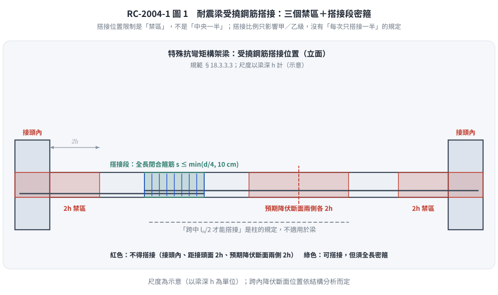

# 考題編號：RC-2004-1

**主分類：** `RC-U3-3` 韌性要求與耐震設計
**副分類：** `RC-U2-3` 鋼筋錨定長度與斷點計算
**設計法：** 概念題
**標籤：** `混凝土品質判定` `圓柱試體` `統計驗收` `耐震搭接` `受撓搭接` `橫向鋼筋間距` `Class B搭接` `ACI規範` `鑽心試驗` `搭接禁區2h` `現行台灣規範`

---

## 1. 題目（考卷原文見題目正本）

> 考卷原文、公式／附表、附圖與判讀清單（已確認）見 [`RC-2004-1-problem.md`](RC-2004-1-problem.md)。本節只列解題時最容易讀錯的地方與本解使用的記號；題意以題目正本為準。

### 常見誤讀

| 項目 | 正確判讀 | 常見誤讀 |
|------|---------|---------|
| 題型 | 兩小題皆為簡答說明 | 當成計算題去用鋼筋資料 |
| ㈡範圍 | 耐震構件受撓鋼筋搭接：搭接範圍內橫向鋼筋（形式、間距）＋搭接位置限制 | 只答搭接長度 |
| ㈡搭接位置 | 梁：接頭內、距接頭面 $2h$、距預期降伏斷面 $2h$ 不得搭接 | 「須在跨中 1/2」（那是柱的規定；本庫舊解） |
| ㈡搭接比例 | 規範無「同一斷面搭接 ≤ 1/2」之限制 | 「每次只搭接一半」（本庫舊解） |
| ㈠取樣頻率 | 每日、每 120 m³、每 450 m² 三者皆須滿足 | 只寫每 100 m³ 一組（本庫舊解） |
| 「資料」 | 全卷共用資料（鋼筋表、$E_c$、$f_r$），本題用不到 | 以為本題要算 |

**本解記號：** $d$＝梁有效深度；$s$＝橫向鋼筋間距；$d_b$＝縱筋直徑。

---

## 2. 考題核心精神與出題者意圖

**（一）** 考驗混凝土強度的**驗收程序**：取樣頻率 → 一次「強度試驗」的定義 → 統計合格準則 → 不合格時的鑽心評估。重點是「用連續三次平均＋單次下限」的統計判定，而不是「每支試體都 ≥ $f'_c$」。

**（二）** 考驗特殊抗彎矩構架**梁**受撓鋼筋搭接的三件事：搭接範圍內須配閉合箍筋（螺箍）、該箍筋的間距上限、以及**不得搭接的位置**（接頭內與可能塑鉸區）。

---

## 3. 解題戰略地圖與陷阱分析

**關鍵陷阱：**
- ⚠ **（一）** 不要只說「試體強度 ≥ $f'_c$」；也不要漏掉取樣頻率的三個「至少」（每日、每 120 m³、每 450 m²）與鑽心的 0.85／0.75 準則
- ⚠ **（二）** 梁的搭接位置規定是**排除區**（接頭內、距接頭面 $2h$、距預期降伏斷面 $2h$），**不是**「須在跨中 1/2」——後者是**柱**縱筋搭接的規定（§18.4.4.3），不可混用
- ⚠ **（二）** 規範沒有「梁同一斷面搭接筋不得超過 1/2」的規定；搭接比例只影響甲／乙級搭接的判定（§25.5.2）

---

## 3.5 變數層次分析 (Variable Hierarchy Analysis)

### 最終目標
（一）說明混凝土強度驗收（取樣、試驗、合格準則、不合格處置）；（二）說明耐震梁受撓鋼筋搭接的橫向鋼筋與位置規定。

### L1：規範直接規定（不需推導）

| 項目 | 規定（建築物混凝土結構設計規範 112 年版） | 條號 |
|------|------|------|
| 取樣頻率 | 每日至少一次；每 120 m³ 至少一次；每 450 m² 樓版或牆面積至少一次 | 26.12.2.1(a) |
| 最少試驗數 | 不足 5 次時至少取 5 個隨機批次（少於 5 批則每批取樣）；總量 < 40 m³ 經核可得免試驗 | 26.12.2.1(b)(c) |
| 一次強度試驗 | 同批標準養護試體之平均：15×30 cm 至少 2 支或 10×20 cm 至少 3 支，28 天或指定齡期 | 26.12.1.1(a) |
| 合格準則 | 任連續三次平均 ≥ $f'_c$；單次不低於 $f'_c-35$（$f'_c \le 350$）或 $f'_c-0.1f'_c$（$f'_c>350$） kgf/cm² | 26.12.3.1(a) |
| 鑽心評估 | 每一疑慮區取 3 個鑽心；平均 ≥ $0.85f'_c$ 且單一 ≥ $0.75f'_c$ 即認為結構適當 | 26.12.6.1 |
| 梁搭接箍筋 | 搭接範圍配閉合箍筋或螺箍筋；間距 ≤ $d/4$ 且 ≤ 10 cm | 18.3.3.3 |
| 梁不得搭接處 | 接頭內；距接頭面 $2h$ 內；距預期撓曲降伏斷面 $2h$ 內 | 18.3.3.3 |

### L3：深層知識

| 知識點 | 說明 | 卡關? |
|--------|------|------|
| 為何統計驗收 | 混凝土強度本有變異；三次平均控制整體水準，單次下限攔下偶發低強度批次 | |
| 為何梁端 $2h$ 不得搭接 | 塑鉸區反覆降伏，保護層剝落後搭接會滑脫，失去彎矩強度與韌性 | |
| 為何搭接區要密箍 | 箍筋提供圍束，抵抗搭接處的劈裂，確保反覆載重下仍能傳力 | |

---

## 4. 詳細解答

> 依現行**建築物混凝土結構設計規範（內政部 112 年版，2023；對應 ACI 318-19）**作答。舊版（ACI 318-99 體系）差異見 §5。

### 甲：混凝土品質判定（8 分）

**1. 取樣頻率（§26.12.2.1）**——每一配比的強度試驗取樣，下列三者都要滿足：
- 每天至少一次；
- 每澆置 120 m³ 至少一次；
- 每 450 m² 樓版或牆面積至少一次。

同一配比整個工程的強度試驗少於 5 次時，至少從 5 個隨機選取的批次取樣（批次少於 5 則每批都取）；總量少於 40 m³ 且提出足夠證據經核可者，可免強度試驗。取樣時一併做坍度、溫度（必要時含氣量、單位重）試驗。

**2. 一次「強度試驗」的定義（§26.12.1.1）**：同一取樣、依 CNS 1231 製作並標準養護的試體平均值——$\phi15\times30$ cm 至少 2 支，或 $\phi10\times20$ cm 至少 3 支，於 28 天或指定齡期試驗。

**3. 合格準則（§26.12.3.1，兩條件同時滿足）：**

$$\text{任連續三次強度試驗之平均} \ \ge\ f'_c$$

$$\text{單次強度試驗} \ \ge\ \begin{cases} f'_c - 35\ \text{kgf/cm}^2 & f'_c \le 350\ \text{kgf/cm}^2 \\ f'_c - 0.10f'_c & f'_c > 350\ \text{kgf/cm}^2 \end{cases}$$

**4. 不合格時（§26.12.6）**：查明原因並評估結構安全。單次試驗低於上列下限時，在該疑慮區鑽取 **3 個**鑽心試體；
$$\bar f_{core} \ge 0.85f'_c \quad\text{且}\quad f_{core,i} \ge 0.75f'_c$$
即認為結構適當；仍不符合者，可依第 27 章做強度評估（分析或載重試驗），必要時補強或拆除。

**5. 現場養護試體（§26.5.3.2(e)）**：用於判斷保護與養護是否足夠——現場養護試體強度 ≥ 同齡期標準養護試體的 85%，或超過 $f'_c$ 35 kgf/cm² 以上，即視為養護適當。

---

### 乙：耐震受撓鋼筋搭接之橫向鋼筋規定（7 分）

依 §18.3.3.3（特殊抗彎矩構架之梁）：

**（1）搭接範圍須配閉合箍筋或螺箍筋**：只有在整段搭接長度內配置閉合箍筋或螺箍筋時，才允許竹節縱向鋼筋搭接。

**（2）搭接範圍橫向鋼筋間距：**

$$s \le \min\!\left(\frac{d}{4},\ 10\ \text{cm}\right)$$

$d$＝梁有效深度。箍筋量另須滿足該處剪力設計。

**（3）不得搭接的位置**（三處）：
- (a) 梁柱接頭內；
- (b) 距接頭面 $2h$ 範圍內；
- (c) 依結構分析預期會發生撓曲降伏的斷面兩側各 $2h$ 範圍內。

**（4）搭接長度**：依 §25.5.2 拉力搭接（甲級 $1.0l_d$／乙級 $1.3l_d$，視搭接比例與鋼筋量餘裕而定）。

**（5）續接器**：機械式續接依其類別限制位置（第 1 類不得位於距接頭面 $2h$ 內；第 2 類可用於任何位置）；銲接續接不得位於距接頭面 $2h$ 內。

**記憶要訣：** 梁搭接——**全段密箍**（$\le d/4$、$\le 10$ cm）＋**三個禁區**（接頭內、接頭面 $2h$、塑鉸 $2h$）。「中央一半」是**柱**的規定。

*圖 1　耐震梁受撓鋼筋搭接：三個禁區＋搭接段密箍（示意，以梁深 $h$ 為單位）。本圖攔下「把柱的中段 1/2 規定套到梁」與「漏掉跨內預期降伏斷面的 $2h$ 禁區」。*

---

## 5. 關鍵爭議點與進階探討

**① 三組平均 vs 任一組的物理意義**

「連續三次平均 ≥ $f'_c$」確保整體強度符合，「單次不低於 $f'_c-35$」則防止偶發的過低批次危及結構安全。兩個條件缺一不可，體現了統計驗收的雙重保護機制。

**② 為何搭接不設在梁端塑鉸區**

特殊抗彎矩構架的梁端是**潛在塑鉸**位置，反覆降伏後保護層剝落，搭接會失去握裹而滑脫。因此規範把搭接排除在接頭面與預期降伏斷面兩側 $2h$ 之外，並要求搭接段全長密箍。注意規範並未要求梁搭接「必須在跨中 1/2」——只要避開三個禁區、配足密箍即可。

**③ 與舊版（ACI 318-99 體系，民國 93 年考試時）的差異**

| 項目 | 舊版 | 現行（112 年版） |
|------|------|------|
| 取樣頻率 | 每日、每約 115 m³（150 yd³）、每約 465 m²（5000 ft²） | 每日、每 120 m³、每 450 m² |
| 合格準則 | 三次平均 ≥ $f'_c$；單次 ≥ $f'_c-35$ | 同（$f'_c>350$ 另以 $0.1f'_c$ 計） |
| 鑽心 | 平均 ≥ $0.85f'_c$、單一 ≥ $0.75f'_c$ | 同 |
| 梁搭接箍筋與禁區 | 間距 ≤ $d/4$、≤ 10 cm；禁區同 | 同（條號改為 18.3.3.3） |

本題兩小題的答案在新舊版之間沒有實質差異，只有取樣數量的換算值不同。

*修正日期：2026-11-14（§1 改為指向題目正本）*

*修正日期：2026-11-14（解析勘誤並改依現行台灣規範（建築物混凝土結構設計規範 112 年版）：㈡梁搭接位置由「須在跨中 1/2」改為三個禁區（接頭內、距接頭面 2h、距預期降伏斷面 2h；§18.3.3.3），刪除不存在的「同一斷面搭接 ≤ 1/2」規定與錯誤單位的 A_v,min 式；㈠取樣頻率由「每 100 m³、每班次」改為每日／每 120 m³／每 450 m²（§26.12.2.1），補最少試驗數、強度試驗定義、鑽心 0.85／0.75 準則與現場養護試體；驗證：逐條對照內政部 112 年版規範原文（nlma.gov.tw a1120815.pdf §18.3.3.3、§26.12）；來源：盲解比對-RC-U3-3-批1-2026-11-14）*

*修正日期：2026-11-14（圖解補繪：圖 1 梁搭接禁區；向量圖，腳本 `gen_RC-2004-1.py` 可重跑）*
