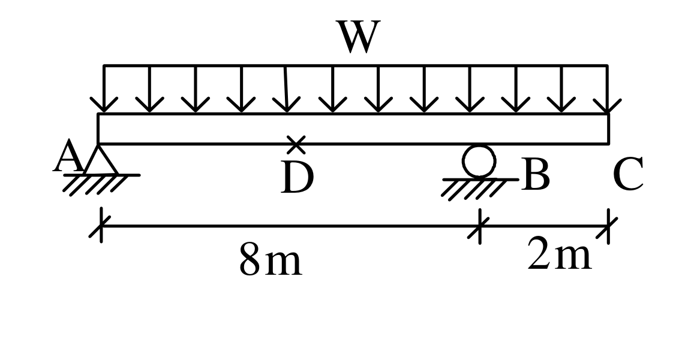

# RC-2004-2 題目正本

> 本檔只記錄**考卷上寫了什麼、圖上畫了什麼**，不含任何解法。解析見同資料夾 `RC-2004-2.md`。
> 判讀清單已經使用者確認（凍結）；本檔原則上不再修改（改動須回考卷原圖並記 log）。

| 項目 | 內容 |
|------|------|
| 考卷 | `raw/exams/RC-2004_鋼筋混凝土設計與預力.pdf` 第 1 頁（全一張之正面），第二題 |
| 考年 | 民國 93 年（2004） |
| 配分 | 25 分 |
| 附圖 | `RC-2004-2-fig-2.png`（梁支承與載重圖，500 dpi 重新擷取）；舊證據圖 `RC-2004-2-fig-1.png` 在 A 端尺寸線旁壓有滑鼠游標，保留不刪 |
| 判讀狀態 | **已確認**（2026-11-12 使用者確認；轉錄 2026-11-12，PyMuPDF 110 dpi 全頁目視＋抽出文字核對，附圖 500 dpi；D 點位置以 PDF 向量座標量測；盲讀後才比對既有解析） |

## 1. 考卷原文（逐字）

> 二、梁結構如圖所示，其尺寸為寬 40cm，高 70cm，有效深度為 d=60cm，d'=6.5cm，假若除了梁本身自重外，此梁另外承受均佈呆載重 $W_D$=5 t/m 及均佈活載重 $W_L$=2 t/m，試計算梁中央 D 點所需之縱向鋼筋量為何？並配置之。（25 分）
> 假設所用縱向鋼筋皆是 D32，箍筋為 D13，$f'_c = 280\ \text{kgf/cm}^2$，$f_y = 4200\ \text{kgf/cm}^2$。

## 2. 考卷給的公式、附表與參數

- 題文數值：$b=40$ cm、$h=70$ cm、$d=60$ cm、$d'=6.5$ cm；$W_D=5$ t/m、$W_L=2$ t/m（另加梁自重）；縱筋 D32、箍筋 D13；$f'_c=280$、$f_y=4200$ kgf/cm²。
- 第一題下方列有「資料：」（版面位於第一題簡答題之後、第二題之前，未註明只適用第一題）：
  - 鋼筋 D10，$a_b$=0.71cm²，D=9.5mm
  - 鋼筋 D13，$a_b$=1.29cm²，D=12.7mm
  - 鋼筋 D19，$a_b$=2.84cm²，D=19.1mm
  - 鋼筋 D25，$a_b$=5.10cm²，D=25.4mm
  - 鋼筋 D32，$a_b$=8.19cm²，D=32.3mm
  - $E_c = 15000\sqrt{f'_c}$，$f_r = 2.0\sqrt{f'_c}$
- **沒有給**：載重因數（載重組合）、混凝土單位重、強度折減係數 $\phi$、保護層厚度、粒料尺寸、設計規範版本。
- 卷首注意事項：㈠不必抄題；㈡可以使用電子計算器。

## 3. 附圖

圖面文字照錄：`W`、`A`、`D`、`B`、`C`、`8m`、`2m`。

## 4. 判讀清單

「把握」標**不確定**者請優先確認；解讀類項目（題目用字的意思）另標「解讀」。

| # | 項目 | 判讀 | 圖上／題文依據 | 把握 |
|---|------|------|---------------|------|
| 1 | 支承 A | 鉸支承（固定鉸） | 三角形＋地面剖線 | 確定 |
| 2 | 支承 B | 滾支承 | 圓圈＋地面剖線 | 確定 |
| 3 | C 端 | 自由端，BC 為懸臂外伸段 | C 點無支承符號 | 確定 |
| 4 | 跨度 | AB＝8 m（簡支跨）、BC＝2 m（外伸） | 尺寸線 8m、2m；刻度分別對齊 A、B、C | 確定 |
| 5 | 載重範圍 | 均佈載重 W 作用於 A 到 C **全長 10 m**（含外伸段） | 載重箭頭由 A 正上方畫到 C 正上方 | 確定 |
| 6 | W 的內容 | W＝自重＋$W_D$（5 t/m）＋$W_L$（2 t/m），題文未區分活載重是否部分跨佈置 | 題文；圖上只有一個全長 W | 確定（解讀） |
| 7 | D 點位置 | **AB 跨中央**，距 A 4 m（不是全梁 10 m 的中點 5 m） | 題文「梁中央 D 點」；PDF 向量座標：A 刻度 x=299.2、B 滾支承圓心 x=393.7、D「×」中心 x=345.9 → 距 A ≈ 3.96 m | 確定（解讀） |
| 8 | 斷面 | 矩形，$b=40$、$h=70$、$d=60$、$d'=6.5$ cm（$d'$ 為壓力筋形心深度，暗示可配壓力筋） | 題文；本題無斷面圖 | 確定 |
| 9 | 所求 | D 點所需縱向鋼筋量並配置（使用 D32，箍筋 D13） | 題文 | 確定 |
| 10 | 考卷沒有給 | 載重因數、混凝土單位重（算自重用）、$\phi$、保護層，皆須考生依規範假設 | 全題 | 確定 |

---

*轉錄：2026-11-12（RC-U1-1 題目正本推廣・批 1）*

*確認：2026-11-12 使用者確認（RC-U1-1 題目正本推廣・批 1，關卡一）*
