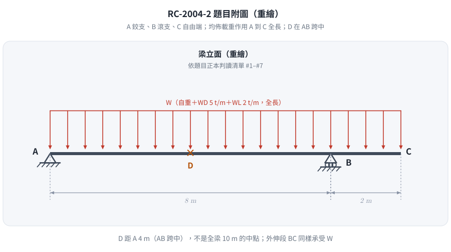
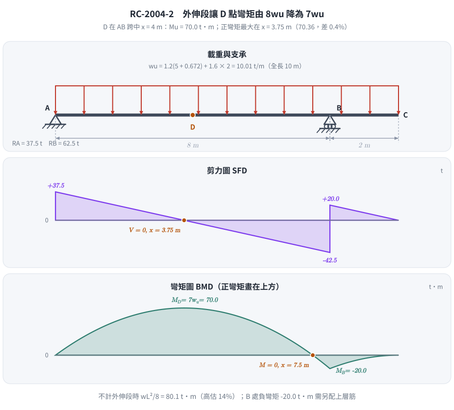

# 考題編號：RC-2004-2

**主分類：** `RC-U1-1` RC 梁彎矩強度分析與設計
**副分類：** 無
**設計法：** USD 強度設計法
**標籤：** `外伸梁` `懸臂梁` `D點跨中彎矩` `單筋梁` `Whitney應力塊` `D32鋼筋` `單排配筋` `拉力控制` `1.2D+1.6L`

---

## 1. 題目（考卷原文見題目正本）

> 考卷原文、公式／附表、附圖與判讀清單（已確認）見 [`RC-2004-2-problem.md`](RC-2004-2-problem.md)。本節只列解題時最容易讀錯的地方與本解使用的記號；題意以題目正本為準。

*重繪自考卷附圖，依題目正本判讀清單 #1–#7；B 是滾支承，D 在 AB 跨中（距 A 4 m），載重涵蓋外伸段。*

### 常見誤讀

| 項目 | 正確判讀 | 常見誤讀 |
|------|---------|---------|
| 支承 | A 鉸支、B **滾支**、C 自由端（判讀 #1–#3） | 把 B 也讀成鉸支承（本解 2026-11-12 前圖說即如此；對垂直載重反力不變） |
| D 點 | AB 跨中，距 A 4 m（判讀 #7） | 取全梁 10 m 的中點 5 m |
| 載重範圍 | W 作用 A 到 C 全長，含外伸段（判讀 #5） | 只放在 AB 跨 |
| 考卷沒給 | 載重因數、混凝土單位重、$\phi$、保護層（判讀 #10）；本解依現行規範取 $1.2D+1.6L$、2.4 t/m³ | 當成題目條件 |
| 載重組合 | 依現行建築物混凝土結構設計規範（2023）取 $1.2D+1.6L$（只有 D、L 時與 $1.4D$ 取大） | 沿用考卷年份的 $1.4D+1.7L$（本解 2026-11-15 前即如此：$M_u$ 79.4、6-D32 兩排） |

**本解記號：** $b=40$、$h=70$、$d=60$、$d'=6.5$ cm；$w_D=5$、$w_L=2$ t/m，$w_{SW}$＝梁自重；$W_u$＝因數化均佈載重；$M_u^D$＝D 點因數化彎矩。

---

## 2. 考題核心精神與出題者意圖

**核心觀念：** 外伸梁的力學分析（反力計算 → D 點彎矩）+ USD 單筋梁設計 + D32 鋼筋排列。

**測驗重點：**
1. 正確求出外伸段對簡支段的反力影響（外伸使 B 支承力增大，A 支承力減小）
2. 判斷是否需要雙筋（本題 $M_u < \phi M_{n,\max}$ → 單筋即可）
3. D32 鋼筋排列：$b=40$ cm 單排最多 5 根
4. 配筋後驗核 $\varepsilon_t$ 與 $\phi$（拉力控制或過渡區）

---

## 3. 解題戰略地圖與陷阱分析

**作戰計畫：**
1. 計算梁自重 $w_{SW}$，依現行載重組合求 $W_u$（只有 D、L：$1.4D$ 與 $1.2D+1.6L$ 取大）
2. 由靜力求 $R_A$、$R_B$（ΣMa = 0）
3. 求 D 點（$x = 4\ \text{m}$）因數化彎矩 $M_u$
4. 計算 $\phi M_{n,\max}$（$\varepsilon_t=0.005$ 單筋上限）確認不需雙筋
5. 設計 $A_s$，選用 D32 鋼筋根數並檢查排列
6. 驗核 $\varepsilon_t$、$\phi M_n \ge M_u$ 與最小鋼筋量

**關鍵陷阱（4 個）：**
- ⚠ **載重組合用現行規範**：考卷沒給載重因數，依現行建築物混凝土結構設計規範（2023）取 $1.2D+1.6L$；舊版 $1.4D+1.7L$ 會把 $M_u$ 高估 13%，並把配筋推到 6 根兩排（見 §5 ①）
- ⚠ **外伸改變反力**：$R_A = 3.75W_u$（≠ $W_u L/2 = 4W_u$），外伸段使 A 端反力減小
- ⚠ **加入 $w_{SW}$ 後再因數化**：梁自重屬靜載重，須先加入再乘 1.2
- ⚠ **D32 排列限制**：單排最多 5 根（$b = 40\ \text{cm}$），本題 5 根剛好排得下

---

## 3.5 變數層次分析 (Variable Hierarchy Analysis)

### 最終目標
求 D 點所需縱向鋼筋量，並完成鋼筋配置。

### 本題關鍵公式（依計算順序）

$$\text{Step 1: } W_u = \max\left[1.4(w_D + w_{SW}),\ 1.2(w_D + w_{SW}) + 1.6\,w_L\right]$$

$$\text{Step 2: } R_B = \frac{W_u \times 10 \times 5}{8},\quad R_A = 10W_u - R_B$$

$$\text{Step 3: } M_u^D = R_A \times 4 - W_u \times \frac{4^2}{2}$$

$$\text{Step 4: } R_n = \frac{M_u}{\phi \cdot b \cdot d^2},\quad \rho = \frac{0.85f'_c}{f_y}\left[1-\sqrt{1-\frac{2R_n}{0.85f'_c}}\right]$$

$$\text{Step 5: } A_s = \rho \cdot b \cdot d \quad\Rightarrow\quad \text{選用 D32 根數}$$

$$\text{Step 6: } a = \frac{A_s f_y}{0.85f'_c b},\quad \varepsilon_t = 0.003\frac{d-c}{c},\quad \phi M_n \ge M_u\ ?$$

### L1：題目直接給定

| 符號 | 數值 | 說明 |
|------|------|------|
| $b,h,d$ | $40,70,60\ \text{cm}$ | 梁斷面 |
| $w_D$（不含自重）| $5\ \text{t/m}$ | 均布靜載重 |
| $w_L$ | $2\ \text{t/m}$ | 均布活載重 |
| $L_{AB}$ | $8\ \text{m}$ | 簡支段 |
| $L_{BC}$ | $2\ \text{m}$ | 外伸段 |

### L2：需知識點推導

| 符號 | 公式／來源 | 卡關? |
|------|------|------|
| $w_{SW}$ | $0.40 \times 0.70 \times 2.4\ \text{t/m}^3 = 0.672\ \text{t/m}$ | |
| $W_u$ | $1.2(5.672) + 1.6(2) = 10.01\ \text{t/m}$（> $1.4D$ = 7.94） | |
| $R_A, R_B$ | 靜力計算 | |
| $M_u^D$ | $7W_u = 70.0\ \text{t·m}$ | |
| $\phi M_{n,\max}$ | 以 $\varepsilon_t = 0.005$ 計算上限 | |
| $A_s$ | 需求 35.52 cm² vs 5-D32 提供 40.95 cm² | |
| $\varepsilon_t$ | 依 $c$ 計算（拉力控制判斷；本庫 SD420 取 0.005）| |
| $A_{s,\min}$ | $\max(0.8\sqrt{f'_c},\,14)\,b_wd/f_y$ | |

---

## 4. 步驟化詳細計算過程

### ① 梁自重與因數化載重

$$w_{SW} = b \times h \times \gamma = 0.40 \times 0.70 \times 2400 = 672\ \text{kg/m} = 0.672\ \text{t/m}$$

只有靜載重與活載重，現行規範兩個組合取大：

$$1.4(w_D + w_{SW}) = 1.4 \times 5.672 = 7.94\ \text{t/m}$$

$$W_u = 1.2(w_D + w_{SW}) + 1.6\,w_L = 1.2(5 + 0.672) + 1.6 \times 2 = 6.806 + 3.200 = 10.01\ \text{t/m} \quad\text{（控制）}$$

---

### ② 支承反力（均布載重 $W_u$ 作用於全長 10 m）

$$\sum M_A = 0:\quad R_B \times 8 = W_u \times 10 \times 5 \Rightarrow R_B = \frac{50 \times 10.006}{8} = 62.54\ \text{t}$$

$$R_A = 10.006 \times 10 - 62.54 = 37.52\ \text{t}$$

---

### ③ D 點因數化彎矩（$x = 4\ \text{m}$ 自 A）

$$M_u^D = R_A \times 4 - W_u \times \frac{4^2}{2} = 37.52 \times 4 - 10.006 \times 8 = 150.10 - 80.05 = \boxed{70.0\ \text{t·m}}$$

*圖 2　外伸段的載重把 A 端反力壓到 $3.75w_u$，D 點彎矩只剩 $7w_u$。這張圖攔下三個錯：照無外伸簡支梁取 $w_uL^2/8 = 8w_u$（高估 14%）、把 D 取在全梁中點 5 m，以及忽略 B 支承處需要上層筋的負彎矩。*

---

### ④ 檢核是否需要雙筋（以 $\varepsilon_t = 0.005$ 計算 $\phi M_{n,\max}$）

$\varepsilon_t = 0.005$ 時的中性軸深度：
$$c_{0.005} = \frac{0.003}{0.003+0.005} \times d = \frac{0.003}{0.008} \times 60 = 22.5\ \text{cm}$$
$$a_{0.005} = \beta_1 c = 0.85 \times 22.5 = 19.13\ \text{cm}$$
$$A_{s,0.005} = \frac{0.85 f'_c \cdot b \cdot a}{f_y} = \frac{9520 \times 19.125}{4200} = 43.35\ \text{cm}^2$$

$$\phi M_{n,\max} = 0.9 \times 43.35 \times 4200 \times \left(60 - \frac{19.13}{2}\right) = 0.9 \times 182{,}070 \times 50.44 = 82.6\ \text{t·m}$$

**結論：** $M_u = 70.0\ \text{t·m} < \phi M_{n,\max} = 82.6\ \text{t·m}$ → **單筋梁即可，$\phi = 0.9$**

---

### ⑤ 設計 $A_s$（$\phi = 0.9$）

$$R_n = \frac{M_u}{\phi \cdot b \cdot d^2} = \frac{70.04 \times 10^5}{0.9 \times 40 \times 60^2} = \frac{7{,}004{,}000}{129{,}600} = 54.05\ \text{kgf/cm}^2$$

$$\rho = \frac{0.85 f'_c}{f_y}\left[1 - \sqrt{1 - \frac{2R_n}{0.85f'_c}}\right] = \frac{0.85 \times 280}{4200}\left[1 - \sqrt{1 - \frac{2 \times 54.05}{238}}\right]$$

$$= 0.05667 \times \left[1 - \sqrt{1 - 0.4542}\right] = 0.05667 \times \left[1 - \sqrt{0.5458}\right] = 0.05667 \times 0.2612 = 0.01480$$

$$A_{s,\text{req}} = \rho \cdot b \cdot d = 0.01480 \times 40 \times 60 = 35.52\ \text{cm}^2$$

**最小鋼筋量驗核（現行規範取兩式大者）：**
$$A_{s,\min} = \max\!\left(\frac{0.8\sqrt{f'_c}}{f_y},\ \frac{14}{f_y}\right) b_w d = \max(7.65,\ 8.00) = 8.00\ \text{cm}^2 \ll 35.52\ \text{cm}^2\ \checkmark$$

---

### ⑥ 選用鋼筋（D32，$a_b = 8.19\ \text{cm}^2$）

$$n_{\min} = \frac{35.52}{8.19} = 4.34 \Rightarrow \text{需 5 根 D32}$$

> 4 根驗核：$A_s = 32.76\ \text{cm}^2$，$a = 14.45\ \text{cm}$，$\phi M_n = 0.9 \times 72.61 = 65.4\ \text{t·m} < 70.0\ \text{t·m}$（不足）

**使用 5-D32：** $A_s = 5 \times 8.19 = 40.95\ \text{cm}^2$

---

### ⑦ 驗核 $\phi M_n$（5 根 D32）

$$a = \frac{40.95 \times 4200}{0.85 \times 280 \times 40} = \frac{171{,}990}{9{,}520} = 18.07\ \text{cm}$$

$$c = \frac{a}{\beta_1} = \frac{18.07}{0.85} = 21.25\ \text{cm}$$

$$\varepsilon_t = 0.003 \times \frac{d-c}{c} = 0.003 \times \frac{60-21.25}{21.25} = 0.00547 \ge 0.005 \quad\Rightarrow\quad \text{拉力控制，}\phi = 0.9$$

（也滿足非預力梁 $\varepsilon_t \ge 0.004$ 的下限。）

$$\phi M_n = 0.9 \times 40.95 \times 4200 \times \left(60 - \frac{18.07}{2}\right) = 0.9 \times 171{,}990 \times 50.97 = 7{,}889{,}000\ \text{kgf·cm} = \boxed{78.9\ \text{t·m}}$$

$$\phi M_n = 78.9\ \text{t·m} \ge M_u = 70.0\ \text{t·m} \quad \checkmark$$

---

### ⑧ 鋼筋配置

**排列驗核（$b = 40\ \text{cm}$，D32 + D13 箍筋，保護層 4 cm）：**

鋼筋可用寬度 $40 - 2(4 + 1.27) = 29.46\ \text{cm}$；5 根 D32 時淨距

$$s_{\text{clear}} = \frac{29.46 - 5 \times 3.23}{4} = 3.33\ \text{cm} \ge \max(d_b,\ 2.5) = 3.23\ \text{cm}\ \checkmark$$

→ **5 根 D32 可排單排**（6 根以上才需兩排）

單排鋼筋形心距梁底 $4 + 1.27 + 1.615 = 6.885\ \text{cm}$，實際 $d = 63.1\ \text{cm}$ > 題給 $d = 60\ \text{cm}$；本解照題給 $d = 60$ 計算（偏保守）。

**最終配置：底部拉力筋 5-D32（單排）**

---

## 5. 關鍵爭議點與進階探討

**① 載重組合：現行 $1.2D+1.6L$ vs 舊版 $1.4D+1.7L$（考卷年份 93 年的規範）**

考卷沒給載重因數。本解依現行建築物混凝土結構設計規範（2023）取 $1.2D+1.6L$；勘誤前的舊解用 93 年當時規範的 $1.4D+1.7L$，對照如下：

| 項目 | 現行 $1.2D+1.6L$（主線） | 舊版 $1.4D+1.7L$（對照） |
|------|------|------|
| $W_u$ | 10.01 t/m | 11.34 t/m |
| $R_A$／$R_B$ | 37.52／62.54 t | 42.53／70.88 t |
| $M_u^D$ | **70.0 t·m** | 79.4 t·m |
| $M_B$（負彎矩） | −20.0 t·m | −22.7 t·m |
| $A_{s,\text{req}}$（$\phi=0.9$） | 35.52 cm² | 41.26 cm² |
| 配筋 | **5-D32 單排**（40.95 cm²） | 6-D32 兩排 3＋3（49.14 cm²；5 根 $\phi M_n$ 78.9 < 79.4 不足） |
| $\varepsilon_t$、$\phi$ | 0.00547 → 0.90 | 0.00406 → 過渡區 0.820 |
| $\phi M_n$ | 78.9 t·m | 83.2 t·m |

舊解在過渡區用 $\phi = 0.65 + (\varepsilon_t - 0.002)\times 0.25/0.003 = 0.822$（$\phi M_n$ 83.4 t·m）；現行規範壓力控制界限為 $\varepsilon_{ty} = f_y/E_s = 0.002059$，本庫 SD420 拉力控制界限取 0.005，內插得 $0.820$、$\phi M_n = 83.2\ \text{t·m}$。兩套載重組合的 $W_u$ 差 13%，剛好跨過「5 根夠不夠」的門檻，所以配筋從 6 根兩排變成 5 根單排。

**② D 點正確為 A-B 跨中（非 A-C 之中）**

題目圖示 A-D-B-C 排列，D 在 A 與 B 之間，確認 $x_D = 4\ \text{m}$ 自 A。若誤將 D 取在 A-C 全長中點（$x = 5\ \text{m}$），所求彎矩將不同。

**③ 外伸使 A 端反力「縮水」**

若無外伸、只有 8 m 簡支跨，$R_A = 4W_u$；本題全長載重下 $R_A = 3.75W_u$。D 點正彎矩因此由 $wL^2/8 = 8W_u$ 降至 $7W_u$（照 $8W_u$ 算會高估 14%），考生容易忽略外伸段的影響。

**④ 最小鋼筋量與 $\varepsilon_t$ 下限**

現行規範 $A_{s,\min}$ 取 $0.8\sqrt{f'_c}/f_y$ 與 $14/f_y$ 兩式大者；$f'_c = 280$ 時 $14/f_y$ 控制（8.00 cm²）。舊解只寫 $14/f_y$，本題數值相同。非預力梁另須 $\varepsilon_t \ge 0.004$，5-D32 的 0.00547 已達拉力控制。

*修正日期：2026-11-12（§1 改為指向題目正本，重繪題目附圖 figs/RC-2004-2-fig-1-problem.svg；刪除「A、B 為鉸支承」誤述）*

*圖解補繪：2026-11-13（圖 2 載重／剪力／彎矩圖；向量圖，腳本 `gen_RC-2004-2.py`，可重跑，檔尾對 §4 公佈值 assert；非勘誤）*

*修正日期：2026-11-15（改依現行台灣規範（建築物混凝土結構設計規範 2023）：載重組合 1.4D＋1.7L → 1.2D＋1.6L，$W_u$ 11.34 → 10.01 t/m、$M_u^D$ 79.4 → 70.0 t·m、$A_{s,req}$ 41.3 → 35.52 cm²，配筋 6-D32 兩排 → **5-D32 單排**（$\varepsilon_t$ 0.00547 拉力控制、$\phi M_n$ 78.9 t·m）；$A_{s,\min}$ 補 $0.8\sqrt{f'_c}$ 式；舊組合結果降 §5 ① 對照（過渡區 $\phi$ 改依 $\varepsilon_{ty}$ 起點）；圖 2 重跑。驗證：`.work/cand1/check_RC-2004-2.py` 獨立重算 MISMATCHES: 0，D 點彎矩以剪力積分交叉驗算）*
