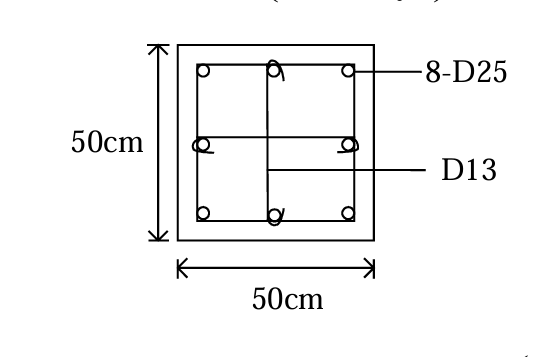

# RC-2004-3 題目正本

> 本檔只記錄**考卷上寫了什麼、圖上畫了什麼**，不含任何解法。解析見同資料夾 `RC-2004-3.md`。
> 判讀清單已經使用者確認（凍結）；本檔原則上不再修改（改動須回考卷原圖並記 log）。

| 項目 | 內容 |
|------|------|
| 考卷 | `raw/exams/RC-2004_鋼筋混凝土設計與預力.pdf` 第 1 頁（正面），第三題 |
| 考年 | 民國 93 年（2004） |
| 配分 | 15 分 |
| 附圖 | `RC-2004-3-fig-1.png`（柱斷面，無圖號） |
| 判讀狀態 | **已確認**（2026-11-14 使用者確認；轉錄 2026-11-14；PyMuPDF 110 dpi 全頁目視＋抽出文字核對，附圖 500 dpi 放大並以 PDF 向量座標核對；盲讀後才比對既有解析） |

## 1. 考卷原文（逐字）

> 三、柱之橫向鋼筋若為矩形閉合箍筋，則需滿足耐震特別規定中之下列公式，試問如圖所示之柱斷面橫向鋼筋之間距該如何才能滿足規範要求。（15 分）

## 2. 考卷給的公式、附表與參數

- 考卷印出兩式（照錄）：

$$A_{sh} = 0.3\left(s \cdot h_c \cdot \frac{f'_c}{f_{yh}}\right)\left(\frac{A_g}{A_{ch}} - 1\right)$$

$$A_{sh} = 0.09\left(s \cdot h_c \cdot \frac{f'_c}{f_{yh}}\right)$$

- 圖旁參數（照錄）：$f'_c = 280\ kgf/cm^2$；箍筋及繫筋 D13 $f_y = 2800\ kgf/cm^2$；主筋 D25 $f_y = 4200\ kgf/cm^2$。
- 全卷「資料」（印在第一題後）：D13 $a_b = 1.29\ cm^2$、D = 12.7 mm；D25 $a_b = 5.10\ cm^2$、D = 25.4 mm（另有 D10、D19、D32 與 $E_c$、$f_r$）。
- **沒有給**：保護層、$h_c$ 與 $A_{ch}$ 的量測基準、柱高或柱淨高、柱軸力、規範版本（兩式以外的間距上限式未印）。
- 卷首注意事項：㈠不必抄題，作答時請將試題題號及答案依照順序寫在試卷上，於本試題上作答者，不予計分。㈡可以使用電子計算器。

## 3. 附圖

圖面文字照錄：`50cm`（左，垂直）、`50cm`（下，水平）、`8-D25`、`D13`。

## 4. 判讀清單

「把握」標**不確定**者請優先確認；解讀類項目（題目用字的意思）另標「解讀」。

| # | 項目 | 判讀 | 圖上／題文依據 | 把握 |
|---|------|------|---------------|------|
| 1 | 柱斷面 | $50 \times 50$ cm 方形 | 兩條外緣尺寸線（PDF 向量：外框 x = 180.1–255.4、y = 831.1–906.2，75.3 pt＝50 cm） | 確定 |
| 2 | 主筋 | 8-D25：四角 4 根、四邊中點 4 根 | 圖上 8 個圓；引線 `8-D25` | 確定 |
| 3 | 橫向鋼筋 | 外圍矩形閉合箍筋 1 圈＋水平繫筋 1 支＋垂直繫筋 1 支，皆 D13；每一方向有 3 支腳（箍筋 2＋繫筋 1） | 箍筋矩形線（PDF 向量 x = 187.6–247.8、y = 838.7–898.7）；兩支繫筋分別勾住中點主筋，兩端畫彎鉤；引線 `D13` | 確定 |
| 4 | 保護層 | 沒有給；箍筋線距外緣在圖上約 7.5 pt（≈5 cm），但圖未標尺寸，屬示意不可量 | PDF 向量：外框與箍筋線相距 7.5 pt | 確定（考卷沒有給，作答須自行假設） |
| 5 | 材料 | $f'_c = 280$；箍筋及繫筋 $f_{yh} = 2800$；主筋 $f_y = 4200$ kgf/cm² | 圖旁參數 | 確定 |
| 6 | 所求 | 依兩式（及規範其他規定）求橫向鋼筋間距 $s$ 須滿足的條件（上限值） | 題文 | 確定（解讀） |
| 7 | 考卷沒有給 | 保護層、$h_c$／$A_{ch}$ 量測基準、柱淨高（$l_o$ 區範圍）、軸力 | 全題 | 確定 |

---

*轉錄：2026-11-14（RC-U3-3 題目正本推廣・批 1）*

*確認：2026-11-14 使用者確認（RC-U3-3 題目正本推廣・批 1，關卡一）*
