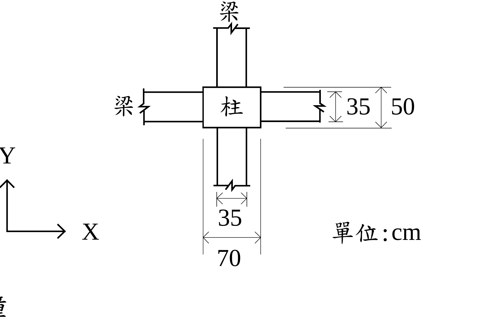

# RC-2004-4 題目正本

> 本檔只記錄**考卷上寫了什麼、圖上畫了什麼**，不含任何解法。解析見同資料夾 `RC-2004-4.md`。
> 判讀清單已經確認（凍結）；本檔原則上不再修改（改動須回考卷原圖並記 log）。

| 項目 | 內容 |
|------|------|
| 考卷 | `raw/exams/RC-2004_鋼筋混凝土設計與預力.pdf` 第 2 頁（背面），第四題 |
| 考年 | 民國 93 年（2004） |
| 配分 | 25 分 |
| 附圖 | `RC-2004-4-fig-2.png`（梁柱平面示意；2026-11-15 由考卷重新擷取 500 dpi）；既有 `RC-2004-4-fig-1.png` 為同一圖，右上空白處有滑鼠游標，保留不刪 |
| 判讀狀態 | **已確認**（2026-11-15 使用者授權依 Claude 建議確認；轉錄 2026-11-15；PyMuPDF 110 dpi 全頁目視，附圖 400–450 dpi 局部放大；文字以 PDF 文字層核對（公式以影像為準）；尺寸線端點以 PDF 向量座標量測；盲讀後才比對既有解析） |

## 1. 考卷原文（逐字）

> 四、建築物壹樓高度 600cm，壹樓中有一根柱尺寸為 50cm×70cm，所連接貳樓梁均為 35cm×70cm。已知條件為:
>
> ㈠呆載重時，軸力 $P_D$＝200t，
> 　頂部 X 軸彎矩 $M_{DX,頂}$＝8t-m，Y 軸彎矩 $M_{DY,頂}$＝10t-m，
> 　底部 X 軸彎矩 $M_{DX,底}$＝-12t-m，Y 軸彎矩 $M_{DY,底}$＝-10t-m。
>
> ㈡活載重時，軸力 $P_L$＝100t，
> 　頂部 X 軸彎矩 $M_{LX,頂}$＝9t-m，Y 軸彎矩 $M_{LY,頂}$＝12t-m，
> 　底部 X 軸彎矩 $M_{LX,底}$＝-8t-m，Y 軸彎矩 $M_{LY,底}$＝-6t-m。
>
> 若僅考量此兩種載重，試問此柱頂部所對應的設計值 $P_u$、$M_{ux}$ 及 $M_{uy}$ 為何？（25 分）
>
> 提示：⑴ $f'_c$＝280 kgf/cm²，$f_y$＝4200 kgf/cm²。⑵ $k\ell_u/r=34-12M_1/M_2$。⑶ $C_m=0.6+0.4M_1/M_2$。⑷ $EI=\dfrac{0.4E_cI_g}{1+\beta_d}$。⑸ $\delta_{ns}=\dfrac{C_m}{1-\dfrac{P_u}{\phi_kP_c}}$。⑹ 彎矩正號代表順時鐘，負號代表逆時鐘

## 2. 考卷給的公式、附表與參數

- 題文數值：壹樓高度 600 cm；柱 50 cm×70 cm；貳樓梁 35 cm×70 cm；D、L 兩種載重下的軸力與柱頂、柱底 X 軸／Y 軸彎矩（見 §1）。
- 提示公式（照錄，⑵ 考卷寫等號）：$k\ell_u/r=34-12M_1/M_2$；$C_m=0.6+0.4M_1/M_2$；$EI=0.4E_cI_g/(1+\beta_d)$；$\delta_{ns}=C_m/(1-P_u/\phi_kP_c)$；彎矩正號順時鐘、負號逆時鐘。
- 同卷第二題「資料」列有 $E_c=15000\sqrt{f'_c}$、$f_r=2.0\sqrt{f'_c}$ 與鋼筋 D10–D32 資料（不在第四題題內）。
- **沒有給**：有效長度因數 $k$、側移或無側移（提示公式為無側移式）、$\phi_k$ 值、載重組合與載重因數、$\beta_d$ 定義、柱配筋、上下樓層資料、梁跨度。
- 卷首注意事項：不必抄題，作答時請將試題題號及答案依照順序寫在試卷上，於本試題上作答者，不予計分。可以使用電子計算器。

## 3. 附圖

圖面文字照錄：`梁`、`梁`、`柱`、`35`、`50`、`35`、`70`、`Y`、`X`、`單位:cm`。

## 4. 判讀清單

「把握」標**不確定**者優先列；解讀類項目（題目用字的意思）另標「解讀」。標「依 Claude 建議確認」者，為使用者 2026-11-15 授權「要我確認的請依你建議」後定案。

| # | 項目 | 判讀 | 圖上／題文依據 | 把握 |
|---|------|------|---------------|------|
| 1 | 柱斷面方向 | **X 向 70 cm、Y 向 50 cm**（題文「50cm×70cm」沒有指明方向，以附圖為準） | PDF 向量座標：柱外框 x 寬 31.4 pt、y 高 22.1 pt，比值 1.42≈70/50；下方「70」尺寸延伸線對齊柱左右邊，右側「50」延伸線對齊柱上下邊 | 確定（影響答案）；依 Claude 建議確認 |
| 2 | X 軸／Y 軸彎矩 | **「X 軸彎矩」＝繞 X 軸的彎矩**（$M_{ux}$），彎曲面為 Y–Z 平面、斷面深度取 Y 向 50 cm；「Y 軸彎矩」繞 Y 軸、深度取 X 向 70 cm | 題文「頂部 X 軸彎矩」「設計值 $M_{ux}$ 及 $M_{uy}$」；下標慣例 | 不確定（影響答案）；依 Claude 建議確認 |
| 3 | 單／雙曲率 | 正號＝順時鐘、負號＝逆時鐘；兩方向皆為柱頂正（順時鐘）、柱底負（逆時鐘）→ 兩端彎矩轉向相反 → **單曲率**（D、L 兩種載重皆然） | 提示⑹；題給頂、底彎矩正負號。端彎矩轉向相反為單曲率、相同為雙曲率 | 確定（解讀）；依 Claude 建議確認 |
| 4 | 柱淨長 $\ell_u$ | 樓層高 600 cm 扣貳樓梁深 70 cm＝**530 cm**（壹樓高度視為樓板面至樓板面；柱底基礎面無梁扣減） | 題文「壹樓高度 600cm」「貳樓梁均為 35cm×70cm」 | 不確定（影響答案）；依 Claude 建議確認 |
| 5 | 側移 | 無側移（提示⑵⑶⑸為無側移構架式） | 提示公式 | 確定（解讀） |
| 6 | 有效長度因數 $k$ | 考卷沒有給；無側移取 $k$＝1.0（保守），須明列 | 全題（梁跨度未給，無法用列線圖） | 確定（解讀）；依 Claude 建議確認 |
| 7 | 所求「柱頂部所對應的設計值」 | 柱頂斷面的 $P_u$、$M_{ux}$、$M_{uy}$；若需細長柱放大，依現行規範處理放大後彎矩所在位置 | 題文 | 確定（解讀） |
| 8 | 梁 | 貳樓梁 35 cm 寬 × 70 cm 深，四面各一支，中心線對齊柱中心 | 附圖：梁寬 16 pt≈35；X 向梁中心 y＝456.1 與柱中心 456.6 重合 | 確定 |
| 9 | 載重組合 | 考卷沒有給；依現行規範（題目印出的提示式亦依現行規範換用） | 題文「若僅考量此兩種載重」 | 確定 |
| 10 | 考卷沒有給 | $k$、$\phi_k$、$\beta_d$ 定義、載重因數、柱配筋、上層資料 | 全題 | 確定 |

---

*轉錄：2026-11-15（RC-U3-3 批 2＋U1-3＋U2-3 題目正本推廣）*

*確認：2026-11-15 使用者授權依 Claude 建議確認（RC-U3-3 批 2＋U1-3＋U2-3 題目正本推廣，關卡一）*
