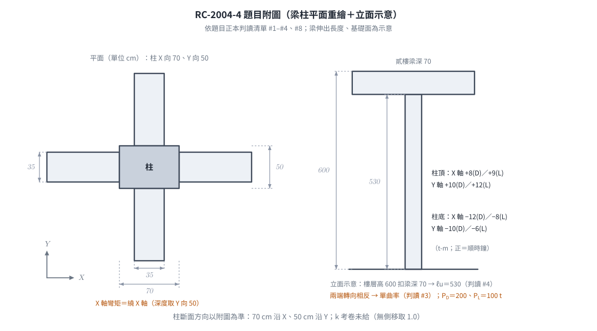
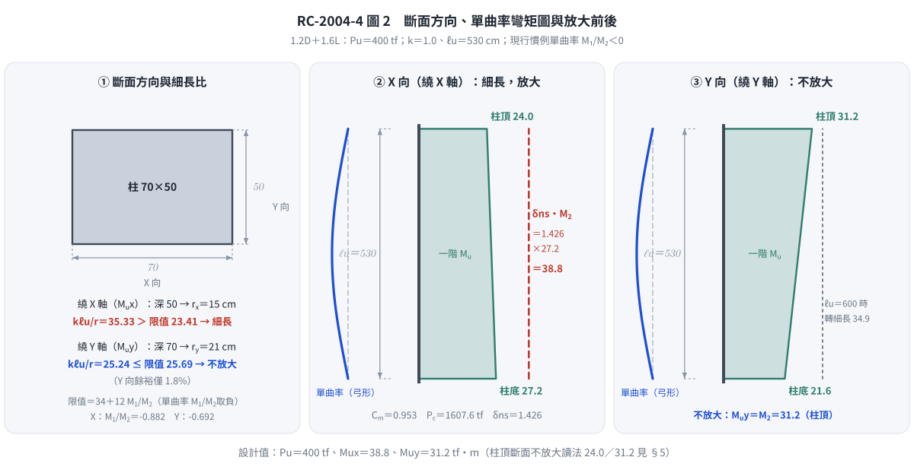

# 考題編號：RC-2004-4

**主分類：** `RC-U1-3` 細長柱
**副分類：** `RC-U1-2` RC 柱強度分析與設計
**設計法：** USD 強度設計法
**標籤：** `雙軸彎矩` `細長柱` `彎矩放大法` `δns放大係數` `無側移構架` `載重組合` `單曲度` `M1M2比值` `迴轉半徑`

---

## 1. 題目（考卷原文見題目正本）

> 考卷原文、公式／附表、附圖與判讀清單（已確認）見 [`RC-2004-4-problem.md`](RC-2004-4-problem.md)。本節只列解題時最容易讀錯的地方與本解使用的記號；題意以題目正本為準。

*重繪自考卷附圖，依題目正本判讀清單 #1–#4、#8。本圖攔下的讀錯：柱 70 cm 讀成 Y 向；單曲率讀成雙曲率；$\ell_u$ 用層高 600 cm。*

### 常見誤讀

| 項目 | 正確判讀 | 常見誤讀 |
|------|---------|---------|
| 柱斷面方向 | X 向 70、Y 向 50 cm（以附圖為準） | X 向 50、Y 向 70（本庫舊解） |
| X 軸彎矩 | 繞 X 軸，深度取 Y 向 50 cm（$r$＝0.3×50＝15） | 深度取 70 cm |
| 曲率 | 頂正（順時鐘）、底負（逆時鐘）→ 轉向相反 → **單曲率**；現行慣例 $M_1/M_2$ 為**負** | 兩端反號即雙曲率（本庫舊解） |
| $\ell_u$ | 600－70＝530 cm | 層高 600 cm（本庫舊解） |
| $k$、載重組合 | 考卷沒有給：無側移取 $k$＝1.0；載重組合依現行規範 1.2D＋1.6L | 1.4D＋1.7L（舊規範，本庫舊解） |
| 提示式 | 考卷印的是舊式（$34-12M_1/M_2$、$C_m=0.6+0.4M_1/M_2$）；現行式 $34+12M_1/M_2\le40$、$C_m=0.6-0.4M_1/M_2$（單曲率 $M_1/M_2$ 為負，兩套數值相同） | 現行慣例的負號代入舊式 |
| 「柱頂部所對應的設計值」 | 細長方向的設計彎矩為全柱的 $M_c=\delta_{ns}M_2$（含柱頂），本解主線取此值；只取柱頂斷面一階彎矩者見 §5 | 一律取柱頂一階彎矩、不放大 |

**本解記號：** 柱 $b_x$＝70、$b_y$＝50 cm；$\ell_u$＝530 cm；$k$＝1.0（假設）；$P_D$＝200、$P_L$＝100 tf；彎矩見題目正本 §1（正＝順時鐘）。$M_{ux}$＝繞 X 軸（深 50），$M_{uy}$＝繞 Y 軸（深 70）。規範：建築物混凝土結構設計規範（2023 年版，ACI 318-19 世代）5.3、6.2.5、6.6.4。

---

## 2. 考題核心精神與出題者意圖

**核心觀念：** 強度設計載重組合＋無側移細長柱判斷，判斷各方向是否需要 $\delta_{ns}$ 彎矩放大，並求放大後設計值。

**測驗重點：**
1. 依現行規範做 $1.2D + 1.6L$ 組合（軸力與頂、底各方向彎矩）
2. 依附圖確定各方向的斷面深度，求 $r$ 與 $k\ell_u/r$（$\ell_u$ 扣梁深）
3. 依提示⑹的正負號判斷曲率（轉向相反＝單曲率）→ $M_1/M_2$ 的正負號
4. 與 $34+12(M_1/M_2)\le40$ 比較；細長方向求 $\beta_{dns}$、$EI$、$P_c$、$C_m$、$\delta_{ns}$

**典型陷阱（3 個）：**
- ⚠ **曲率判斷**：「正＝順時鐘」是端彎矩轉向；頂順、底逆＝**單曲率**（不是看數字正負號相反就是雙曲率）
- ⚠ **$r$ 的方向**：$M_{ux}$（繞 X 軸）用 Y 向深度 50 cm → $r_x$＝15 cm；$M_{uy}$ 用 X 向 70 cm → $r_y$＝21 cm
- ⚠ **Y 向貼邊界**：$k\ell_u/r_y$＝25.24 vs 限值 25.69，僅差 1.8%

---

## 3. 解題戰略地圖與陷阱分析

**作戰計畫：**
1. $U = 1.2D + 1.6L$：求 $P_u$ 與頂、底各方向因數化彎矩
2. 判斷曲率（單曲率）→ $M_1/M_2$ 取負
3. 計算 $r_x$＝0.3×50、$r_y$＝0.3×70
4. 取 $k = 1.0$，$\ell_u = 530$ cm，計算 $k\ell_u/r$
5. 與 $34 + 12(M_1/M_2)\le40$ 比較，決定是否放大
6. 細長方向：$\beta_{dns}$、$EI$、$P_c$、$C_m$、$\delta_{ns}$、$M_{2,\min}$、$M_c$

---

## 3.5 變數層次分析 (Variable Hierarchy Analysis)

### 最終目標
求柱頂部的設計值 $P_u$（tf）、$M_{ux}$（tf·m）、$M_{uy}$（tf·m），包含細長柱效應。

### 本題關鍵公式

$$P_u = 1.2P_D + 1.6P_L,\qquad M_u = 1.2M_D + 1.6M_L$$

$$r_x = 0.3\times50,\quad r_y = 0.3\times70$$

$$\text{可忽略細長效應：} \frac{k\ell_u}{r} \le 34 + 12\left(\frac{M_1}{M_2}\right) \le 40\quad(\text{單曲率 } M_1/M_2<0)$$

$$EI=\frac{0.4E_cI_g}{1+\beta_{dns}},\quad P_c=\frac{\pi^2EI}{(k\ell_u)^2},\quad C_m=0.6-0.4\frac{M_1}{M_2},\quad \delta_{ns}=\frac{C_m}{1-P_u/(0.75P_c)}\ge1.0$$

$$M_c=\delta_{ns}\max(M_2,\ M_{2,\min}),\quad M_{2,\min}=P_u(1.5+0.03h)$$

### L1：題目直接給定

| 符號 | 數值 |
|------|------|
| 樓層高 | 600 cm |
| 柱 | X 向 70 × Y 向 50 cm（附圖）|
| 梁 | 35 × 70 cm（貳樓）|
| $P_D,P_L$ | 200 tf, 100 tf |
| $f'_c$、$f_y$ | 280、4200 kgf/cm² |
| 各端彎矩 | 見題目正本 §1 |

### L2：需知識點推導

| 符號 | 公式／來源 | 卡關? |
|------|------|------|
| $\ell_u$ | $600-70=530$ cm | |
| $P_u$ | $1.2(200)+1.6(100) = 400$ tf | |
| $M_{ux,\text{頂}}$ | $1.2(8)+1.6(9) = 24.0$ tf·m（順） | |
| $M_{ux,\text{底}}$ | $1.2(12)+1.6(8) = 27.2$ tf·m（逆） | |
| $M_{uy,\text{頂}}$ | $1.2(10)+1.6(12) = 31.2$ tf·m（順） | |
| $M_{uy,\text{底}}$ | $1.2(10)+1.6(6) = 21.6$ tf·m（逆） | |
| $r_x$、$r_y$ | $0.3\times50=15$、$0.3\times70=21$ cm | |
| $k\ell_u/r_x$、限值 | $530/15=35.33$；$34+12(-0.882)=23.41$ → 細長 | |
| $k\ell_u/r_y$、限值 | $530/21=25.24$；$34+12(-0.692)=25.69$ → 可忽略 | |
| $\beta_{dns}$ | $1.2P_D/P_u=240/400=0.6$ | |
| $P_{c,x}$ | 1607.6 tf | |
| $C_{m,x}$、$\delta_{ns,x}$ | 0.953、1.426 | |

### L3：深層知識（不懂就卡住）

| 知識點 | 說明 | 卡關? |
|--------|------|------|
| 單曲率 vs 雙曲率 | 端彎矩轉向相反（一順一逆）＝單曲率（弓形），柱中段二階效應最大；轉向相同＝雙曲率（S 形） | |
| 現行符號慣例 | ACI 318-19 世代：單曲率 $M_1/M_2$ 為負、雙曲率為正；式子 $34+12M_1/M_2$、$0.6-0.4M_1/M_2$ | |
| $\beta_{dns}$ | 現行規範：最大因數化**持續軸力**／同組合最大因數化軸力（舊版以彎矩比定義） | |
| $r$ 方向對應 | 繞 X 軸彎曲時斷面深度是 Y 向尺寸；矩形可取 $r=0.3h$ | |

---

## 4. 步驟化詳細計算過程

### ① 因數化設計載重（$U = 1.2D + 1.6L$，現行規範 5.3）

$$P_u = 1.2 \times 200 + 1.6 \times 100 = 240 + 160 = \boxed{400\ \text{tf}}$$

**各端彎矩（大小；轉向依提示⑹）：**

| 位置 | $M_{ux}$（繞 X 軸） | $M_{uy}$（繞 Y 軸） |
|------|:---:|:---:|
| 頂部 | $1.2(8)+1.6(9) = \mathbf{24.0}$ tf·m（順） | $1.2(10)+1.6(12) = \mathbf{31.2}$ tf·m（順） |
| 底部 | $1.2(12)+1.6(8) = \mathbf{27.2}$ tf·m（逆） | $1.2(10)+1.6(6) = \mathbf{21.6}$ tf·m（逆） |

> 頂部順時鐘、底部逆時鐘 → 兩端轉向相反 → **單曲率**（兩方向、D 與 L 皆然）

---

### ② $M_2$ 與 $M_1/M_2$（現行慣例：單曲率為負）

| 方向 | $M_2$ | $M_1$ | $M_1/M_2$ |
|------|:---:|:---:|:---:|
| X 軸（$M_{ux}$） | 27.2 tf·m（底） | 24.0 tf·m（頂） | $-24.0/27.2 = -0.882$ |
| Y 軸（$M_{uy}$） | 31.2 tf·m（頂） | 21.6 tf·m（底） | $-21.6/31.2 = -0.692$ |

---

### ③ 細長比驗核（$k = 1.0$，$\ell_u = 530$ cm，$r=0.3h$）

**X 軸彎曲（深度 50 cm）：**
$$r_x = 0.3\times50 = 15\ \text{cm},\qquad \frac{k\ell_u}{r_x} = \frac{530}{15} = 35.33$$
$$34 + 12(-0.882) = 23.41 \;<\; 35.33 \quad\Rightarrow\quad \text{X 向為細長柱，需放大}$$

**Y 軸彎曲（深度 70 cm）：**
$$r_y = 0.3\times70 = 21\ \text{cm},\qquad \frac{k\ell_u}{r_y} = \frac{530}{21} = 25.24$$
$$34 + 12(-0.692) = 25.69 \;\ge\; 25.24 \quad\Rightarrow\quad \text{Y 向可忽略細長效應（餘裕僅 1.8\%）}$$

---

### ④ X 向彎矩放大

$$\beta_{dns} = \frac{1.2P_D}{P_u} = \frac{240}{400} = 0.6$$

$$E_c = 15000\sqrt{280} = 250{,}998\ \text{kgf/cm}^2,\qquad I_{g} = \frac{70\times50^3}{12} = 729{,}167\ \text{cm}^4$$

$$EI = \frac{0.4E_cI_g}{1+\beta_{dns}} = \frac{0.4\times250{,}998\times729{,}167}{1.6} = 4.576\times10^{10}\ \text{kgf·cm}^2$$

$$P_c = \frac{\pi^2EI}{(k\ell_u)^2} = \frac{9.8696\times4.576\times10^{10}}{530^2} = 1{,}607{,}600\ \text{kgf} = 1607.6\ \text{tf}$$

$$C_m = 0.6 - 0.4\times(-0.882) = 0.953$$

$$\delta_{ns} = \frac{0.953}{1 - 400/(0.75\times1607.6)} = \frac{0.953}{1-0.332} = 1.426 \ge 1.0$$

$$M_{2,\min} = P_u(1.5+0.03h) = 400\times(1.5+0.03\times50)/100 = 12.0\ \text{tf·m} < 27.2$$

$$M_{c,x} = \delta_{ns}M_2 = 1.426\times27.2 = \boxed{38.8\ \text{tf·m}}$$

*圖 2　三格依序回答「哪個方向細長」「彎矩怎麼分布」「放大後多少」：X 向（繞 X 軸、深 50）細長需放大，Y 向（深 70）餘裕僅 1.8% 不放大。攔的是柱斷面方向弄反（把 70 cm 當繞 X 軸的深度）、把兩端轉向相反的單曲率誤當雙曲率（$M_1/M_2$ 取正會使 $C_m$ 與限值都算錯），以及放大前後的彎矩混用。*

---

### ⑤ 結論：設計值

| 項目 | 數值 | 說明 |
|------|------|------|
| $P_u$ | **400 tf** | $1.2D+1.6L$ |
| $M_{ux}$ | **38.8 tf·m** | X 向細長，$\delta_{ns}M_2$＝1.426×27.2（全柱設計彎矩，含柱頂） |
| $M_{uy}$ | **31.2 tf·m** | Y 向不放大，柱頂即 $M_2$ 所在 |

$$\boxed{P_u = 400\ \text{tf},\qquad M_{ux} = 38.8\ \text{tf·m},\qquad M_{uy} = 31.2\ \text{tf·m}}$$

（以此三值做雙軸 P-M-M 檢核；Y 向貼近細長限值，見 §5。）

---

## 5. 關鍵爭議點與進階探討

**① 「柱頂部所對應的設計值」的兩種讀法**

| 讀法 | $P_u$ | $M_{ux}$ | $M_{uy}$ |
|------|:---:|:---:|:---:|
| **主線：細長方向用全柱設計彎矩 $\delta_{ns}M_2$**（現行規範 6.6.4.5，放大後彎矩用於整支柱設計） | 400 | **38.8** | 31.2 |
| 對照：只取柱頂斷面一階彎矩、不放大 | 400 | 24.0 | 31.2 |

無側移構架的二階彎矩發生在柱中段，規範以 $\delta_{ns}M_2$ 作為整支柱的設計彎矩；題目若只要柱頂斷面的組合值，答案為 24.0／31.2。

**② $\ell_u$＝600 cm 對照（不扣梁深）**

| 方向 | $k\ell_u/r$ | 限值 | 判斷 | $P_c$ | $\delta_{ns}$ | $M_c$ |
|------|:---:|:---:|------|:---:|:---:|:---:|
| X | 40.0 | 23.41 | 細長 | 1254.4 tf | 1.658 | 45.1 tf·m |
| Y | 28.57 | 25.69 | **變為細長** | 2458.6 tf | 1.120 | 34.9 tf·m |

**③ Y 向細長比貼近限值（敏感度）**

$k\ell_u/r_y$＝25.24 vs 25.69，差 1.8%。以下任一情況都會使 Y 向轉為細長：$\ell_u$＝600（上表）、$k$ 稍大於 1.02、或以精確 $r=h/\sqrt{12}$＝20.21 cm（$k\ell_u/r$＝26.23 > 25.69，此時 $\delta_{ns}$＝1.056、$M_{uy}$＝32.9 tf·m）。規範容許矩形取 $r=0.3h$，本解主線照用；實務設計遇此邊界宜保守放大。

**④ 舊解（1.4D＋1.7L、斷面方向與曲率讀錯）對照**

舊解讀成 X 向 50、Y 向 70、雙曲率、$\ell_u$＝600、$U=1.4D+1.7L$，得 $P_u$＝450、$M_{ux}$＝26.5、$M_{uy}$＝34.4 tf·m（兩向皆不放大）。斷面方向、曲率、$\ell_u$ 三處讀法與題目正本不符，載重組合為舊規範，已全部更正。

**⑤ 單曲率使細長效應最大的物理意義**

單曲率（弓形）柱在 $P$ 作用下中段側向變位與一階彎矩同向疊加，二階效應最大；$M_1/M_2\to-1$（等端彎矩單曲率）時限值降到 22、$C_m\to1.0$。本題 X 向 $M_1/M_2$＝－0.882，接近等彎矩，故 $C_m$＝0.953、放大 43%。

*修正日期：2026-11-15（§1 改為指向題目正本，插入重繪附圖 figs/RC-2004-4-fig-1-problem.svg；舊 §1 重述改寫為常見誤讀與本解記號；本行非答案勘誤）*

*修正日期：2026-11-15（改依現行台灣規範（建築物混凝土結構設計規範 2023／耐震規範 111）；依題目正本更正讀法：柱 X 向 70／Y 向 50、單曲率、$\ell_u$＝530 cm；載重組合 1.4D＋1.7L → 1.2D＋1.6L、$\beta_{dns}$ 改軸力比、細長限值與 $C_m$ 改現行式；$P_u$ 450 → **400 tf**、$M_{ux}$ 26.5 → **38.8 tf·m**（X 向細長放大 $\delta_{ns}$＝1.426）、$M_{uy}$ 34.4 → **31.2 tf·m**；§5 列柱頂斷面不放大（24.0／31.2）與 $\ell_u$＝600 對照；驗證：`.work/u33b2c/check_errata_U3_3_B2.py` 重算 MISMATCHES: 0）*

*圖解補繪：2026-11-15（向量圖 `figs/RC-2004-4-fig-2-moments.svg`，腳本 `figs/gen_RC-2004-4.py`，可重跑；數值由常數現算並於檔尾 assert 對 §4；DIAG-RC-U3-3-B2）*
