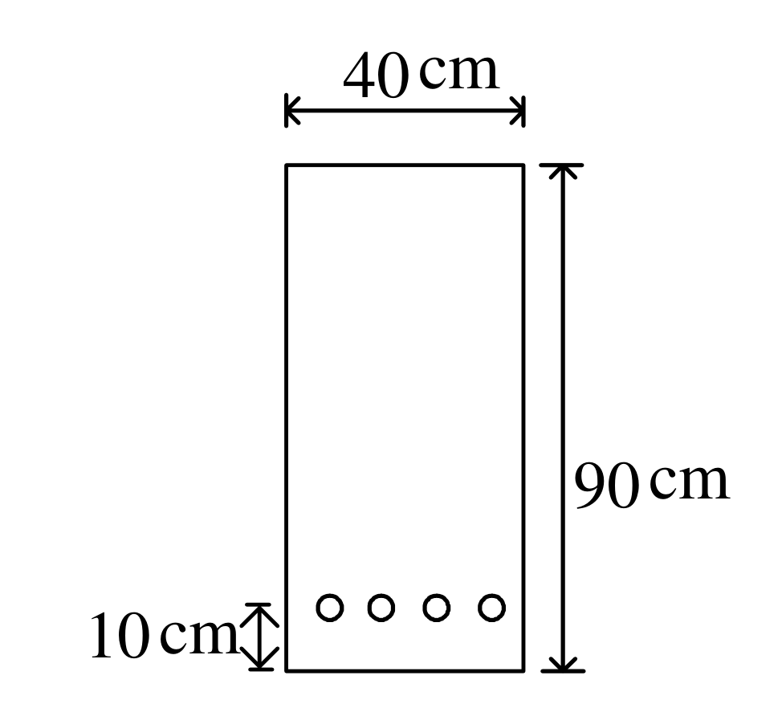

# RC-2004-5 題目正本

> 本檔只記錄**考卷上寫了什麼、圖上畫了什麼**，不含任何解法。解析見同資料夾 `RC-2004-5.md`。
> 判讀清單已經使用者確認（凍結）；本檔原則上不再修改（改動須回考卷原圖並記 log）。

| 項目 | 內容 |
|------|------|
| 考卷 | `raw/exams/RC-2004_鋼筋混凝土設計與預力.pdf` 第 2 頁（背面），第五題；$E_c$、$f_r$ 見第 1 頁「資料：」欄 |
| 考年 | 民國 93 年（2004） |
| 配分 | 20 分 |
| 附圖 | `RC-2004-5-fig-2.png`（矩形斷面，無圖號；2026-11-14 由考卷向量圖 500 dpi 重新擷取）；既有 `RC-2004-5-fig-1.png` 為同一圖、解析度較低且左側有滑鼠游標（未壓到圖），保留不刪 |
| 判讀狀態 | **已確認**（2026-11-14 使用者確認；轉錄 2026-11-14；PyMuPDF 110 dpi 全頁目視＋抽出文字核對，附圖 500 dpi 並讀 PDF 繪圖座標；盲讀後才比對既有解析） |

## 1. 考卷原文（逐字）

> 五、先拉預力梁之矩形斷面與鋼腱配置如圖所示，預力鋼腱之抗拉強度 $f_{pu} = 16500\,kgf/cm^2$，降伏強度 $f_{py} = 0.85f_{pu}$，有效預力 $f_e = 0.6f_{pu}$，預力鋼腱之斷面積 $A_{ps} = 6.16cm^2$，$f'_c = 350\,kgf/cm^2$，試求此斷面之開裂彎矩與彎矩設計強度。（20 分）
>
> 提示：⑴ $f_{ps} = f_{pu}\left(1 - \dfrac{\gamma_p}{\beta_1}\rho_p\dfrac{f_{pu}}{f'_c}\right)$　其中 $\gamma_p = 0.4$
> 　　　⑵ $\omega_p = \dfrac{A_{ps}f_{ps}}{bd_pf'_c}$

## 2. 考卷給的公式、附表與參數

- 題文數值：$f_{pu}=16{,}500$、$f_{py}=0.85f_{pu}$、$f_e=0.6f_{pu}$、$A_{ps}=6.16$ cm²、$f'_c=350$ kgf/cm²。
- 提示公式⑴（$f_{ps}$ 近似式，$\gamma_p=0.4$）、⑵（$\omega_p$ 定義），照錄如上。
- 第 1 頁第一題下方「資料：」欄（排版縮排在第一題之下，未寫只適用第一題）：鋼筋 D10、D13、D19、D25、D32 的 $a_b$、D，以及 $E_c = 15000\sqrt{f'_c}$，$f_r = 2.0\sqrt{f'_c}$。
- **沒有給**：$\beta_1$ 數值、強度折減因數 $\phi$、自重或載重（只問斷面）、鋼腱根數對應的單根面積。
- 卷首注意事項：不必抄題，作答時請將試題題號及答案依照順序寫在試卷上，於本試題上作答者，不予計分。可以使用電子計算器。

## 3. 附圖

圖面文字照錄：`40cm`、`90cm`、`10cm`。

## 4. 判讀清單

「把握」標**不確定**者請優先確認；解讀類項目（題目用字的意思）另標「解讀」。

| # | 項目 | 判讀 | 圖上／題文依據 | 把握 |
|---|------|------|---------------|------|
| 1 | 斷面 | 矩形 $b = 40$、$h = 90$ cm（全深） | 90cm 尺寸線兩端對齊頂面（y＝694.6）與底面（y＝785.4），PDF 座標 | 確定 |
| 2 | 鋼腱位置 | 一排 4 根，鋼腱中心距底面 10 cm → $d_p = 80$ cm | 10cm 尺寸線上端 y＝773.5、圓心列 y≈774.0、底面 y＝785.4（500 dpi＋PDF 座標） | 確定 |
| 3 | 握裹 | 先拉法 → 有握裹 | 題文「先拉預力梁」 | 確定 |
| 4 | 有效預力 | $f_e = 0.6f_{pu}$ 為有效**應力**（kgf/cm²），總有效預力需乘 $A_{ps}$ | 題文用小寫 $f_e$、與 $f_{pu}$ 同單位 | 確定（解讀） |
| 5 | 問的量 | ① 開裂彎矩 $M_{cr}$；② 彎矩**設計**強度（$\phi M_n$） | 題文「彎矩設計強度」 | 確定 |
| 6 | $E_c$、$f_r$ 的來源 | 第 1 頁「資料：」欄印 $E_c = 15000\sqrt{f'_c}$、$f_r = 2.0\sqrt{f'_c}$，位置在第一題之下；解讀為全卷共用資料，本題可用 | 第 1 頁 110 dpi 目視 | 確定（解讀） |
| 7 | 考卷沒有給 | $\beta_1$、$\phi$ | 全題 | 確定（作答須自行假設） |

---

*轉錄：2026-11-14（RC-U4-1 題目正本推廣・批 1）*

*確認：2026-11-14 使用者確認（RC-U4-1 題目正本推廣・批 1，關卡一）*
