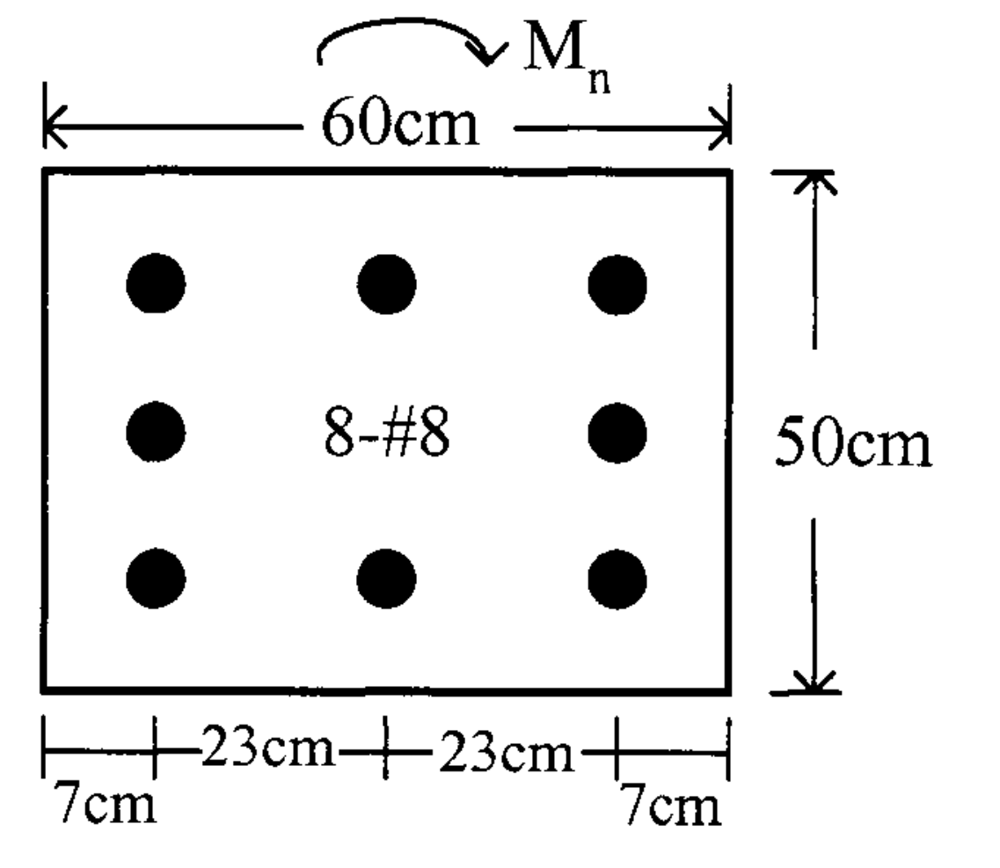

# RC-2005-1 題目正本

> 本檔只記錄**考卷上寫了什麼、圖上畫了什麼**，不含任何解法。解析見同資料夾 `RC-2005-1.md`。
> 判讀清單已經使用者確認（凍結）；本檔原則上不再修改（改動須回考卷原圖並記 log）。

| 項目 | 內容 |
|------|------|
| 考卷 | `raw/exams/RC-2005_鋼筋混凝土設計與預力.pdf` 第 1 頁（全一頁），第一題 |
| 考年 | 民國 94 年（2005） |
| 配分 | 20 分 |
| 附圖 | `RC-2005-1-fig-2.png`（500 dpi 重新擷取）；既有 `RC-2005-1-fig-1.png` 上緣夾到前一行題文、解析度低，保留不刪 |
| 判讀狀態 | **已確認**（2026-11-14 使用者確認；影響答案項目使用者選擇：#3、#4 沿 60 cm 方向彎曲，三層 3／2／3 根在 7／30／53 cm；不確定項照草稿判讀定案；轉錄 2026-11-14；PyMuPDF 110 dpi 全頁目視＋抽出文字核對，附圖 450／500 dpi 放大；盲讀後才比對既有解析） |

## 1. 考卷原文（逐字）

> 一、一鋼筋混凝土柱斷面如圖所示，採用混凝土 $f'_c$=280 kgf/cm²，鋼筋降伏強度 $f_y$=4200 kgf/cm²，試求作用於此斷面上之標稱軸力 $P_n$=90 t 時之標稱極限彎矩 $M_n$ 與延展比 $\mu_\phi$。（20 分）

## 2. 考卷給的公式、附表與參數

- 題文數值：$f'_c=280$、$f_y=4200$ kgf/cm²；$P_n=90$ t。
- **沒有給**：#8 鋼筋截面積、$E_s$、$\varepsilon_{cu}$、$\beta_1$、延展比 $\mu_\phi$ 的定義（降伏曲率怎麼取）、鋼筋在 50 cm 方向的位置尺寸、箍筋。
- 卷首注意事項：㈠不必抄題，作答時請將試題題號及答案依照順序寫在試卷上，於本試題紙上作答者，不予計分。㈡可以使用電子計算器，但需詳列解答過程。

## 3. 附圖

圖面文字照錄：「Mn」「60cm」「50cm」「8-#8」「7cm」「23cm」「23cm」「7cm」。

## 4. 判讀清單

| # | 項目 | 判讀 | 圖上／題文依據 | 把握 |
|---|------|------|---------------|------|
| 1 | 延展比 $\mu_\phi$ 的定義 | 曲率延展比 $\mu_\phi=\phi_u/\phi_y$（下標 φ 為曲率）；$\phi_u$ 取極限狀態（$\varepsilon_{cu}$），$\phi_y$ 取最外拉力鋼筋初降伏，兩者都在 $P_n=90$ t 下 | 題文「延展比 $\mu_\phi$」；考卷未定義 | 不確定（解讀）（$\phi_y$ 的定義會影響答案，請確認）；使用者確認 |
| 2 | 斷面尺寸 | 寬 60 cm（彎曲方向）、高 50 cm | 450 dpi：上方 60cm、右側 50cm 尺寸線 | 確定 |
| 3 | 彎曲方向 | 沿 60 cm 方向彎曲（Mn 箭頭在斷面上方） | 附圖 | 確定 |
| 4 | 鋼筋配置 | 三縱列：距左緣 7、30、53 cm（量至鋼筋中心）；左右兩列各 3 根、中間列上下各 1 根，共 8-#8 → 沿彎曲深度三層 $A_s$：3 根／2 根／3 根 | 下方尺寸線 7／23／23／7 端點對齊各列圓心；數圓點 3+2+3 | 確定 |
| 5 | 鋼筋在 50 cm 方向的位置 | 未標尺寸；同列鋼筋在同一彎曲深度，不影響本題 | 圖上無對應尺寸線 | 確定 |
| 6 | 標稱值 | $P_n=90$ t 為標稱軸力；所求 $M_n$ 為標稱彎矩（對斷面中心，鋼筋對稱即塑性中心） | 題文「標稱軸力」「標稱極限彎矩」 | 確定 |
| 7 | 柱型式 | 圖上未畫箍筋；考卷未說明 | 附圖 | 確定（不影響標稱值） |
| 8 | 考卷沒有給 | #8 截面積、$E_s$、$\varepsilon_{cu}$、$\beta_1$ 需自行採用 | 題文 | 確定 |

---

*轉錄：2026-11-14（RC-U1-2 題目正本推廣・批 1）*

*確認：2026-11-14 使用者確認（RC-U1-2 題目正本推廣・批 1，關卡一）*
