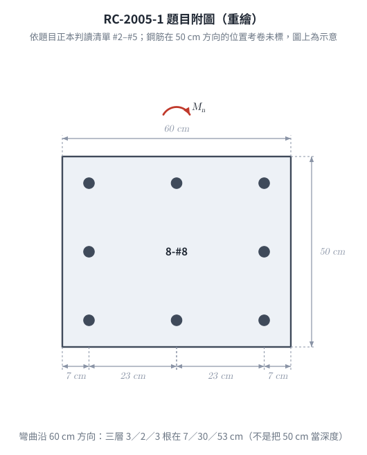
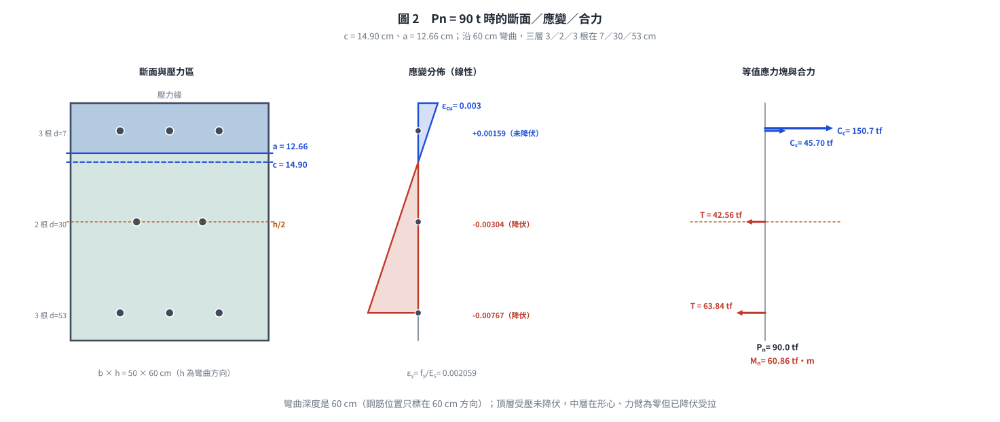
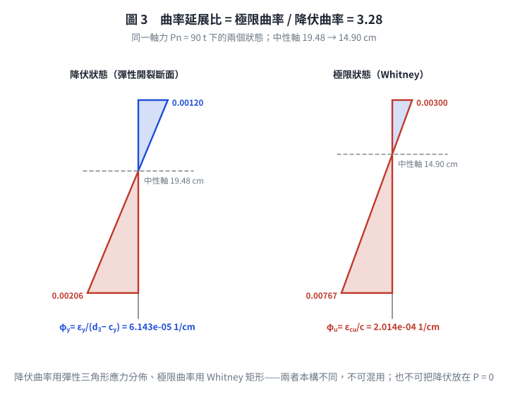

# 考題編號：RC-2005-1

**主分類：** `RC-U1-2` RC 柱強度分析與設計
**副分類：** 無
**設計法：** USD 強度設計法
**標籤：** `矩形柱` `P-M互制` `曲率延展比` `壓縮區鋼筋未降伏` `彎矩曲率` `8-#8對稱配筋` `偏心受壓` `三排配筋`

---

## 1. 題目（考卷原文見題目正本）

> 考卷原文、公式／附表、附圖與判讀清單（已確認）見 [`RC-2005-1-problem.md`](RC-2005-1-problem.md)。本節只列解題時最容易讀錯的地方與本解使用的記號；題意以題目正本為準。

*重繪自考卷附圖，依題目正本判讀清單；攔下把斷面轉 90°、以 50 cm 當彎曲深度的錯誤（考卷只標了 60 cm 方向的鋼筋位置）。*

### 常見誤讀

| 項目 | 正確判讀 | 常見誤讀 |
|---|---|---|
| 彎曲方向 | 沿 60 cm 方向（Mn 畫在斷面上方，判讀 #3） | 以 50 cm 為深度（考卷在 50 cm 方向根本沒標鋼筋位置） |
| 鋼筋層 | 三縱列距左緣 7／30／53 cm，根數 3／2／3（判讀 #4） | 讀成上中下三排、距頂 7／25／43 cm |
| 延展比 | $\mu_\phi=\phi_u/\phi_y$，$\phi_y$ 取最外拉筋初降伏、$\phi_u$ 取 $\varepsilon_{cu}$，皆在 $P_n=90$ t 下（判讀 #1） | $\phi_y$ 取純彎（$P=0$）或取任意鋼筋降伏 |
| #8 截面積 | 考卷沒有給，自行採用 5.067 cm² | 當作題給 |

**本解記號：** $h=60$ cm（彎曲方向）、$b=50$ cm；三層 $A_s$ 自壓力面 $d_1=7$（3 根）、$d_2=30$（2 根）、$d_3=53$ cm（3 根）；$P_n=90$ t；$\beta_1=0.85$、$E_s=2.04\times10^6$ kgf/cm²（自行採用）。

---

## 2. 考題核心精神與出題者意圖 (Core Concepts & Examiner's Intent)

**核心觀念：** P-M 互制與曲率延展比的組合計算。出題者要求考生在指定軸力下，利用應變相容 + Whitney 應力塊求出 $M_n$，再用彈性開裂斷面求 $\phi_y$，最後對比得到 $\mu_\phi$。

**測驗能力：**
1. 判讀斷面方向：彎曲深度是 60 cm（鋼筋位置只標在 60 cm 方向）
2. 在給定 $P_n$ 下以試算或二次式找出中性軸深度 $c$
3. 判斷各層鋼筋在極限狀態是否降伏（受壓筋常未達 $f_y$）
4. 用彈性開裂斷面計算降伏曲率 $\phi_y$（同一軸力 90 t）
5. 中層鋼筋位於形心（$d_2=30=h/2$），對 $M_n$ 力臂為零、但參與軸力平衡

---

## 3. 解題戰略地圖與陷阱分析 (Strategic Roadmap & Trap Analysis)

**作戰計畫：**
1. 假設受壓層未降伏、中層與拉力層降伏，列出 $P_n(c)=90$ t 的二次式解 $c$，再驗證假設
2. 對斷面形心取矩 → $M_n$
3. 切換至彈性開裂斷面求 $\phi_y$（最外拉力層剛好 $\varepsilon_y$，其餘鋼筋與混凝土彈性）
4. $\phi_u=0.003/c$，$\mu_\phi=\phi_u/\phi_y$

**關鍵陷阱：**
- ⚠ **斷面方向**：以 50 cm 為深度是錯的——考卷在 50 cm 方向沒有標任何鋼筋位置；Mn 箭頭與 7／23／23／7 尺寸都在 60 cm 邊
- ⚠ **受壓筋是否降伏**：頂層 $d_1=7$ cm 在 $c=14.90$ cm 時 $\varepsilon_{s1}=0.00159<\varepsilon_y$ → 未降伏，用 $f_{s1}=E_s\varepsilon_{s1}$，並扣 $0.85f'_c$（在應力塊內）
- ⚠ **中層鋼筋**：$d_2=30=h/2$，取矩臂為零，但它已降伏受拉，軸力平衡必須計入
- ⚠ **兩種中性軸**：$\phi_u$ 用 Whitney（$c=14.90$），$\phi_y$ 用彈性開裂斷面（$c_y=19.48$），同一軸力下兩者不同

---

## 3.5 變數層次分析 (Variable Hierarchy Analysis)

> 複習提示：第一次解題後，在每個卡住的知識點旁標記 `⚠`；第二次複習時只看有 `⚠` 的項目。

### 最終目標
求 $P_n = 90\ \text{t}$ 時之標稱極限彎矩 $M_n$（tf·m）及曲率延展比 $\mu_\phi = \phi_u / \phi_y$。

### 本題關鍵公式（依計算順序）

$$\text{Step 1: } C_c = 0.85 f'_c \cdot b \cdot a, \quad a = \beta_1 \boxed{c}$$

$$\text{Step 2: } \varepsilon_{si} = 0.003 \cdot \frac{\boxed{c} - d_i}{\boxed{c}}, \quad f_{si} = E_s\varepsilon_{si},\ |f_{si}|\le f_y$$

$$\text{Step 3: } P_n = C_c + C_{s1} - T_{s2} - T_{s3} = 90{,}000\ \text{kgf} \quad \Rightarrow \text{解出 } \boxed{c}$$

$$\text{Step 4: } M_n = C_c\left(\frac{h}{2} - \frac{a}{2}\right) + C_{s1}\left(\frac{h}{2} - d_1\right) + T_{s3}\left(d_3 - \frac{h}{2}\right)\quad(T_{s2}\text{ 臂}=0)$$

$$\text{Step 5 (降伏態): 彈性開裂斷面，令 } \varepsilon_{s3} = \varepsilon_y \Rightarrow \phi_y = \frac{\varepsilon_y}{d_3 - \boxed{c_y}}$$

$$\text{Step 6: } \phi_u = \frac{\varepsilon_{cu}}{\boxed{c}},\qquad \text{Step 7: } \mu_\phi = \frac{\phi_u}{\phi_y}$$

### L1：題目直接給定

| 符號 | 數值 | 說明 |
|------|------|------|
| $f'_c$ | $280\ \text{kgf/cm}^2$ | 混凝土抗壓強度 |
| $f_y$ | $4200\ \text{kgf/cm}^2$ | 鋼筋降伏強度 |
| $h$ | $60\ \text{cm}$ | 彎曲方向深度 |
| $b$ | $50\ \text{cm}$ | 受壓面寬度 |
| $d_1,d_2,d_3$ | $7,\ 30,\ 53\ \text{cm}$ | 三層鋼筋至受壓緣（3／2／3 根） |
| $P_n$ | $90\ \text{t}$ | 標稱軸力 |

### L2：需知識點推導

| 符號 | 公式／來源 | 卡關? |
|------|------|------|
| $A_b$ | #8＝5.067 cm²（考卷未給，自行採用） | |
| $A_{s1},A_{s2},A_{s3}$ | 15.20、10.13、15.20 cm² | |
| $\beta_1$ | 0.85（$f'_c=280$） | |
| $E_s$、$\varepsilon_y$ | 2.04×10⁶；0.002059 | |
| $c$ | 二次式解 14.90 cm | |
| $E_c$、$n$ | $15000\sqrt{f'_c}=250{,}998$；$n=E_s/E_c=8.13$ | |
| $c_y$ | 彈性開裂斷面力平衡解 19.48 cm | |
| $\phi_y$ | $\varepsilon_y/(53-c_y)=6.143\times10^{-5}$ 1/cm | |
| $\phi_u$ | $0.003/14.90=2.014\times10^{-4}$ 1/cm | |

### L3：深層知識（不懂就卡住）

| 知識點 | 說明 | 卡關? |
|--------|------|------|
| 受壓筋扣 $0.85f'_c$ | 位於 Whitney 塊內時，混凝土已算入 $C_c$，鋼筋淨貢獻 $A_s(f_s-0.85f'_c)$ | |
| 彈性開裂斷面 | 計算 $\phi_y$ 時混凝土為線彈性三角形分布、不計拉力 | ⚠ |
| 中層鋼筋在形心 | $d_2=h/2=30$ cm → 取矩臂 0，但軸力平衡要算 | |
| 判讀斷面方向 | 鋼筋位置尺寸標在哪一邊，那一邊就是彎曲深度 | ⚠ |

---

## 4. 步驟化詳細計算過程 (Step-by-Step Detailed Calculation)

### 斷面參數確認

$$h = 60\ \text{cm（彎曲方向）},\quad b = 50\ \text{cm},\quad h/2 = 30\ \text{cm}$$

$$A_{s1} = 3 \times 5.067 = 15.20\ \text{cm}^2\ (d_1=7),\quad A_{s2} = 10.13\ \text{cm}^2\ (d_2=30),\quad A_{s3} = 15.20\ \text{cm}^2\ (d_3=53)$$

$$0.85f'_c\,\beta_1\, b = 0.85 \times 280 \times 0.85 \times 50 = 10{,}115\ \text{kgf/cm}$$

---

### ① 極限狀態：求中性軸深度 $c$

假設頂層未降伏、中層與底層降伏（受拉）：

$$10{,}115\,c + 15.20\left(6120\,\frac{c-7}{c} - 238\right) - (10.13+15.20)\times4200 = 90{,}000$$

乘以 $c$ 整理：$10{,}115\,c^2 + (89{,}410 - 106{,}407 - 90{,}000)\,c - 651{,}200 = 0$

$$c = 14.90\ \text{cm},\qquad a = 0.85 \times 14.90 = 12.66\ \text{cm}$$

**驗證各層應變：**

$$\varepsilon_{s1} = 0.003 \times \frac{14.90-7}{14.90} = 0.00159 < \varepsilon_y \Rightarrow f_{s1} = 3{,}245\ \text{kgf/cm}^2\ \text{（壓，未降伏）}✓$$
$$\varepsilon_{s2} = 0.003 \times \frac{14.90-30}{14.90} = -0.00304 \Rightarrow 4{,}200\ \text{（拉，降伏）}✓$$
$$\varepsilon_{s3} = 0.003 \times \frac{14.90-53}{14.90} = -0.00767 \Rightarrow 4{,}200\ \text{（拉，降伏）}✓$$

**各力：**

$$C_c = 0.85 \times 280 \times 12.66 \times 50 = 150{,}703\ \text{kgf}$$
$$C_{s1} = 15.20 \times (3{,}245 - 238) = 45{,}704\ \text{kgf}\quad(d_1 = 7 < a = 12.66\text{，扣 }0.85f'_c)$$
$$T_{s2} = 10.13 \times 4{,}200 = 42{,}563\ \text{kgf},\qquad T_{s3} = 15.20 \times 4{,}200 = 63{,}844\ \text{kgf}$$

$$P_n = 150{,}703 + 45{,}704 - 42{,}563 - 63{,}844 = 90{,}000\ \text{kgf}\ ✓$$

---

### ② 標稱彎矩 $M_n$（對斷面形心 $h/2 = 30\ \text{cm}$ 取矩）

| 力 | 大小 (kgf) | 力臂 (cm) | 矩 (kgf·cm) |
|---|---|---|---|
| $C_c$ | $150{,}703$ | $30 - 6.33 = 23.67$ | $3{,}566{,}800$ |
| $C_{s1}$ | $45{,}704$ | $30 - 7 = 23$ | $1{,}051{,}200$ |
| $T_{s2}$ | $42{,}563$ | $0$ | $0$ |
| $T_{s3}$ | $63{,}844$ | $53 - 30 = 23$ | $1{,}468{,}400$ |

$$M_n = 3{,}566{,}800 + 1{,}051{,}200 + 1{,}468{,}400 = 6{,}086{,}400\ \text{kgf·cm}$$

$$\boxed{M_n \approx 60.86\ \text{tf·m}}$$

偏心距：$e = M_n/P_n = 60.86/90 = 0.676\ \text{m} = 67.6\ \text{cm}$

---

*圖 2　$P_n=90$ t 時的斷面／應變／合力。彎曲深度是 60 cm；頂層受壓 $\varepsilon_{s1}=0.00159$ 未降伏，中層在形心、力臂為零但已降伏受拉——攔下把斷面轉 90°、頂層誤當降伏、漏算中層軸力三種錯。*

### ③ 極限曲率 $\phi_u$

$$\phi_u = \frac{\varepsilon_{cu}}{c} = \frac{0.003}{14.90} = 2.014 \times 10^{-4}\ \text{1/cm}$$

---

### ④ 降伏曲率 $\phi_y$（彈性開裂斷面，同一軸力 90 t）

**條件：** 底層鋼筋恰好 $\varepsilon_{s3}=\varepsilon_y$，混凝土與其他鋼筋線彈性；$E_c = 15000\sqrt{280} = 250{,}998$ kgf/cm²。

設中性軸深度 $c_y$，則 $\phi_y = \varepsilon_y/(53 - c_y)$，混凝土壓力 $C_c^y = \tfrac12 b\,c_y\,E_c\,\phi_y c_y$；頂層鋼筋扣除被佔據的混凝土 $(E_s - E_c)\phi_y(c_y-7)A_{s1}$。

由 $C_c^y + C_{s1}^y - T_{s2}^y - T_{s3}^y = 90{,}000$ 解得：

$$c_y = 19.48\ \text{cm},\qquad \phi_y = \frac{0.002059}{53 - 19.48} = 6.143 \times 10^{-5}\ \text{1/cm}$$

**驗核：**
- 壓力緣應變 $\varepsilon_c = 6.143\times10^{-5} \times 19.48 = 0.00120$
- $C_c^y = \tfrac12 \times 50 \times 19.48 \times (250{,}998 \times 0.00120) = 146{,}342$ kgf
- 頂層 $\varepsilon_{s1} = 0.000767$：$C_{s1}^y = 15.20 \times (1{,}565 - 193) = 20{,}856$ kgf
- 中層 $\varepsilon_{s2} = -0.000646$：$T_{s2}^y = 10.13 \times 1{,}318 = 13{,}354$ kgf
- 底層：$T_{s3}^y = 63{,}844$ kgf

$$P^y = 146{,}342 + 20{,}856 - 13{,}354 - 63{,}844 = 90{,}000\ \text{kgf}\ ✓$$

---

### ⑤ 曲率延展比 $\mu_\phi$

$$\mu_\phi = \frac{\phi_u}{\phi_y} = \frac{2.014 \times 10^{-4}}{6.143 \times 10^{-5}} = \boxed{\mu_\phi \approx 3.28}$$

*圖 3　曲率延展比的兩個狀態。降伏用彈性三角形應力分佈、極限用 Whitney 矩形，兩者都在同一軸力 90 t 下——攔下兩個曲率混用同一種應力分佈、或把降伏放在 $P=0$ 的錯。*

---

## 5. 關鍵爭議點與進階探討 (Critical Issues & Advanced Discussion)

**① 舊版解析的判讀錯誤（2026-11-14 勘誤）**

舊版把斷面轉了 90°：以 $h=50$ cm、三層 7／25／43 cm 計算，得 $c=13$ cm、$M_n\approx49.3$ tf·m、$\mu_\phi\approx3.0$。題目正本（關卡一確認）為沿 60 cm 方向彎曲、三層 7／30／53 cm，$M_n$ 增為 60.86 tf·m（+23%）。

**② 受壓筋是否降伏（高頻陷阱）**

頂層在極限狀態 $\varepsilon_{s1}=0.00159<\varepsilon_y=0.00206$，**未降伏**。若誤用 $f_y$，$C_{s1}$ 高估、$c$ 偏小，$M_n$ 與 $\mu_\phi$ 都會偏離。考場安全做法：**先假設，後驗核**。

**③ 中層鋼筋的角色**

中層位於形心（$d_2=h/2=30$ cm），取矩臂長為零，**對 $M_n$ 無貢獻**；但在軸力平衡與 $c_y$ 的求解中**必須計入**（極限時已降伏受拉）。

**④ 降伏曲率的混凝土模型**

線彈性模型在 $c_y=19.48$ cm 時，壓力緣應力 $E_c\varepsilon_c\approx300$ kgf/cm²，略超過 $f'_c$；壓力緣應變 0.0012 仍遠小於 0.003。對照：
- 不扣頂層位移混凝土（傳統換算斷面）：$\mu_\phi=3.29$
- 混凝土改用 Hognestad 拋物線：$\mu_\phi=3.20$

三者差 ±3%，考場採線彈性開裂斷面為標準做法。

**⑤ 延展比的工程意義**

$\mu_\phi\approx3.3$ 代表本柱在 $P_n=90$ t 下極限曲率約為降伏曲率的 3 倍。與純彎梁（典型 $\mu_\phi\approx10$ 以上）相比偏低，因為軸壓使中性軸變深、壓力區變大，限制了轉動能力。

**⑥ 規範版本**

依現行建築物混凝土結構設計規範（2023）：$\varepsilon_{cu}=0.003$、$\beta_1=0.85$、$E_s=2.04\times10^6$、$E_c=15000\sqrt{f'_c}$ kgf/cm²。本題只問標稱值與曲率比，不涉及 $\phi$。

*修正日期：2026-11-14（§1 改為指向題目正本，插入重繪附圖 figs/RC-2005-1-fig-1-problem.svg、改寫常見誤讀與本解記號；本行非答案勘誤）*

*修正日期：2026-11-14（解析勘誤：斷面方向由 h＝50 cm、三層 7／25／43 cm 改為 h＝60 cm、三層 7／30／53 cm〔題目正本判讀 #3、#4〕；$M_n$ 49.3 → 60.86 tf·m、$\mu_\phi$ 3.0 → 3.28；改寫 §2–§5。驗證：Python 重算 MISMATCHES: 0，c 以試算求根與二次式閉合解交叉、c_y 以閉合力平衡與纖維積分交叉；依 RC-U1-2 批 1 盲解比對與使用者判定）*

*圖解補繪：2026-11-14（向量圖 2 張〔圖 2 斷面／應變／合力、圖 3 降伏 vs 極限應變〕，腳本 `gen_RC-2005-1.py`，可重跑；腳本檔尾對 §4 公佈值做 assert；φu 捨入 2.013 → 2.014×10⁻⁴（0.003/14.899），非勘誤）*
