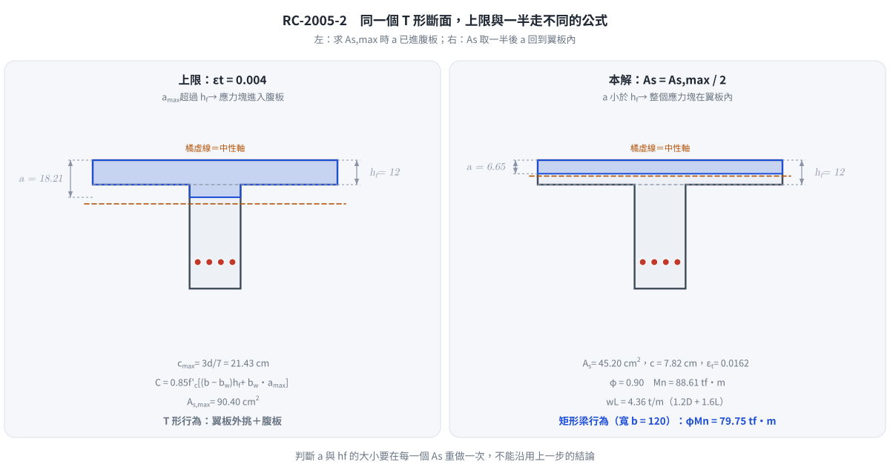

# 考題編號：RC-2005-2

**主分類：** `RC-U1-1` RC 梁彎矩強度分析與設計
**副分類：** 無
**設計法：** USD 強度設計法
**標籤：** `T形梁` `最大拉力筋量` `0.75ρb` `T型梁平衡鋼筋` `NA在翼板` `活載重反推` `設計彎矩` `ACI載重組合` `εt=0.004上限` `1.2D+1.6L`

---

## 1. 題目（考卷原文見題目正本）

> 考卷原文、公式／附表與判讀清單（已確認）見 [`RC-2005-2-problem.md`](RC-2005-2-problem.md)。本節只列解題時最容易讀錯的地方與本解使用的記號；題意以題目正本為準。

### 常見誤讀

| 項目 | 正確判讀 | 常見誤讀 |
|------|---------|---------|
| 「ACI 規範允許之最大拉力筋量」 | 考卷沒寫版本；本解採 ACI 318-02 起的淨拉應變上限：最外層拉力筋 $\varepsilon_t \ge 0.004$ 時的 $A_s$（使用者確認，判讀 #3） | 一律用舊版 $0.75A_{sb}$（本解 2026-11-12 前即如此，$w_L = 3.28$ t/m）；兩者給的 $A_{s,\max}$ 不同 |
| 載重組合 | $1.2D + 1.6L$，與 $\varepsilon_t$ 體系同一版規範成套 | 混用 $\varepsilon_t$ 上限與舊版 $1.4D + 1.7L$ |
| $b = 120$ cm | 題目直接給的有效翼寬，不必再算 | 再依跨距、梁距重算有效翼寬 |
| 靜載重 0.75 t/m | 已含自重，不再另加 | 另加腹板自重 |
| 所求 | ㈠ 設計彎矩 $\phi M_n$；㈡ 工作（未乘因數）活載重 $w_L$ | 把 $W_u$ 當成答案 |

**本解記號：** $b=120$、$b_w=25$、$h_f=12$、$d=50$ cm；$A_{s,\max}$＝$\varepsilon_t = 0.004$ 時的拉力筋量；$A_s = A_{s,\max}/2$；$w_D=0.75$ t/m、$w_L$＝活載重（工作載重）；$W_u$＝因數化均佈載重。

---

## 2. 考題核心精神與出題者意圖 (Core Concepts & Examiner's Intent)

**核心觀念：** T 型梁「最大拉力筋量」的正確計算，以及 USD 反推活載重。

**測驗重點：**
1. 最大拉力筋量：取最外層拉力筋 $\varepsilon_t = 0.004$ 時的中性軸 $c = \tfrac{3}{7}d$，此時應力塊深 $a > h_f$，壓力須計入翼板外挑 + 腹板
2. 確認使用 $A_s = A_{s,\max}/2$ 後，中性軸深度是否仍在翼板內（若在翼板，可簡化為矩形梁計算）
3. 知道「設計彎矩」= $\phi M_n$，並由 $\varepsilon_t$ 確認 $\phi = 0.9$（拉力控制）
4. 利用 $\phi M_n = M_u = W_u L^2/8$ 反推因數化載重，再以 $1.2D + 1.6L$ 求 $w_L$

**典型陷阱：**
- 誤用矩形梁（寬 $b_w$）求上限而忽略翼板壓力貢獻 → 低估 $A_{s,\max}$
- 計算完 $A_{s,\max}/2$ 後，未檢核 NA 是否在翼板內，就套用 T 形梁公式
- 規範體系混用：$\varepsilon_t$ 上限配舊版 $1.4D + 1.7L$

---

## 3. 解題戰略地圖與陷阱分析 (Strategic Roadmap & Trap Analysis)

**作戰計畫：**
1. 由 $\varepsilon_t = 0.004$ 求上限中性軸 $c_{\max} = \tfrac{0.003}{0.003+0.004}d$ 與 $a_{\max} = \beta_1 c_{\max}$，判斷在翼板或腹板
2. 依 NA 位置計算 T 型梁壓力 → 求 $A_{s,\max}$
3. 使用 $A_s = A_{s,\max}/2$
4. 確認 NA 位置（用 $A_s$ 計算的 $a$ 是否 $\le h_f$）
5. 若 NA 在翼板 → 矩形梁公式求 $\phi M_n$
6. 設 $\phi M_n = W_u L^2/8$，以 $W_u = 1.2w_D + 1.6w_L$ 反推 $w_L$

**關鍵陷阱（3 個）：**
- ⚠ **上限狀態 NA 在腹板中**：$a_{\max} = 18.21\ \text{cm} > h_f = 12\ \text{cm}$，翼板伸出部分 + 腹板均受壓，$A_{s,\max}$ 遠大於腹板矩形梁的上限
- ⚠ **用 $A_s/2$ 後 NA 反而跑回翼板內**：$A_s = 45.20\ \text{cm}^2$ 時，$a = 6.65\ \text{cm} < 12\ \text{cm}$，此時設計方法退化為矩形梁（寬度 $b = 120\ \text{cm}$），**不需用 T 形梁公式**
- ⚠ **$\phi$ 值驗核**：$\varepsilon_t = 0.0162 \gg 0.005$，確認拉力控制 $\phi = 0.9$ ✓

---

## 3.5 變數層次分析 (Variable Hierarchy Analysis)

> 複習提示：第一次解題後，在每個卡住的知識點旁標記 `⚠`；第二次複習時只看有 `⚠` 的項目。

### 最終目標
（一）求 $\phi M_n$（設計彎矩，使用 $A_{s,\max}/2$）；（二）求最大容許活載重 $w_L$（t/m）。

### 本題關鍵公式（依計算順序）

$$\text{Step 1: } c_{\max} = \frac{0.003}{0.003+0.004}\,d,\quad a_{\max} = \beta_1 \cdot c_{\max}$$

$$\text{Step 2: } C_{\max} = 0.85f'_c \cdot (b-b_w) \cdot h_f + 0.85f'_c \cdot b_w \cdot \boxed{a_{\max}}$$

$$\text{Step 3: } A_{s,\max} = \frac{\boxed{C_{\max}}}{f_y};\quad A_s = \frac{A_{s,\max}}{2}$$

$$\text{Step 4: } a = \frac{\boxed{A_s} \cdot f_y}{0.85f'_c \cdot b} \quad \text{（驗核：} a \le h_f \text{ → 矩形梁）}$$

$$\text{Step 5: } \phi M_n = \phi \cdot \boxed{A_s} \cdot f_y \cdot \left(d - \frac{\boxed{a}}{2}\right)$$

$$\text{Step 6: } W_u = \frac{8\,\phi M_n}{L^2};\quad w_L = \frac{W_u - 1.2\,w_D}{1.6}$$

### L1：題目直接給定

| 符號 | 數值 | 說明 |
|------|------|------|
| $b$ | $120\ \text{cm}$ | 有效翼板寬 |
| $b_w$ | $25\ \text{cm}$ | 腹板寬 |
| $h_f$ | $12\ \text{cm}$ | 翼板厚 |
| $d$ | $50\ \text{cm}$ | 有效深度 |
| $f'_c$ | $280\ \text{kgf/cm}^2$ | |
| $f_y$ | $4200\ \text{kgf/cm}^2$ | |
| $L$ | $9\ \text{m}$ | 簡支跨距 |
| $w_D$ | $0.75\ \text{t/m}$ | 靜載重（含自重）|

### L2：需知識點推導

**最大拉力筋量（$\varepsilon_t = 0.004$）**

| 符號 | 公式／來源 | 卡關? |
|------|------|------|
| $\beta_1$ | $0.85$（$f'_c \le 280$）| |
| $c_{\max}$ | $\tfrac{3}{7} \times 50 = 21.43\ \text{cm}$ | |
| $a_{\max}$ | $0.85 \times 21.43 = 18.21\ \text{cm}$（在腹板）| |
| $C_{\max}$ | 翼板外挑 + 腹板壓力之和 = $379{,}695\ \text{kgf}$ | |
| $A_{s,\max}$ | $C_{\max}/f_y = 90.40\ \text{cm}^2$ | |

**鋼筋用量與 NA 位置**

| 符號 | 公式／來源 | 卡關? |
|------|------|------|
| $A_s$ | $90.40/2 = 45.20\ \text{cm}^2$ | |
| $a$ | $45.20 \times 4200/28{,}560 = 6.65\ \text{cm} < h_f$（矩形梁！）| |

**設計彎矩與活載重**

| 符號 | 公式／來源 | 卡關? |
|------|------|------|
| $\varepsilon_t$ | $0.003(d-c)/c$；$c = 7.82\ \text{cm}$ → $\varepsilon_t = 0.0162 \gg 0.005$ → $\phi=0.9$ | |
| $\phi M_n$ | $0.9 \times A_s \times f_y \times (d-a/2)$ | |
| $W_u$ | $8\phi M_n/L^2$ | |
| $w_L$ | $(W_u - 1.2 w_D)/1.6$ | |

### L3：深層知識（不懂就卡住）

| 知識點 | 說明 | 卡關? |
|--------|------|------|
| 最大拉力筋量的兩個時代 | 舊版（ACI 318-99 以前）：$A_s \le 0.75A_{sb}$；ACI 318-02 起：最外層拉力筋 $\varepsilon_t \ge 0.004$，對應 $c \le \tfrac{3}{7}d$ | |
| 上限狀態 NA 在翼板或腹板 | 先算 $a_{\max}$，與 $h_f$ 比較，本題 $18.21 > 12$ → 腹板中，壓力需分開計算翼板 + 腹板 | |
| 使用部分鋼筋後 NA 位置可能改變 | $A_s = 45.20\ \text{cm}^2$ 比上限小很多，此時 $a = 6.65 < h_f$ → NA 回到翼板內，退化為矩形梁 | |
| 載重組合與規範版本成套 | $\varepsilon_t$ 體系（ACI 318-02 起）的強度載重組合為 $U = 1.2D + 1.6L$ | |

---

## 4. 步驟化詳細計算過程 (Step-by-Step Detailed Calculation)

### ① 最大拉力筋量對應的中性軸

最外層拉力筋 $\varepsilon_t = 0.004$、混凝土 $\varepsilon_{cu} = 0.003$：

$$c_{\max} = \frac{0.003}{0.003 + 0.004}\,d = \frac{3}{7} \times 50 = 21.43\ \text{cm}$$

$$a_{\max} = \beta_1 \cdot c_{\max} = 0.85 \times 21.43 = \boxed{18.21\ \text{cm}}$$

**判斷：** $a_{\max} = 18.21\ \text{cm} > h_f = 12\ \text{cm}$，**上限狀態的中性軸在腹板中** → 需計算 T 型斷面完整壓力

---

### ② 計算上限壓力 $C_{\max}$ 與 $A_{s,\max}$

$$C_f = 0.85 f'_c (b - b_w) h_f = 0.85 \times 280 \times (120-25) \times 12 = 238 \times 1{,}140 = 271{,}320\ \text{kgf}$$

$$C_w = 0.85 f'_c \cdot b_w \cdot a_{\max} = 238 \times 25 \times 18.214 = 108{,}375\ \text{kgf}$$

$$C_{\max} = 271{,}320 + 108{,}375 = 379{,}695\ \text{kgf}$$

$$A_{s,\max} = \frac{C_{\max}}{f_y} = \frac{379{,}695}{4{,}200} = \boxed{90.40\ \text{cm}^2}$$

---

### ③ 使用量

$$A_s = \frac{A_{s,\max}}{2} = \frac{90.40}{2} = \boxed{45.20\ \text{cm}^2}$$

---

### ④ 驗核 NA 位置（確認矩形梁模式）

假設 NA 在翼板（$a \le h_f$）：

$$a = \frac{A_s f_y}{0.85 f'_c \cdot b} = \frac{45.20 \times 4{,}200}{0.85 \times 280 \times 120} = \frac{189{,}840}{28{,}560} = \boxed{6.65\ \text{cm}}$$

**驗核：** $a = 6.65\ \text{cm} < h_f = 12\ \text{cm}$ ✓

→ **NA 在翼板內，等效為矩形梁（$b = 120\ \text{cm}$）**

---

### ⑤ 確認 $\phi$ 值

$$c = \frac{a}{\beta_1} = \frac{6.65}{0.85} = 7.82\ \text{cm}$$

$$\varepsilon_t = 0.003 \times \frac{d - c}{c} = 0.003 \times \frac{50 - 7.82}{7.82} = 0.003 \times 5.39 = 0.0162 \gg 0.005$$

*圖 1　上限與一半的應力塊深度一個在腹板、一個在翼板內，所以兩步要用不同的公式。這張圖攔下兩個錯：求 $A_{s,\max}$ 時直接用翼板寬的矩形應力塊，以及鋼筋取一半後仍沿用翼板＋腹板分解。*

**拉力控制斷面，$\phi = 0.9$ ✓**

---

### ⑥ 設計彎矩 $\phi M_n$

$$M_n = A_s f_y \left(d - \frac{a}{2}\right) = 45.20 \times 4{,}200 \times \left(50 - \frac{6.65}{2}\right)$$

$$= 189{,}840 \times 46.675 = 8{,}860{,}782\ \text{kgf·cm} = 88.61\ \text{tf·m}$$

$$\phi M_n = 0.9 \times 88.61 = \boxed{79.75\ \text{tf·m}}$$

---

### ⑦ 最大容許活載重

簡支梁跨中最大彎矩：

$$M_u = \frac{W_u L^2}{8} = \phi M_n \Rightarrow W_u = \frac{8\,\phi M_n}{L^2}$$

$$W_u = \frac{8 \times 79.75}{9^2} = \frac{638.0}{81} = 7.88\ \text{t/m}$$

USD 載重組合（$U = 1.2D + 1.6L$）：

$$W_u = 1.2\,w_D + 1.6\,w_L$$

$$7.88 = 1.2 \times 0.75 + 1.6\,w_L = 0.90 + 1.6\,w_L$$

$$w_L = \frac{7.88 - 0.90}{1.6} = \frac{6.98}{1.6} = \boxed{w_{L,\max} \approx 4.36\ \text{t/m}}$$

---

## 5. 關鍵爭議點與進階探討 (Critical Issues & Advanced Discussion)

**① 「ACI 規範允許之最大拉力筋量」是哪一版？**

考卷（民國 94 年）沒有指明版本，本解採 ACI 318-02 起的淨拉應變上限 $\varepsilon_t \ge 0.004$，並配同一版的 $1.2D + 1.6L$（使用者 2026-11-12 確認）。三種讀法對照：

| 讀法 | $A_{s,\max}$ | $A_s$ | $\phi M_n$ | $w_L$ |
|------|------:|------:|------:|------:|
| **本解：$\varepsilon_t = 0.004$，$1.2D+1.6L$** | 90.40 cm² | 45.20 cm² | 79.75 tf·m | **4.36 t/m** |
| 舊版：$0.75A_{sb}$（全 T 平衡法，$A_{sb} = 100.3$ cm²），$1.4D+1.7L$ | 75.23 cm² | 37.61 cm² | 67.16 tf·m | 3.28 t/m |
| $\varepsilon_t = 0.004$ 但配 $1.4D+1.7L$（體系混用） | 90.40 cm² | 45.20 cm² | 79.75 tf·m | 4.02 t/m |

考場上應寫明採用的規範版本，答案依版本而異。舊版的 $0.75A_{sb}$ 另有「分拆法」（$A_{sf} + 0.75\rho_b^\text{rect} b_w d$），不同教科書寫法不一，同一題內不可混用。

**② 令人驚訝的「退化」現象**

上限狀態 NA 在腹板（$a_{\max} = 18.21\ \text{cm}$），加上翼板貢獻後 $A_{s,\max} = 90.40\ \text{cm}^2$，遠大於只用腹板寬算的上限（$238 \times 25 \times 18.21 / 4200 = 25.8\ \text{cm}^2$）。但取 $A_{s,\max}/2 = 45.20\ \text{cm}^2$ 後，$a$ 縮短至 6.65 cm，NA 重新落入翼板，此時 T 形梁完全以矩形梁行為運作。這說明「大翼板 T 型梁」在使用遠低於最大鋼筋量時，翼板幾乎總是未被充分利用。

**③ 實際配筋數量估算**

$A_s = 45.20\ \text{cm}^2$，若選用 #8 筋（$A_s = 5.07\ \text{cm}^2$/根）：
需根數 = $45.20/5.07 = 8.9$ → 選 9 根 #8（$A_s = 45.6\ \text{cm}^2$）

若選用 #9 筋（$A_s = 6.47\ \text{cm}^2$/根）：
需根數 = $45.20/6.47 = 7.0$ → 選 7 根 #9（$A_s = 45.3\ \text{cm}^2$）

腹板寬僅 25 cm，這麼多根必須分 2～3 排配置，排數增加會使實際 $d$ 減小，需回頭驗核。

---

*修正日期：2026-11-12（§1 改為指向題目正本）*

*修正日期：2026-11-12（勘誤：題意判讀，「ACI 規範允許之最大拉力筋量」改採 εt ≥ 0.004 上限並配 1.2D + 1.6L（使用者確認；舊解 0.75Asb ＋ 1.4D + 1.7L）；As,max 75.2 → 90.40 cm²，φMn 67.1 → 79.75 tf·m，wL 3.28 → 4.36 t/m；§2、§3、§3.5、§4、§5 改寫，舊解數值保留在 §5① 對照表；驗證：Python 獨立重算 MISMATCHES: 0）*

*圖解補繪：2026-11-13（圖 1 T 形斷面上限與一半的應力塊對照；向量圖，腳本 `gen_RC-2005-2.py`，可重跑，檔尾對 §4 公佈值 assert；非勘誤）*
