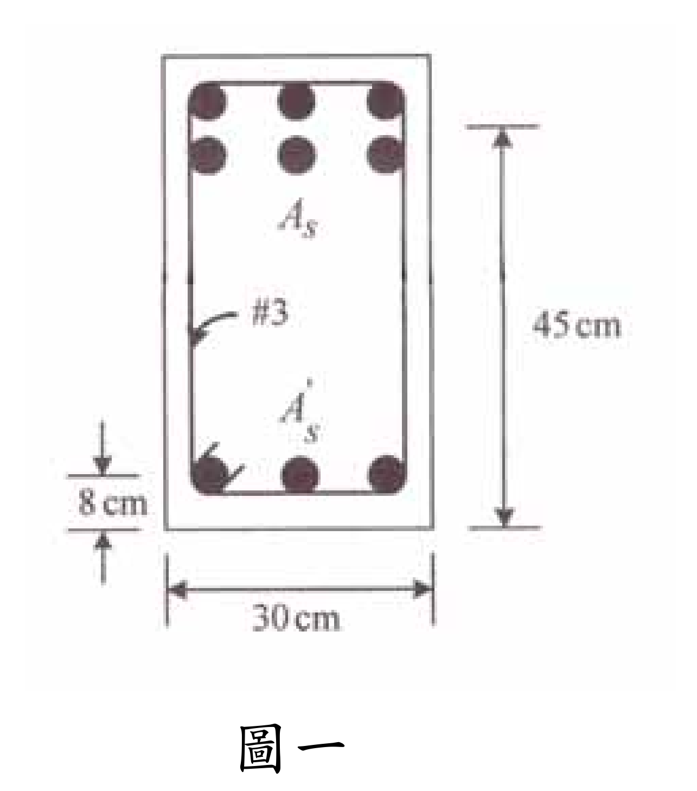

# RC-2006-1 題目正本

> 本檔只記錄**考卷上寫了什麼、圖上畫了什麼**，不含任何解法。解析見同資料夾 `RC-2006-1.md`。
> 判讀清單已經使用者確認（凍結）；本檔原則上不再修改（改動須回考卷原圖並記 log）。

| 項目 | 內容 |
|------|------|
| 考卷 | `raw/exams/RC-2006_鋼筋混凝土設計與預力.pdf` 第 1 頁（正面），第一題 |
| 考年 | 民國 95 年（2006） |
| 配分 | 40 分 |
| 附圖 | `RC-2006-1-fig-2.png`（圖一：梁斷面；2026-11-15 由考卷重新擷取 500 dpi）；既有 `RC-2006-1-fig-1.png` 為同一圖，斷面頂部壓有滑鼠游標，保留不刪 |
| 判讀狀態 | **已確認**（2026-11-15 使用者確認；影響答案項目使用者選擇：#1 45 cm 為有效深度 d；轉錄 2026-11-15；PyMuPDF 110 dpi 全頁目視，附圖 400 dpi 局部放大（附圖為內嵌點陣影像）；文字以 PDF 文字層核對；盲讀後才比對既有解析） |

## 1. 考卷原文（逐字）

> 一、有一懸臂梁，跨度 4.5 m，全梁承受均布靜載重及均布活載重。其斷面如圖一所示，下方為受壓面，$A_s$＝40 cm²，$A'_s$＝24 cm²，$f'_c$＝280 kgf/cm²，$f_y$＝4200 kgf/cm²，$E_s$＝2.04×10⁶ kgf/cm²。剪力鋼筋採用#3 垂直肋筋且全梁均勻分布，#3 鋼筋之斷面積為 0.71 cm²。此梁所能承受之設計載重由斷面撓曲強度所控制，若須考慮壓力鋼筋對斷面撓曲強度之貢獻，試問此梁剪力鋼筋所能容許之最大間距為何？（40 分）
> （註：撓曲設計之強度折減因數 $\phi$ 採用 0.9，剪力設計之強度折減因數 $\phi$ 採用 0.75）

## 2. 考卷給的公式、附表與參數

- 題文數值：跨度 4.5 m（懸臂）；$A_s$＝40 cm²、$A'_s$＝24 cm²；$f'_c$＝280、$f_y$＝4200、$E_s$＝2.04×10⁶ kgf/cm²；#3 面積 0.71 cm²。
- 題目印出的強度折減因數：撓曲 $\phi$＝0.9、剪力 $\phi$＝0.75。
- **沒有給**：梁全深 $h$、保護層、主筋號數、靜／活載重比例與載重組合、支承（固定端）寬度、混凝土單位重（是否計自重）、輕質或常重混凝土。
- 卷首注意事項：㈠可以使用電子計算器。㈡不必抄題，作答時請將試題題號及答案依照順序寫在試卷上，於本試題上作答者，不予計分。

## 3. 附圖

圖面文字照錄：`As`、`#3`、`A's`、`45cm`、`8cm`、`30cm`、`圖一`。

## 4. 判讀清單

「把握」標**不確定**者請優先確認；解讀類項目（題目用字的意思）另標「解讀」。

| # | 項目 | 判讀 | 圖上／題文依據 | 把握 |
|---|------|------|---------------|------|
| 1 | 45 cm 量測基準 | 45 cm 為**有效深度 $d$**：由受壓面（底面）量到上方兩排拉力筋的形心；不是梁全深 | 400 dpi：上端延伸線 y≈185，落在第一排筋心（y≈150）與第二排筋心（y≈230）之間；下端延伸線 y≈778，與斷面底面（y≈780）對齊 | 確定（解讀）（影響答案）；使用者確認 |
| 2 | 8 cm 量測基準 | $d'$＝8 cm：底面到下排壓力筋中心 | 8cm 兩箭頭：下端對齊底面，上端對齊下排筋心（y≈700） | 確定 |
| 3 | 梁寬 | $b$＝30 cm（斷面外緣） | 30cm 尺寸線兩端延伸線對齊斷面左右外緣 | 確定 |
| 4 | 拉／壓側 | 上方為拉力側（懸臂負彎矩），$A_s$＝40 cm² 為上方兩排各 3 根；下方為受壓面，$A'_s$＝24 cm² 為下方一排 3 根 | 題文「下方為受壓面」；圖上 `As` 標在上方、`A's` 標在下方 | 確定 |
| 5 | 肋筋 | #3 閉合垂直肋筋，兩肢；全梁等間距 | 圖上單一閉合肋筋（左下彎鉤）；題文「#3 垂直肋筋且全梁均勻分布」 | 確定（解讀） |
| 6 | 載重 | 懸臂全長 4.5 m 均布靜載重＋均布活載重；兩者比例未給；「設計載重」大小由斷面撓曲強度決定 | 題文 | 確定 |
| 7 | 題目印出的 $\phi$ | 撓曲 0.9、剪力 0.75（照錄；屬題目印出的規範係數） | 題文註 | 確定 |
| 8 | 所求 | 全梁剪力鋼筋（#3 垂直肋筋）可容許的最大間距 | 題文 | 確定 |
| 9 | 考卷沒有給 | 梁全深 $h$、保護層、主筋號數、靜活載重比例、固定端支承寬度、自重 | 全題 | 確定 |

---

*轉錄：2026-11-15（RC-U2-1／U2-2 題目正本推廣・批 1）*

*確認：2026-11-15 使用者確認（RC-U2-1／U2-2 題目正本推廣・批 1，關卡一）*
