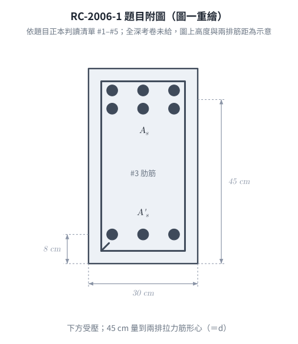
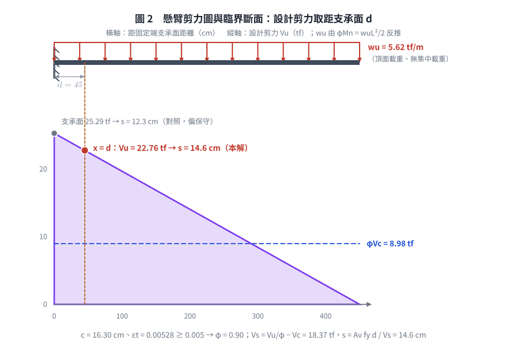

### 考題編號：RC-2006-1

**主分類：** `RC-U2-1` RC 剪力強度分析與設計
**副分類：** `RC-U1-1` RC 梁彎矩強度分析與設計
**設計法：** USD強度設計法
**標籤：** `懸臂梁` `雙筋梁` `壓力鋼筋未降伏` `剪力設計` `最大箍筋間距` `撓曲強度控制設計剪力` `#3箍筋`

---

## 1. 題目（考卷原文見題目正本）

> 考卷原文、公式／附表、附圖與判讀清單（已確認）見 [`RC-2006-1-problem.md`](RC-2006-1-problem.md)。本節只列解題時最容易讀錯的地方與本解使用的記號；題意以題目正本為準。

*重繪自考卷圖一，依題目正本判讀清單 #1–#5。本圖攔下的讀錯：45 cm 量到上方兩排拉力筋的形心（＝$d$），不是全深。*

### 常見誤讀

| 項目 | 正確判讀 | 常見誤讀 |
|------|---------|---------|
| 45 cm | 有效深度 $d$＝45 cm（受壓面至上方兩排拉力筋形心） | 全深 $h$，再扣 8 cm 得 $d$＝37（本庫 2026-11-15 前舊解，答 13.2 cm） |
| 受壓面 | 下方（懸臂負彎矩，拉力筋在上） | 照一般簡支梁以上方為受壓 |
| 8 cm | $d'$：底面至下排壓力筋中心 | 淨保護層 |
| 全深 $h$ | 考卷沒有給 | 補成 45 cm |
| 題目印出的 $\phi$ | 撓曲 0.9、剪力 0.75；依現行規範撓曲 $\phi$ 由 $\varepsilon_t$ 決定，本題 $\varepsilon_t$＝0.00528 屬拉力控制，0.9 成立 | 不檢查 $\varepsilon_t$ 直接用 0.9 |
| 臨界斷面 | 懸臂與支承一體、載重作用於頂面、無集中載重 → 取距固定端支承面 $d$ | 一律取固定端面（得 12.3 cm，偏保守） |

**本解記號：** $A_s$＝上方兩排拉力筋（40 cm²）；$A'_s$＝下方壓力筋（24 cm²）；$d$＝45、$d'$＝8 cm；$w_u$＝由 $\phi M_n$ 反推的設計載重；$A_v=2\times0.71=1.42$ cm²（兩肢）。規範：建築物混凝土結構設計規範（內政部 2023 年版）。

---

## 2. 考題核心精神與出題者意圖 (Core Concepts & Examiner's Intent)

**解題邏輯鏈：** $\phi M_n$ → 均布設計載重 $w_u$ → 臨界斷面 $V_u$ → 最大箍筋間距

**核心陷阱：** 壓力鋼筋應變 $\varepsilon'_s < \varepsilon_y$（**未降伏**），需二次方程求 $c$；45 cm 是 $d$ 不是 $h$。

---

## 3. 解題戰略地圖與陷阱分析 (Strategic Roadmap & Trap Analysis)

| 步驟 | 工作 |
|------|------|
| 1 | 先假設壓力鋼筋降伏，驗算 $\varepsilon'_s$ |
| 2 | 確認未降伏後，用二次方程解 $c$ |
| 3 | 計算 $M_n$，由 $\varepsilon_t$ 定 $\phi$，得 $\phi M_n$ |
| 4 | 由 $\phi M_n = w_u L^2/2$ 求 $w_u$，再求臨界斷面 $V_u$ |
| 5 | 由 $V_u$ 求所需 $V_s$，轉換為最大間距 $s$ |
| 6 | 比對規範最大間距限制 |

**三大陷阱：**

| 陷阱 | 說明 |
|------|------|
| ⚠ 壓力鋼筋是否降伏 | 先假設降伏→算出 $c$→驗算 $\varepsilon'_s$，本題未降伏 |
| ⚠ 臨界斷面位置須逐條驗三條件 | (a) 支承反力在端區產生壓力 (b) 載重施加於頂面 (c) 區間內無集中載重。懸臂梁與支承一體澆置時三條件成立 → 取距固定端支承面 $d$，$V_u = w_u(L-d)$ |
| ⚠ 最大間距閾值判斷 | $V_s$ 是否超過 $1.06\sqrt{f'_c}\,b_w d$，決定 $s_{\max}$ 取 $d/2$ 或 $d/4$ |

---

## 3.5 變數層次分析 (Variable Hierarchy Analysis)

### 最終目標
`由撓曲強度推算設計剪力，再計算最大箍筋間距`

### 本題關鍵公式鏈

$$\text{Step 1 (假設降伏)}: a_0 = \frac{(A_s-A_s')f_y}{0.85f'_c b} \Rightarrow c_0 = a_0/\beta_1 \Rightarrow \varepsilon'_s = 0.003\frac{c_0-d'}{c_0}$$

$$\text{Step 2 (未降伏，二次方程)}: 6{,}069c - \frac{1{,}175{,}040}{c} = 26{,}832 \Rightarrow c$$

$$\text{Step 3 (Mn)}: M_n = C_c\!\left(d-\frac{a}{2}\right) + C_s(d-d'),\quad \varepsilon_t = 0.003\frac{d-c}{c}\Rightarrow\phi$$

$$\text{Step 4}: w_u = \frac{2\phi M_n}{L^2},\quad V_u = w_u (L-d)$$

$$\text{Step 5}: V_s = \frac{V_u}{\phi} - V_c,\quad s_{max} = \frac{A_v f_y d}{V_s}$$

### L1：題目直接給定
$b$＝30、$d$＝45、$d'$＝8 cm；$A_s$＝40、$A'_s$＝24 cm²；$f'_c$＝280、$f_y$＝4200、$E_s$＝2.04×10⁶ kgf/cm²；$L$＝4.5 m；$A_v$＝1.42 cm²

### L2：$c$、$f'_s$、$M_n$、$\varepsilon_t$、$\phi$
### L3：$w_u$、$V_u$、$V_c$、$V_s$、$s$

---

## 4. 步驟化詳細計算過程 (Step-by-Step Detailed Calculation)

### Step 1：試驗壓力鋼筋是否降伏

假設 $f'_s = f_y$：
$$a_0 = \frac{(A_s - A_s')f_y}{0.85 f'_c b} = \frac{(40-24)\times4200}{0.85\times280\times30} = \frac{67{,}200}{7{,}140} = 9.41 \text{ cm}$$
$$c_0 = a_0/\beta_1 = 9.41/0.85 = 11.07 \text{ cm}$$

$$\varepsilon'_s = 0.003 \times \frac{c_0 - d'}{c_0} = 0.003 \times \frac{11.07-8}{11.07} = 0.000832 < \varepsilon_y = 0.00206 \quad \Rightarrow \text{壓力鋼筋\textbf{未降伏}}$$

### Step 2：未降伏，二次方程求 $c$

壓力鋼筋應力：
$$f'_s = E_s \cdot \varepsilon'_s = 2{,}040{,}000 \times 0.003 \times \frac{c-8}{c} = \frac{6{,}120(c-8)}{c}$$

力平衡（$T = C_c + C_s$，壓力筋在壓力區內，扣除混凝土）：
$$A_s f_y = 0.85 f'_c \cdot \beta_1 c \cdot b + A_s'(f'_s - 0.85 f'_c)$$

$$168{,}000 = 7{,}140 \times 0.85c + 24\!\left(\frac{6{,}120(c-8)}{c} - 238\right)$$

$$168{,}000 = 6{,}069c + \frac{146{,}880(c-8)}{c} - 5{,}712$$

$$6{,}069c - \frac{1{,}175{,}040}{c} = 26{,}832 \quad \Rightarrow \quad c^2 - 4.42c - 193.65 = 0$$

$$c = \frac{4.42 + \sqrt{4.42^2 + 4\times193.65}}{2} = \boxed{16.30 \text{ cm}},\qquad a = 0.85 \times 16.30 = 13.86 \text{ cm}$$

（$c$ 與 $d$ 無關：力平衡只含 $d'$。）

**驗算：**
$$f'_s = \frac{6{,}120\times(16.30-8)}{16.30} = 3{,}116 \text{ kgf/cm}^2 < f_y \quad \checkmark,\qquad d' = 8 < a = 13.86 \text{ cm} \ \checkmark$$

### Step 3：計算 $M_n$ 與 $\phi$

$$C_c = 0.85 \times 280 \times 13.86 \times 30 = 98{,}936 \text{ kgf},\qquad C_s = 24 \times (3{,}116 - 238) = 69{,}072 \text{ kgf}$$

$$M_n = 98{,}936\times(45-6.93) + 69{,}072\times(45-8) = 3{,}766{,}493 + 2{,}555{,}664 = 6{,}322{,}157 \text{ kgf·cm} = 63.22 \text{ tf·m}$$

$$\varepsilon_t = 0.003 \times \frac{45-16.30}{16.30} = 0.00528 \ \ge\ 0.005 \ \Rightarrow\ \text{拉力控制},\ \phi = 0.90$$

（拉力控制界限依本庫約定 SD420 取 0.005；若取 $\varepsilon_{ty}+0.003$＝0.00506，結論相同。）

（$d_t$ 未給，以 $d$ 代；最外排 $d_t > d$ 只會使 $\varepsilon_t$ 更大，結論不變。）

$$\phi M_n = 0.9 \times 6{,}322{,}157 = \boxed{5{,}689{,}941 \text{ kgf·cm} = 56.90 \text{ tf·m}}$$

### Step 4：設計載重與設計剪力

$$w_u = \frac{2\phi M_n}{L^2} = \frac{2 \times 5{,}689{,}941}{450^2} = 56.20 \text{ kgf/cm} = 5.620 \text{ tf/m}$$

臨界斷面取距固定端支承面 $d$（三條件成立，見 §5）：
$$V_u = w_u (L-d) = 56.20 \times (450-45) = \boxed{22{,}760 \text{ kgf}}$$

*圖 2　懸臂梁設計剪力沿梁長的分布與臨界斷面位置。本圖攔下的錯：臨界斷面一律取固定端面（三條件成立時應取距支承面 $d$），以及把 45 cm 當全深而縮小 $d$。*

### Step 5：混凝土剪力強度

$$V_c = 0.53\sqrt{f'_c} \cdot b_w \cdot d = 0.53 \times 16.733 \times 30 \times 45 = \boxed{11{,}973 \text{ kgf}}$$

$$\phi V_c = 0.75 \times 11{,}973 = 8{,}980 \text{ kgf} < V_u \quad \Rightarrow \text{需配箍筋}$$

### Step 6：所需 $V_s$ 與最大間距

$$V_s = \frac{V_u}{\phi} - V_c = \frac{22{,}760}{0.75} - 11{,}973 = 30{,}347 - 11{,}973 = 18{,}374 \text{ kgf}$$

**間距上限閾值**：$1.06\sqrt{f'_c}\,b_w d = 1.06 \times 16.733 \times 30 \times 45 = 23{,}945$ kgf > $V_s$ → $s_{max,code} = \min(d/2,\,60) = 22.5$ cm

**由剪力強度需求求最大間距：**
$$s = \frac{A_v f_y d}{V_s} = \frac{1.42 \times 4200 \times 45}{18{,}374} = \frac{268{,}380}{18{,}374} = 14.6 \text{ cm}$$

最少剪力筋：$s \le A_v f_{yt}/(3.5 b_w) = 1.42\times4200/(3.5\times30) = 56.8$ cm，不控制。

**最終最大間距：**
$$s_{max} = \min(14.6,\ 22.5) = \boxed{14.6 \text{ cm}}\quad（\text{實務取 \#3@14 cm}）$$

---

## 5. 關鍵爭議點與進階探討

### 懸臂梁臨界剪力斷面（三條件逐一判斷）

| # | 條件 | 本題判斷 |
|---|------|---------|
| (a) | 支承反力在端區產生**壓力** | 成立（懸臂梁與支承柱／牆一體，固定端反力壓入端區） |
| (b) | 載重施加於**頂面**（壓力側） | 成立（均布靜活載重自頂面施加） |
| (c) | 支承面與臨界斷面間**無集中載重** | 成立（純均布載重） |

→ 取距固定端支承面 $d$＝45 cm，$V_u = w_u(L-d)$。

> **注意（勿用錯理由）：** 「懸臂梁固定端剪力最大」<u>不是</u>不折減的理由 ——
> 簡支梁的剪力同樣是支承面最大、向內遞減，卻可採 d 偏移；真正的判準只有上表三條件。
>
> **對照（固定端面取 $V_u$，若支承為吊掛等 (a) 不成立情形）：** $V_u = w_uL = 25{,}290$ kgf → $V_s = 21{,}747$ kgf → $s = 12.3$ cm。
> 參見同類題 [RC-2023-3](../RC-2023-3/RC-2023-3.md)（懸臂、取 d 偏移）。

### 撓曲 φ 值確認（題目印 0.9，與現行規範比對）

拉力控制界限依本庫約定（SD420 取 0.005，2026-11-14 定案；現行規範式 $\varepsilon_{ty}+0.003$＝0.00506）；本題 $\varepsilon_t$＝0.00528 超過兩者 → $\phi$＝0.90，與題目印出值相同，答案不受影響。

### 舊解讀法對照（45 cm 誤當全深）

若把 45 cm 當 $h$、取 $d$＝37：$\varepsilon_t$＝0.00381 落在過渡區（現行 $\phi$＝0.80），且 $M_n$、$V_c$ 全部偏小；舊解照題目印的 0.9、固定端面取 $V_u$ 得 $s$＝13.2 cm。此讀法與考卷圖一 45 cm 尺寸線端點不符（見題目正本判讀清單 #1）。

*修正日期：2026-11-15（§1 改為指向題目正本，插入重繪附圖 figs/RC-2006-1-fig-1-problem.svg；舊 §1 重述改寫為常見誤讀與本解記號；本行非答案勘誤）*

*修正日期：2026-11-15（解析勘誤：45 cm 改讀為有效深度 d＝45（原讀 h＝45、d＝37）；臨界斷面改取距固定端支承面 d（使用者定案）；改依現行台灣規範（建築物混凝土結構設計規範 2023 年版）檢核 εt 與 φ；s 13.2 cm → 14.6 cm；驗證：盲解比對 + 勘誤腳本重算 MISMATCHES: 0）*

*修正日期：2026-11-15（圖解補繪（非勘誤）：新增 figs/RC-2006-1-fig-2-shear.svg，腳本 figs/gen_RC-2006-1.py，可重跑；答案不變）*
