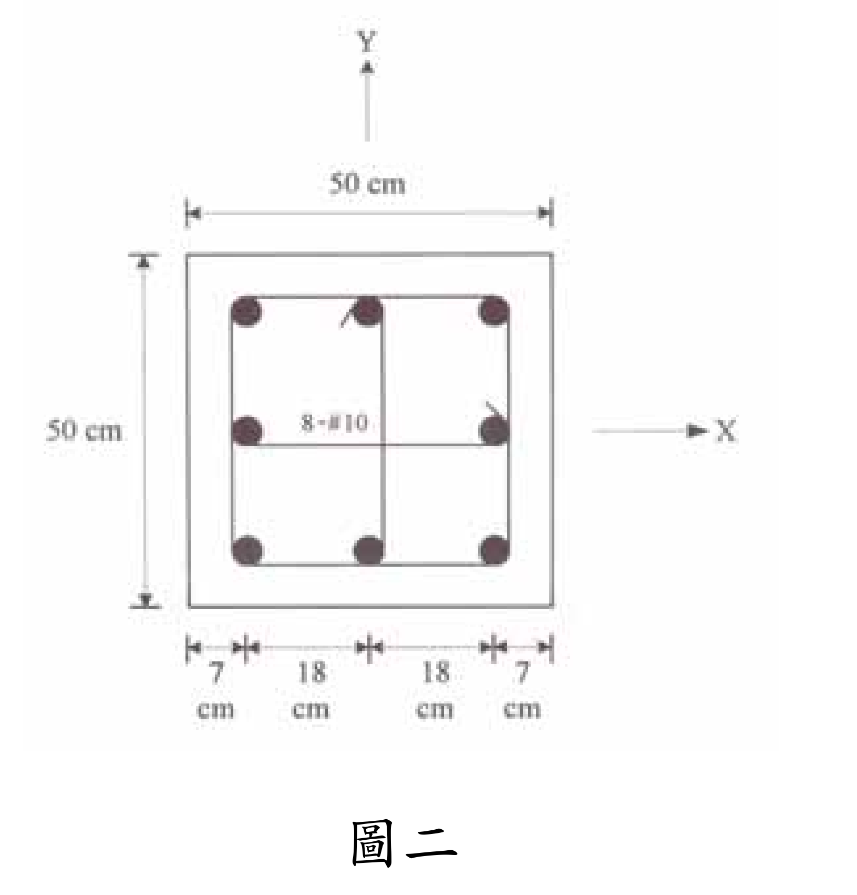

# RC-2006-2 題目正本

> 本檔只記錄**考卷上寫了什麼、圖上畫了什麼**，不含任何解法。解析見同資料夾 `RC-2006-2.md`。
> 判讀清單已經確認（凍結）；本檔原則上不再修改（改動須回考卷原圖並記 log）。

| 項目 | 內容 |
|------|------|
| 考卷 | `raw/exams/RC-2006_鋼筋混凝土設計與預力.pdf` 第 1 頁（正面），第二題 |
| 考年 | 民國 95 年（2006） |
| 配分 | 20 分 |
| 附圖 | `RC-2006-2-fig-2.png`（圖二：柱斷面；2026-11-15 由考卷重新擷取 500 dpi）；既有 `RC-2006-2-fig-1.png` 為同一圖，右上空白處有滑鼠游標，保留不刪 |
| 判讀狀態 | **已確認**（2026-11-15 使用者授權依 Claude 建議確認；轉錄 2026-11-15；PyMuPDF 110 dpi 全頁目視，附圖 400–450 dpi 局部放大；文字以 PDF 文字層核對（公式以影像為準）（圖二為嵌入點陣圖，450 dpi 目視）；盲讀後才比對既有解析） |

## 1. 考卷原文（逐字）

> 二、有一無側移柱，淨高 6 m，其斷面如圖二所示，$f'_c$＝280 kgf/cm²，$f_y$＝4200 kgf/cm²，$E_s$＝2.04×10⁶ kgf/cm²，#10 鋼筋之斷面積為 8.14 cm²。此柱承受軸向壓力及對 Y 軸之單向彎矩，柱之有效長度因數 k＝0.9。此柱之設計軸力 $P_u$＝400 tf，最大設計軸向靜載重與設計軸力之比值 $\beta_d$＝0.3，柱頭之設計彎矩 $M_u$＝15 tf-m，柱腳之設計彎矩 $M_u$＝27 tf-m，且柱成單曲率彎曲，試以彎矩放大法求設計此柱時所應採用之放大彎矩 $M_c$ 值為何？（20 分）

## 2. 考卷給的公式、附表與參數

- 題文數值：無側移；淨高 6 m；$f'_c$＝280、$f_y$＝4200、$E_s$＝2.04×10⁶ kgf/cm²；#10 $A_b$＝8.14 cm²；對 Y 軸單向彎矩；$k$＝0.9；$P_u$＝400 tf；$\beta_d$＝0.3；柱頭 $M_u$＝15、柱腳 $M_u$＝27 tf-m；單曲率。
- **沒有給**：$E_c$、$EI$ 計算式、$\phi_k$（勁度折減因數）、$C_m$ 與 $\delta_{ns}$ 公式、#10 的 $d_b$、保護層（圖上只有筋心位置）、作答規範。
- 卷首注意事項：㈠可以使用電子計算器。㈡不必抄題，作答時請將試題題號及答案依照順序寫在試卷上，於本試題上作答者，不予計分。

## 3. 附圖

圖面文字照錄：`Y`、`50 cm`、`50 cm`、`8-#10`、`X`、`7 cm`、`18 cm`、`18 cm`、`7 cm`、`圖二`。

## 4. 判讀清單

「把握」標**不確定**者優先列；解讀類項目（題目用字的意思）另標「解讀」。標「依 Claude 建議確認」者，為使用者 2026-11-15 授權「要我確認的請依你建議」後定案。

| # | 項目 | 判讀 | 圖上／題文依據 | 把握 |
|---|------|------|---------------|------|
| 1 | Y 向筋位 | Y 向未標尺寸；依方形對稱取與 X 向相同：筋心距上下緣 7 cm、列距 18 cm | 圖上三排筋的垂直間距與水平間距目視相同；斷面為正方形 | 確定（解讀） |
| 2 | 下方尺寸鏈 | 7（左緣→左列筋心）＋18（左列→中列筋心）＋18（中列→右列筋心）＋7（右列筋心→右緣）＝50 cm | 450 dpi：各段界線分別對齊外緣與三列筋心 | 確定 |
| 3 | 主筋排列 | 8-#10：四角 4 根＋四邊中點 4 根（3×3 扣中心）；$A_{st}$＝8×8.14＝65.12 cm² | 圖上 8 個實心圓、中心無筋 | 確定 |
| 4 | 彎矩方向 | 對 Y 軸彎曲：彎曲面為 X–Z 平面，斷面深度沿 X 向 50 cm；三列筋（距左緣 7、25、43 cm）各 3、2、3 根 | 題文「對 Y 軸之單向彎矩」；座標軸 | 確定 |
| 5 | 端彎矩 | 柱頭 15、柱腳 27 tf-m（皆為設計值），單曲率 | 題文 | 確定 |
| 6 | $\beta_d$ | 題給 0.3（最大設計軸向靜載重／設計軸力） | 題文 | 確定 |
| 7 | 斷面 | 50×50 cm | 上方、左側 50 cm 尺寸對齊外緣 | 確定 |
| 8 | 箍筋與繫筋 | 外圍閉合箍＋垂直、水平各一支繫筋（號數未標，本題用不到） | 圖上線條 | 確定 |
| 9 | 考卷沒有給 | $E_c$、$EI$ 式、$\phi_k$、$C_m$／$\delta_{ns}$ 式、作答規範 | 全題 | 確定 |

---

*轉錄：2026-11-15（RC-U3-3 批 2＋U1-3＋U2-3 題目正本推廣）*

*確認：2026-11-15 使用者授權依 Claude 建議確認（RC-U3-3 批 2＋U1-3＋U2-3 題目正本推廣，關卡一）*
