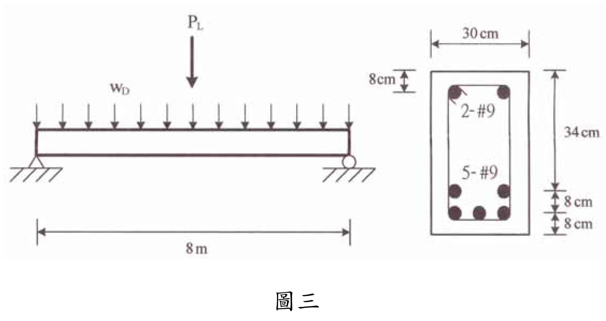

# RC-2006-3 題目正本

> 本檔只記錄**考卷上寫了什麼、圖上畫了什麼**，不含任何解法。解析見同資料夾 `RC-2006-3.md`。
> 判讀清單已經確認（凍結）；本檔原則上不再修改（改動須回考卷原圖並記 log）。

| 項目 | 內容 |
|------|------|
| 考卷 | `raw/exams/RC-2006_鋼筋混凝土設計與預力.pdf` 第 2 頁（背面），第三題 |
| 考年 | 民國 95 年（2006） |
| 配分 | 20 分 |
| 附圖 | `RC-2006-3-fig-2.png`（圖三：簡支梁立面＋梁斷面；2026-11-15 由考卷重新擷取 500 dpi）；既有 `RC-2006-3-fig-1.png` 為同一圖，梁下方空白處有滑鼠游標，保留不刪 |
| 判讀狀態 | **已確認**（2026-11-15 使用者授權依 Claude 建議確認；轉錄 2026-11-15；PyMuPDF 110 dpi 全頁目視，附圖 250–450 dpi 局部放大；文字以 PDF 文字層核對；盲讀後才比對既有解析） |

## 1. 考卷原文（逐字）

> 三、有一簡支梁及其斷面如圖三所示，$f'_c$＝280 kgf/cm²，$f_y$＝4200 kgf/cm²，$E_s$＝2.04×10⁶ kgf/cm²，n＝8，#9 鋼筋之斷面積為 6.47 cm²。若於梁上先施加 0.8 tf/m 之均布靜載重 wD（含自重），再於梁中央施加一 5 tf 之集中活載重 PL，試求施加集中活載重 PL 後於梁中央所增加之即時撓度為何？（20 分）（註：可不考慮壓力筋之影響）

## 2. 考卷給的公式、附表與參數

- 題文數值：$f'_c$＝280、$f_y$＝4200、$E_s$＝2.04×10⁶ kgf/cm²；$n$＝8；#9 面積 6.47 cm²；$w_D$＝0.8 tf/m（含自重）先施加；$P_L$＝5 tf 後施加於梁中央；可不考慮壓力筋。
- **沒有給**：$E_c$（只給 $n$＝8）、開裂模數 $f_r$、混凝土種類（常重／輕質）、有效慣性矩的計算式。
- 卷首注意事項：㈠可以使用電子計算器。㈡不必抄題，作答時請將試題題號及答案依照順序寫在試卷上，於本試題上作答者，不予計分。

## 3. 附圖

圖面文字照錄：`PL`、`wD`、`8m`、`30cm`、`8cm`、`2-#9`、`5-#9`、`34cm`、`8cm`、`8cm`、`圖三`。

## 4. 判讀清單

「把握」標**不確定**者優先列；解讀類項目（題目用字的意思）另標「解讀」。標「依 Claude 建議確認」者，為使用者 2026-11-15 授權「要我確認的請依你建議」後定案。

| # | 項目 | 判讀 | 圖上／題文依據 | 把握 |
|---|------|------|---------------|------|
| 1 | 右側尺寸鏈 34＋8＋8 | **全深 $h$＝50 cm**：34 cm 由頂面量到底部上排拉力筋中心，8 cm 為兩排拉力筋中心距，8 cm 由下排筋中心量到底面 | 500 dpi：34cm 上端延伸線與斷面頂面對齊、下端延伸線與上排（2 根）筋心對齊；中間 8cm 兩端分別對齊上排、下排筋心；最下 8cm 下端對齊斷面底面 | 確定（影響答案）；依 Claude 建議確認 |
| 2 | 拉力筋 5-#9 排列 | 兩排：下排 3 根（距底 8 cm）、上排 2 根（距底 16 cm，位於兩角）；$A_s$＝5×6.47＝32.35 cm²；形心距底 $(3\times8+2\times16)/5$＝11.2 cm | 圖上下排 3 個實心圓、其上一排左右各 1 個；`5-#9` 標於兩排上方 | 確定 |
| 3 | 壓力筋 2-#9 | 頂部 2 根，中心距頂面 8 cm；題目註明可不考慮 | 左上 8cm 尺寸線上端對齊頂面、下端對齊頂筋心；題文註 | 確定 |
| 4 | 梁寬 | $b$＝30 cm（斷面外緣） | 30cm 尺寸線延伸線對齊斷面左右外緣 | 確定 |
| 5 | 支承與跨度 | 左端鉸支、右端滾支；跨度 8 m（支承間） | 左端三角形鉸支承、右端圓形滾支承；8m 尺寸線兩端對齊兩支承 | 確定 |
| 6 | 載重 | $w_D$＝0.8 tf/m 全跨均布（含自重），先施加；$P_L$＝5 tf 於跨度中央，後施加 | 圖上全跨均布箭頭＋跨中單一集中箭頭；題文「先…再…」 | 確定 |
| 7 | 所求 | 施加 $P_L$ 後跨中**增加**的即時撓度＝（$w_D$＋$P_L$ 作用下的跨中即時撓度）－（僅 $w_D$ 作用下的跨中即時撓度），兩者各依其彎矩算有效慣性矩 | 題文「施加集中活載重 $P_L$ 後於梁中央所增加之即時撓度」 | 確定（解讀） |
| 8 | 考卷沒有給 | $E_c$（由 $n$＝8 反推 $E_c=E_s/n$）、$f_r$、混凝土種類 | 全題 | 確定 |

---

*轉錄：2026-11-15（RC-U3-1／U3-2 題目正本推廣・批 1）*

*確認：2026-11-15 使用者授權依 Claude 建議確認（RC-U3-1／U3-2 題目正本推廣・批 1，關卡一）*
