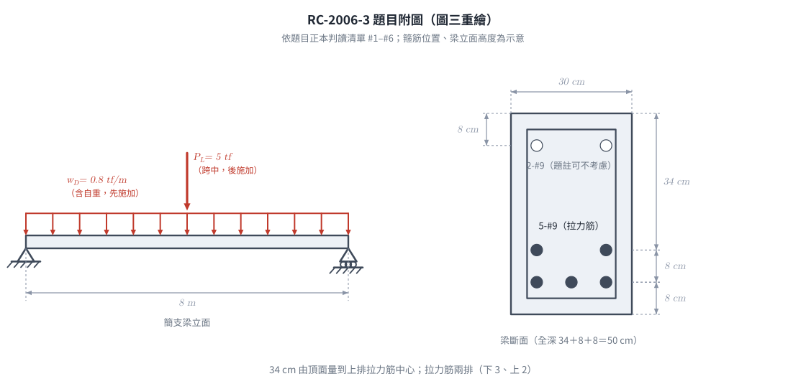
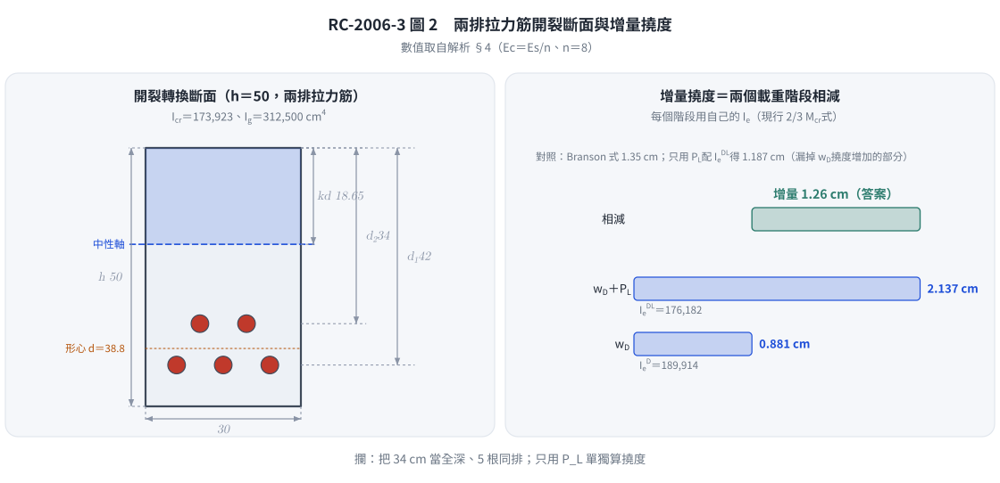

### 考題編號：RC-2006-3

**主分類：** `RC-U3-1` 梁工作性要求（含撓度、裂縫）
**副分類：** 無
**設計法：** USD強度設計法
**標籤：** `簡支梁` `即時撓度增量` `有效慣性矩Ie` `開裂彎矩Mcr` `轉換斷面法` `集中活載重` `忽略壓力筋` `現行規範2023` `兩排拉力筋`

---

## 1. 題目（考卷原文見題目正本）

> 考卷原文、公式／附表、附圖與判讀清單（已確認）見 [`RC-2006-3-problem.md`](RC-2006-3-problem.md)。本節只列解題時最容易讀錯的地方與本解使用的記號；題意以題目正本為準。

*重繪自考卷圖三，依題目正本判讀清單 #1–#6。本圖攔下的讀錯：34 cm 只量到上排拉力筋中心，全深是 34＋8＋8＝50 cm；拉力筋兩排，形心距底 11.2 cm。*

### 常見誤讀

| 項目 | 正確判讀 | 常見誤讀 |
|------|---------|---------|
| 右側尺寸鏈 | 34（頂面→上排拉力筋心）＋8（兩排筋心距）＋8（下排筋心→底面）＝全深 50 cm | 把 34 cm 當全深、再扣 8 cm 得有效深度（本庫舊解） |
| 拉力筋排列 | 下排 3 根（距底 8）、上排 2 根（距底 16），形心距底 11.2 cm → $d$＝38.8 cm | 5 根同排、形心距底 8 cm |
| 壓力筋 | 2-#9 距頂 8 cm，題註可不考慮 | 納入轉換斷面 |
| 所求 | （$w_D$＋$P_L$）與（僅 $w_D$）兩狀態跨中即時撓度之差，各自依其彎矩算 $I_e$ | 只用 $P_L$ 單獨的彎矩算 $I_e$ 與撓度 |
| $E_c$ | 考卷只給 $n$＝8 → $E_c=E_s/n$ | 另用 $15000\sqrt{f'_c}$ |
| $I_e$ 公式 | 現行規範表 24.2.3.5：$I_e=\dfrac{I_{cr}}{1-\left(\frac{(2/3)M_{cr}}{M_a}\right)^2\left(1-\frac{I_{cr}}{I_g}\right)}$（$M_a>\frac23M_{cr}$） | 沿用 Branson 三次方式（舊規範） |

**本解記號：** $b$＝30 cm；$h$＝50 cm；$d$＝38.8 cm（兩排形心）；$A_s$＝5×6.47＝32.35 cm²；$n$＝8；$L$＝800 cm。

---

## 2. 考題核心精神與出題者意圖 (Core Concepts & Examiner's Intent)

**核心：** 兩個不同荷載水準（$w_D$ 與 $w_D+P_L$）對應不同的 $I_e$，增量撓度 = 全部載重下的撓度 − 僅 $w_D$ 下的撓度。

**關鍵：** 先從右側尺寸鏈 34＋8＋8 讀出全深 50 cm、拉力筋兩排（題目正本 #1、#2）；兩個載重水準都已開裂（$M_a>M_{cr}$），$I_e$ 依現行規範表 24.2.3.5（$\frac23M_{cr}$ 式）計算。

---

## 3. 解題戰略地圖與陷阱分析 (Strategic Roadmap & Trap Analysis)

| 步驟 | 工作 |
|------|------|
| 1 | 計算 $M_D$（均布 $w_D$）和 $M_{D+L}$（$w_D$ + $P_L$ 之跨中彎矩）|
| 2 | 計算 $I_g$、$M_{cr}$（全深 $h$＝50 cm）|
| 3 | 計算 $I_{cr}$（兩排拉力筋分別計，忽略壓力鋼筋）|
| 4 | 計算 $I_e^D$（在 $M_D$ 水準）和 $I_e^{DL}$（在 $M_{D+L}$ 水準）|
| 5 | 計算 $\Delta_D$（僅 $w_D$）和 $\Delta_{D+L}$（$w_D$ + $P_L$）|
| 6 | 增量 $= \Delta_{D+L} - \Delta_D$ |

**三大陷阱：**

| 陷阱 | 說明 |
|------|------|
| ⚠ 尺寸鏈 | 34 cm 只到上排拉力筋中心，全深＝34＋8＋8＝50 cm；$d_1$＝42（下排）、$d_2$＝34（上排） |
| ⚠ 兩個 $I_e$ 不同 | $\Delta_D$ 用 $I_e^D$，$\Delta_{D+L}$ 用 $I_e^{DL}$（各自對應最大彎矩水準）|
| ⚠ 均布＋集中混合撓度 | $\Delta_{D+L} = 5w_D L^4/(384E_cI_e^{DL}) + P_L L^3/(48E_cI_e^{DL})$（同一 $I_e^{DL}$）|

---

## 3.5 變數層次分析 (Variable Hierarchy Analysis)

### 最終目標
`計算加入 PL 後跨中即時撓度增量 Δ_PL`

### 本題關鍵公式鏈

$$I_{cr}: \quad \frac{b(kd)^2}{2} = nA_{s1}(d_1-kd)+nA_{s2}(d_2-kd) \Rightarrow kd$$

$$I_e = \frac{I_{cr}}{1-\left(\dfrac{(2/3)M_{cr}}{M_a}\right)^2\left(1-\dfrac{\boxed{I_{cr}}}{I_g}\right)}\le I_g \quad(M_a>\tfrac23M_{cr})$$

$$\Delta_D = \frac{5w_D L^4}{384 E_c \boxed{I_e^D}}, \quad \Delta_{D+L} = \frac{5w_D L^4}{384 E_c \boxed{I_e^{DL}}} + \frac{P_L L^3}{48 E_c \boxed{I_e^{DL}}}$$

$$\Delta_{P_L} = \Delta_{D+L} - \Delta_D$$

### L2：需知識點推導（關鍵數字）

| 符號 | 值 | 說明 |
|------|---|------|
| $E_c$ | $E_s/n = 255{,}000$ kgf/cm² | $n=8$ given |
| $A_{s1},\ d_1$ | 19.41 cm²、42 cm | 下排 3-#9 |
| $A_{s2},\ d_2$ | 12.94 cm²、34 cm | 上排 2-#9（形心 $d$＝38.8 cm） |
| $I_g$ | $312{,}500$ cm⁴ | $30\times50^3/12$ |
| $M_{cr}$ | $4.183$ tf·m | $2\sqrt{280}\times312{,}500/25$ |
| $M_D$ | $6.40$ tf·m | $0.8\times8^2/8$ |
| $M_{D+L}$ | $16.40$ tf·m | $6.40+5\times8/4$ |
| $kd$ | 18.65 cm | 二次方程 |
| $I_{cr}$ | $173{,}923$ cm⁴ | 兩排分算 |
| $I_e^D$ | $189{,}914$ cm⁴ | 現行式 |
| $I_e^{DL}$ | $176{,}182$ cm⁴ | 現行式 |
| $\Delta_D$ | 0.881 cm | |
| $\Delta_{D+L}$ | 2.137 cm | |
| $\Delta_{P_L}$ | **1.26 cm** | |

### L3：深層知識（不懂就卡住）

| 知識點 | 說明 | 卡關? |
|--------|------|:-----:|
| 尺寸鏈讀法 | 延伸線對齊的是鋼筋中心還是外緣，決定 $h$ 與 $d$ | ⚠ |
| 現行 $I_e$ 式 | ACI 318-19 起改用 Bischoff 式並以 $\frac23M_{cr}$ 折減開裂彎矩（考慮收縮約束使實際開裂提早）；Branson 式在低配筋時高估勁度 | ⚠ |
| 增量撓度要兩階段相減 | 兩階段 $I_e$ 不同，不能只用 $P_L$ 配 $I_e^{DL}$ | |

---

## 4. 步驟化詳細計算過程 (Step-by-Step Detailed Calculation)

### Step 1：彎矩計算

$$M_D = \frac{w_D L^2}{8} = \frac{8 \times 800^2}{8} = 640{,}000 \text{ kgf·cm} = 6.40 \text{ tf·m}$$

$$M_L^{conc} = \frac{P_L \cdot L}{4} = \frac{5{,}000 \times 800}{4} = 1{,}000{,}000 \text{ kgf·cm} = 10.0 \text{ tf·m}$$

$$M_{D+L} = 640{,}000 + 1{,}000{,}000 = 1{,}640{,}000 \text{ kgf·cm} = 16.40 \text{ tf·m}$$

### Step 2：截面性質（$h$＝50 cm）

$$E_c = \frac{E_s}{n} = \frac{2{,}040{,}000}{8} = 255{,}000 \text{ kgf/cm}^2$$

$$I_g = \frac{30 \times 50^3}{12} = 312{,}500 \text{ cm}^4,\qquad f_r = 2\sqrt{280} = 33.47 \text{ kgf/cm}^2, \quad y_t = 25 \text{ cm}$$

$$M_{cr} = \frac{f_r I_g}{y_t} = \frac{33.47 \times 312{,}500}{25} = 418{,}330 \text{ kgf·cm} = 4.183 \text{ tf·m}$$

$$M_D = 6.40 \text{ tf·m} > M_{cr} = 4.183 \text{ tf·m} \quad \Rightarrow \text{兩個載重水準都已開裂}$$

### Step 3：開裂轉換斷面中性軸 $kd$（兩排拉力筋分別計，忽略壓力鋼筋）

$$A_{s1} = 3\times6.47 = 19.41\text{ cm}^2\ (d_1 = 42),\qquad A_{s2} = 2\times6.47 = 12.94\text{ cm}^2\ (d_2 = 34)$$

$$\frac{b(kd)^2}{2} = nA_{s1}(d_1-kd) + nA_{s2}(d_2-kd)$$
$$15(kd)^2 + 258.8(kd) - 8(19.41\times42 + 12.94\times34) = 0$$
$$15(kd)^2 + 258.8(kd) - 10{,}041.4 = 0$$

$$kd = \frac{-258.8 + \sqrt{258.8^2 + 4\times15\times10{,}041.4}}{2\times15} = \boxed{18.65 \text{ cm}}$$

$$I_{cr} = \frac{30 \times 18.65^3}{3} + 8\times19.41\times(42 - 18.65)^2 + 8\times12.94\times(34-18.65)^2$$

$$= 64{,}837 + 84{,}685 + 24{,}401 = \boxed{173{,}923 \text{ cm}^4}$$

（以兩排形心 $d$＝38.8 cm 單一鋼筋計：$I_{cr}$＝169,948 cm⁴，差 2%。）

### Step 4：有效慣性矩 $I_e$（現行規範表 24.2.3.5）

$$\frac23M_{cr} = 2.789\text{ tf·m},\qquad 1-\frac{I_{cr}}{I_g} = 1-\frac{173{,}923}{312{,}500} = 0.4434$$

**$w_D$ 水準**（$M_a = M_D = 6.40$ tf·m）：
$$\left(\frac{2.789}{6.40}\right)^2 = 0.1899,\qquad I_e^D = \frac{173{,}923}{1-0.1899\times0.4434} = \boxed{189{,}914 \text{ cm}^4}$$

**$w_D+P_L$ 水準**（$M_a = M_{D+L} = 16.40$ tf·m）：
$$\left(\frac{2.789}{16.40}\right)^2 = 0.02892,\qquad I_e^{DL} = \frac{173{,}923}{1-0.02892\times0.4434} = \boxed{176{,}182 \text{ cm}^4}$$

### Step 5：各階段撓度

$$\frac{5w_DL^4}{384} = \frac{5\times8\times800^4}{384} = 4.2667\times10^{10},\qquad \frac{P_LL^3}{48} = \frac{5{,}000\times800^3}{48} = 5.3333\times10^{10}$$

**僅 $w_D$：**
$$\Delta_D = \frac{4.2667 \times 10^{10}}{255{,}000 \times 189{,}914} = \boxed{0.881 \text{ cm}}$$

**$w_D + P_L$（均採 $I_e^{DL}$）：**
$$\Delta_{D+L} = \frac{4.2667\times10^{10} + 5.3333\times10^{10}}{255{,}000 \times 176{,}182} = 0.950 + 1.187 = \boxed{2.137 \text{ cm}}$$

### Step 6：集中活載重引起之即時撓度增量

$$\Delta_{P_L}^{incr} = \Delta_{D+L} - \Delta_D = 2.137 - 0.881 = \boxed{1.26 \text{ cm}}$$

---

*圖 2　兩排拉力筋開裂斷面與兩階段撓度相減。攔：把 34 cm 當全深、5 根同排；只用 $P_L$ 配 $I_e^{DL}$（1.187 cm）而漏掉 $w_D$ 撓度因勁度下降增加的部分。*

## 5. 關鍵爭議點與進階探討

### 舊解的錯誤（本次勘誤）

舊解把 34 cm 當全深、單排拉力筋距底 8 cm（$d$＝26 cm），得 $I_g$＝98,260、$I_{cr}$＝64,668 cm⁴，撓度增量 3.27 cm，高估約 2.6 倍。考卷圖三右側尺寸鏈 34／8／8 的延伸線依序對齊頂面、上排筋心、下排筋心、底面（題目正本 #1），全深是 50 cm。

### $I_e$ 式對照（同一讀法）

| 方法 | $I_e^D$ | $I_e^{DL}$ | $\Delta_D$ | $\Delta_{D+L}$ | 增量 |
|------|------|------|------|------|------|
| 現行規範（$\frac23M_{cr}$ 式，主線） | 189,914 | 176,182 | 0.881 | 2.137 | **1.26 cm** |
| Branson $(M_{cr}/M_a)^3$（舊規範） | 212,623 | 176,223 | 0.787 | 2.136 | 1.35 cm |
| 兩階段皆用 $I_{cr}$ | 173,923 | 173,923 | — | — | 1.20 cm |

- 增量主要來自 $P_L$ 直接作用在接近開裂的斷面上：只用 $P_L$ 與 $I_e^{DL}$ 算得 1.187 cm；另 0.07 cm 來自 $w_D$ 撓度因 $I_e$ 由 $I_e^D$ 降為 $I_e^{DL}$ 而增加。
- Branson 式在 $M_D/M_{cr}$＝1.5 附近勁度偏高（$I_e^D$ 大 12%），使 $\Delta_D$ 偏小、增量偏大。

### 若不忽略壓力鋼筋（$A'_s$＝12.94 cm²）

加入 $A'_s$ 後 $kd$ 縮小、$I_{cr}$ 增大，撓度減小。本題註明可不考慮，故不計。

### 撓度限制參考

$L/d=800/38.8=20.6$；$\Delta_{D+L}/L = 2.137/800 = 1/374$，活載重增量 $1.26$ cm ＜ $L/360=2.22$ cm（規範表 24.2.2 不支承易損非結構構件之樓版，活載重即時撓度參考限值）。

*修正日期：2026-11-15（§1 改為指向題目正本，插入重繪附圖 figs/RC-2006-3-fig-1-problem.svg；舊 §1 重述改寫為常見誤讀與本解記號；本行非答案勘誤）*

*修正日期：2026-11-15（FIX-RC-U3-B1 解析勘誤，改依現行台灣規範（建築物混凝土結構設計規範 2023）：尺寸鏈改讀全深 $h$＝50 cm、拉力筋兩排 $d_1$＝42／$d_2$＝34（題目正本 #1、#2，考卷第 2 頁圖三）；$I_g$ 98,260 → 312,500、$M_{cr}$ 1.94 → 4.183 tf·m、$I_{cr}$ 64,668 → 173,923 cm⁴；$I_e$ 改現行表 24.2.3.5（$\frac23M_{cr}$ 式）；增量撓度 3.27 → **1.26 cm**（Branson 對照 1.35 cm）；撤除 §1 待勘誤提示。驗證：check_errata_U3_B1.py 重算、Ie 式兩種寫法交叉，MISMATCHES: 0）*

*圖解補繪：2026-11-15（DIAG-RC-U3-B1，向量圖，腳本 `figs/gen_RC-2006-3.py`，可重跑；非勘誤、答案不變）*
