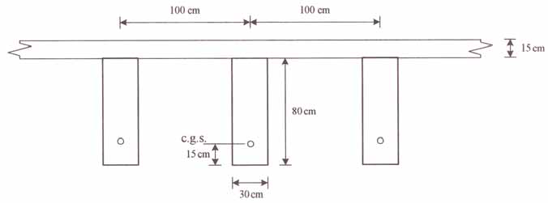

# RC-2006-4 題目正本

> 本檔只記錄**考卷上寫了什麼、圖上畫了什麼**，不含任何解法。解析見同資料夾 `RC-2006-4.md`。
> 判讀清單已經使用者確認（凍結）；本檔原則上不再修改（改動須回考卷原圖並記 log）。

| 項目 | 內容 |
|------|------|
| 考卷 | `raw/exams/RC-2006_鋼筋混凝土設計與預力.pdf` 第 2 頁（背面），第四題 |
| 考年 | 民國 95 年（2006） |
| 配分 | 20 分 |
| 附圖 | `RC-2006-4-fig-2.png`（圖四；2026-11-14 由考卷內嵌影像原生解析度 676×251 抽出，無游標）；既有 `RC-2006-4-fig-1.png` 為同一圖放大、30cm 尺寸線旁有滑鼠游標，保留不刪 |
| 判讀狀態 | **已確認**（2026-11-14 使用者確認；影響答案項目使用者選擇：#2 梁中心距 100 cm（解析原用 200 cm，另行勘誤）；轉錄 2026-11-14；PyMuPDF 110 dpi 全頁目視＋抽出文字核對，附圖為掃描點陣、以原生影像 2× 放大目視；盲讀後才比對既有解析） |

## 1. 考卷原文（逐字）

> 四、有一簡支預力梁，其跨度為 20 m，梁寬為 30 cm，梁全深為 80 cm，梁之 $f'_c$ =350 kgf/cm²。在此梁中，預力損失後預力鋼鍵之有效預力為 210 tf。此梁在預力損失後開始吊裝，並在其上澆置 15 cm 厚樓版，澆置樓版時利用梁作為支撐，澆置後跨度中央梁與樓版之斷面如圖四所示，樓版之 $f'_c$ =280 kgf/cm²。當樓版硬化並與梁結合為一體後，再於樓版上施加 1.0 tf/m² 之均布活載重。試求施加均布活載重後，跨度中央斷面預力梁上緣及下緣之混凝土所承受之應力為何？（20 分）

（「鋼鍵」照考卷原文。）

## 2. 考卷給的公式、附表與參數

- 題文數值：跨度 20 m；梁 $30 \times 80$ cm（全深）、$f'_c = 350$；有效預力 210 tf（損失後）；樓版厚 15 cm、$f'_c = 280$；活載重 1.0 tf/m²。
- 考卷未印任何公式。
- **沒有給**：混凝土單位重、$E_c$（或兩種混凝土的模數比）、有效翼版寬規定、鋼腱線形（只給跨中 c.g.s.）、容許應力（題目只求應力，未要求檢核）。
- 卷首注意事項：可以使用電子計算器。不必抄題，作答時請將試題題號及答案依照順序寫在試卷上，於本試題上作答者，不予計分。

## 3. 附圖

圖面文字照錄：`100 cm`、`100 cm`、`15cm`、`80cm`、`c.g.s.`、`15cm`、`30cm`、`圖四`。

## 4. 判讀清單

「把握」標**不確定**者請優先確認；解讀類項目（題目用字的意思）另標「解讀」。

| # | 項目 | 判讀 | 圖上／題文依據 | 把握 |
|---|------|------|---------------|------|
| 1 | 梁深 80 cm 的量測基準 | **梁本身全深 80 cm（樓版底面到梁底），不含 15 cm 樓版**；合成斷面總深 95 cm | 80cm 尺寸線上端箭頭對齊樓版底／梁頂、下端對齊梁底（原生影像 2×）；題文「梁全深為 80 cm」 | 確定 |
| 2 | 梁距 | 梁中心距 100 cm | 兩段 100cm 尺寸線端點落在三支梁的中心（左梁中心 ≈ x 297、中梁 ≈ 617、右梁 ≈ 937，2× 影像 px） | 確定 |
| 3 | 鋼腱位置（跨中） | c.g.s. 距梁底 15 cm → 距梁頂 65 cm | 15cm 尺寸線上端對齊 c.g.s. 引線水平、下端對齊梁底 | 確定 |
| 4 | 樓版 | 厚 15 cm，$f'_c=280$；兩端折斷線＝連續版 | 圖上 15cm、題文 | 確定 |
| 5 | 施工順序 | 梁先受預力（損失後）＋自重 → 澆版時版重由**梁單獨**承擔 → 硬化後合成斷面承受活載重 | 題文「澆置樓版時利用梁作為支撐」「當樓版硬化並與梁結合為一體後，再於樓版上施加」 | 確定 |
| 6 | 活載重換算 | 1.0 tf/m² 作用於版面；每支梁分擔寬度依梁距 100 cm | 題文、#2 | 確定（解讀） |
| 7 | 問的量 | 施加活載重後、**跨中**、**預力梁**（不是樓版）上緣與下緣的混凝土應力 | 題文 | 確定 |
| 8 | 考卷沒有給 | 混凝土單位重、$E_c$／模數比、有效翼版寬規定、鋼腱線形 | 全題 | 確定（作答須自行假設） |

---

*轉錄：2026-11-14（RC-U4-1 題目正本推廣・批 1）*

*確認：2026-11-14 使用者確認（RC-U4-1 題目正本推廣・批 1，關卡一）*
