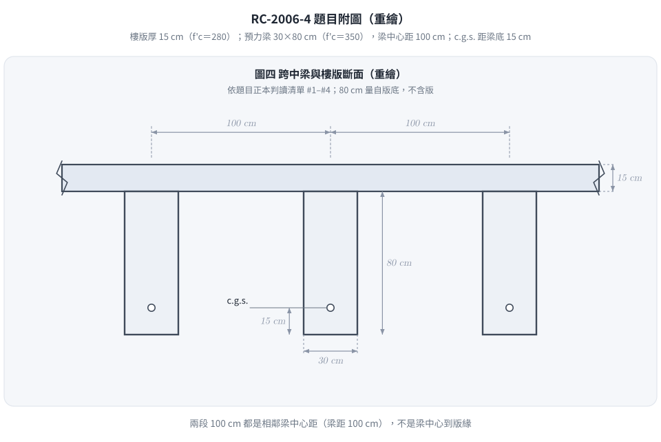
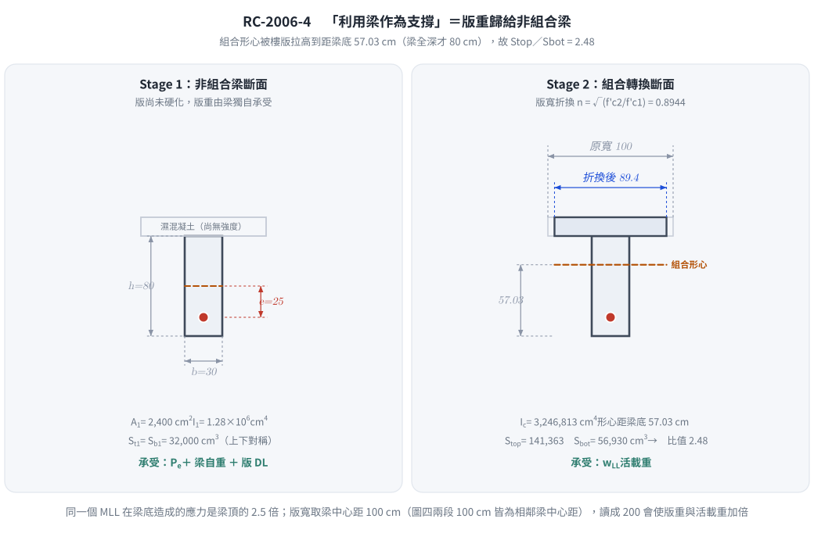
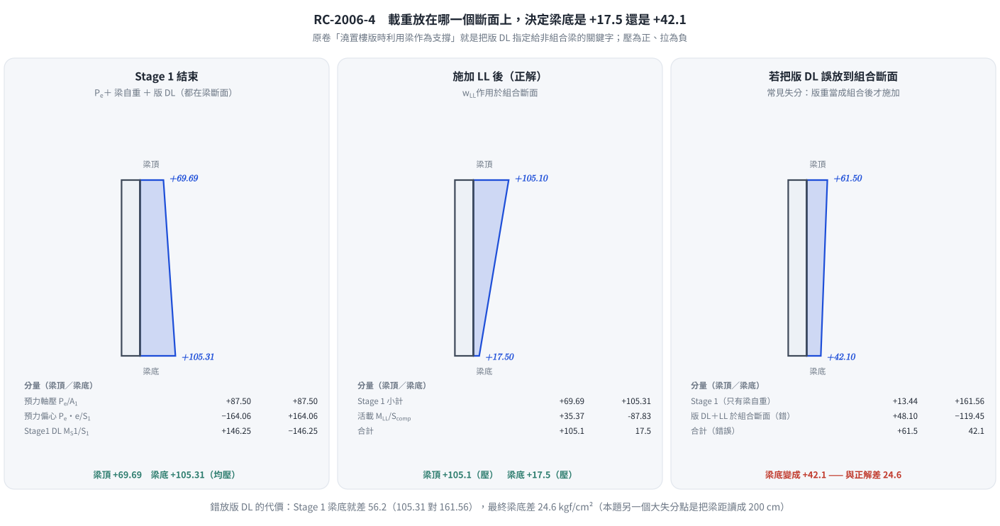
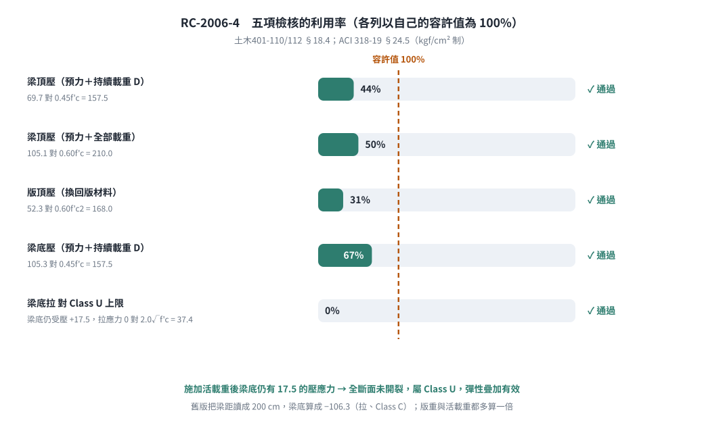

### 考題編號：RC-2006-4

**主分類：** `RC-U4-1` 預力梁斷面應力分析
**副分類：** 無
**設計法：** WSD工作應力法
**標籤：** `後拉法` `組合T型斷面` `兩階段應力疊加` `非組合梁承受DL` `組合梁承受LL` `上緣壓力` `下緣拉力` `不同f'c轉換` `梁距100cm`

---

## 1. 題目（考卷原文見題目正本）

> 考卷原文、公式／附表、附圖與判讀清單（已確認）見 [`RC-2006-4-problem.md`](RC-2006-4-problem.md)。本節只列解題時最容易讀錯的地方與本解使用的記號；題意以題目正本為準。

*重繪自考卷圖四，依題目正本判讀清單。圖上兩段 100 cm 都是**相鄰梁的中心距**——本圖攔下「把 100 cm 當成梁中心到版緣、梁距讀成 200 cm」的誤讀（舊版解析即犯此錯，版重與活載重多算一倍）。*

### 常見誤讀

| 項目 | 正確判讀 | 常見誤讀 |
|------|---------|---------|
| 梁距（題目正本 #2） | 兩段 100 cm 皆為相鄰梁中心距 → 梁距 100 cm，每支梁分擔版寬 100 cm | 讀成「梁中心向兩側各 100 cm」→ 梁距 200 cm（梁底會被算成拉 106.3，結論整個反轉） |
| 梁深 80 cm（#1） | 梁本身全深，量自版底；合成斷面總深 95 cm | 把 80 當成含版的總深 |
| 施工順序（#5） | 「澆置樓版時利用梁作為支撐」→ 版重由**非組合梁**承受；活載重才由合成斷面承受 | 版重放到合成斷面 |
| 問的量（#7） | 跨中、**預力梁**上緣與下緣的應力 | 改答版頂應力，或只答活載增量 |

**本解記號：** 壓為正、拉為負（kgf/cm²）；$P_e = 210$ tf；$A_1, I_1, S_1$ 為梁單獨斷面；$\bar y$ 為合成斷面形心距梁底；$S_{c,top}$、$S_{c,bot}$ 為合成斷面對**梁頂**、梁底的斷面模數（梁材料）；$n = \sqrt{f'_{c2}/f'_{c1}}$ 為版對梁的模數比。

**自行假設（考卷未給）：** 混凝土單位重 $\gamma_c = 2400$ kgf/m³；$E_c \propto \sqrt{f'_c}$；有效翼寬取 $\min(L/4,\ b_w+16h_f,\ \text{梁距})$。

---

## 2. 考題核心精神與出題者意圖 (Core Concepts & Examiner's Intent)

**兩階段施工順序：**
- **Stage 1（非組合梁）：** $P_e$ + 梁自重 + 版濕混凝土 DL → 作用於梁斷面
- **Stage 2（組合斷面）：** $w_{LL}$ → 作用於組合轉換斷面

**控制條件：** 本題不要求驗算，只求應力值；§5 另依現行台灣規範做容許應力檢核。

---

## 3. 解題戰略地圖與陷阱分析 (Strategic Roadmap & Trap Analysis)

| 步驟 | 工作 |
|------|------|
| 1 | 計算梁斷面性質（$A_1$, $I_1$, $S_{t1}$, $S_{b1}$）|
| 2 | Stage 1：預力 + 梁 SW + 版 DL → 梁頂/底應力 |
| 3 | 計算組合轉換斷面（有效翼寬 100 cm，$n=\sqrt{280/350}$）|
| 4 | Stage 2：$w_{LL}$ → 組合斷面增量應力 |
| 5 | 疊加得最終應力 |

**四大陷阱：**

| 陷阱 | 說明 |
|------|------|
| ⚠ 梁距讀成 200 cm | 圖四兩段 100 cm 是相鄰梁中心距；讀錯會使版重、活載重、翼寬全部加倍 |
| ⚠ 版 DL 作用在非組合梁 | 版尚未硬化時，版重由梁獨自承受 |
| ⚠ $n = \sqrt{f'_{c2}/f'_{c1}}$（非 1）| 版混凝土較弱，需折減轉換 |
| ⚠ LL 在組合斷面上 | 版硬化後形成組合，活載重作用於組合截面 |

---

## 3.5 變數層次分析 (Variable Hierarchy Analysis)

### 最終目標
`疊加 Stage1（預力+DL）和 Stage2（LL）應力，得梁頂梁底最終應力`

### 本題關鍵公式鏈

$$\text{Stage 1: } f = \frac{P_e}{A_1} \pm \frac{P_e \cdot e}{S_1} \mp \frac{M_{S1}}{S_1}$$

$$b_e = \min\!\left(\tfrac{L}{4},\ b_w+16h_f,\ s\right), \quad n = \sqrt{\frac{f'_{c2}}{f'_{c1}}}, \quad b' = b_e \times n, \quad \bar{y} = \frac{\sum A_i y_i}{\sum A_i}$$

$$\text{Stage 2: } \Delta f = \pm \frac{M_{LL} \cdot y}{I_c}$$

### L2 關鍵數值

| 符號 | 值 |
|------|---|
| $e$ | $40-15=25$ cm |
| $A_1, I_1$ | 2400 cm², 1,280,000 cm⁴ |
| $S_{t1}=S_{b1}$ | 32,000 cm³ |
| $w_{S1}$ | $576+360=936$ kgf/m |
| $M_{S1}$ | 4,680,000 kgf·cm |
| $f_{top}^{S1}$, $f_{bot}^{S1}$ | +69.69, +105.31 kgf/cm²（均壓縮）|
| $b_e$, $n$, $b'$ | 100 cm, 0.8944, 89.44 cm |
| $\bar{y}$ | 57.03 cm（梁底起）|
| $I_c$ | 3,246,813 cm⁴ |
| $S_{c,top}$, $S_{c,bot}$ | 141,363, 56,930 cm³ |
| $M_{LL}$ | 5,000,000 kgf·cm |
| $\Delta f_{top}^{LL}$, $\Delta f_{bot}^{LL}$ | +35.37, −87.83 kgf/cm² |
| **梁頂最終** | **+105.1 kgf/cm²（壓縮）** |
| **梁底最終** | **+17.5 kgf/cm²（壓縮）** |

---

## 4. 步驟化詳細計算過程 (Step-by-Step Detailed Calculation)

### Step 1：非組合梁斷面性質

$$A_1 = 30 \times 80 = 2{,}400 \text{ cm}^2, \quad I_1 = \frac{30 \times 80^3}{12} = \frac{30 \times 512{,}000}{12} = 1{,}280{,}000 \text{ cm}^4$$

$$S_{t1} = S_{b1} = \frac{I_1}{h/2} = \frac{1{,}280{,}000}{40} = 32{,}000 \text{ cm}^3$$

偏心距：$e = \frac{h}{2} - 15 = 40 - 15 = \boxed{25 \text{ cm}}$

---

### Step 2：Stage 1（非組合梁：$P_e$ + 梁 SW + 版 DL）

**預力應力（壓縮為正）：**

$$f_{top}^{PS} = \frac{P_e}{A_1} - \frac{P_e \cdot e}{S_{t1}} = \frac{210{,}000}{2{,}400} - \frac{210{,}000 \times 25}{32{,}000} = 87.50 - 164.06 = \boxed{-76.56 \text{ kgf/cm}^2 \text{ （拉）}}$$

$$f_{bot}^{PS} = \frac{P_e}{A_1} + \frac{P_e \cdot e}{S_{b1}} = 87.50 + 164.06 = \boxed{+251.56 \text{ kgf/cm}^2 \text{ （壓）}}$$

**Stage 1 DL 荷載（作用於非組合梁；每支梁分擔版寬＝梁距 1.0 m）：**

$$w_{beam} = 2400 \times \frac{30 \times 80}{10{,}000} = 576 \text{ kgf/m} = 5.76 \text{ kgf/cm}$$

$$w_{slab} = 2400 \times 0.15 \times 1.00 = 360 \text{ kgf/m} = 3.60 \text{ kgf/cm}$$

$$w_{S1} = 5.76 + 3.60 = 9.36 \text{ kgf/cm}$$

$$M_{S1} = \frac{9.36 \times 2000^2}{8} = 9.36 \times 500{,}000 = 4{,}680{,}000 \text{ kgf·cm}$$

**Stage 1 DL 應力：**

$$f_{top}^{S1,DL} = +\frac{M_{S1}}{S_{t1}} = +\frac{4{,}680{,}000}{32{,}000} = +146.25 \text{ kgf/cm}^2 \text{ （壓）}$$

$$f_{bot}^{S1,DL} = -\frac{M_{S1}}{S_{b1}} = -146.25 \text{ kgf/cm}^2 \text{ （拉）}$$

**Stage 1 總應力（預力 + DL）：**

$$f_{top}^{S1} = -76.56 + 146.25 = \boxed{+69.69 \text{ kgf/cm}^2 \text{ （壓）}}$$

$$f_{bot}^{S1} = +251.56 - 146.25 = \boxed{+105.31 \text{ kgf/cm}^2 \text{ （壓）}}$$

---

### Step 3：組合轉換斷面

有效翼寬：

$$b_e = \min\left(\frac{L}{4},\ b_w + 16h_f,\ s\right) = \min(500,\ 30+16\times15=270,\ 100) = \boxed{100 \text{ cm}}$$

$$n = \sqrt{\frac{f'_{c2}}{f'_{c1}}} = \sqrt{\frac{280}{350}} = \sqrt{0.800} = 0.8944$$

轉換版寬：$b' = 100 \times 0.8944 = 89.44$ cm

各子斷面（梁底起量）：

| 子斷面 | 面積 $A_i$ | 形心 $y_i$ |
|--------|----------|----------|
| 梁（30×80）| 2,400 cm² | 40 cm |
| 轉換版（89.44×15）| 1,341.6 cm² | 80+7.5 = 87.5 cm |

**組合形心：**
$$\bar{y} = \frac{2{,}400 \times 40 + 1{,}341.6 \times 87.5}{2{,}400 + 1{,}341.6} = \frac{96{,}000 + 117{,}394}{3{,}741.6} = \frac{213{,}394}{3{,}741.6} = \boxed{57.03 \text{ cm}}$$

各關鍵距離：
- 梁底至形心：57.03 cm（$y_{bot}$）
- 形心至梁頂：$80 - 57.03 = 22.97$ cm（$y_{beam,top}$）
- 形心至版頂：$95 - 57.03 = 37.97$ cm

**組合慣性矩：**

$$I_{beam} = 1{,}280{,}000 + 2{,}400 \times (57.03 - 40)^2 = 1{,}280{,}000 + 2{,}400 \times 290.1 = 1{,}976{,}240 \text{ cm}^4$$

$$I_{slab} = \frac{89.44 \times 15^3}{12} + 1{,}341.6 \times (87.5 - 57.03)^2 = 25{,}156 + 1{,}341.6 \times 928.4 = 25{,}156 + 1{,}245{,}417 = 1{,}270{,}573 \text{ cm}^4$$

$$I_c \approx \boxed{3{,}246{,}813 \text{ cm}^4}$$

> 上兩行為取三位有效數字的展示值，加總為 3,246,813（精算 $\bar y = 57.032$ cm）。下方 $S$ 值以精算值計。

**截面模數（梁材料）：**
$$S_{c,top} = \frac{I_c}{y_{beam,top}} = \frac{3{,}246{,}813}{22.97} = 141{,}363 \text{ cm}^3$$

$$S_{c,bot} = \frac{I_c}{\bar{y}} = \frac{3{,}246{,}813}{57.03} = 56{,}930 \text{ cm}^3$$

> $S_{c,top}/S_{c,bot} = 2.48$——組合後形心上移到距梁底 57.03 cm（梁全深 80 cm），同一個 $M_{LL}$ 在梁底造成的應力是梁頂的 2.5 倍。

*圖 1　兩個階段、兩個斷面。組合後形心距梁底 57.03 cm，$S_{c,top}/S_{c,bot} = 2.48$——這張圖攔的是「兩階段共用同一組斷面性質」：若 LL 誤用裸梁的 $S_b = 32{,}000$，梁底拉應力增量會算成 156.3 而非 87.8；版寬取梁距 100 cm，讀成 200 會使版重與活載重加倍。*

---

### Step 4：Stage 2（組合斷面：$w_{LL}$ 均布活載重）

$$w_{LL} = 1.0 \text{ tf/m}^2 \times 1.0 \text{ m} = 1.0 \text{ tf/m} = 10.0 \text{ kgf/cm}$$

$$M_{LL} = \frac{10.0 \times 2000^2}{8} = 10.0 \times 500{,}000 = 5{,}000{,}000 \text{ kgf·cm}$$

**LL 增量應力（作用於梁）：**

$$\Delta f_{top}^{LL} = +\frac{M_{LL}}{S_{c,top}} = +\frac{5{,}000{,}000}{141{,}363} = +\boxed{35.37 \text{ kgf/cm}^2 \text{ （壓）}}$$

$$\Delta f_{bot}^{LL} = -\frac{M_{LL}}{S_{c,bot}} = -\frac{5{,}000{,}000}{56{,}930} = -\boxed{87.83 \text{ kgf/cm}^2 \text{ （拉）}}$$

---

### Step 5：施加 LL 後梁頂/底總應力

| 位置 | Stage 1 | Stage 2 LL | **總應力** |
|------|---------|-----------|-----------|
| 梁頂 | +69.69（壓）| +35.37（壓）| $\boxed{+105.1 \text{ kgf/cm}^2}$（**壓縮**）|
| 梁底 | +105.31（壓）| −87.83（拉）| $\boxed{+17.5 \text{ kgf/cm}^2}$（**壓縮**）|

**答：** 施加均布活載重後，跨中預力梁**上緣 +105.1 kgf/cm²（壓）**、**下緣 +17.5 kgf/cm²（壓）**；全斷面仍受壓。

*圖 2　載重該掛在哪個斷面上。版澆置時組合作用尚未形成，版 DL 必須由裸梁單獨承擔——最右格是把版 DL 誤放到組合斷面的結果，梁底從 +17.5 變成 +42.1，高估了梁底的預壓餘裕。*

---

## 5. 關鍵爭議點與進階探討

### ⚠ 舊版梁距判讀錯誤（2026-11-14 勘誤）

舊版把圖四兩段 100 cm 讀成「梁中心向兩側各 100 cm」，梁距取 200 cm，於是版重 720 kgf/m、$w_{LL}$ 2.0 tf/m、翼寬 200 cm 全部加倍，得到梁頂 +161.6、梁底 **−106.3（拉）**，並據此判斷「Class C 已開裂、預力不足」。考卷圖四兩段尺寸線的端點都落在梁中心（左、中、右三梁），梁距是 100 cm；改正後梁底仍有 +17.5 的預壓，**原來的開裂結論不成立**。

| 讀法 | 版重 | $M_{LL}$ | 合成形心 | 梁頂 | 梁底 |
|---|---|---|---|---|---|
| **梁距 100 cm（本解）** | 360 kgf/m | 50 tf·m | 57.03 | **+105.1** | **+17.5（壓）** |
| 梁距 200 cm（舊版誤讀） | 720 kgf/m | 100 tf·m | 65.07 | +161.6 | −106.3（拉） |

### 容許應力檢核（現行台灣規範：建築物混凝土結構設計規範 112 年版 §24.5，kgf/cm² 制）

題目只求應力；以下依現行規範判讀其意義。

| 位置 | 計算應力 | 載重組合 | 容許值 | 判斷 |
|------|---------|---------|--------|------|
| 梁頂（壓）| **69.7** | 預力＋持續載重（梁、版自重）| $0.45f'_c = 157.5$ | ✅（44%）|
| 梁頂（壓）| **105.1** | 預力＋全部載重 | $0.60f'_c = 210.0$ | ✅（50%）|
| 梁底（壓）| **105.3** | 預力＋持續載重 | $0.45f'_c = 157.5$ | ✅（67%）|
| 梁底（全部載重）| **+17.5（壓）** | 使用階段 | 拉應力 ≤ U 類 $2.0\sqrt{f'_c} = 37.4$ | ✅ 無拉應力 → **U 類（未開裂）** |
| 版頂（壓）| **52.3** | 活載重（換回版材料）| $0.60f'_{c2} = 168$ | ✅ |

**結論：** 全斷面在使用載重下仍受壓，屬 U 類，§4 的未開裂彈性疊加完全有效。

*圖 3　五條檢核各自對哪一個容許值。$0.45f'_c$ 管持續載重、$0.60f'_c$ 管全部載重——這張圖攔的是拿 $0.4f'_c$、$3\sqrt{f'_c}$ 這類規範查不到的係數去判斷，以及梁距讀成 200 cm 而誤判開裂。*

### 版頂應力驗算（附加）

版頂位於組合形心上方 $95 - 57.03 = 37.97$ cm，LL 引起之版頂壓應力（須乘 $n$ 換回版材料）：

$$f_{deck,top}^{LL} = +\frac{M_{LL} \times y_{deck,top}}{I_c} \times n = +\frac{5{,}000{,}000 \times 37.97}{3{,}246{,}813} \times 0.8944 = 58.47 \times 0.8944 = 52.3 \text{ kgf/cm}^2$$

$52.3 < 0.60f'_{c2} = 168$ ✓

### 版 DL 在 Stage 1 而非 Stage 2

若版 DL 誤置於組合斷面（Stage 2），Stage 1 只扣掉梁自重：

$$f_{bot}^{S1,\text{錯誤}} = +251.56 - \frac{5.76\times500{,}000}{32{,}000} = +251.56 - 90.0 = +161.56\ \text{kgf/cm}^2$$

最終梁底變成 $+161.56 - (1{,}800{,}000 + 5{,}000{,}000)/56{,}930 = +42.1$（正解 +17.5），差 24.6 kgf/cm²。原卷「**澆置樓版時利用梁作為支撐**」就是判定依據。

### 附記：吊裝後、澆版前的梁底壓應力

$P_e$＋梁自重（版尚未澆置）時，梁底 $= 251.56 - 90.0 = +161.56$，略高於 $0.45f'_c = 157.5$（2.6%）。此狀態只維持到澆版為止，屬施工暫態；題目也未給施預力時強度 $f'_{ci}$ 與初始預力，無法做傳遞階段檢核。作答時可註明但不影響本題答案。

### 幾何與假設的精度說明

- $\gamma_c = 2400$ kgf/m³ 為原卷**未給**之假設。若改用 2,300 kgf/m³，$M_{S1}/S_1$ 由 146.25 降為 140.16 → 梁頂 $+98.96$、梁底 $+23.58$ kgf/cm²，結論（全斷面受壓）不變。作答時務必把假設寫出來。
- 版的有效寬度：$\min(L/4=500,\ b_w+16h_f=270,\ \text{梁距}=100) = 100$ cm，即梁距控制。
- $n = E_{c2}/E_{c1}$，以 $E_c = 15000\sqrt{f'_c}$（現行規範常重混凝土式）代入得 $\sqrt{280/350}$。

### 規範版本說明

95 年考卷未指定規範版本。依本庫「規範版本」規定，容許應力一律用現行台灣規範（112 年版 §24.5：U／T／C 分類與 $0.45f'_c$、$0.60f'_c$ 壓應力限制）；本題計算本身（兩階段疊加、組合斷面折換）新舊規範沒有差異。

---

*圖解補繪：2026-08-31（向量圖 3 張，腳本 `figs/gen_RC-2006-4.py`，可重跑；腳本檔尾對 §4／§5 公佈值做 assert）*

*修正日期：2026-11-14（解析勘誤：梁距由 200 cm 改為 100 cm（題目正本判讀 #2，考卷圖四兩段 100 cm 皆為相鄰梁中心距）；版重 720→360 kgf/m、$w_{LL}$ 2.0→1.0 tf/m、翼寬 200→100 cm；梁頂 +161.6→+105.1、梁底 −106.3（拉）→+17.5（壓），Class C 結論撤銷改為 U 類；舊 §6 規範對照併入 §5，改依現行台灣規範（建築物混凝土結構設計規範 112 年版）；驗證：verify_RC-2006-4.py 重算 12 值 MISMATCHES: 0，條帶積分第二路徑梁底差 0.000；圖 1–3 依新數值重跑）*

*修正日期：2026-11-14（§1 改為指向題目正本，重繪題目附圖 figs/RC-2006-4-fig-1-problem.svg）*
