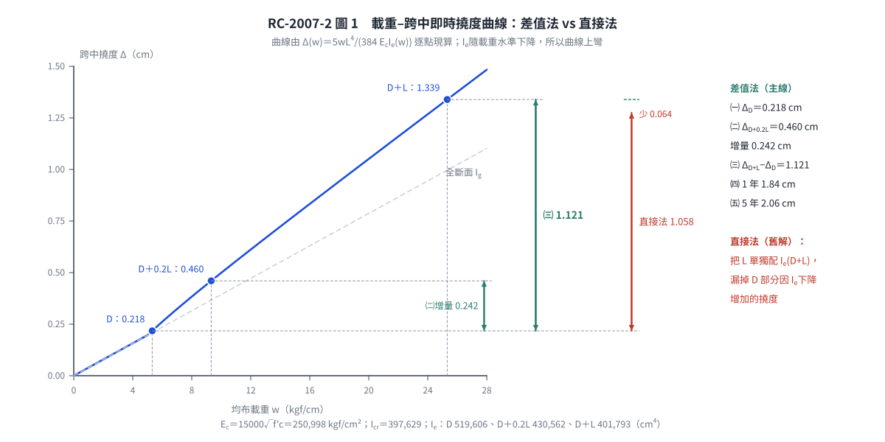

### 考題編號：RC-2007-2

**主分類：** `RC-U3-1` 梁工作性要求（含撓度、裂縫）
**副分類：** 無
**設計法：** USD強度設計法
**標籤：** `雙筋梁` `即時撓度` `長期撓度` `有效慣性矩Ie` `開裂彎矩Mcr` `λ長期修正係數` `五小題撓度` `20%持續活載重` `現行規範2023` `差值法`

---

## 1. 題目（考卷原文見題目正本）

> 考卷原文、公式／附表、附圖與判讀清單（已確認）見 [`RC-2007-2-problem.md`](RC-2007-2-problem.md)。本節只列解題時最容易讀錯的地方與本解使用的記號；題意以題目正本為準。

### 常見誤讀

| 項目 | 正確判讀 | 常見誤讀 |
|------|---------|---------|
| 拉力筋有效深度 $d$ | 考卷沒有給，須由「8-D25 平均分列兩排」自行假設保護層、箍筋與排距並明列 | 把假設值當作題目已知 |
| 持續載重 | 靜載重＋20% 活載重；$(\Delta_i)_{sus}$ 依題意可寫 D＋0.2L 的總即時撓度，或其中 0.2L 的增量（兩者並列） | 只算靜載重或把全部活載重當持續 |
| ㈡㈢ 計算法 | **差值法**：$\Delta_{D+0.2L}-\Delta_D$、$\Delta_{D+L}-\Delta_D$，每個載重水準用自己的 $I_e$ | 直接法：把 0.4、2.0 tf/m 單獨配上 $I_e$ 算（本庫舊解，低估約 7%） |
| ㈢活載重瞬間位移 | （D＋L）即時撓度減 D 即時撓度（$I_e$ 依各自彎矩） | 只用活載重彎矩算 $I_e$ |
| 長期乘數 | 只乘持續部分（靜載重＋20% 活載重），$\lambda$ 含 $\rho'$（3-D19） | 全部活載重也乘長期乘數 |
| 卷首係數 | 載重因數與 $\phi$ 本題（使用載重撓度）用不到 | 撓度用因數化載重 |
| $E_c$ | 本題沒有給 $n$ → $E_c=15000\sqrt{f'_c}$ | 直接用 $E_s/8$ |
| $I_e$ 公式 | 現行規範表 24.2.3.5（$\frac23M_{cr}$ 式）；$M_D$＝4.256 ＞ $\frac23M_{cr}$＝4.016，故 $I_{e,D}<I_g$ | Branson 式且以 $M_D<M_{cr}$ 判 $I_e=I_g$ |

**本解記號：** $b\times h$＝30×60 cm；$A_s$＝40.56 cm²（兩排，$d$＝50.94 cm 為假設）；$A'_s$＝8.55 cm²、$d'$＝6.5 cm；$L$＝800 cm；$w_D$＝自重＋0.1 tf/m；$w_L$＝2 tf/m（20% 持續）。

---

## 2. 考題核心精神與出題者意圖 (Core Concepts & Examiner's Intent)

**核心：** 三個載重水準（D、D＋0.2L、D＋L）各自計算 $I_e$ 與總即時撓度，所求的「某部分載重造成的撓度」以**差值法**取得；長期撓度只乘持續載重部分。

**關鍵觀察：** $M_D$＝4.256 tf·m 小於 $M_{cr}$＝6.024 但大於 $\frac23M_{cr}$＝4.016，依現行 $I_e$ 式已開始折減（$I_{e,D}$＝519,606 ＜ $I_g$）；加上持續活載重與全部活載重後深度開裂。

---

## 3. 解題戰略地圖與陷阱分析 (Strategic Roadmap & Trap Analysis)

| 步驟 | 工作 |
|------|------|
| 1 | 假設 $d$（兩排形心），計算各荷載水準之 $M_a$ |
| 2 | 計算 $M_{cr}$、$I_{cr}$ |
| 3 | 三個水準分別求 $I_e$（現行式）與總即時撓度 $\Delta_D$、$\Delta_{D+0.2L}$、$\Delta_{D+L}$ |
| 4 | 差值法得 ㈡㈢ |
| 5 | 計算 $\lambda_\Delta$（1年/5年），總撓度 $=\Delta_{D+L}+\lambda_\Delta\Delta_{D+0.2L}$ |

**四大陷阱：**

| 陷阱 | 說明 |
|------|------|
| ⚠ 直接法 vs 差值法 | 撓度與載重非線性（$I_e$ 隨 $M_a$ 改變），部分載重的撓度須用「總撓度相減」 |
| ⚠ $\frac23M_{cr}$ 門檻 | 現行式在 $M_a>\frac23M_{cr}$ 就折減；本題 D 水準已過門檻 |
| ⚠ 長期公式只乘持續載重 | $\lambda_\Delta$ 只作用於 D＋0.2L 的即時撓度，非全部活載重 |
| ⚠ $\rho'$ 的定義 | $\rho' = A_s'/(b \cdot d)$，用**壓力鋼筋**面積 |

---

## 3.5 變數層次分析 (Variable Hierarchy Analysis)

> 複習提示：第一次解題後，在每個卡住的知識點旁標記 `⚠`；第二次複習時只看有 `⚠` 的項目。

### 最終目標
`求 D、持續、活載重的即時撓度，再疊加長期效應得 1 年與 5 年總撓度`

### 本題關鍵公式（依計算順序）

$$\text{Step 1: } M_{cr} = \frac{f_r \cdot I_g}{y_t}, \quad f_r = 2\sqrt{f'_c}$$

$$\text{Step 2 (Icr): } \frac{b(\boxed{kd})^2}{2} + (n-1)A_s'(\boxed{kd}-d') = nA_{s1}(d_1-\boxed{kd})+nA_{s2}(d_2-\boxed{kd})$$

$$\text{Step 3: } I_e = \frac{\boxed{I_{cr}}}{1-\left(\dfrac{(2/3)M_{cr}}{M_a}\right)^2\left(1-\dfrac{I_{cr}}{I_g}\right)}\le I_g$$

$$\text{Step 4: } \Delta_{(\cdot)} = \frac{5w_{(\cdot)}L^4}{384 E_c \boxed{I_{e,(\cdot)}}},\quad (\Delta_i)_{sus}=\Delta_{D+0.2L}-\Delta_D,\quad (\Delta_i)_l=\Delta_{D+L}-\Delta_D$$

$$\text{Step 5: } \lambda_\Delta = \frac{\xi}{1+50\rho'}, \quad \Delta_{total} = \Delta_{D+L} + \lambda_\Delta\,\Delta_{D+0.2L}$$

### L1：題目直接給定

| 符號 | 數值 | 說明 |
|------|------|------|
| $b, h$ | 30, 60 cm | 斷面 |
| $d'$ | 6.5 cm | 壓力筋深度 |
| $L$ | 800 cm | 跨距 |
| $A_s$ | 40.56 cm² | 8-D25 兩排 |
| $A_s'$ | 8.55 cm² | 3-D19 |
| $w_{LL}$ | 2 tf/m（20% 持續）| 活載重 |

假設（考卷未給）：淨保護層 4 cm、D13 箍筋、兩排淨距 2.5 cm；$E_c=15000\sqrt{f'_c}$；$f_r=2\sqrt{f'_c}$。

### L2：需知識點推導

**Step 1：荷載、幾何**

| 符號 | 公式/來源 | 卡關? |
|------|----------|:-----:|
| $d_1,\ d_2$ | $60-(4+1.27+1.27)=53.46$；$53.46-(2.54+2.5)=48.42$ cm | |
| $d$ | 兩排形心 $50.94$ cm | |
| $w_D$ | $2.4\times0.30\times0.60+0.1=0.532$ tf/m = 5.32 kgf/cm | |
| $w_{D+0.2L}$ | $5.32+4.0=9.32$ kgf/cm | |
| $w_{D+L}$ | $5.32+20.0=25.32$ kgf/cm | |
| $M_D,\ M_{D+0.2L},\ M_{D+L}$ | 4.256、7.456、20.256 tf·m | |

**Step 2：斷面性質**

| 符號 | 公式/來源 | 卡關? |
|------|----------|:-----:|
| $E_c$ | $15000\sqrt{280} = 250{,}998$ kgf/cm²，$n=8.128$ | |
| $I_g$ | $30\times60^3/12=540{,}000$ cm⁴ | |
| $M_{cr}$ | $2\sqrt{280}\times540{,}000/30=6.024$ tf·m；$\frac23M_{cr}$＝4.016 | ⚠ |
| $kd$ | 二次方程 = 23.25 cm | |
| $I_{cr}$ | 四項合計 = 397,629 cm⁴ | |

**Step 3：各荷載水準 $I_e$ 與總即時撓度**

| 情況 | $M_a$ (tf·m) | $\left(\frac{(2/3)M_{cr}}{M_a}\right)^2$ | $I_e$ (cm⁴) | 總即時撓度 |
|------|-------|-------------|------------------|-------|
| D | 4.256 | 0.8904 | 519,606 | $\Delta_D$＝0.218 cm |
| D＋0.2L | 7.456 | 0.2901 | 430,562 | $\Delta_{D+0.2L}$＝0.460 cm |
| D＋L | 20.256 | 0.0393 | 401,793 | $\Delta_{D+L}$＝1.339 cm |

**Step 4：差值法與長期係數**

| 符號 | 公式/來源 | 卡關? |
|------|----------|:-----:|
| ㈡ 增量 | $0.460-0.218=0.242$ cm | ⚠ |
| ㈢ | $1.339-0.218=1.121$ cm | ⚠ |
| $\rho'$ | $8.55/(30\times50.94)=0.00559$ | |
| $\lambda_{1yr},\ \lambda_{5yr}$ | $1.4/1.2797=1.094$；$2.0/1.2797=1.563$ | |

### L3：深層知識（不懂就卡住）

| 知識點 | 說明 | 卡關? |
|--------|------|:-----:|
| 為何用差值法 | 撓度＝$\int M\,dx/(E_cI_e)$，$I_e$ 隨載重水準改變，撓度與載重非線性；某部分載重的撓度＝（加上它之後的總撓度）−（加之前的總撓度） | ⚠ |
| 現行 $I_e$ 式 | ACI 318-19 起改 Bischoff 式並以 $\frac23M_{cr}$ 計，反映收縮約束提早開裂；Branson 式低配筋時高估勁度 | ⚠ |
| $\xi$ 對應時間 | 1年→1.4，5年→2.0（3月=1.0，6月=1.2） | |
| 長期公式只乘持續部分 | $\lambda_\Delta$ 描述潛變＋乾縮，只有持續載重才會持續潛變 | |
| 兩排鋼筋的 $d$ | $I_{cr}$ 兩排分別計；$\rho'$、敘述用形心 $d$ | |

---

## 4. 步驟化詳細計算過程 (Step-by-Step Detailed Calculation)

### Step 1：幾何與荷載

有效深度（考卷未給，假設：淨保護層 4 cm、D13 箍筋、8-D25 兩排各 4 根、排間淨距 2.5 cm）：

$$d_1 = 60 - (4 + 1.27 + 1.27) = 53.46 \text{ cm},\qquad d_2 = 53.46 - (2.54 + 2.5) = 48.42 \text{ cm}$$
$$\boxed{d = \frac{53.46+48.42}{2} = 50.94 \text{ cm}}$$

$$w_D = 2.4 \times 0.30 \times 0.60 + 0.1 = 0.532 \text{ tf/m} = 5.32 \text{ kgf/cm}$$
$$w_{D+0.2L} = 5.32 + 0.2\times20.0 = 9.32 \text{ kgf/cm},\qquad w_{D+L} = 5.32 + 20.0 = 25.32 \text{ kgf/cm}$$

**跨中彎矩（$L=800$ cm，$wL^2/8$）：**
$$M_D = 4.256 \text{ tf·m},\qquad M_{D+0.2L} = 7.456 \text{ tf·m},\qquad M_{D+L} = 20.256 \text{ tf·m}$$

---

### Step 2：斷面性質

$$E_c = 15000\sqrt{280} = 250{,}998 \text{ kgf/cm}^2,\qquad n = \frac{2.04\times10^6}{250{,}998} = 8.128$$

$$I_g = \frac{30 \times 60^3}{12} = 540{,}000 \text{ cm}^4,\qquad f_r = 2\sqrt{280} = 33.47 \text{ kgf/cm}^2,\quad y_t = 30 \text{ cm}$$

$$M_{cr} = \frac{33.47 \times 540{,}000}{30} = \boxed{602{,}400 \text{ kgf·cm} = 6.024 \text{ tf·m}},\qquad \frac23M_{cr} = 4.016\text{ tf·m}$$

$M_D$＝4.256 ＞ $\frac23M_{cr}$ → 依現行式 D 水準 $I_e$ 已開始折減；$M_{D+0.2L}$、$M_{D+L}$ 均 ＞ $M_{cr}$。

---

### Step 3：開裂轉換斷面 $I_{cr}$（兩排分算，$d'=6.5$ cm）

$$\frac{b(kd)^2}{2} + (n-1)A_s'(kd-d') = nA_{s1}(d_1-kd) + nA_{s2}(d_2-kd),\quad A_{s1}=A_{s2}=20.28\text{ cm}^2$$
$$15(kd)^2 + 390.59(kd) - 17{,}188.7 = 0 \ \Rightarrow\ \boxed{kd = 23.25 \text{ cm}}$$

$$I_{cr} = \frac{30 \times 23.25^3}{3} + 7.128 \times 8.55 \times (23.25-6.5)^2 + 8.128 \times 20.28 \times \left[(53.46-23.25)^2 + (48.42-23.25)^2\right]$$

$$= 125{,}665 + 17{,}096 + 150{,}438 + 104{,}431 = \boxed{397{,}629 \text{ cm}^4}$$

---

### Step 4：各水準有效慣性矩 $I_e$（現行規範表 24.2.3.5）

$$1-\frac{I_{cr}}{I_g} = 1-\frac{397{,}629}{540{,}000} = 0.2637$$

| 水準 | $M_a$ | $\left(\frac{4.016}{M_a}\right)^2$ | $I_e=\dfrac{397{,}629}{1-(\cdot)\times0.2637}$ |
|------|------|------|------|
| D | 4.256 | 0.8904 | **519,606 cm⁴** |
| D＋0.2L | 7.456 | 0.2901 | **430,562 cm⁴** |
| D＋L | 20.256 | 0.0393 | **401,793 cm⁴** |

---

### Step 5：各水準總即時撓度（$\Delta = \frac{5wL^4}{384E_cI_e}$）

共同因子：$\dfrac{5L^4}{384} = \dfrac{5 \times 800^4}{384} = 5.333 \times 10^9$ cm⁴

$$\Delta_D = \frac{5.32 \times 5.333 \times 10^9}{250{,}998 \times 519{,}606} = 0.218 \text{ cm}$$

$$\Delta_{D+0.2L} = \frac{9.32 \times 5.333 \times 10^9}{250{,}998 \times 430{,}562} = 0.460 \text{ cm}$$

$$\Delta_{D+L} = \frac{25.32 \times 5.333 \times 10^9}{250{,}998 \times 401{,}793} = 1.339 \text{ cm}$$

**㈠ 靜載重下位移：**
$$\boxed{(\Delta_i)_d = \Delta_D = 0.218 \text{ cm}}$$

**㈡ 持續載重下位移**（兩種寫法並列）：
$$\boxed{(\Delta_i)_{sus} = \Delta_{D+0.2L} = 0.460 \text{ cm（D＋0.2L 總即時撓度）}}$$
$$\boxed{\Delta_{D+0.2L} - \Delta_D = 0.460 - 0.218 = 0.242 \text{ cm（其中 0.2L 增量）}}$$

**㈢ 活載重產生之瞬間位移：**
$$\boxed{(\Delta_i)_l = \Delta_{D+L} - \Delta_D = 1.339 - 0.218 = 1.121 \text{ cm}}$$

---

*圖 1　載重–撓度曲線（$I_e$ 隨載重水準下降，曲線上彎）。所求部分載重的撓度是曲線上兩點的差；直接法把活載重單獨配 $I_{e,D+L}$，漏了靜載重部分因 $I_e$ 下降而增加的撓度，㈢ 低估約 6%。*

### Step 6：長期修正係數 $\lambda_\Delta$

$$\rho' = \frac{A_s'}{b \cdot d} = \frac{8.55}{30 \times 50.94} = 0.00559$$

| 時間 | $\xi$ | $\lambda_\Delta = \xi/(1+50\rho')$ |
|------|-------|---------------------------|
| 1 年 | 1.4 | $1.4/1.2797 = 1.094$ |
| 5 年 | 2.0 | $2.0/1.2797 = 1.563$ |

---

### Step 7：長期總撓度

總撓度＝全部載重即時撓度＋持續載重即時撓度 × $\lambda_\Delta$：
$$\Delta_{total} = \Delta_{D+L} + \lambda_\Delta\,\Delta_{D+0.2L}$$

**㈣ 一年後總位移：**
$$\Delta_{total,1yr} = 1.339 + 1.094 \times 0.460 = 1.339 + 0.503 = \boxed{1.84 \text{ cm}}$$

**㈤ 五年後總位移：**
$$\Delta_{total,5yr} = 1.339 + 1.563 \times 0.460 = 1.339 + 0.719 = \boxed{2.06 \text{ cm}}$$

（等價寫法：持續部分 $0.460\times(1+\lambda_\Delta)$ ＋ 非持續活載重 $1.339-0.460=0.879$。）

---

## 5. 關鍵爭議點與進階探討 (Critical Issues & Advanced Discussion)

### 彙總表（現行規範主線）

| 項目 | 數值 |
|------|------|
| ㈠ $(\Delta_i)_d$ | **0.218 cm** |
| ㈡ $(\Delta_i)_{sus}$：D＋0.2L 總值／0.2L 增量 | **0.460 cm／0.242 cm** |
| ㈢ $(\Delta_i)_l$ | **1.121 cm** |
| ㈣ 1 年後總位移 | **1.84 cm** |
| ㈤ 5 年後總位移 | **2.06 cm** |

### 方法與規範版本對照

| 小題 | 現行 $I_e$＋差值法（主線） | Branson＋差值法 | 舊解：Branson＋直接法＋$E_c=E_s/8$、$d$＝50.69 |
|------|------|------|------|
| ㈠ | 0.218 | 0.209 | 0.206 |
| ㈡ 總值／增量 | 0.460／0.242 | 0.419／0.210 | —／0.178 |
| ㈢ | 1.121 | 1.131 | 1.055 |
| ㈣ | 1.84 | 1.80 | 1.68 |
| ㈤ | 2.06 | 2.00 | 1.86 |

- 舊解的主要問題是**直接法**：把 0.4、2.0 tf/m 單獨配上該水準 $I_e$ 算撓度，等於假設這部分載重作用在已開裂的勁度上而前面的載重不受影響；但 $I_e$ 由 $I_{e,D}$ 降到 $I_{e,D+L}$ 時，靜載重部分的撓度也增加了。差值法才符合規範「同一載重水準的總撓度」定義；光是方法差就使 ㈣㈤ 低估約 7%。
- $E_c$：本題未給 $n$，取 $15000\sqrt{f'_c}$＝250,998；舊解用 $E_s/8$＝255,000（差 1.6%）。
- $d$ 假設敏感度：$d$＝50／52 cm 時 $\Delta_{D+L}$ 約 1.40／1.28 cm（±5%），須明列假設。

### 現象：D 未達 $M_{cr}$ 但 $I_e$ 已折減

$M_D$＝4.256 ＜ $M_{cr}$＝6.024，舊規範 Branson 式判 $I_e=I_g$；現行式以 $\frac23M_{cr}$＝4.016 為門檻，考慮收縮與溫度約束使實際開裂彎矩低於理論 $M_{cr}$，因此 D 水準 $I_e$＝519,606（比 $I_g$ 小 4%）。

### $\xi = 1.4$（1 年）vs $\xi = 2.0$（≥5 年）

$\xi$ 值對應關係：3 個月 = 1.0，6 個月 = 1.2，1 年 = 1.4，5 年以上 = 2.0。

*修正日期：2026-11-15（§1 改為指向題目正本；舊 §1 重述改寫為常見誤讀與本解記號；本行非答案勘誤）*

*修正日期：2026-11-15（FIX-RC-U3-B1 解析勘誤，改依現行台灣規範（建築物混凝土結構設計規範 2023）：㈡㈢ 由直接法改差值法；$I_e$ 改現行表 24.2.3.5（$\frac23M_{cr}$ 式）；$E_c$ 改 $15000\sqrt{f'_c}$、$d$ 改明列假設 50.94 cm、$I_{cr}$ 兩排分算：㈠ 0.206 → **0.218**、㈡ 0.178 → **0.460（總值）／0.242（增量）**、㈢ 1.055 → **1.121**、㈣ 1.68 → **1.84**、㈤ 1.86 → **2.06 cm**；Branson 與舊解對照列 §5。驗證：check_errata_U3_B1.py 重算、總撓度兩種寫法交叉，MISMATCHES: 0）*

*圖解補繪：2026-11-15（DIAG-RC-U3-B1，向量圖，腳本 `figs/gen_RC-2007-2.py`，可重跑；非勘誤、答案不變）*
