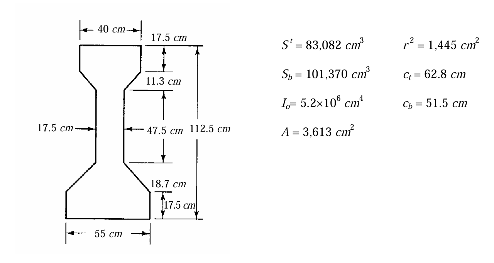

# RC-2007-4 題目正本

> 本檔只記錄**考卷上寫了什麼、圖上畫了什麼**，不含任何解法。解析見同資料夾 `RC-2007-4.md`。
> 判讀清單已經使用者確認（凍結）；本檔原則上不再修改（改動須回考卷原圖並記 log）。

| 項目 | 內容 |
|------|------|
| 考卷 | `raw/exams/RC-2007_鋼筋混凝土設計與預力.pdf` 第 2 頁（背面），第四題；卷首常數見第 1 頁 |
| 考年 | 民國 96 年（2007） |
| 配分 | 25 分 |
| 附圖 | `RC-2007-4-fig-1.png`（I 形梁斷面與斷面性質，無圖號；考卷原為 1-bit 點陣） |
| 判讀狀態 | **已確認**（2026-11-14 使用者確認；影響答案項目使用者選擇：#1 斷面性質照考卷數據，版置於 c_t＋c_b＝114.3 cm 頂面（與圖上總高 112.5 的矛盾於解析 §5 註明）；#7 澆版無支撐（版重由梁單獨承受）；轉錄 2026-11-14；PyMuPDF 110 dpi 全頁目視＋抽出文字核對；附圖以程式依圖上尺寸重算斷面性質核對；盲讀後才比對既有解析） |

## 1. 考卷原文（逐字）

> 四、一座跨距 20 公尺簡支 I 形預力梁橋，其梁與梁間距為 2.2 公尺，其斷面及數據如下圖所示，預力梁上之橋面版厚 20 公分，預力梁之混凝土抗壓強度為 350 $kgf/cm^2$，橋面版之混凝土抗壓強度為 280 $kgf/cm^2$，容許壓應力為 $0.4f'_c$，容許拉應力為 $3\sqrt{f'_c}$，預力鋼線容許應力為 13200 $kgf/cm^2$，預力鋼線總斷面積為 21.7 $cm^2$，假設預力損失 20%，鋼線中心離底部最小距離為 20 公分，除了梁及版自重外，還有其他靜載重為 750 $kgf/m$，混凝土單位重為 2,400 $kgf/m^3$，試計算出中間梁在跨距中央能承受之集中活載重。（25 分）

## 2. 考卷給的公式、附表與參數

- 題文數值：跨距 20 m；梁距 2.2 m；橋面版厚 20 cm；梁 $f'_c=350$、版 $f'_c=280$；容許壓應力 $0.4f'_c$、容許拉應力 $3\sqrt{f'_c}$（照錄，未註明適用階段）；預力鋼線容許應力 13,200、$A_{ps}=21.7$ cm²；預力損失 20%；鋼線中心離底部最小 20 cm；其他靜載重 750 kgf/m；單位重 2,400 kgf/m³。
- 圖旁斷面性質（照錄）：$S^t = 83{,}082\ cm^3$、$S_b = 101{,}370\ cm^3$、$I_o = 5.2\times10^6\ cm^4$、$A = 3{,}613\ cm^2$、$r^2 = 1{,}445\ cm^2$、$c_t = 62.8\ cm$、$c_b = 51.5\ cm$。
- 卷首（第 1 頁）「以下各題之計算所用之規定及常數如下（※如有條件不足時，請自行合理假設）」：靜載重因數 1.2，活載重因數 1.6；強度折減係數：拉力控制 0.90（$\varepsilon_t$ 大於 0.005）、壓力控制 0.65、過渡 $\phi = 0.483 + 83.3\varepsilon_t$、剪力 0.75、柱 0.65；$E_s = 2.04\times10^6$ kgf/cm²；D29 面積 6.469 cm²。
- **沒有給**：施工是否有支撐（版重由梁單獨或合成斷面承受）、施預力（transfer）階段容許應力、兩種混凝土模數比、有效翼版寬規定、鋼腱線形、活載重衝擊或分配係數。
- 卷首注意事項：可以使用電子計算器。不必抄題，作答時請將試題題號及答案依照順序寫在試卷上，於本試題上作答者，不予計分。

## 3. 附圖

圖面文字照錄：`40 cm`、`17.5 cm`、`11.3 cm`、`17.5 cm`（腹板寬）、`47.5 cm`、`112.5 cm`、`18.7 cm`、`17.5cm`、`55 cm`；`S^t = 83,082 cm^3`、`r^2 = 1,445 cm^2`、`S_b = 101,370 cm^3`、`c_t = 62.8 cm`、`I_o= 5.2×10^6 cm^4`、`c_b = 51.5 cm`、`A = 3,613 cm^2`。

## 4. 判讀清單

「把握」標**不確定**者請優先確認；解讀類項目（題目用字的意思）另標「解讀」。

| # | 項目 | 判讀 | 圖上／題文依據 | 把握 |
|---|------|------|---------------|------|
| 1 | 斷面性質自相矛盾 | **$c_t + c_b = 114.3 \ne 112.5$ cm**；依圖上尺寸自算 $A = 3{,}497$ cm²、$c_b = 50.7$、$c_t = 61.8$、$I \approx 4.90\times10^6$ cm⁴，與考卷所給數據都不合。考卷要求用「斷面及數據如下圖所示」，解讀為**梁的斷面性質照考卷所給數據**（$A$、$I_o$、$S^t$、$S_b$、$c_t$、$c_b$），總高 112.5 只用於幾何 | 五段尺寸和 17.5＋11.3＋47.5＋18.7＋17.5＝112.5；$I_o/c_t = 82{,}803$、$I_o/c_b = 100{,}971$，與 $S^t$、$S_b$ 差 0.3–0.4% | 不確定（影響答案）；使用者確認（選擇見頭表判讀狀態） |
| 2 | 斷面形狀 | 上翼 40×17.5、上斜坡 11.3（40→17.5）、腹板 17.5×47.5、下斜坡 18.7（17.5→55）、下翼 55×17.5 | 分段尺寸線端點對齊各轉折水平線 | 確定 |
| 3 | 有效翼版 | 梁距 2.2 m；橋面版厚 20 cm 置於上翼頂 | 題文 | 確定 |
| 4 | 預力鋼線應力 | 「預力鋼線容許應力 13,200」解讀為施預力時（損失前）的鋼線應力；損失 20% 後 $f_{se} = 0.8 \times 13{,}200$ | 題文順序「容許應力 13200…假設預力損失 20%」 | 確定（解讀） |
| 5 | 偏心距 | 鋼線中心離底部「最小」20 cm → 跨中取最大偏心，鋼線中心距梁底 20 cm | 題文 | 確定（解讀） |
| 6 | 容許拉應力 $3\sqrt{f'_c}$ | 照考卷原文（kgf/cm² 制下 $3\sqrt{350} = 56$ kgf/cm²）；考卷未註明適用施預力或使用階段、未說版是否也適用 | 題文 | 確定（照考卷原文） |
| 7 | 施工順序 | 考卷**沒有寫**版澆置時是否有支撐（版重由梁單獨或合成斷面承受） | 題文無相關敘述 | 不確定（影響答案）；使用者確認（選擇見頭表判讀狀態） |
| 8 | 問的量 | 中間梁在跨距中央能承受之**集中活載重**（工作載重，非因數化） | 題文；卷首載重因數為強度設計用 | 確定（解讀） |
| 9 | 考卷沒有給 | 施工支撐、施預力階段容許應力、模數比、有效翼寬規定、衝擊與分配係數 | 全題 | 確定（作答須自行假設） |

---

*轉錄：2026-11-14（RC-U4-1 題目正本推廣・批 1）*

*確認：2026-11-14 使用者確認（RC-U4-1 題目正本推廣・批 1，關卡一）*
