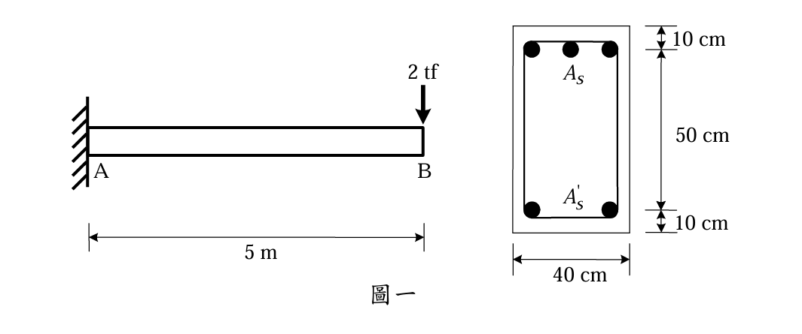

# RC-2008-1 題目正本

> 本檔只記錄**考卷上寫了什麼、圖上畫了什麼**，不含任何解法。解析見同資料夾 `RC-2008-1.md`。
> 判讀清單已經確認（凍結）；本檔原則上不再修改（改動須回考卷原圖並記 log）。

| 項目 | 內容 |
|------|------|
| 考卷 | `raw/exams/RC-2008_鋼筋混凝土設計與預力.pdf` 第 1 頁（正面），第一題 |
| 考年 | 民國 97 年（2008） |
| 配分 | 20 分 |
| 附圖 | `RC-2008-1-fig-1.png`（圖一：懸臂梁立面＋梁斷面；考卷為向量圖，尺寸以 PDF drawings 座標核對） |
| 判讀狀態 | **已確認**（2026-11-15 使用者授權依 Claude 建議確認；轉錄 2026-11-15；PyMuPDF 110 dpi 全頁目視，附圖 250–450 dpi 局部放大，向量圖以 PDF drawings 座標核對尺寸線端點；文字以 PDF 文字層核對；盲讀後才比對既有解析） |

## 1. 考卷原文（逐字）

> 一、有一懸臂梁及其斷面如圖一所示，$A_s$＝50 cm²，$A'_s$＝20 cm²，$f'_c$＝280 kgf/cm²，$f_y$＝4200 kgf/cm²，$E_s$＝2.04×10⁶ kgf/cm²，n＝8。若梁安裝後同時於 B 點施加一 2 tf 之集中載重，試問該集中載重及梁自重持續作用一年後 B 點之撓度為何？（20 分）
> （梁端撓度公式：$\Delta=PL^3/3EI$，$\Delta=wL^4/8EI$）

## 2. 考卷給的公式、附表與參數

- 題文數值：$A_s$＝50 cm²、$A'_s$＝20 cm²；$f'_c$＝280、$f_y$＝4200、$E_s$＝2.04×10⁶ kgf/cm²；$n$＝8；B 點集中載重 2 tf（安裝後同時施加）；持續一年。
- 題目給的公式：懸臂梁端撓度 $\Delta=PL^3/3EI$（端點集中載重）、$\Delta=wL^4/8EI$（均布載重）。
- **沒有給**：混凝土單位重（自重）、$E_c$（只給 $n$＝8）、開裂模數 $f_r$、一年的時間因數 $\xi$。
- 卷首注意事項：㈠不必抄題，作答時請將試題題號及答案依照順序寫在試卷上，於本試題上作答者，不予計分。㈡可以使用電子計算器，但需詳列解答過程。㈢各題計算所用之規定及常數，如有條件不足時，請自行合理假設。

## 3. 附圖

圖面文字照錄：`2 tf`、`A`、`B`、`5 m`、`圖一`、`As`、`A's`、`10 cm`、`50 cm`、`10 cm`、`40 cm`。

## 4. 判讀清單

「把握」標**不確定**者優先列；解讀類項目（題目用字的意思）另標「解讀」。標「依 Claude 建議確認」者，為使用者 2026-11-15 授權「要我確認的請依你建議」後定案。

| # | 項目 | 判讀 | 圖上／題文依據 | 把握 |
|---|------|------|---------------|------|
| 1 | 右側尺寸鏈 10＋50＋10 | **全深 $h$＝70 cm**：上 10 cm＝頂面至頂筋（$A_s$）中心、50 cm＝頂筋中心至底筋中心、下 10 cm＝底筋（$A'_s$）中心至底面；故 $d$＝60、$d'$＝10 cm | PDF 座標：斷面外框 y＝396.2～528.6；尺寸延伸線 y＝396.2／411.4／514.0／528.2；頂筋圓心 y＝411.2、底筋圓心 y＝513.8，與中間兩條延伸線重合 | 確定（影響答案）；依 Claude 建議確認 |
| 2 | 拉／壓側 | 懸臂負彎矩：頂部 3 根為拉力筋 $A_s$＝50 cm²，底部 2 根為壓力筋 $A'_s$＝20 cm² | 圖上 `As` 標在頂排、`A's` 標在底排 | 確定 |
| 3 | 梁寬 | $b$＝40 cm（斷面外緣） | 40 cm 尺寸線延伸線 x＝440.5、514.8，與斷面外框 x＝440.5～514.8 重合 | 確定 |
| 4 | 支承與跨度 | A 端固定、B 端自由；懸臂長 5 m（固定面至 B） | A 端牆面剖線；5 m 尺寸線 x＝170.0～383.8，左端對齊固定面、右端對齊 B 端 | 確定 |
| 5 | 載重 | B 端集中 2 tf；梁自重另計；兩者於安裝後同時作用、持續一年 | 題文；圖上 B 端單一集中箭頭 | 確定 |
| 6 | 所求 | 持續作用一年後 B 點總撓度（即時＋長期） | 題文 | 確定 |
| 7 | 考卷沒有給 | 混凝土單位重、$E_c$（由 $n$＝8 反推）、$f_r$、$\xi$（一年） | 全題；卷首允許自行合理假設 | 確定 |

---

*轉錄：2026-11-15（RC-U3-1／U3-2 題目正本推廣・批 1）*

*確認：2026-11-15 使用者授權依 Claude 建議確認（RC-U3-1／U3-2 題目正本推廣・批 1，關卡一）*
