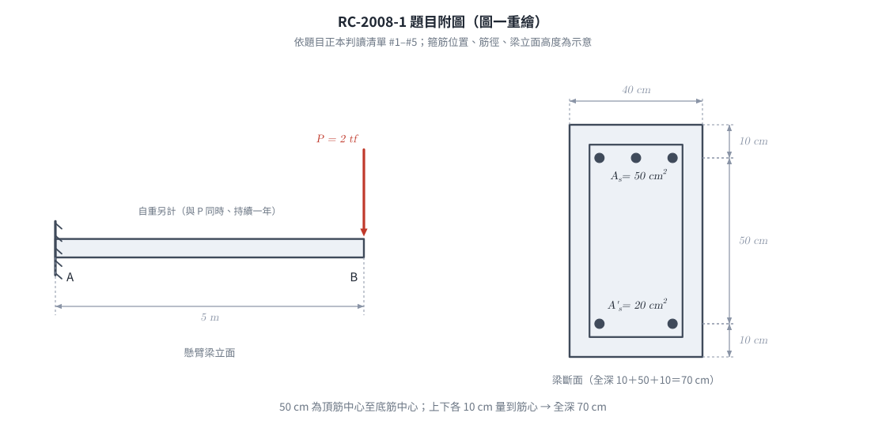
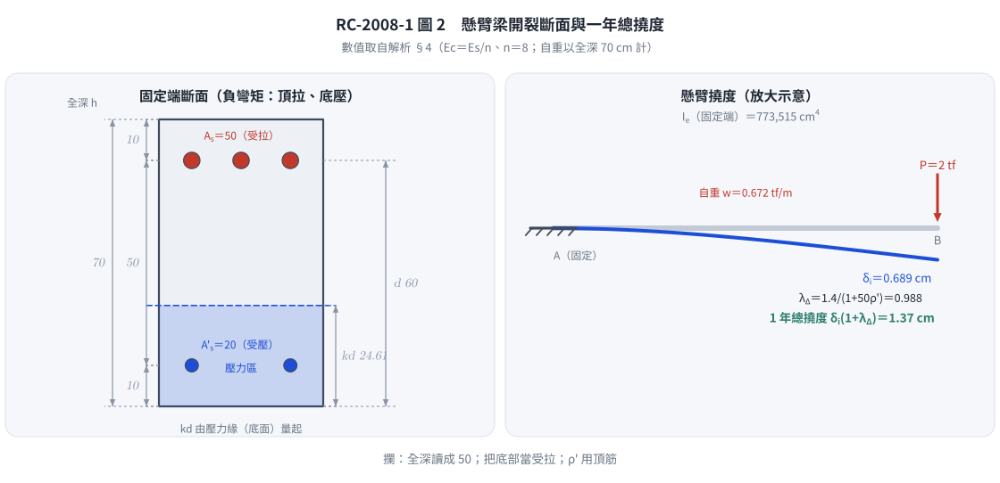

### 考題編號：RC-2008-1

**主分類：** `RC-U3-1` 梁工作性要求（含撓度、裂縫）
**副分類：** 無
**設計法：** USD強度設計法
**標籤：** `懸臂梁` `雙筋梁` `長期撓度` `有效慣性矩Ie` `開裂彎矩Mcr` `λ長期修正係數` `轉換斷面法` `現行規範2023`

---

## 1. 題目（考卷原文見題目正本）

> 考卷原文、公式／附表、附圖與判讀清單（已確認）見 [`RC-2008-1-problem.md`](RC-2008-1-problem.md)。本節只列解題時最容易讀錯的地方與本解使用的記號；題意以題目正本為準。

*重繪自考卷圖一，依題目正本判讀清單 #1–#5。本圖攔下的讀錯：50 cm 是頂筋中心到底筋中心，全深 10＋50＋10＝70 cm（$d$＝60、$d'$＝10）。*

### 常見誤讀

| 項目 | 正確判讀 | 常見誤讀 |
|------|---------|---------|
| 右側尺寸鏈 | 10（頂面→頂筋心）＋50（頂筋心→底筋心）＋10（底筋心→底面）＝全深 70 cm；$d$＝60、$d'$＝10 cm | 全深 50 cm、上下保護層各 10（本庫舊解） |
| 拉／壓側 | 懸臂負彎矩：頂部 $A_s$ 受拉、底部 $A'_s$ 受壓 | 照簡支梁以底部受拉 |
| 自重 | 依全深 70 cm 計（單位重考卷沒有給，自行假設） | 依 50 cm 計 |
| $E_c$ | 考卷只給 $n$＝8 → $E_c=E_s/n$ | 另用 $15000\sqrt{f'_c}$ |
| 時間因數 | 一年 $\xi$ 考卷沒有給，依規範取 1.4 | 取 2.0（5 年以上） |
| $I_e$ 公式 | 現行規範表 24.2.3.5（$\frac23M_{cr}$ 式），懸臂取固定端 | 沿用 Branson 三次方式（舊規範） |

**本解記號：** $b$＝40 cm；$h$＝70 cm；$d$＝60 cm；$d'$＝10 cm；$A_s$＝50、$A'_s$＝20 cm²；$n$＝8；$L$＝500 cm；$P$＝2 tf 於 B 端。

---

## 2. 考題核心精神與出題者意圖 (Core Concepts & Examiner's Intent)

**核心觀念：** 有效慣性矩法（$I_e$）求即時撓度，再乘長期修正係數 $\lambda_\Delta$ 估算潛變與收縮引起的附加撓度。

**出題者測驗能力：**
1. 從尺寸鏈 10＋50＋10 讀出全深 70 cm（$d$＝60、$d'$＝10）
2. 懸臂梁「哪側是壓力側」——頂部 $A_s$（50 cm²）受拉、底部 $A'_s$（20 cm²）受壓（$\rho'$ 用此算）
3. 轉換斷面法求 $I_{cr}$（雙筋梁，壓力鋼筋以 $(n-1)A_s'$ 計）
4. $I_e$ 以固定端最大彎矩 $M_a$ 代入（現行規範式）
5. 1 年 $\xi = 1.4$，$\lambda_\Delta=\xi/(1+50\rho')$

---

## 3. 解題戰略地圖與陷阱分析 (Strategic Roadmap & Trap Analysis)

**作戰順序：**
1. 算 $E_c = E_s/n$；算梁自重 $w$（全深 70 cm）
2. 算 $I_g$、$M_{cr}$；算固定端最大彎矩 $M_a$，判斷是否開裂
3. 用轉換斷面法解中性軸深度 $kd$，求 $I_{cr}$
4. 套現行 $I_e$ 式
5. 算即時撓度 $\delta_i$（集中載重 + 自重）
6. 算長期修正係數 $\lambda_\Delta$（$\xi = 1.4$），求 1 年後總撓度

**五大陷阱：**

| 陷阱 | 說明 |
|------|------|
| ⚠ 尺寸鏈 | 50 cm 是頂筋中心到底筋中心，全深＝10＋50＋10＝70 cm，自重與 $I_g$ 都依 70 cm |
| ⚠ 壓力側判斷 | 懸臂梁頂受拉，$A_s'$（壓力鋼筋）在**底部**；$\rho' = A_s'/(b d)$ |
| ⚠ $M_a$ 的計算基準 | 懸臂梁 $M_a$ 取固定端（最大彎矩截面） |
| ⚠ $\xi$ 值選取 | 1 年 → $\xi = 1.4$（≥5年才取 2.0） |
| ⚠ $I_{cr}$ 中壓力鋼筋係數 | 轉換斷面法中壓力鋼筋面積取 $(n-1)A_s'$，不是 $nA_s'$ |

---

## 3.5 變數層次分析 (Variable Hierarchy Analysis)

> 複習提示：第一次解題後，在每個卡住的知識點旁標記 `⚠`；第二次複習時只看有 `⚠` 的項目。

### 最終目標
`求懸臂梁 B 點在集中載重 + 自重持續作用 1 年後的總撓度 δ_total`

### 本題關鍵公式（依計算順序）

> $\boxed{\cdot}$ = 需由前步驟推導，非題目直接給定的變數

$$\text{Step 1: } E_c = \frac{E_s}{n}, \quad w = \gamma \cdot b \cdot h$$

$$\text{Step 2: } M_a = P \cdot L + \frac{w L^2}{2}$$

$$\text{Step 3 (Mcr): } M_{cr} = \frac{f_r \cdot I_g}{y_t}, \quad f_r = 2\sqrt{f'_c}$$

$$\text{Step 4 (Icr): } \frac{b \cdot (kd)^2}{2} + (n-1)A_s'(kd - d') = n A_s (d - kd)$$

$$I_{cr} = \frac{b(\boxed{kd})^3}{3} + (n-1)A_s'(\boxed{kd}-d')^2 + n A_s (d - \boxed{kd})^2$$

$$\text{Step 5: } I_e = \frac{\boxed{I_{cr}}}{1-\left(\dfrac{(2/3)M_{cr}}{M_a}\right)^2\left(1-\dfrac{I_{cr}}{I_g}\right)}\le I_g$$

$$\text{Step 6 (即時撓度): } \delta_i = \frac{PL^3}{3 E_c \boxed{I_e}} + \frac{w L^4}{8 E_c \boxed{I_e}}$$

$$\text{Step 7 (長期撓度): } \lambda_\Delta = \frac{\xi}{1 + 50\rho'}, \quad \delta_{total} = \boxed{\delta_i}(1 + \lambda_\Delta)$$

### L1：題目直接給定

| 符號 | 數值 | 說明 |
|------|------|------|
| $b$ | 40 cm | 梁寬 |
| $h$ | 70 cm | 梁總深（10＋50＋10） |
| $A_s$ | 50 cm² | 頂部（張力）鋼筋，$d$＝60 cm |
| $A_s'$ | 20 cm² | 底部（壓力）鋼筋，$d'$＝10 cm |
| $f'_c$ | 280 kgf/cm² | 混凝土抗壓強度 |
| $f_y$ | 4200 kgf/cm² | 鋼筋降伏強度 |
| $E_s$ | $2.04 \times 10^6$ kgf/cm² | 鋼筋彈性模數 |
| $n$ | 8 | 模數比 $E_s/E_c$ |
| $L$ | 500 cm | 懸臂長 |
| $P$ | 2000 kgf | B 點集中載重 |

假設（考卷未給）：混凝土單位重 2.4 tf/m³；1 年 $\xi$＝1.4。

### L2：需知識點推導

**Step 1：基本材料參數**

| 符號 | 公式/來源 | 卡關? |
|------|----------|:-----:|
| $E_c$ | $E_s / n = 2{,}040{,}000/8 = 255{,}000 \text{ kgf/cm}^2$ | |
| $d$ | $10+50 = 60 \text{ cm}$（壓力緣＝底面至頂筋中心）| ⚠ |
| $d'$ | $10 \text{ cm}$（底面至底筋中心）| |
| $w$ | $2400 \times 0.40 \times 0.70 = 672 \text{ kgf/m} = 6.72 \text{ kgf/cm}$ | |

**Step 2：固定端最大彎矩**

| 符號 | 公式/來源 | 卡關? |
|------|----------|:-----:|
| $M_P$ | $P \cdot L = 2000 \times 500 = 1{,}000{,}000 \text{ kgf·cm}$ | |
| $M_w$ | $wL^2/2 = 6.72 \times 500^2/2 = 840{,}000 \text{ kgf·cm}$ | |
| $M_a$ | $1{,}840{,}000 \text{ kgf·cm} = 18.40$ tf·m | |

**Step 3：開裂彎矩**

| 符號 | 公式/來源 | 卡關? |
|------|----------|:-----:|
| $I_g$ | $40 \times 70^3/12 = 1{,}143{,}333 \text{ cm}^4$ | |
| $f_r$ | $2\sqrt{280} = 33.47 \text{ kgf/cm}^2$ | |
| $y_t$ | $h/2 = 35 \text{ cm}$ | |
| $M_{cr}$ | $33.47 \times 1{,}143{,}333/35 = 1{,}093{,}240 \text{ kgf·cm} = 10.93$ tf·m | |

→ $M_a = 18.40 > M_{cr} = 10.93$ tf·m，斷面**已開裂**

**Step 4：開裂轉換斷面慣性矩**

| 符號 | 公式/來源 | 卡關? |
|------|----------|:-----:|
| $kd$ | 由二次方程求解（壓力緣量起）= 24.61 cm | |
| $I_{cr}$ | 三項之和 = 729,599 cm⁴ | |

**Step 5：有效慣性矩**

| 符號 | 公式/來源 | 卡關? |
|------|----------|:-----:|
| $\left(\frac{(2/3)M_{cr}}{M_a}\right)^2$ | $(7.288/18.40)^2 = 0.1569$ | |
| $I_e$ | 現行式 = 773,515 cm⁴（≤ $I_g$）✓ | ⚠ |

**Step 6：即時撓度**

| 符號 | 公式/來源 | 卡關? |
|------|----------|:-----:|
| $\delta_P$ | $PL^3/(3E_cI_e) = 0.422 \text{ cm}$ | |
| $\delta_w$ | $wL^4/(8E_cI_e) = 0.266 \text{ cm}$ | |
| $\delta_i$ | $0.422 + 0.266 = 0.689 \text{ cm}$ | |

**Step 7：1 年長期撓度**

| 符號 | 公式/來源 | 卡關? |
|------|----------|:-----:|
| $\rho'$ | $A_s'/(b d) = 20/(40 \times 60) = 0.00833$ | |
| $\xi$ | 1 年 → $\xi = 1.4$ | |
| $\lambda_\Delta$ | $1.4/(1 + 50 \times 0.00833) = 0.988$ | |
| $\delta_{total}$ | $0.689 \times (1 + 0.988) = 1.37 \text{ cm}$ | |

### L3：深層知識（不懂就卡住）

| 知識點 | 說明 | 卡關? |
|--------|------|:-----:|
| 尺寸鏈讀法 | 延伸線對齊鋼筋中心 → 中段 50 cm 是筋心距，全深要加上下 10 cm | ⚠ |
| 懸臂梁壓力側方向 | 懸臂梁下側受壓，頂部受拉；$A_s'$ 在底（壓力側） | |
| $I_{cr}$ 壓力鋼筋係數 | 壓力鋼筋用 $(n-1)A_s'$（總轉換面積 $nA_s'$ 減去被鋼筋取代的混凝土 $A_s'$）| |
| 懸臂 $I_e$ 的 $M_a$ | 規範：懸臂梁取支承（固定端）斷面 | |
| 現行 $I_e$ 式 | 表 24.2.3.5：以 $\frac23M_{cr}$ 計，Bischoff 形式；比 Branson 式保守 | ⚠ |
| $\xi$ 與持續時間 | 3月→1.0、6月→1.2、1年→**1.4**、5年以上→2.0 | |
| $\lambda_\Delta$ 為何含 $\rho'$ | 壓力鋼筋分擔壓力、抑制潛變與收縮，$\rho'$ 愈大長期撓度愈小 | |

---

## 4. 步驟化詳細計算過程 (Step-by-Step Detailed Calculation)

### Step 1：基本材料與幾何

$$E_c = \frac{E_s}{n} = \frac{2.04 \times 10^6}{8} = 255{,}000 \text{ kgf/cm}^2$$

全深 $h = 10 + 50 + 10 = 70$ cm。懸臂梁受向下載重時，頂部為張力側，底部為壓力側：
$$d = 10 + 50 = 60 \text{ cm} \quad (\text{壓力緣至張力鋼筋中心}),\qquad d' = 10 \text{ cm}$$

梁自重（$\gamma = 2400 \text{ kgf/m}^3$，假設）：
$$w = 2400 \times 0.40 \times 0.70 = 672 \text{ kgf/m} = 6.72 \text{ kgf/cm}$$

### Step 2：固定端最大服務彎矩

$$M_P = P \cdot L = 2000 \times 500 = 1{,}000{,}000 \text{ kgf·cm}$$

$$M_w = \frac{wL^2}{2} = \frac{6.72 \times 500^2}{2} = 840{,}000 \text{ kgf·cm}$$

$$M_a = M_P + M_w = \boxed{1{,}840{,}000 \text{ kgf·cm} = 18.40\text{ tf·m}}$$

### Step 3：開裂彎矩

$$I_g = \frac{bh^3}{12} = \frac{40 \times 70^3}{12} = 1{,}143{,}333 \text{ cm}^4$$

$$M_{cr} = \frac{f_r \cdot I_g}{y_t} = \frac{33.47 \times 1{,}143{,}333}{35} = 1{,}093{,}240 \text{ kgf·cm} = 10.93\text{ tf·m}$$

比較：$M_a = 18.40 > M_{cr} = 10.93$ tf·m → **斷面已開裂，需計算 $I_{cr}$**

### Step 4：開裂轉換斷面中性軸（$kd$ 從壓力緣＝底面量起）

$$\frac{b \cdot (kd)^2}{2} + (n-1)A_s'(kd - d') = n A_s (d - kd)$$

$$20(kd)^2 + 140(kd - 10) = 400(60 - kd)$$

$$20(kd)^2 + 540\,kd - 25{,}400 = 0 \ \Rightarrow\ (kd)^2 + 27\,kd - 1{,}270 = 0$$

$$kd = \frac{-27 + \sqrt{27^2 + 4 \times 1{,}270}}{2} = \frac{-27 + \sqrt{5{,}809}}{2} = \frac{-27 + 76.22}{2} = \boxed{24.61 \text{ cm}}$$

驗證：$kd = 24.61 > d' = 10$ cm → 壓力鋼筋確在壓力區 ✓

### Step 5：開裂斷面慣性矩 $I_{cr}$

$$I_{cr} = \frac{40 \times 24.61^3}{3} + 7 \times 20 \times (24.61 - 10)^2 + 8 \times 50 \times (60 - 24.61)^2$$

$$= 198{,}696 + 29{,}877 + 501{,}026 = \boxed{729{,}599 \text{ cm}^4}$$

### Step 6：有效慣性矩 $I_e$（現行規範表 24.2.3.5）

$$\frac23M_{cr} = 7.288\text{ tf·m},\qquad \left(\frac{7.288}{18.40}\right)^2 = 0.1569,\qquad 1-\frac{I_{cr}}{I_g} = 1-\frac{729{,}599}{1{,}143{,}333} = 0.3619$$

$$I_e = \frac{729{,}599}{1 - 0.1569\times0.3619} = \boxed{773{,}515 \text{ cm}^4}\quad(< I_g\ \checkmark)$$

$$E_cI_e = 255{,}000 \times 773{,}515 = 1.9725 \times 10^{11} \text{ kgf·cm}^2$$

### Step 7：即時撓度 $\delta_i$

$$\delta_P = \frac{PL^3}{3E_cI_e} = \frac{2000 \times 500^3}{3 \times 1.9725 \times 10^{11}} = 0.422 \text{ cm}$$

$$\delta_w = \frac{wL^4}{8E_cI_e} = \frac{6.72 \times 500^4}{8 \times 1.9725 \times 10^{11}} = 0.266 \text{ cm}$$

$$\delta_i = 0.422 + 0.266 = \boxed{0.689 \text{ cm}}$$

### Step 8：長期撓度修正（1 年）

$$\rho' = \frac{A_s'}{b \cdot d} = \frac{20}{40 \times 60} = 0.00833,\qquad \lambda_\Delta = \frac{1.4}{1 + 50 \times 0.00833} = \frac{1.4}{1.4167} = 0.988$$

兩種載重均為持續作用，全部即時撓度均乘 $\lambda_\Delta$：
$$\Delta_{LT} = 0.988 \times 0.689 = 0.681 \text{ cm}$$

### 最終答案

$$\delta_{total} = \delta_i + \Delta_{LT} = 0.689 + 0.681 = \boxed{1.37 \text{ cm}}$$

---

*圖 2　懸臂梁負彎矩斷面與一年總撓度。攔：全深讀成 50 cm；把底部當受拉側（$kd$ 應由底面量起、$\rho'$ 用底部 $A'_s$）。*

## 5. 關鍵爭議點與進階探討 (Critical Issues & Advanced Discussion)

### 舊解的錯誤（本次勘誤）

舊解把尺寸鏈 10＋50＋10 讀成「全深 50、上下各 10 cm」（$d$＝40），自重 0.48 tf/m、$I_g$＝416,667、$I_{cr}$＝279,184 cm⁴、$\rho'$＝0.0125，並用 Branson 式，得 3.09 cm，高估約 2.3 倍。考卷圖一的中間兩條延伸線與頂筋、底筋圓心重合（題目正本 #1），50 cm 是筋心距。

### $I_e$ 式對照（同一讀法）

| 方法 | $I_e$ (cm⁴) | $\delta_i$ | 1 年總撓度 |
|------|------|------|------|
| 現行規範（$\frac23M_{cr}$ 式，主線） | 773,515 | 0.689 | **1.37 cm** |
| Branson $(M_{cr}/M_a)^3$（舊規範） | 816,377 | 0.652 | 1.30 cm |

### 爭議：自重是否計入持續荷載？

題目明確說「集中載重**及梁自重**持續作用一年」，兩者都是持續載重，全部即時撓度乘 $\lambda_\Delta$。

### 爭議：自重單位重

考卷未給，取常重混凝土 2.4 tf/m³；自重佔 $M_a$ 的 46%，不可忽略（若不計自重，$M_a$＝10.0 tf·m ＜ $M_{cr}$，斷面未開裂，答案完全不同）。

### 進階：懸臂梁 $I_e$

規範規定懸臂梁取支承斷面 $I_e$；本題全長彎矩由固定端向自由端遞減，以固定端 $I_e$ 計算偏保守。

*修正日期：2026-11-15（§1 改為指向題目正本，插入重繪附圖 figs/RC-2008-1-fig-1-problem.svg；舊 §1 重述改寫為常見誤讀與本解記號；本行非答案勘誤）*

*修正日期：2026-11-15（FIX-RC-U3-B1 解析勘誤，改依現行台灣規範（建築物混凝土結構設計規範 2023）：尺寸鏈改讀全深 $h$＝70、$d$＝60、$d'$＝10 cm（題目正本 #1，考卷第 1 頁圖一）；自重 0.48 → 0.672 tf/m、$M_a$ 16.0 → 18.40 tf·m、$I_{cr}$ 279,184 → 729,599 cm⁴、$\rho'$ 0.0125 → 0.00833；$I_e$ 改現行表 24.2.3.5（$\frac23M_{cr}$ 式）；1 年總撓度 3.09 → **1.37 cm**（Branson 對照 1.30 cm）；撤除 §1 待勘誤提示。驗證：check_errata_U3_B1.py 重算、曲率積分交叉，MISMATCHES: 0）*

*圖解補繪：2026-11-15（DIAG-RC-U3-B1，向量圖，腳本 `figs/gen_RC-2008-1.py`，可重跑；非勘誤、答案不變）*
