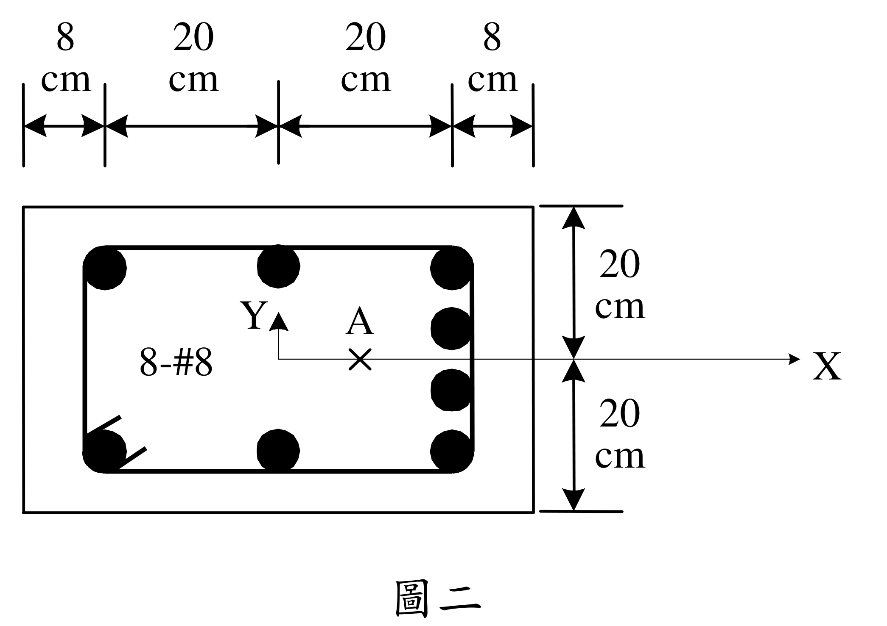

# RC-2008-2 題目正本

> 本檔只記錄**考卷上寫了什麼、圖上畫了什麼**，不含任何解法。解析見同資料夾 `RC-2008-2.md`。
> 判讀清單已經使用者確認（凍結）；本檔原則上不再修改（改動須回考卷原圖並記 log）。

| 項目 | 內容 |
|------|------|
| 考卷 | `raw/exams/RC-2008_鋼筋混凝土設計與預力.pdf` 第 1 頁（正面），第二題 |
| 考年 | 民國 97 年（2008） |
| 配分 | 25 分 |
| 附圖 | `RC-2008-2-fig-2.png`（圖二，500 dpi 重新擷取）；既有 `RC-2008-2-fig-1.png` 右上角有滑鼠游標，保留不刪 |
| 判讀狀態 | **已確認**（2026-11-14 使用者確認；影響答案項目使用者選擇：#1 彎矩對幾何形心（圖上 Y 軸）取矩；轉錄 2026-11-14；PyMuPDF 110 dpi 全頁目視＋抽出文字核對，附圖 450／500 dpi 放大，鋼筋與軸線位置讀 PDF 向量座標；盲讀後才比對既有解析） |

## 1. 考卷原文（逐字）

> 二、有一短柱，其斷面如圖二所示，$f'_c$＝350 kgf/cm²，$f_y$＝4200 kgf/cm²，$E_s$＝2.04×10⁶ kgf/cm²。壓力作用於 X 軸上之 A 點，右側為壓力側。若此柱斷面達到其軸力計算強度 $P_n$ 時，拉力側鋼筋之應變剛好等於零，試求此時柱斷面所承受之彎矩值為何？（25 分）
> （#8 鋼筋之斷面積為 5.07 cm²）

## 2. 考卷給的公式、附表與參數

- 題文數值：$f'_c=350$、$f_y=4200$ kgf/cm²；$E_s=2.04\times10^6$ kgf/cm²；#8 斷面積 5.07 cm²。
- **沒有給**：$\varepsilon_{cu}$、$\beta_1$、彎矩的參考軸（斷面形心或塑性形心）、A 點位置尺寸、右列 4 根鋼筋的垂直間距、角隅鋼筋的垂直保護層。
- 卷首注意事項：㈠不必抄題，作答時請將試題題號及答案依照順序寫在試卷上，於本試題上作答者，不予計分。㈡可以使用電子計算器，但需詳列解答過程。㈢各題計算所用之規定及常數，如有條件不足時，請自行合理假設。

## 3. 附圖

圖面文字照錄：「8 cm」「20 cm」「20 cm」「8 cm」「20 cm」「20 cm」「Y」「A」「X」「8-#8」「圖二」。

## 4. 判讀清單

| # | 項目 | 判讀 | 圖上／題文依據 | 把握 |
|---|------|------|---------------|------|
| 1 | 「柱斷面所承受之彎矩」的參考軸 | 鋼筋左 2／中 2／右 4 不對稱，塑性形心不在斷面中心。圖上 Y 軸畫在**斷面幾何中心**（PDF：斷面左右緣 x＝223.9／397.0，中點 310.45；Y 軸箭頭 x＝310.6），判讀為對 Y 軸（幾何形心）取矩 | 圖二 Y 軸位置；題文未明寫 | 不確定（影響答案，請確認）；使用者確認 |
| 2 | 斷面尺寸 | X 向 $8+20+20+8=56$ cm；Y 向 $20+20=40$ cm | 尺寸線端點：x＝223.9／251.6／310.6／369.5／397.0；y＝793.6／845.3／897.0（中間為 X 軸） | 確定 |
| 3 | 圖不依比例 | 8 cm 畫成 27.7 pt、20 cm 畫成 59 pt，以標註數字為準 | PDF 座標 | 確定 |
| 4 | 鋼筋配置（X 向位置） | 左列 x＝8 cm：2 根（上下角）；中列 x＝28 cm：2 根（上下）；右列 x＝48 cm：4 根 → 共 8-#8 | 鋼筋圓心 x＝251.7／310.5／369.4 pt 與尺寸線端點一致；數圓點 2+2+4 | 確定 |
| 5 | 右列 4 根的垂直位置 | 未標尺寸；圖上等距（y＝814.4／835.4／855.8／876.6 pt）。四根同一 x，不影響繞 Y 軸彎矩 | PDF 座標 | 確定（解讀） |
| 6 | 受壓側與拉力側鋼筋 | 「右側為壓力側」→ 最大壓應變在右緣；「拉力側鋼筋」＝左列 2 根（x＝8 cm） | 題文 | 確定 |
| 7 | 中性軸條件 | 左列鋼筋應變為零 → 中性軸通過左列鋼筋中心，自右緣量 $c=48$ cm | 題文「拉力側鋼筋之應變剛好等於零」＋#4 | 確定（解讀） |
| 8 | A 點 | 在 X 軸上、Y 軸右側；位置未標尺寸（為本題要求的偏心位置，不是已知條件） | 圖二 × 位於 x＝338.2 pt，無尺寸線 | 確定 |
| 9 | 「軸力計算強度 $P_n$」 | 標稱軸力強度（不乘 $\phi$）；所求彎矩為對應的標稱彎矩 | 題文 | 確定（解讀） |
| 10 | 柱型式 | 圖上畫箍筋（左下角彎鉤）→ 箍筋柱；短柱（不考慮細長效應） | 圖二、題文「短柱」 | 確定 |
| 11 | 考卷沒有給 | $\varepsilon_{cu}$、$\beta_1$ 需依規範自行採用 | 題文 | 確定 |

---

*轉錄：2026-11-14（RC-U1-2 題目正本推廣・批 1）*

*確認：2026-11-14 使用者確認（RC-U1-2 題目正本推廣・批 1，關卡一）*
