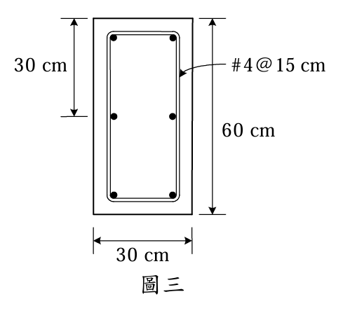

# RC-2008-3 題目正本

> 本檔只記錄**考卷上寫了什麼、圖上畫了什麼**，不含任何解法。解析見同資料夾 `RC-2008-3.md`。
> 判讀清單已經使用者確認（凍結）；本檔原則上不再修改（改動須回考卷原圖並記 log）。

| 項目 | 內容 |
|------|------|
| 考卷 | `raw/exams/RC-2008_鋼筋混凝土設計與預力.pdf` 第 2 頁（背面），第三題 |
| 考年 | 民國 97 年（2008） |
| 配分 | 25 分（㈠10 分、㈡15 分） |
| 附圖 | `RC-2008-3-fig-1.png`（圖三：梁斷面） |
| 判讀狀態 | **已確認**（2026-11-15 使用者確認；轉錄 2026-11-15；PyMuPDF 110 dpi 全頁目視，附圖 400 dpi 局部放大（向量圖）；盲讀後才比對既有解析） |

## 1. 考卷原文（逐字）

> 三、有一梁承受純扭矩作用，其斷面如圖三所示，$f'_c$＝280 kgf/cm²，$f_y$＝2800 kgf/cm²。閉合肋筋及縱向鋼筋均採#4 鋼筋，閉合肋筋間距為 15 cm，淨保護層為 4 cm。此梁斷面為維持平衡須承受一設計扭矩 $T_u$＝3.0 tf-m。若強度折減因數 $\phi$ 採 0.75，試證明：
> ㈠此梁斷面之大小是否合適？（10 分）
> ㈡此梁斷面扭力鋼筋之配置是否合適？（15 分）
> （#4 鋼筋之直徑為 1.27cm，斷面積為 1.27cm²）

## 2. 考卷給的公式、附表與參數

- 題文數值：$f'_c$＝280、$f_y$＝2800 kgf/cm²；閉合肋筋與縱筋 #4（直徑 1.27 cm、面積 1.27 cm²）；肋筋間距 15 cm；淨保護層 4 cm；$T_u$＝3.0 tf-m（平衡扭矩）；$\phi$＝0.75。
- **沒有給**：公式、剪力（題文為純扭矩）、混凝土種類（常重／輕質）。
- 卷首注意事項：不必抄題，作答時請將試題題號及答案依照順序寫在試卷上，於本試題上作答者，不予計分。可以使用電子計算器，但需詳列解答過程。各題計算所用之規定及常數，如有條件不足時，請自行合理假設。

## 3. 附圖

圖面文字照錄：`30 cm`（左側）、`#4@15 cm`、`60 cm`、`30 cm`（底部）、`圖三`。

## 4. 判讀清單

「把握」標**不確定**者請優先確認；解讀類項目（題目用字的意思）另標「解讀」。

| # | 項目 | 判讀 | 圖上／題文依據 | 把握 |
|---|------|------|---------------|------|
| 1 | 斷面 | $b$＝30 cm、$h$＝60 cm（外緣） | 400 dpi：底部 30cm、右側 60cm 尺寸線延伸線對齊斷面外緣 | 確定 |
| 2 | 縱筋配置 | 6 根 #4：四角各 1、左右側面中高各 1；中高筋距頂面 30 cm（＝$h/2$） | 圖上 6 個黑點；左側 30cm 尺寸線上端對齊頂面、下端對齊中高筋心 | 確定 |
| 3 | 肋筋 | 一圈 #4 閉合肋筋，間距 15 cm | 圖上閉合肋筋（雙線）；`#4@15 cm` | 確定 |
| 4 | 淨保護層 | 4 cm，量到肋筋外緣 | 題文「淨保護層為 4 cm」 | 確定（解讀） |
| 5 | 載重 | 純扭矩 $T_u$＝3.0 tf-m（無剪力），為平衡扭矩（不可重分配） | 題文「純扭矩」「為維持平衡須承受」 | 確定 |
| 6 | 題目印出的 $\phi$ | 0.75（照錄） | 題文 | 確定 |
| 7 | 所求 | ㈠斷面大小是否合適（斷面尺寸上限檢核）；㈡扭力鋼筋（肋筋與縱筋）配置是否合適 | 題文 | 確定（解讀） |
| 8 | 考卷沒有給 | 公式、混凝土種類 | 全題 | 確定 |

---

*轉錄：2026-11-15（RC-U2-1／U2-2 題目正本推廣・批 1）*

*確認：2026-11-15 使用者確認（RC-U2-1／U2-2 題目正本推廣・批 1，關卡一）*
