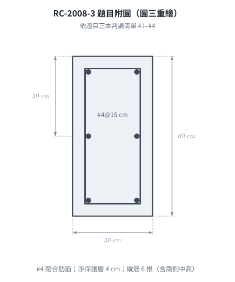
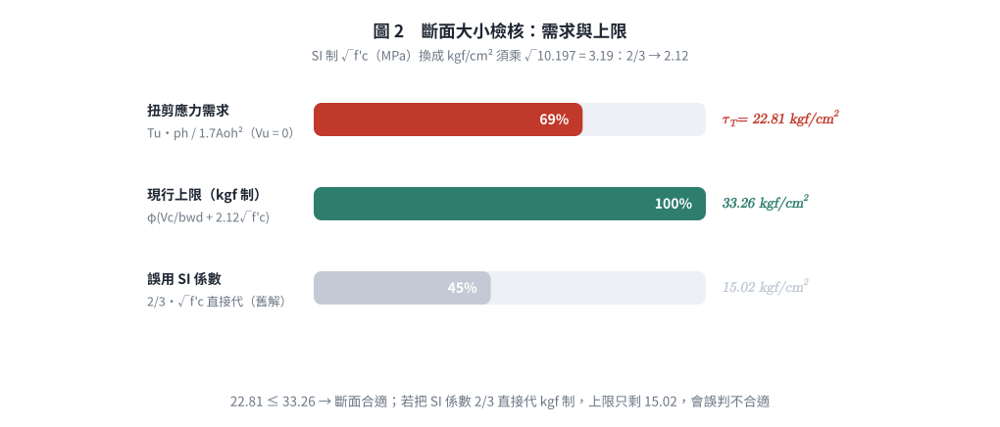

### 考題編號：RC-2008-3

**主分類：** `RC-U2-2` RC 扭力強度設計
**副分類：** 無
**設計法：** USD強度設計法
**標籤：** `矩形梁` `純扭矩` `斷面適當性` `空間桁架類比` `閉合箍筋` `Aoh計算` `poh最大間距` `縱向扭力筋`

---

## 1. 題目（考卷原文見題目正本）

> 考卷原文、公式／附表、附圖與判讀清單（已確認）見 [`RC-2008-3-problem.md`](RC-2008-3-problem.md)。本節只列解題時最容易讀錯的地方與本解使用的記號；題意以題目正本為準。

*重繪自考卷圖三，依題目正本判讀清單 #1–#4。本圖攔下的讀錯：縱筋共 6 根（含兩側中高），不是只有四角。*

### 常見誤讀

| 項目 | 正確判讀 | 常見誤讀 |
|------|---------|---------|
| 縱筋 | 6 根 #4（四角＋兩側中高） | 只計四角 4 根 |
| 淨保護層 | 4 cm 量到肋筋外緣 | 量到縱筋中心 |
| 扭矩性質 | 平衡扭矩（「為維持平衡須承受」），不可折減 | 當諧和扭矩折減 |
| 強度折減因數 | 0.75（題目指定；與現行規範相同） | — |
| 斷面上限係數 | kgf 制 $\phi(V_c/b_wd+2.12\sqrt{f'_c})$ | SI 制 $\tfrac{2}{3}\sqrt{f'_c}$（MPa）直接代 kgf/cm²，上限低估 3.19 倍（本庫 2026-11-15 前舊解，誤判「斷面不合適」） |

**本解記號：** $x_o$、$y_o$＝肋筋中心線尺寸；$A_{oh}=x_oy_o$；$A_o=0.85A_{oh}$；$p_h=2(x_o+y_o)$；$A_t$＝單肢面積；$A_\ell$＝縱向扭力筋。規範：建築物混凝土結構設計規範（內政部 2023 年版），kgf-cm 制。

---

## 2. 考題核心精神與出題者意圖 (Core Concepts & Examiner's Intent)

1. **(a) 斷面適當性** = 驗算混凝土不因斜壓破壞而壓碎（上限公式），與鋼筋量無關
2. **(b) 鋼筋適當性** = 空間桁架模型，驗算 $\phi T_n \geq T_u$，並查最大間距 $s \leq p_{oh}/8$

**出題者陷阱：**
- $f_y = 2800$（非 4200），容易用錯
- 淨保護層到箍筋**外緣**，求 $A_{oh}$ 時需加 $d_b/2$ 到箍筋中心
- 斷面上限要用 kgf 制係數 2.12（不是 SI 制的 2/3）
- 縱筋需求 $A_\ell$ 要和**實際配置的 6 根**比較

---

## 3. 解題戰略地圖與陷阱分析 (Strategic Roadmap & Trap Analysis)

| 步驟 | 工作項目 |
|------|---------|
| 1 | 計算 $A_{cp}$、$p_{cp}$（外輪廓）和 $A_{oh}$、$p_{oh}$（箍筋中心線）|
| 2 | **(a)** 計算扭力剪應力 $\tau_T$，與 $\phi(\tau_c + \tau_{max})$ 比較 |
| 3 | **(b-1)** 計算 $\phi T_n$（箍筋貢獻），與 $T_u$ 比較 |
| 4 | **(b-2)** 驗算最大間距 $s \leq p_{oh}/8$ |
| 5 | **(b-3)** 計算需要之縱向鋼筋 $A_l$，換算 #4 根數 |

**四大陷阱：**

| 陷阱 | 說明 |
|------|------|
| ⚠ 保護層到箍筋中心 | $c_{to center} = 4 + 1.27/2 = 4.635$ cm，不是直接用 4 cm |
| ⚠ $f_y = 2800$（非 4200）| 本題特殊，縱向和橫向鋼筋降伏強度均為 2800 |
| ⚠ 斷面適當性與鋼筋量無關 | (a) 只看斷面幾何，不看鋼筋多少 |
| ⚠ $A_o = 0.85 A_{oh}$，非 $A_{oh}$ | 計算 $T_n$ 時用 $A_o$，計算間距/縱筋用 $A_{oh}$ / $p_{oh}$ |
| ⚠ SI 係數直接代 kgf 制 | $\tfrac{2}{3}\sqrt{f'_c}$（MPa）＝$2.12\sqrt{f'_c}$（kgf/cm²）；混用會把合格斷面判為不合格 |

---

## 3.5 變數層次分析 (Variable Hierarchy Analysis)

> 複習提示：第一次解題後，在每個卡住的知識點旁標記 `⚠`；第二次複習時只看有 `⚠` 的項目。

### 最終目標
`(a) 驗算斷面剪應力上限；(b) 驗算 φTn≥Tu 及間距、縱筋是否合規`

### 本題關鍵公式（依計算順序）

$$\text{Step 1: } A_{oh} = x_{oh} \times y_{oh}, \quad p_{oh} = 2(x_{oh}+y_{oh}), \quad A_o = 0.85 A_{oh}$$

$$\text{(a) Step 2: } \frac{T_u \cdot p_{oh}}{1.7 A_{oh}^2} \leq \phi\!\left(\frac{V_c}{b_w d} + 2.12\sqrt{f'_c}\right)$$

$$\text{(b) Step 3: } \phi T_n = \phi \cdot 2 \boxed{A_o} \cdot \frac{A_t}{s} \cdot f_{yt} \geq T_u$$

$$\text{Step 4 (間距): } s \leq \frac{p_{oh}}{8}, \quad s \leq 30 \text{ cm}$$

$$\text{Step 5 (縱筋): } A_l = \frac{A_t}{s} \cdot \boxed{p_{oh}} \cdot \frac{f_{yt}}{f_y}$$

### L1：題目直接給定

| 符號 | 數值 | 說明 |
|------|------|------|
| $b, h$ | 30, 60 cm | 斷面外輪廓 |
| 淨保護層 | 4 cm | 至箍筋外緣 |
| $d_b$ | 1.27 cm（#4）| 箍筋直徑 |
| $A_t$ | 1.27 cm² | 單肢箍筋面積 |
| $s$ | 15 cm | 箍筋間距 |
| $f'_c$ | 280 kgf/cm² | |
| $f_y = f_{yt}$ | 2800 kgf/cm² | 縱向與橫向均同 |
| $T_u$ | 300,000 kgf·cm | |
| $\phi$ | 0.75 | |

### L2：需知識點推導

**Step 1：幾何計算**

| 符號 | 公式/來源 | 卡關? |
|------|----------|:-----:|
| 箍筋中心至面距 | $4 + 1.27/2 = 4.635$ cm | |
| $x_{oh}$ | $30 - 2 \times 4.635 = 20.73$ cm | |
| $y_{oh}$ | $60 - 2 \times 4.635 = 50.73$ cm | |
| $A_{oh}$ | $20.73 \times 50.73 = 1051.6$ cm² | |
| $p_{oh}$ | $2(20.73+50.73) = 142.92$ cm | |
| $A_o$ | $0.85 \times 1051.6 = 893.9$ cm² | |
| $A_{cp}$ | $30 \times 60 = 1800$ cm² | |

**Step 2：(a) 斷面適當性**

| 符號 | 公式/來源 | 卡關? |
|------|----------|:-----:|
| $\tau_T$（左側）| $T_u \cdot p_{oh}/(1.7 A_{oh}^2) = 300{,}000 \times 142.92 / (1.7 \times 1051.6^2) = 22.81$ kgf/cm² | |
| $V_c/b_wd$（右側）| $0.53\sqrt{280} = 8.87$ kgf/cm² | |
| $2.12\sqrt{f'_c}$ | $2.12\times 16.733 = 35.47$ kgf/cm² | ⚠ |
| 右側上限 | $\phi(8.87+35.47) = 0.75 \times 44.34 = 33.26$ kgf/cm² | |
| **結論** | $22.81 \le 33.26$ → **斷面合適** | |

**Step 3：(b) 箍筋能力**

| 符號 | 公式/來源 | 卡關? |
|------|----------|:-----:|
| $\phi T_n$ | $0.75 \times 2 \times 893.9 \times (1.27/15) \times 2800 = 317{,}900$ kgf·cm $= 3.179$ tf·m | |
| **結論** | $3.179 > T_u = 3.0$ tf·m → 箍筋強度**合適** | |
| 最大間距 | $p_{oh}/8 = 142.92/8 = 17.87$ cm；$s = 15 < 17.87$ ✓ | |

**Step 4：(b) 縱向鋼筋**

| 符號 | 公式/來源 | 卡關? |
|------|----------|:-----:|
| $A_l$（需求）| $(A_t/s)_{req} \times p_{oh} = 0.07991 \times 142.92 = 11.42$ cm² | |
| $A_{\ell,\min}$ | 較小者 $\{14.31-11.42,\ 14.31-2.68\} = 2.89$ cm²，不控制 | |
| 已配置 | 6 根 #4 ＝ 7.62 cm² < 11.42 → **不足** | |
| \#4 根數 | $11.42/1.27 = 9.0$，需 **9 根** | |

### L3：深層知識（不懂就卡住）

| 知識點 | 說明 | 卡關? |
|--------|------|:-----:|
| 斷面適當性公式意義 | 左側為扭力產生之斜向壓力應力；右側為混凝土能承受的上限（防止斜壓壓碎）| |
| 係數換算 | SI：$\phi(V_c/b_wd+0.66\sqrt{f'_c})$（MPa）；kgf 制 $0.66\times\sqrt{10.197}=2.11\approx2.12$ | |
| $A_o$ vs $A_{oh}$ | $A_{oh}$ 是箍筋中心圍成的面積；$A_o = 0.85A_{oh}$ 是有效剪力流面積（考慮混凝土彈性與裂縫後退縮）| |
| 最大間距 $p_{oh}/8$ | 確保在每個 45° 對角裂縫段至少有一支箍筋；$p_{oh}$ 是箍筋中心線周長 | |
| $(A_t/s)_{req}$ vs 已提供 | 計算需求縱筋時用**需求的** $A_t/s$（非提供值），避免虛增縱筋 | |

---

## 4. 步驟化詳細計算過程 (Step-by-Step Detailed Calculation)

### Step 1：幾何計算

外輪廓（$A_{cp}$、$p_{cp}$）：
$$A_{cp} = b \times h = 30 \times 60 = 1800 \text{ cm}^2$$
$$p_{cp} = 2(b+h) = 2(30+60) = 180 \text{ cm}$$

是否需考慮扭力：$\phi T_{th} = 0.75\times0.27\sqrt{280}\times1800^2/180 = 0.75\times81{,}322 = 60{,}990$ kgf·cm $= 0.61$ tf·m $< T_u = 3.0$ tf·m → 須做扭力設計；且為平衡扭矩，不可折減。

至箍筋中心的距離：
$$c_{eff} = \text{淨保護層} + \frac{d_b}{2} = 4 + \frac{1.27}{2} = 4.635 \text{ cm}$$

箍筋中心圍成的矩形：
$$x_{oh} = b - 2c_{eff} = 30 - 2 \times 4.635 = \boxed{20.73 \text{ cm}}$$
$$y_{oh} = h - 2c_{eff} = 60 - 2 \times 4.635 = \boxed{50.73 \text{ cm}}$$

$$A_{oh} = x_{oh} \times y_{oh} = 20.73 \times 50.73 = \boxed{1051.6 \text{ cm}^2}$$
$$p_{oh} = 2(x_{oh}+y_{oh}) = 2(20.73+50.73) = 2 \times 71.46 = \boxed{142.92 \text{ cm}}$$
$$A_o = 0.85 A_{oh} = 0.85 \times 1051.6 = \boxed{893.9 \text{ cm}^2}$$

---

### (a) 斷面大小是否合適？

**斷面適當性上限公式**（純扭矩，$V_u = 0$）：

$$\frac{T_u \cdot p_{oh}}{1.7 A_{oh}^2} \leq \phi\left(\frac{V_c}{b_w d} + 2.12\sqrt{f'_c}\right)$$

**左側（扭力剪應力）：**
$$\tau_T = \frac{T_u \cdot p_{oh}}{1.7 A_{oh}^2} = \frac{300{,}000 \times 142.92}{1.7 \times (1051.6)^2}$$

$$= \frac{42{,}876{,}000}{1.7 \times 1{,}105{,}863} = \frac{42{,}876{,}000}{1{,}879{,}967} = \boxed{22.81 \text{ kgf/cm}^2}$$

**右側上限：**
$$\frac{V_c}{b_w d} = 0.53\sqrt{f'_c} = 0.53 \times \sqrt{280} = 0.53 \times 16.73 = 8.87 \text{ kgf/cm}^2$$

$$2.12\sqrt{f'_c} = 2.12 \times 16.733 = 35.47 \text{ kgf/cm}^2$$

$$\phi\left(\frac{V_c}{b_w d} + 2.12\sqrt{f'_c}\right) = 0.75 \times (8.87 + 35.47) = 0.75 \times 44.34 = \boxed{33.26 \text{ kgf/cm}^2}$$

（純扭矩 $V_u=0$，$V_c/b_wd$ 仍取 $0.53\sqrt{f'_c}$；$V_c/b_wd$ 與 $d$ 無關。）

**比較：**
$$\tau_T = 22.81 \text{ kgf/cm}^2 \quad \le \quad 33.26 \text{ kgf/cm}^2$$

$$\boxed{\text{斷面大小合適}}\quad（\text{可承受 } T_u \text{ 至 } 3.0\times33.26/22.81 = 4.37\ \text{tf·m}）$$

*圖 2　斷面大小檢核的需求與上限。本圖攔下的錯：把 SI 制係數 $\tfrac{2}{3}\sqrt{f'_c}$ 直接代入 kgf/cm²，上限低估 3.19 倍而誤判斷面不合適。*

---

### (b) 扭力鋼筋配置是否合適？

#### b-1：閉合箍筋強度驗算

標稱扭矩（空間桁架模型）：
$$T_n = 2 A_o \cdot \frac{A_t}{s} \cdot f_{yt} = 2 \times 893.9 \times \frac{1.27}{15} \times 2800$$

$$= 2 \times 893.9 \times 0.08467 \times 2800 = 1787.8 \times 237.1 = 423{,}887 \text{ kgf·cm}$$

$$\phi T_n = 0.75 \times 423{,}887 = 317{,}915 \text{ kgf·cm} = \boxed{3.179 \text{ tf·m}}$$

$$\phi T_n = 3.179 \text{ tf·m} \quad > \quad T_u = 3.0 \text{ tf·m} \quad \checkmark$$

→ **箍筋強度合適**

#### b-2：最大間距驗算

$$s_{max} = \min\!\left(\frac{p_{oh}}{8},\ 30 \text{ cm}\right) = \min\!\left(\frac{142.92}{8},\ 30\right) = \min(17.87,\ 30) = 17.87 \text{ cm}$$

$$s = 15 \text{ cm} \leq s_{max} = 17.87 \text{ cm} \quad \checkmark$$

最少扭力箍筋：$(A_v+2A_t)/s = 2\times1.27/15 = 0.169 \ge \max(0.2\sqrt{f'_c},3.5)\,b_w/f_{yt} = 3.5\times30/2800 = 0.0375$ ✓

→ **箍筋間距與最少量合適**

#### b-3：縱向扭力鋼筋需求

需求 $A_t/s$（依 $T_u$）：
$$\left(\frac{A_t}{s}\right)_{req} = \frac{T_u}{\phi \cdot 2 A_o \cdot f_{yt}} = \frac{300{,}000}{0.75 \times 2 \times 893.9 \times 2800} = \frac{300{,}000}{3{,}754{,}380} = 0.07991 \text{ cm}^2/\text{cm}$$

需求縱向鋼筋總面積（$f_y = f_{yt}$ 時 $f_{yt}/f_y = 1$，$\theta$＝45°）：
$$A_l = \left(\frac{A_t}{s}\right)_{req} \times p_{oh} \times \frac{f_{yt}}{f_y} = 0.07991 \times 142.92 \times 1.0 = \boxed{11.42 \text{ cm}^2}$$

最少縱向扭力筋（取兩式較小者）：
$$A_{l,\min} = \frac{1.33\sqrt{f'_c}A_{cp}}{f_y} - \left\{\frac{A_t}{s},\ \frac{1.75b_w}{f_{yt}}\right\}p_h\frac{f_{yt}}{f_y} = 14.31 - \max(11.42,\ 2.68) = 2.89\ \text{cm}^2 \quad（\text{不控制}）$$

**與已配置比較：** 6 根 #4 ＝ $6\times1.27 = 7.62$ cm² $< 11.42$ cm² → **縱向扭力筋不足**

使用 #4 縱向鋼筋（$A_b = 1.27$ cm²），需要根數：
$$n = \frac{A_l}{A_b} = \frac{11.42}{1.27} = 8.99 \rightarrow \text{最少需 } \boxed{9 \text{ 根 \#4 縱向鋼筋}}$$

縱筋間距驗算（沿 $p_{oh}$ 均勻分布）：
$$s_l = \frac{p_{oh}}{n} = \frac{142.92}{9} = 15.88 \text{ cm} \leq 30 \text{ cm} \quad \checkmark$$

**縱向鋼筋小結：**
- 需 $A_l = 11.42$ cm²，以 #4 計最少 **9 根**；現配 6 根（7.62 cm²）**不足**
- 現配 6 根的間距（長側 25.4 cm、短側 20.7 cm）≤ 30 cm、號數 ≥ $0.042s$＝0.63 cm 皆符合，問題只在數量
- 改善：例如長側每面配 4 根、短側不加（4 角＋長側中間各 2 根＝8 根）仍不足，需 **10 根 #4**（長側每面 4 根、短側每面中間 1 根）或改用 #5

### (b) 結論

| 項目 | 需求 | 配置 | 判定 |
|---|---|---|---|
| 箍筋 $A_t/s$ | 0.0799 cm²/cm | 0.0847 | ✓ |
| 箍筋間距 | ≤ 17.87 cm | 15 cm | ✓ |
| 最少箍筋 | ≥ 0.0375 | 0.169 | ✓ |
| 縱向扭力筋 $A_\ell$ | 11.42 cm² | 7.62 cm² | **✗** |

$$\boxed{\text{箍筋合適；縱向扭力筋不足 → 扭力鋼筋配置不合適}}$$

---

## 5. 關鍵爭議點與進階探討 (Critical Issues & Advanced Discussion)

### 舊解的錯誤：SI 係數代 kgf 制

本庫 2026-11-15 前舊解以 $\phi(V_c/b_wd+\tfrac{2}{3}\sqrt{f'_c})$＝15.02 kgf/cm² 為上限，判「斷面不合適、需加大斷面」。$\tfrac{2}{3}\sqrt{f'_c}$ 是 ACI 318 SI 版（$f'_c$ 以 MPa）的係數；kgf/cm² 制須乘 $\sqrt{10.197}=3.19$，即 2.12。同類錯誤：RC-2011-4（$T_{cr}$ 用 $\sqrt{f'_c}/3$）、RC-2013-3（$T_{th}$ 用 $\sqrt{f'_c}/12$）。

### 斷面與鋼筋兩個檢核是獨立的

- **(a) 斷面壓碎上限**：確保混凝土斜壓應力不超限（超限時加多少鋼筋都沒用）
- **(b) 鋼筋強度**：箍筋與縱筋的空間桁架剪力流

本題 (a) 通過，(b) 箍筋通過、縱筋不足。

### $\theta$ 能否調整讓現有縱筋過關？

規範允許 $30°\le\theta\le60°$。$\theta$ 加大可減少縱筋（$\propto\cot^2\theta$），但箍筋需求同步增加（$\propto\tan\theta$）：

| $\theta$ | 需 $A_t/s$（供 0.0847） | 需 $A_\ell$（供 7.62） |
|---|---|---|
| 45° | 0.0799 ✓ | 11.42 ✗ |
| 50° | 0.0952 ✗ | 9.58 ✗ |
| 55° | 0.1141 ✗ | 8.00 ✗ |
| 60° | 0.1384 ✗ | 6.59 ✓ |

不存在讓兩者同時滿足的 $\theta$，結論不變。

### $(A_t/s)_{req}$ 用需求值還是提供值計算 $A_l$？

規範計算 $A_\ell$ 時用**需求的** $A_t/s$；以提供值 0.0847 計得 12.10 cm²，同樣不足。

*修正日期：2026-11-15（§1 改為指向題目正本，插入重繪附圖 figs/RC-2008-3-fig-1-problem.svg；舊 §1 重述改寫為常見誤讀與本解記號；本行非答案勘誤）*

*修正日期：2026-11-15（解析勘誤：斷面上限係數由 SI 制 2/3·√f'c 改為 kgf 制 2.12√f'c（現行台灣規範，建築物混凝土結構設計規範 2023 年版），㈠「斷面不合適」→「斷面合適」（22.81 ≤ 33.26 kgf/cm²）；㈡ 補上與已配置 6 根 #4 的比較（7.62 < 11.42 cm²，縱筋不足）、扭力門檻、最少箍筋與 Aℓ,min 檢核；§5 重寫；驗證：盲解比對 + 勘誤腳本重算 MISMATCHES: 0）*

*修正日期：2026-11-15（圖解補繪（非勘誤）：新增 figs/RC-2008-3-fig-2-limit.svg，腳本 figs/gen_RC-2008-3.py，可重跑；答案不變）*
