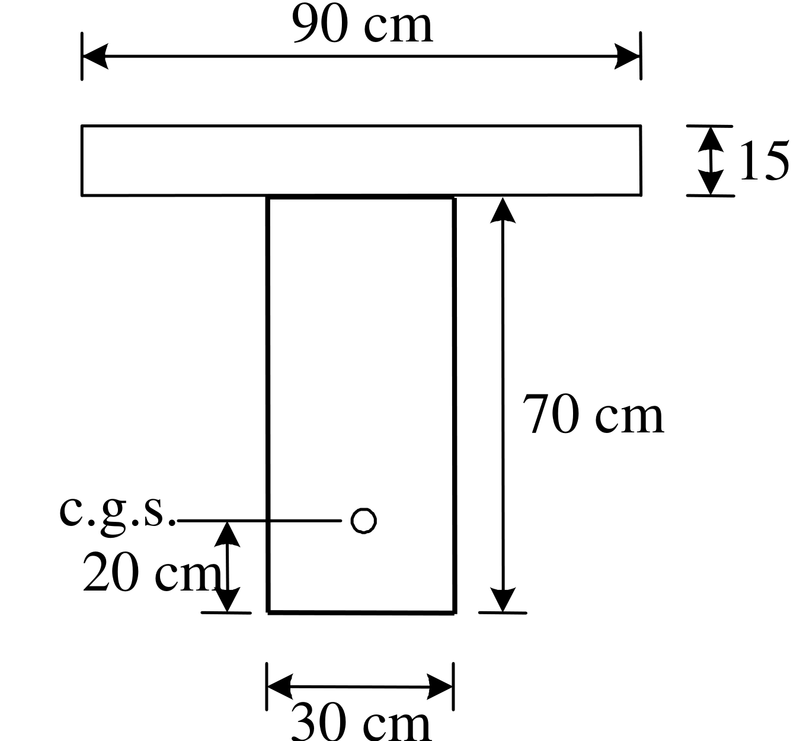

# RC-2008-4 題目正本

> 本檔只記錄**考卷上寫了什麼、圖上畫了什麼**，不含任何解法。解析見同資料夾 `RC-2008-4.md`。
> 判讀清單已經使用者確認（凍結）；本檔原則上不再修改（改動須回考卷原圖並記 log）。

| 項目 | 內容 |
|------|------|
| 考卷 | `raw/exams/RC-2008_鋼筋混凝土設計與預力.pdf` 第 2 頁（背面），第四題 |
| 考年 | 民國 97 年（2008） |
| 配分 | 30 分 |
| 附圖 | `RC-2008-4-fig-2.png`（圖四；2026-11-14 由考卷向量圖 500 dpi 重新擷取，無游標）；既有 `RC-2008-4-fig-1.png` 為同一圖、左上角有滑鼠游標（未壓到圖），保留不刪 |
| 判讀狀態 | **已確認**（2026-11-14 使用者確認；轉錄 2026-11-14；PyMuPDF 110 dpi 全頁目視＋抽出文字核對，附圖 500 dpi 並讀 PDF 繪圖座標；盲讀後才比對既有解析） |

## 1. 考卷原文（逐字）

> 四、有一簡支預力梁，其跨度為 15 m，梁寬為 30 cm，梁全深為 70 cm，梁之 $f'_c$ =350 kgf/cm²。在此梁中，預力損失後預力鋼鍵之有效預力為 200 tf。此梁在預力損失後開始吊裝，並在其上澆置 15 cm 厚樓版，澆置後跨度中央梁與樓版之斷面如圖四所示，樓版之 $f'_c$ = 280 kgf/cm²。當樓版硬化並與梁結合為一體後，再於樓版上施加均佈活載重。若梁及樓版之混凝土壓應力均不得超過 0.45 $f'_c$，亦不容許混凝土承受張應力，則樓版上所能施加之最大均佈活載重為何？（30 分）

（「鋼鍵」照考卷原文。）

## 2. 考卷給的公式、附表與參數

- 題文數值：跨度 15 m；梁 $30 \times 70$ cm（全深）、$f'_c=350$；有效預力 200 tf（損失後）；樓版厚 15 cm、$f'_c=280$；容許壓應力 $0.45f'_c$（梁、版各依自身 $f'_c$）；不容許拉應力。
- 考卷未印任何公式。
- **沒有給**：混凝土單位重、$E_c$／模數比、梁距（圖只畫 90 cm 版寬）、澆版時是否有支撐、活載重單位（tf/m² 或 tf/m）。
- 卷首注意事項：不必抄題，作答時請將試題題號及答案依照順序寫在試卷上，於本試題上作答者，不予計分。可以使用電子計算器，但需詳列解答過程。各題計算所用之規定及常數，如有條件不足時，請自行合理假設。

## 3. 附圖

圖面文字照錄：`90 cm`、`15 cm`、`70 cm`、`c.g.s.`、`20 cm`、`30 cm`、`圖四`。

## 4. 判讀清單

「把握」標**不確定**者請優先確認；解讀類項目（題目用字的意思）另標「解讀」。

| # | 項目 | 判讀 | 圖上／題文依據 | 把握 |
|---|------|------|---------------|------|
| 1 | 梁深 70 cm 的量測基準 | **梁本身 70 cm（樓版底面到梁底），不含版**；合成斷面總深 85 cm | 70cm 尺寸線 y＝757.8（版底，版為 740.5–757.5）至 858.8（梁底），PDF 座標；題文「梁全深為 70 cm」 | 確定 |
| 2 | 版寬 | 樓版寬 90 cm（圖上即為合成斷面的翼寬） | 90cm 尺寸線兩端對齊版左右緣（x＝274.8、410.5） | 確定 |
| 3 | 梁位置 | 梁置中於版下 | 版中心 x＝342.65、梁中心 x＝342.6 | 確定 |
| 4 | 鋼腱位置（跨中） | c.g.s. 距梁底 20 cm → 距梁頂 50 cm | 20cm 尺寸線由 c.g.s. 水平線（y＝836.5）至梁底（858.8） | 確定 |
| 5 | 施工順序 | 梁先受預力（損失後）＋自重 → 澆版 → 版硬化後合成斷面承受活載重；考卷**沒有明寫**澆版時梁是否單獨承受版重（不像 2006 年同型題寫「利用梁作為支撐」） | 題文「此梁在預力損失後開始吊裝，並在其上澆置」 | 確定（解讀）（「在其上澆置」視為無支撐，版重由梁單獨承受） |
| 6 | 活載重單位 | 題目要「樓版上所能施加之最大均佈活載重」，未給單位；以版寬 90 cm 為分擔寬度，可答 tf/m²，也可同時列每公尺梁長 tf/m | 題文「於樓版上施加均佈活載重」 | 確定（解讀） |
| 7 | 應力限制 | 梁、版壓應力各 ≤ $0.45f'_c$（梁 157.5、版 126 kgf/cm²）；全斷面不得受拉 | 題文「梁及樓版之混凝土壓應力均不得超過 0.45 $f'_c$，亦不容許混凝土承受張應力」 | 確定 |
| 8 | 考卷沒有給 | 單位重、模數比、梁距、支撐、活載重單位 | 全題 | 確定（作答須自行假設） |

---

*轉錄：2026-11-14（RC-U4-1 題目正本推廣・批 1）*

*確認：2026-11-14 使用者確認（RC-U4-1 題目正本推廣・批 1，關卡一）*
