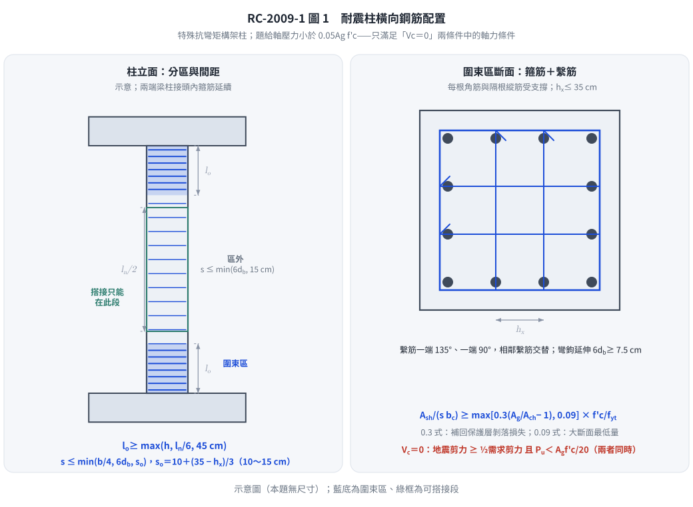

# 考題編號：RC-2009-1

**主分類：** `RC-U3-3` 韌性要求與耐震設計  
**副分類：** `RC-U2-1` RC 剪力強度分析與設計  
**設計法：** 概念題（USD 耐震設計）  
**標籤：** `耐震柱` `橫向鋼筋` `密箍區lo` `圍束箍筋` `Ash公式` `Vc=0條件` `特殊矩形框架柱` `剪力設計` `Mpr` `Nu小於0.05Agfc` `Vc=0兩條件` `s0公式` `現行台灣規範`

---

## 1. 題目（考卷原文見題目正本）

> 考卷原文、公式／附表、附圖與判讀清單（已確認）見 [`RC-2009-1-problem.md`](RC-2009-1-problem.md)。本節只列解題時最容易讀錯的地方與本解使用的記號；題意以題目正本為準。

### 常見誤讀

| 項目 | 正確判讀 | 常見誤讀 |
|------|---------|---------|
| 軸力門檻 | 題給「設計軸壓力小於 $0.05A_gf'_c$」 | 讀成 $0.1A_gf'_c$ |
| $V_c = 0$ 條件 | 軸力 $< A_gf'_c/20$ **且** 地震剪力 ≥ 需求剪力之半，兩者同時成立 | 只要軸力小就 $V_c=0$（本庫舊解） |
| $A_{sh}$ 兩式來源 | 0.3 式補回保護層剝落損失；0.09 式為大斷面最低量 | 兩式來源說反（本庫舊解） |
| 題型 | 說明題，可繪圖（柱立面圍束區、斷面箍筋配置） | 自行假設斷面去算 |

**本解記號：** $l_o$＝圍束區長度；$s_o$＝圍束區外箍筋間距；$h_c$＝核心尺寸；$A_{sh}$＝橫向鋼筋斷面積。

---

## 2. 考題核心精神與出題者意圖 (Core Concepts & Examiner's Intent)

**核心觀念：** 特殊矩形框架柱（SMRF）橫向鋼筋同時承擔三個任務：
1. **圍束（Confinement）**：提升核心混凝土延性
2. **剪力抵抗（Shear）**：在塑性鉸區抵抗地震剪力
3. **縱筋防挫屈（Buckling prevention）**：防止縱向鋼筋在反覆載重下挫屈

**出題重點：** 題給 $P_u < 0.05A_gf'_c$（$=A_gf'_c/20$），正好滿足 $V_c = 0$ 的**兩個條件之一**；若再加上「地震引致剪力 ≥ $l_o$ 內最大需求剪力之半」（耐震柱通常成立），圍束區內 $V_c = 0$，**所有剪力由橫向鋼筋承擔**，此時剪力設計更嚴格（規範 §18.4.6.2.1）。

---

## 3. 解題戰略地圖與陷阱分析 (Strategic Roadmap & Trap Analysis)

**作戰計畫：**
1. 說明耐震柱橫向鋼筋的三大目的
2. 定義密箍區（$l_o$）位置與長度
3. 說明密箍區間距 $s_o$ 規定
4. 推導圍束箍筋面積 $A_{sh}$ 兩公式
5. 說明柱剪力設計（$V_e$）及 $V_c = 0$ 的兩個條件（題給軸力滿足其一）
6. 說明非密箍區的橫向鋼筋要求

**關鍵陷阱：**

| 陷阱 | 說明 | 應對 |
|------|------|------|
| ❶ $V_c = 0$ 只寫軸力條件 | 規範要求**兩條件同時成立**：(a) 地震引致剪力 ≥ $l_o$ 內最大需求剪力之半，(b) $P_u < A_gf'_c/20$ | 兩條件都寫；成立時 $V_s = V_e/\phi$（無 $V_c$ 分攤） |
| ❷ $A_{sh}$ 兩公式須取大值 | 兩個圍束條件均須滿足 | 均算後取較大者 |
| ❸ $l_o$ 的三個取法取最大 | $l_o = \max(h_n/6, h_{max}, 45cm)$ | 不得省略任何一項 |
| ❺ 圍束區間距漏 $s_o$ 公式 | 第三個上限是 $s_o = 10 + (35-h_x)/3$ cm（10～15 cm），不是固定 15 cm | 先算 $h_x$ 再代入 |
| ❹ 密箍區 vs. 非密箍區間距不同 | 非密箍區間距較寬鬆 | 分區說明 |

---

## 3.5 變數層次分析 (Variable Hierarchy Analysis)

### 最終目標

完整說明耐震柱橫向鋼筋的配置規定，並特別指出 $N_u < 0.05A_gf'_c$ 的影響。

### 關鍵公式（依設計順序）

$$l_o \ge \max\!\left(\frac{h_n}{6},\ h_{\max},\ 45\text{ cm}\right)$$

$$s \le \min\!\left(\frac{b_{\min}}{4},\ 6d_b,\ s_o\right),\quad s_o = 10 + \frac{35 - h_x}{3}\ (\text{cm}),\ 10 \le s_o \le 15$$

$$A_{sh} \ge \max\!\left(0.09\,s\,h_c\,\frac{f'_c}{f_{yh}},\quad 0.3\,s\,h_c\!\left(\frac{A_g}{A_{ch}}-1\right)\!\frac{f'_c}{f_{yh}}\right)$$

$$V_e = \frac{M_{pr,1}+M_{pr,2}}{h_n}\ (\text{加計重力剪力})$$

$$\text{若 (a) }V_{E} \ge \tfrac12 V_{u,\max}\ \text{且 (b) }P_u < \frac{A_gf'_c}{20}:\quad V_c = 0,\quad V_s = \frac{V_e}{\phi} = \frac{A_v f_{yt} d}{s}$$

### L1：規範直接規定（不需推導）

| 規定項目 | 內容 |
|---------|------|
| $l_o$ 計算方式 | 三值取大 |
| 圍束區間距 | $b_{\min}/4$、$6d_b$（$f_y$=4,200）、$s_o$ 三值取小；$h_x \le 35$ cm |
| $A_{sh}$ 計算方式 | 兩公式取大 |
| $V_c = 0$ 條件（§18.4.6.2.1） | (a) 地震引致剪力 ≥ 最大需求剪力之半，**且** (b) $P_u < A_gf'_c/20$ |

### L3：深層知識

| 知識點 | 說明 | 卡關? |
|--------|------|-------|
| 為何小軸力且地震剪力主控時 $V_c = 0$ | 塑鉸區反覆開裂、保護層剝落，骨料咬合與壓力區剪力傳遞退化；軸壓小時無法抑制斜裂縫，故保守取 $V_c = 0$ | |
| $A_{sh}$ 的 $0.3(A_g/A_{ch}-1)$ 式來源 | 保護層剝落後，以圍束提高核心強度（$f'_{cc} \approx f'_c + 4.1f_\ell$）補回失去的保護層軸力強度：核心強度 ≥ 原全斷面強度；$A_g/A_{ch}$ 越大（保護層佔比越高）需要越多 | |
| $A_{sh}$ 的 $0.09$ 式來源 | 大斷面時 $A_g/A_{ch} \to 1$，上式趨近 0，仍須最低圍束量以確保塑鉸區曲率韌性 | |
| $M_{pr}$ 的定義 | 可能彎矩強度：$M_{pr} = A_s \times 1.25f_y \times$ 力臂（用 $\alpha=1.25$ 考慮應變硬化） | |

---

## 4. 步驟化詳細計算過程 (Step-by-Step Detailed Calculation)

本題為概念說明題，以條列式配合圖說明橫向鋼筋配置。

---

### 一、耐震柱橫向鋼筋的三大目的

| 目的 | 說明 |
|------|------|
| ① 圍束核心混凝土 | 提升混凝土延性，使塑性鉸能承受大變形而不脆斷 |
| ② 抵抗剪力 | 柱端塑性鉸區承受大剪力，需足夠箍筋作為 truss 機構 |
| ③ 防止縱筋挫屈 | 反覆壓縮下縱筋可能挫屈，橫向鋼筋提供側向支撐 |

---

### 二、密箍區（$l_o$）的設置

特殊矩形框架柱在**柱端**必須設置密箍區，以容納塑性鉸形成。

$$\boxed{l_o \ge \max\!\left(\frac{h_n}{6},\quad h_{\max,\text{dim}},\quad 45\text{ cm}\right)}$$

- $h_n$ = 柱淨高
- $h_{\max,\text{dim}}$ = 柱斷面最大邊長
- 45 cm = 絕對最小值

**密箍區位置：** 柱**兩端**（上端及下端），各取 $l_o$；接頭（joint）內全長也需配置（見下圖說明）。

```
┌─────────────────────────────────────────┐
│ 上柱端 ← lo →                           │
│ ┌──────────────────────────────────────┐ │
│ │    密箍區（so間距）                   │ │
│ ├──────────────────────────────────────┤ │
│ │                                      │ │
│ │    非密箍區（較寬間距）               │ │
│ │                                      │ │
│ ├──────────────────────────────────────┤ │
│ │    密箍區（so間距）                   │ │
│ └──────────────────────────────────────┘ │
│              ← lo →  下柱端              │
└─────────────────────────────────────────┘
```

---



*圖 1　耐震柱橫向鋼筋配置（示意）。本圖攔下三種錯：$l_o$ 三值取錯、圍束區間距漏掉 $s_o = 10 + (35-h_x)/3$、以及只看軸力就令 $V_c = 0$。*

### 三、密箍區橫向鋼筋間距（$s_o$）

$$\boxed{s \le \min\!\left(\frac{b_{\min}}{4},\quad 6d_b,\quad s_o\right),\qquad s_o = 10 + \frac{35 - h_x}{3}\ \text{cm}}$$

- $b_{\min}$ = 柱斷面最小邊長
- $d_b$ = 最小縱向鋼筋直徑（$f_y$ = 4,200 kgf/cm² 時 $6d_b$；5,000 時 $5.5d_b$；5,600 時 $5d_b$）
- $s_o$：$h_x$ 為受箍筋角或繫筋支撐之縱筋最大中心距；$s_o$ 不大於 15 cm、不必小於 10 cm（規範 §18.4.5.3）

---

### 四、密箍區圍束箍筋面積（$A_{sh}$）

在密箍區內，每個方向均需滿足：

$$\boxed{A_{sh} \ge \max\!\left(\underbrace{0.09\,s\,h_c\,\frac{f'_c}{f_{yh}}}_{\text{公式①}},\quad \underbrace{0.3\,s\,h_c\!\left(\frac{A_g}{A_{ch}}-1\right)\!\frac{f'_c}{f_{yh}}}_{\text{公式②}}\right)}$$

- $s$ = 箍筋間距
- $h_c$（現行規範記為 $b_c$）= 被圍束方向的核心尺寸，量到箍筋**外緣**（現行規範寫作 $b_c$）
- $A_g$ = 全斷面積
- $A_{ch}$ = 核心面積（同樣量到箍筋外緣，故方形柱 $A_{ch} = h_c^2$）

> **量法一致性（2026-08-21 統一）：** 本庫 $h_c$ 與 $A_{ch}$ 一律量到箍筋**外緣**。
> 舊版 ACI 318-99 的 $h_c$ 是箍筋**中心至中心**（比外緣值小一個 $d_{tie}$），而 $A_{ch}$ 仍量到外緣——
> 那套定義下 $A_{ch} \ne h_c^2$，且算出的間距上限會放寬約 3%。兩套不可混用，詳見 [[RC-2004-3]] §4①。
- $f_{yh}$ = 箍筋降伏強度

**公式②（0.3）** 來自「保護層剝落後，圍束核心的強度須補回失去的保護層強度」——$A_g/A_{ch}$ 越大需要越多；  
**公式①（0.09）** 是大斷面（$A_g/A_{ch}$ 接近 1、公式②很小）時的最低圍束量。取**兩式較大值**（本題 $P_u$ 小，不需加 $P_u > 0.3A_gf'_c$ 時的 $0.2k_fk_nP_u/(f_{yt}A_{ch})$ 式；規範表 18.4.5.4）。

---

### 五、柱剪力設計及 $V_c = 0$ 條件（題給軸力的意義）

**設計剪力 $V_e$（考量強柱弱梁的實際剪力）：**

$$V_e = \frac{M_{pr,\text{top}} + M_{pr,\text{bot}}}{h_n} + V_{\text{gravity}}$$

- $M_{pr}$ = 可能彎矩強度（以 $1.25f_y$ 計算，考量應變硬化）
- 此 $V_e$ 為最大可能剪力（不折減，考慮超強）

**$V_c = 0$ 的條件（規範 §18.4.6.2.1，兩條件同時成立）：**

> (a) $l_o$ 範圍內，地震引致剪力 ≥ 最大需求剪力強度之一半；**且**  
> (b) 含地震效應之因數化軸壓力 $P_u < A_gf'_c/20$。
>
> 題目給的「設計軸壓力小於 $0.05A_gf'_c$」就是條件 (b)；耐震柱的剪力大多來自地震，(a) 通常也成立，故圍束區內 $V_c = 0$，剪力全由橫向鋼筋承擔。若 (a) 不成立（重力剪力佔多數），仍可計入 $V_c$。

物理原因：軸壓力小代表混凝土在反覆地震力下更容易開裂，無法提供穩定的骨料咬合剪力。

$$V_c = 0 \Rightarrow V_e \le \phi V_s = \phi\cdot\frac{A_v\,f_{yh}\,d}{s}$$

所需箍筋間距（由剪力控制）：

$$s \le \frac{A_v\,f_{yh}\,d}{\phi^{-1}V_e}$$

配置時取：$s = \min(s_{\text{剪力}},\ s_o)$（取剪力與圍束條件的更嚴格者）

---

### 六、非密箍區橫向鋼筋

在柱中段（非密箍區），橫向鋼筋間距放寬：

$$s_{\text{non-lo}} \le \min(6d_b,\ 15\text{ cm})$$

圍束區外不需滿足 $A_{sh}$ 式，但仍須以閉合箍筋（螺箍）配置並滿足 $V_e$ 的剪力需求。

---

### 七、橫向鋼筋型式

- **閉合箍筋（Closed Hoops）**：圍繞全部縱筋的封閉矩形箍
- **繫筋（Crossties）**：連接對角縱筋，每端 135° 彎鉤，兩端交替配置
- **矩形箍筋組合**：多個矩形箍疊套，確保每個縱筋均受橫向支撐

每根角筋與**隔根**縱筋須由箍筋角或繫筋（135° 耐震彎鉤，延伸 ≥ $6d_b$ 且 ≥ 7.5 cm）側向支撐；受支撐縱筋的中心距 $h_x \le 35$ cm（防止縱筋挫屈）。

---

## 5. 關鍵爭議點與進階探討 (Critical Issues & Advanced Discussion)

**① 為何 $0.05A_gf'_c$ 是分界點？**

$A_gf'_c/20$ 是規範認定「軸壓足以抑制斜裂縫」的門檻（§18.4.6.2.1 條件 (b)）。低於此值，且地震剪力主控（條件 (a)）時：
- 柱可能在地震下承受淨拉力（雙軸地震時）
- 混凝土開裂廣泛，骨料咬合喪失
- $V_c$ 的前提（軸壓克制對角拉力）不成立

因此規範在兩條件同時成立時保守地取 $V_c = 0$，確保箍筋能完全承擔剪力。只有軸力小、但剪力以重力為主的柱，仍可計入 $V_c$。

**② 密箍區全高配置的情形**

柱若支承不連續的剛性構材（如上方牆體中斷）且 $P_u > A_gf'_c/10$，圍束橫向鋼筋須沿柱全高配置，並伸入不連續構材內一個伸展長度；本題 $P_u < 0.05A_gf'_c$，不適用此規定，只在兩端 $l_o$ 內配置。

**③ 考場繪圖建議**

25 分題強調「必要時請繪圖」，建議繪：
- 柱立面圖（標示密箍區 $l_o$、非密箍區、箍筋間距 $s_o$）
- 柱斷面圖（標示箍筋 + 繫筋配置方式、$h_c$ 量法）

*修正日期：2026-11-14（§1 改為指向題目正本）*

*修正日期：2026-11-14（解析勘誤並改依現行台灣規範（建築物混凝土結構設計規範 112 年版）：V_c = 0 由「只要 N_u < 0.05A_gf'c」改為兩條件同時成立（地震剪力 ≥ 需求剪力之半，且 P_u < A_gf'c/20；§18.4.6.2.1）；A_sh 0.3 式與 0.09 式的來源說明對調更正；圍束區間距補 s_o = 10 + (35 − h_x)/3（10～15 cm）、6d_b 依 f_y 分級；圍束區外刪除「仍須提供 A_sh」；縱筋支撐改為角筋與隔根筋受支撐、h_x ≤ 35 cm；§5② 改為全高圍束的實際規定；驗證：逐條對照內政部 112 年版規範原文（§18.4.5.3、表 18.4.5.4、§18.4.6.2.1）；來源：盲解比對-RC-U3-3-批1-2026-11-14）*

*修正日期：2026-11-14（圖解補繪：圖 1 柱分區與斷面箍筋；向量圖，腳本 `gen_RC-2009-1.py` 可重跑）*
