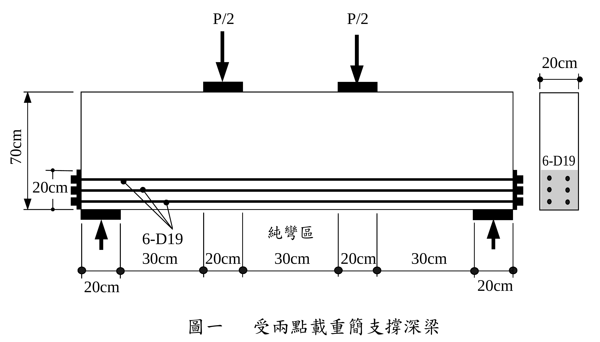

# RC-2009-3 題目正本

> 本檔只記錄**考卷上寫了什麼、圖上畫了什麼**，不含任何解法。解析見同資料夾 `RC-2009-3.md`。
> 判讀清單已經使用者確認（凍結）；本檔原則上不再修改（改動須回考卷原圖並記 log）。

| 項目 | 內容 |
|------|------|
| 考卷 | `raw/exams/RC-2009_鋼筋混凝土設計與預力.pdf` 第 1 頁（正面），第三題 |
| 考年 | 民國 98 年（2009） |
| 配分 | 25 分 |
| 附圖 | `RC-2009-3-fig-2.png`（圖一：受兩點載重簡支撐深梁；2026-11-15 由考卷重新擷取 500 dpi，含圖名）；既有 `RC-2009-3-fig-1.png` 為同一圖，梁身中央壓有滑鼠游標，保留不刪 |
| 判讀狀態 | **已確認**（2026-11-15 使用者確認；影響答案項目使用者選擇：#8 不視為指定 ACI，依現行台灣規範解題（ACI 僅為腹筋條件）；轉錄 2026-11-15；PyMuPDF 110 dpi 全頁目視，附圖 300 dpi 局部放大；附圖為向量圖，尺寸文字以 PDF 文字座標核對；盲讀後才比對既有解析） |

## 1. 考卷原文（逐字）

> 註：下列問題之相關公式及設計參數未提及時，請自行做合理假設或推斷。（卷首，適用全卷）
>
> 三、試以壓拉桿模式（strut-and-tie model），預估圖一受兩點載重簡支撐深梁之最大載重 $P$ 及可能破壞模式為何？其中，梁配有水平與垂直腹筋，且符合ACI規範之規定。混凝土 $f'_c$＝250 kgf/cm²，鋼筋 $f_y$＝4200 kgf/cm²，$A_{s,D19}$＝2.87 cm²。假設純彎區水平壓桿寬為 20cm，不考慮強度折減係數。鋼筋兩端有良好錨定，且承壓鈑與混凝土表面均有良好接觸。（25 分）

## 2. 考卷給的公式、附表與參數

- 題文數值：$f'_c$＝250、$f_y$＝4200 kgf/cm²；D19 面積 2.87 cm²；純彎區水平壓桿寬 20 cm；不考慮強度折減係數。
- 題文條件：水平與垂直腹筋「符合 ACI 規範之規定」（量未給）；鋼筋兩端良好錨定；承壓鈑與混凝土良好接觸。
- **沒有給**：腹筋號數與間距、拉力筋各排間距（圖上只有拉桿區總高 20 cm）、承壓鈑厚度與出平面尺寸（只畫出長 20 cm）、ACI 版本、混凝土種類（常重／輕質）。
- 卷首注意事項：㈠可以使用電子計算器，但需詳列解答過程。㈡不必抄題，作答時請將試題題號及答案依照順序寫在試卷上，於本試題上作答者，不予計分。另有卷首註（見 §1）。

## 3. 附圖

圖面文字照錄：`P/2`、`P/2`、`70cm`、`20cm`（左側拉桿區高）、`6-D19`（立面指示線）、`純彎區`、底部尺寸鏈 `20cm`、`30cm`、`20cm`、`30cm`、`20cm`、`30cm`、`20cm`、斷面 `20cm`、`6-D19`、`圖一　受兩點載重簡支撐深梁`。

## 4. 判讀清單

「把握」標**不確定**者請優先確認；解讀類項目（題目用字的意思）另標「解讀」。

| # | 項目 | 判讀 | 圖上／題文依據 | 把握 |
|---|------|------|---------------|------|
| 1 | 拉力筋形心位置 | 6-D19 分 3 層、每層 2 根，均布在底面起 20 cm 高的拉桿區內；各層間距未標，形心取拉桿區中央、距底面 **10 cm** | 300 dpi：左側 20cm 尺寸線上端點對齊拉桿區頂（端部錨定鈑頂，y≈528）、下端對齊底面（y≈650）；三層筋 y≈555、590、625，中層在 20 cm 區中央；斷面圖灰色區（拉桿區）內 3 排筋等距 | 確定（解讀）（影響答案）；使用者確認 |
| 2 | 尺寸鏈與承壓鈑 | 底部尺寸鏈 20＋30＋20＋30＋20＋30＋20＝**170 cm**＝梁全長；兩端 20 cm 為支承承壓鈑長（鈑外緣齊梁端），兩個 20 cm 中段為載重承壓鈑長（與頂面載重鈑對齊） | 尺寸鏈刻點：x≈232（梁左端）、353（左支承鈑內緣）、610、733（左載重鈑兩緣）、1030、1150（右載重鈑兩緣）、1450、1572（右支承鈑、梁右端）（300 dpi） | 確定 |
| 3 | 剪力跨 | 支承鈑中心到載重鈑中心＝10＋30＋10＝**50 cm**；兩載重鈑中心距＝10＋30＋10＝50 cm；載重鈑淨距 30 cm（純彎區） | 由 #2 尺寸鏈推得 | 確定 |
| 4 | 斷面 | 梁高 $h$＝70 cm、寬 $b$＝20 cm | 立面左側 70cm（頂面至底面）；斷面 20cm（外緣） | 確定 |
| 5 | 載重與支承 | 頂面兩點各 $P/2$（向下，作用在 20 cm 承壓鈑上），左右對稱；兩端支承反力向上（簡支） | 立面箭頭與承壓鈑 | 確定 |
| 6 | 拉力筋錨定 | 拉力筋兩端穿出梁端並有錨定鈑（圖上黑色小鈑）；題文「鋼筋兩端有良好錨定」 | 立面左右端黑色突出物 | 確定 |
| 7 | 純彎區壓桿寬 | 純彎區水平壓桿寬 20 cm（題目給定，量自頂面向下） | 題文 | 確定（解讀） |
| 8 | 規範 | 題文提到「腹筋符合 ACI 規範之規定」；使用者定案：**不視為指定 ACI**，依現行台灣規範的壓拉桿條文解題；ACI 僅為腹筋條件 | 題文 | 不確定（解讀）（影響答案）；使用者確認 |
| 9 | 圖的比例 | 附圖未依比例：垂直 70 cm≈365 px、水平 170 cm≈1340 px（300 dpi），不能用量圖取幾何 | 量測 | 確定 |
| 10 | 所求 | 以壓拉桿模式預估最大載重 $P$（$P$＝兩點載重和）及可能破壞模式；不考慮強度折減係數 | 題文 | 確定 |
| 11 | 考卷沒有給 | 腹筋量、拉力筋層間距、承壓鈑出平面寬（是否等於梁寬 20 cm）、ACI 版本 | 全題 | 確定 |

---

*轉錄：2026-11-15（RC-U2-1／U2-2 題目正本推廣・批 1）*

*確認：2026-11-15 使用者確認（RC-U2-1／U2-2 題目正本推廣・批 1，關卡一）*
