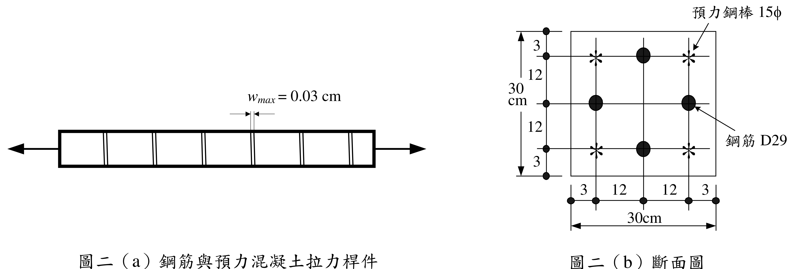

# RC-2009-4 題目正本

> 本檔只記錄**考卷上寫了什麼、圖上畫了什麼**，不含任何解法。解析見同資料夾 `RC-2009-4.md`。
> 判讀清單已經使用者確認（凍結）；本檔原則上不再修改（改動須回考卷原圖並記 log）。

| 項目 | 內容 |
|------|------|
| 考卷 | `raw/exams/RC-2009_鋼筋混凝土設計與預力.pdf` 第 2 頁（背面），第四題 |
| 考年 | 民國 98 年（2009） |
| 配分 | 25 分 |
| 附圖 | `RC-2009-4-fig-2.png`（圖二(a)(b)；2026-11-14 由考卷向量圖 500 dpi 重新擷取）；既有 `RC-2009-4-fig-1.png` 為同一圖、(a) 下方空白處有滑鼠游標（未壓到圖），保留不刪 |
| 判讀狀態 | **已確認**（2026-11-14 使用者確認；轉錄 2026-11-14；PyMuPDF 110 dpi 全頁目視＋抽出文字核對，斷面圖 350–500 dpi；盲讀後才比對既有解析） |

## 1. 考卷原文（逐字）

> 四、已知一斷面如圖二（b）所示，為一鋼筋與預力混凝土斷面。預力鋼棒有效預力為 13200 kgf /cm²，試預估受一純軸拉力為何，使得最大混凝土裂縫寬為 0.03cm，如圖二（a）？（25 分）
> 最大裂縫寬度 $w_{max} = 1.08\times10^{-6}\beta f_s\sqrt[3]{d_cA}$（cm 計，$\beta$ 為中性軸至拉力外緣與至拉筋距離比值，$f_s$ 為拉筋應力，$d_c$ 為拉力緣至鋼筋形心厚度，$A$ 為ㄧ支受拉鋼筋所佔有受拉混凝土面積）。
> 混凝土：$f'_c$= 350 kgf /cm²。請考慮混凝土開裂後，亦有平均拉力貢獻，
> 即 $f_{ct} = \dfrac{f_r}{1+\sqrt{500\varepsilon_{ct}}}$，$\varepsilon_{ct}$ 為混凝土平均拉應變。
> 預力鋼棒：$A_{p,\,15\phi}$ = 1.77 cm²，$f_{py}$(降伏強度) = 16330 kgf /cm²，$f_{pu}$(極限強度) = 18980 kgf /cm²，$E_p = E_s$
> 鋼筋：$f_y$ = 4200 kgf /cm²，$A_{s,D29}$ = 6.47 cm²

## 2. 考卷給的公式、附表與參數

- 裂縫寬度式（Gergely-Lutz 型）與 $\beta$、$f_s$、$d_c$、$A$ 的定義，照錄如上。
- 開裂後混凝土平均拉應力 $f_{ct} = f_r/(1+\sqrt{500\varepsilon_{ct}})$，照錄。
- 材料：$f'_c=350$；預力鋼棒 15φ 每根 1.77 cm²、$f_{py}=16{,}330$、$f_{pu}=18{,}980$、有效預應力 13,200 kgf/cm²、$E_p=E_s$；鋼筋 $f_y=4200$、D29 每根 6.47 cm²。
- **沒有給**：$E_s$（及 $E_p$）數值、$E_c$、$f_r$、預力鋼棒是否有握裹、純拉構材的 $\beta$ 值。
- 卷首注意事項：可以使用電子計算器，但需詳列解答過程。不必抄題，作答時請將試題題號及答案依照順序寫在試卷上，於本試題上作答者，不予計分。卷首註：「下列問題之相關公式及設計參數未提及時，請自行做合理假設或推斷。」

## 3. 附圖

圖面文字照錄：`w_max = 0.03 cm`、`圖二（a）鋼筋與預力混凝土拉力桿件`；`預力鋼棒 15φ`、`鋼筋 D29`、`3`、`12`、`12`、`3`（兩向）、`30 cm`、`30cm`、`圖二（b）斷面圖`。

## 4. 判讀清單

「把握」標**不確定**者請優先確認；解讀類項目（題目用字的意思）另標「解讀」。

| # | 項目 | 判讀 | 圖上／題文依據 | 把握 |
|---|------|------|---------------|------|
| 1 | 鋼材配置 | **預力鋼棒 4 根在四角**（距兩邊各 3 cm）；**D29 鋼筋 4 根在四邊中點**（距一邊 3 cm、位於另一向中線）；**正中心沒有鋼材** | 350 dpi：星號在 (3,3)、(27,3)、(3,27)、(27,27)；實心圓在 (15,3)、(3,15)、(27,15)、(15,27)；(15,15) 只有格線交點 | 確定 |
| 2 | 斷面 | $30 \times 30$ cm，格線距邊 3、15、27 cm | 尺寸鏈 3-12-12-3（兩向）與 30 cm | 確定 |
| 3 | 鋼材面積 | $A_p = 4 \times 1.77 = 7.08$ cm²；$A_s = 4 \times 6.47 = 25.88$ cm² | 題文單根面積＋圖上根數 | 確定 |
| 4 | 有效預力 | 13,200 kgf/cm² 為鋼棒有效**應力** | 題文單位 kgf/cm² | 確定 |
| 5 | 受力 | 純軸拉力（無彎矩），裂縫貫穿全斷面 | 題文「純軸拉力」、圖二(a) 兩端拉力 | 確定 |
| 6 | 裂縫式參數 | 式中 $f_s$ 為「拉筋應力」；$d_c$、$A$ 依一支受拉鋼筋定義；純拉時 $\beta$ 的取法題目未給（題文只給定義） | 題文 | 確定（解讀） |
| 7 | 考卷沒有給 | $E_s$／$E_p$ 數值、$E_c$、$f_r$、握裹與否 | 全題 | 確定（作答須自行假設） |

---

*轉錄：2026-11-14（RC-U4-1 題目正本推廣・批 1）*

*確認：2026-11-14 使用者確認（RC-U4-1 題目正本推廣・批 1，關卡一）*
