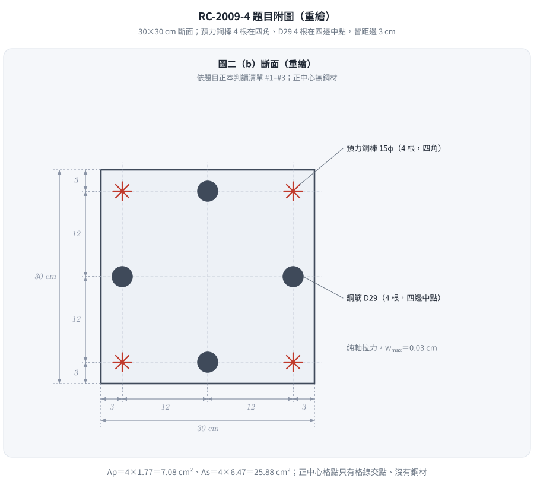
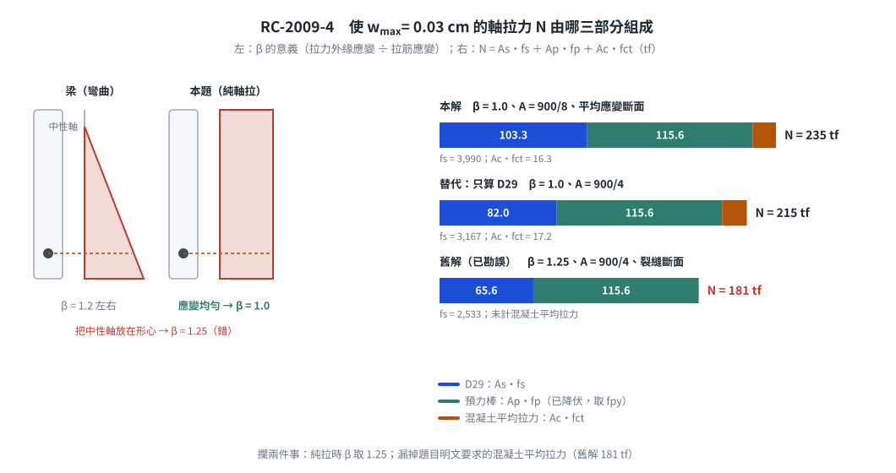

# 考題編號：RC-2009-4

**主分類：** `RC-U4-1` 預力梁斷面應力分析  
**副分類：** `RC-U3-1` 梁工作性要求（含撓度、裂縫）  
**設計法：** 混合（預力 WSD + 裂縫寬度）  
**標籤：** `預力RC拉力桿` `混合斷面` `裂縫寬度` `張力硬化` `wmax` `有效預力` `去壓載重` `15φ預力棒` `D29鋼筋` `平均應變相容`

---

## 1. 題目（考卷原文見題目正本）

> 考卷原文、公式／附表、附圖與判讀清單（已確認）見 [`RC-2009-4-problem.md`](RC-2009-4-problem.md)。本節只列解題時最容易讀錯的地方與本解使用的記號；題意以題目正本為準。

*重繪自考卷圖二（b），依題目正本判讀清單 #1–#3。本圖攔下「預力鋼棒與 D29 位置互換、正中心多一根」。*

### 常見誤讀

| 項目 | 正確判讀 | 常見誤讀 |
|------|---------|---------|
| 鋼材配置（#1） | 預力鋼棒 4 根在四角、D29 4 根在四邊中點；正中心無鋼材 | 位置互換或多算中心一根 |
| 有效預力（#4） | 13,200 kgf/cm² 為鋼棒有效**應力**，$A_p=4\times1.77=7.08$ cm² | 當成總力 |
| 受力（#5） | 純軸拉力，裂縫貫穿全斷面 | 當成彎曲構材 |
| 裂縫式參數（#6） | 純拉應變均勻，中性軸在無窮遠 → $\beta=1.0$；$A=900/8=112.5$ cm²（8 支有握裹受拉鋼材） | 把中性軸放在形心得 $\beta=1.25$；或套梁的 $\beta=1.2$ |
| 混凝土平均拉力 | 題目明文要求計入：$N=A_sf_s+A_pf_p+A_cf_{ct}$（平均應變斷面） | 只用裂縫斷面 $N=A_pf_p+A_sf_s$，漏掉 $A_cf_{ct}$ |

**本解記號：** $A_s=4\times6.47=25.88$ cm²；$f_{pe}=13{,}200$ kgf/cm²；$f_{ct}=f_r/(1+\sqrt{500\varepsilon_{ct}})$（考卷給定）。

**自行假設（考卷未給）：** $f_r=2\sqrt{f'_c}$；$E_c=15000\sqrt{f'_c}$；$E_p=E_s=2.04\times10^6$ kgf/cm²（考卷只寫 $E_p=E_s$，未給數值）；鋼棒有握裹，達 $f_{py}$ 後應力不再增加（彈塑性）；平均應變相容：混凝土平均拉應變 $\varepsilon_{ct}$＝鋼筋應變 $\varepsilon_s$。

---

## 2. 考題核心精神與出題者意圖 (Core Concepts & Examiner's Intent)

**核心觀念：** 此為預力RC拉力桿件（tension member）問題。分析流程：
1. 初始狀態：預力壓縮混凝土（$\sigma_{c0} < 0$）
2. 外力施加：張力增加 → 去壓 → 開裂 → 裂縫增寬
3. 裂縫寬度公式直接給出 $f_s$，反求 $N$
4. 張力硬化（tension stiffening）：混凝土在裂縫間仍有平均拉力 $f_{ct}$

---

## 3. 解題戰略地圖與陷阱分析 (Strategic Roadmap & Trap Analysis)

**作戰計畫：**
1. 確認斷面幾何（4 根 $A_p$＋4 根 $A_s$），淨混凝土面積 $A_c$
2. 有效預力狀態：混凝土與 D29 的初始壓應變 $\varepsilon_{c0}$
3. 裂縫寬度式反算 D29 應力 $f_s$（$\beta=1.0$）→ $\varepsilon_s=f_s/E_s$
4. 平均應變相容：混凝土平均拉應變 $\varepsilon_{ct}=\varepsilon_s$；預力棒 $f_p=f_{pe}+E_p(\varepsilon_s-\varepsilon_{c0})\le f_{py}$
5. 張力硬化：$f_{ct}=f_r/(1+\sqrt{500\varepsilon_{ct}})$
6. 平衡：$N=A_sf_s+A_pf_p+A_cf_{ct}$

| 陷阱 | 說明 | 應對 |
|------|------|------|
| ❶ D29 有**初始壓縮**（因預力） | $\varepsilon_{c0}<0$，D29 與混凝土同步受壓 | 外力造成的應變增量 $\Delta\varepsilon=\varepsilon_s-\varepsilon_{c0}$ 才是預力棒的增量 |
| ❷ $\beta$ 定義 | $\beta$＝中性軸至拉力外緣距離 ÷ 至拉筋距離；純軸拉應變均勻、無中性軸（在無窮遠） | $\beta=1.0$；**不可**把中性軸放在形心（得 1.25） |
| ❸ $A$ 的取法 | 「一支受拉鋼筋所佔有受拉混凝土面積」；預力鋼棒也是有握裹的受拉鋼材 | $A=900/8=112.5$ cm²（只算 D29 得 225 cm²，見 §5） |
| ❹ 預力棒可能先達 $f_{py}$ | $f_p$ 需與 $f_{py}=16{,}330$ 比較 | 超過則取 $f_{py}$ |
| ❺ 漏掉混凝土平均拉力 | 題目明文「請考慮混凝土開裂後，亦有平均拉力貢獻」 | 用平均應變斷面平衡，計入 $A_cf_{ct}$ |

---

## 3.5 變數層次分析 (Variable Hierarchy Analysis)

### 最終目標

求使 $w_{max} = 0.03$ cm 的純軸拉力 $N$。

### 關鍵公式

$$\varepsilon_{c0} = -\frac{A_p f_{pe}}{A_cE_c + A_sE_s}$$

$$f_s = \frac{w_{max}}{1.08\times10^{-6}\,\beta\,\sqrt[3]{d_c A}},\qquad \varepsilon_s=\varepsilon_{ct}=\frac{f_s}{E_s}$$

$$f_p = f_{pe} + E_p(\varepsilon_s-\varepsilon_{c0}) \le f_{py},\qquad f_{ct}=\frac{f_r}{1+\sqrt{500\,\varepsilon_{ct}}}$$

$$N = A_s f_s + A_p f_p + A_c f_{ct}$$

### L1：題目直接給定

| 符號 | 值 | 說明 |
|------|-----|------|
| $b=h$ | 30 cm | 斷面尺寸 |
| $f_{pe}$ | 13,200 kgf/cm² | 有效預應力 |
| $A_p$ per bar | 1.77 cm² | 15φ |
| $A_s$ per bar | 6.47 cm² | D29 |
| $f_{py}$ | 16,330 kgf/cm² | 預力棒降伏 |
| $f_y$ | 4,200 kgf/cm² | D29 |
| $w_{max}$ | 0.03 cm | |
| $d_c$ | 3 cm | 拉力緣至鋼筋形心 |

### L2：推導量

| 符號 | 公式 | 值 |
|------|------|-----|
| 總 $A_p$ | $4\times1.77$ | 7.08 cm² |
| 總 $A_s$ | $4\times6.47$ | 25.88 cm² |
| $A_c$ | $900-25.88-7.08$ | 867.0 cm² |
| $E_c$ | $15000\sqrt{350}$ | 280,624 kgf/cm² |
| $\varepsilon_{c0}$ | $-93{,}456/(867.0\times280{,}624+25.88\times2.04\times10^6)$ | $-3.156\times10^{-4}$ |
| $f_r$ | $2\sqrt{350}$ | 37.42 kgf/cm² |
| $\beta$ | 純拉 | 1.0 |
| $A$ | $900/8$ | 112.5 cm² |
| $\sqrt[3]{d_c A}$ | $\sqrt[3]{3\times112.5}$ | 6.962 cm |
| $f_s$ | from $w_{max}$ | 3,990 kgf/cm² |
| $\varepsilon_s=\varepsilon_{ct}$ | $3990/2.04\times10^6$ | $1.956\times10^{-3}$ |
| $f_p$ | $13200+2.04\times10^6\times2.271\times10^{-3}$ | 17,834 → 取 $f_{py}=16{,}330$ |
| $f_{ct}$ | $37.42/(1+\sqrt{0.978})$ | 18.81 kgf/cm² |
| $N$ | 平均斷面平衡 | ≈ 235 tf |

### L3：深層知識（不懂就卡住）

| 知識點 | 說明 | 卡關? |
|--------|------|:-----:|
| **$\beta$ 的意義** | 梁的應變沿深度線性變化，拉力緣應變比鋼筋處大 $\beta$ 倍；純拉應變均勻，兩處應變相同 → $\beta=1$ | |
| **平均應變 vs 裂縫斷面** | 裂縫處混凝土拉力為 0、鋼材應力最大；裂縫間混凝土仍分擔拉力（張力硬化）。題目給 $f_{ct}$ 式，就是要用平均應變斷面平衡 | |
| **預力棒的應變增量** | 有效預力狀態下鋼棒已有 $f_{pe}$；外力只帶來 $\varepsilon_s-\varepsilon_{c0}$ 的增量（$\varepsilon_{c0}$ 為負，增量大於 $\varepsilon_s$） | |

---

## 4. 步驟化詳細計算過程 (Step-by-Step Detailed Calculation)

### Step 1：斷面幾何與材料

- 4 根 15φ 預力棒（角隅，距兩面各 3 cm）：$A_p = 4\times1.77 = 7.08$ cm²
- 4 根 D29（各邊中點，距面 3 cm）：$A_s = 4\times6.47 = 25.88$ cm²
- 淨混凝土：$A_c = 900 - 25.88 - 7.08 = 867.0$ cm²

$$E_c = 15000\sqrt{350} = 280{,}624 \text{ kgf/cm}^2,\qquad f_r = 2\sqrt{350} = 37.42 \text{ kgf/cm}^2$$

---

### Step 2：有效預力狀態（$N=0$）

有效預力 $P_e = A_pf_{pe} = 7.08\times13{,}200 = 93{,}456$ kgf，由混凝土與 D29（與混凝土握裹、同步受壓）共同承受：

$$\varepsilon_{c0} = -\frac{93{,}456}{867.0\times280{,}624 + 25.88\times2.04\times10^6} = -\frac{93{,}456}{2.961\times10^8} = -3.156\times10^{-4}$$

混凝土 $\sigma_{c0}=E_c\varepsilon_{c0}=-88.6$ kgf/cm²（壓）；D29 $\sigma_{s0}=E_s\varepsilon_{c0}=-644$ kgf/cm²（壓）。

---

### Step 3：裂縫寬度式 → 求 $f_s$

純軸拉時整個斷面應變相同，沒有中性軸（在無窮遠），拉力外緣與拉筋的應變比為 1：

$$\beta = 1.0,\qquad d_c = 3 \text{ cm},\qquad A = \frac{900}{8} = 112.5 \text{ cm}^2 \text{（8 支有握裹受拉鋼材）}$$

$$\sqrt[3]{d_c A} = \sqrt[3]{3\times112.5} = \sqrt[3]{337.5} = 6.962 \text{ cm}$$

$$0.03 = 1.08\times10^{-6}\times1.0\times f_s\times6.962 = 7.519\times10^{-6}\,f_s$$

$$\boxed{f_s = \frac{0.03}{7.519\times10^{-6}} = 3{,}990 \text{ kgf/cm}^2} < f_y = 4200 \ ✅\text{（D29 未降伏）}$$

$$\varepsilon_s = \frac{3990}{2.04\times10^6} = 1.956\times10^{-3}$$

---

### Step 4：預力棒應力（平均應變相容）

預力棒與混凝土握裹，外力造成的應變增量 $\Delta\varepsilon = \varepsilon_s - \varepsilon_{c0} = 1.956\times10^{-3} + 0.316\times10^{-3} = 2.271\times10^{-3}$：

$$f_p = 13{,}200 + 2.04\times10^6\times2.271\times10^{-3} = 17{,}834 > f_{py} = 16{,}330$$

→ 預力棒已降伏，取 $f_p = f_{py} = 16{,}330$ kgf/cm²（降伏發生在 $\varepsilon_s = 1.219\times10^{-3}$，即 $f_s=2{,}486$ 時）。

---

### Step 5：混凝土平均拉應力（張力硬化）

混凝土平均拉應變等於鋼筋應變 $\varepsilon_{ct}=\varepsilon_s=1.956\times10^{-3}$：

$$f_{ct} = \frac{37.42}{1+\sqrt{500\times1.956\times10^{-3}}} = \frac{37.42}{1+0.989} = 18.81 \text{ kgf/cm}^2$$

---

### Step 6：平均斷面力平衡

$$N = A_sf_s + A_pf_p + A_cf_{ct} = 25.88\times3{,}990 + 7.08\times16{,}330 + 867.0\times18.81$$

$$= 103{,}253 + 115{,}616 + 16{,}312 = 235{,}181 \text{ kgf}$$

$$\boxed{N \approx 235 \text{ tf（使 }w_{max} = 0.03 \text{ cm）}}$$

*圖 1　$\beta$ 的意義與 $N$ 的三個組成。純拉應變均勻，$\beta=1.0$；三段長條並列——這張圖攔兩個錯：把純拉的中性軸放在形心得 $\beta=1.25$，以及漏掉題目明文要求的混凝土平均拉力 $A_cf_{ct}$。*

---

## 5. 關鍵爭議點與進階探討 (Critical Issues & Advanced Discussion)

**① 載重門檻**

| 載重狀態 | $N$ |
|---------|-----|
| 去壓載重 $N_0$（混凝土應力 = 0） | $\lvert\varepsilon_{c0}\rvert(A_cE_c+A_sE_s+A_pE_p) \approx 98$ tf |
| 開裂載重 $N_{cr}$（混凝土達 $f_r$） | $(\lvert\varepsilon_{c0}\rvert+f_r/E_c)(A_cE_c+A_sE_s+A_pE_p) \approx 139$ tf |
| 預力棒降伏（$\varepsilon_s=1.219\times10^{-3}$） | 介於開裂與答案之間 |
| $w_{max} = 0.03$ cm（**答案**） | ≈ **235 tf** |

**② $A$ 的另一種取法**

若認為式中「受拉鋼筋」只指 D29（4 支），$A=900/4=225$ cm²：$\sqrt[3]{675}=8.772$，$f_s=3{,}167$，$\varepsilon_{ct}=1.552\times10^{-3}$，$f_{ct}=19.89$，預力棒仍降伏，

$$N = 25.88\times3167 + 7.08\times16330 + 867.0\times19.89 = 81{,}952 + 115{,}616 + 17{,}247 \approx 215 \text{ tf}$$

本解採 8 支（預力鋼棒有握裹，同樣控制裂縫間距）。兩種取法相差約 9%。

**③ 舊版解析的兩個錯誤（2026-11-14 勘誤）**

- $\beta=1.25$：把純拉的中性軸放在形心。純拉沒有應變梯度，$\beta$ 應為 1.0；$\beta$ 偏大會使反算的 $f_s$ 偏小（2,534）。
- 最終答案用裂縫斷面 $N=A_pf_p+A_sf_s$（181 tf），沒有計入題目要求的混凝土平均拉力；且所附「平均斷面驗核」的平均應變與裂縫寬度式反算的鋼筋應變不一致。

**④ 規範版本**

現行建築物混凝土結構設計規範（2023）已不用裂縫寬度式，改以鋼筋間距控制裂縫。本題的 $w_{max}$ 式與 $f_{ct}$ 式是考卷指定的計算模型（題意資料），照用；$f_r=2.0\sqrt{f'_c}$、$E_c=15000\sqrt{f'_c}$ 為自行假設。

*修正日期：2026-11-14（§1 改為指向題目正本，重繪題目附圖 figs/RC-2009-4-fig-1-problem.svg；f_r、E_s 數值改標為自行假設）*

*修正日期：2026-11-14（解析勘誤：$\beta$ 1.25 → 1.0（純拉無應變梯度）、$A$ 225 → 112.5 cm²（8 支有握裹受拉鋼材，225 降為 §5 對照）、改用平均應變斷面並計入題目要求的混凝土平均拉力 $A_cf_{ct}$；$f_s$ 2,534 → 3,990 kgf/cm²，$N$ 181 → 235 tf（只算 D29 為 215 tf）；初始應變改以淨斷面 $A_cE_c+A_sE_s$ 計算；§3、§3.5、§4、§5 改寫；verify 腳本重算 MISMATCHES: 0，第二路徑以 $A$＝225 交叉）*

*圖解補繪：2026-11-14（向量圖 1 張 `figs/RC-2009-4-fig-2-force.svg`，腳本 `gen_RC-2009-4.py`，可重跑；腳本檔尾對 §4／§5 公佈值做 assert）*
