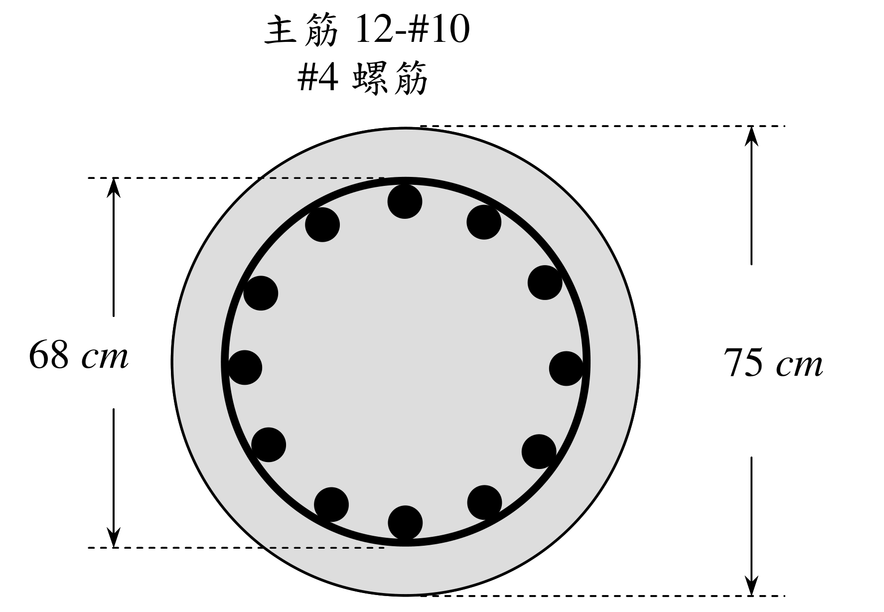

# RC-2010-1 題目正本

> 本檔只記錄**考卷上寫了什麼、圖上畫了什麼**，不含任何解法。解析見同資料夾 `RC-2010-1.md`。
> 判讀清單已經使用者確認（凍結）；本檔原則上不再修改（改動須回考卷原圖並記 log）。

| 項目 | 內容 |
|------|------|
| 考卷 | `raw/exams/RC-2010_鋼筋混凝土設計與預力.pdf` 第 1 頁（正面），第一題 |
| 考年 | 民國 99 年（2010） |
| 配分 | 40 分 |
| 附圖 | `RC-2010-1-fig-2.png`（500 dpi 重新擷取）；既有 `RC-2010-1-fig-1.png` 核心內有滑鼠游標壓在鋼筋旁，保留不刪 |
| 判讀狀態 | **已確認**（2026-11-14 使用者確認；不確定項照草稿判讀定案（#1 螺距須自行假設；#2 採讀法①）；轉錄 2026-11-14；PyMuPDF 110 dpi 全頁目視＋抽出文字核對，附圖 400／500 dpi 放大，尺寸線端點讀 PDF 向量座標；盲讀後才比對既有解析） |

## 1. 考卷原文（逐字）

> 一、試檢核鋼筋混凝土圓柱（如圖所示）所能承受之降伏軸力 $P_y$ 與極限軸力 $P_u$。已知 $f'_c$ = 350 kgf/cm²，$f_y$ = 4,200 kgf/cm²，#4：$A_s$ = 1.27 cm²，#10：$A_s$ = 8.17 cm²。（40 分）

## 2. 考卷給的公式、附表與參數

- 題文數值：$f'_c=350$、$f_y=4200$ kgf/cm²；#4 $A_s=1.27$ cm²；#10 $A_s=8.17$ cm²。
- **沒有給**：**螺筋間距（螺距）$s$**、$P_y$ 與 $P_u$ 的定義、$E_s$、強度折減因數、#4 與 #10 的直徑。
- 卷首注意事項：㈠可以使用電子計算器。㈡不必抄題，作答時請將試題題號及答案依照順序寫在試卷上，於本試題上作答者，不予計分。㈢以下各計算題依規範所需之公式或物理參數等，請自行推知或合理假設。

## 3. 附圖

圖面文字照錄：「主筋 12-#10」「#4 螺筋」「68 cm」「75 cm」。

## 4. 判讀清單

| # | 項目 | 判讀 | 圖上／題文依據 | 把握 |
|---|------|------|---------------|------|
| 1 | 螺筋間距 | **考卷沒有給**。若 $P_u$ 要計入螺筋圍束效果或要檢核螺筋量，須自行假設 $s$ | 題文、圖面均無；卷首㈢「請自行推知或合理假設」 | 不確定（影響答案，請確認）；使用者確認 |
| 2 | $P_y$、$P_u$ 的意思 | 考卷未定義。可能讀法：①$P_y$＝鋼筋降伏時（混凝土 $0.85f'_c$）之同心軸力 $0.85f'_c(A_g-A_{st})+f_yA_{st}$，$P_u$＝保護層剝落後核心受螺筋圍束之極限軸力；②$P_u$＝規範設計軸力上限 $\phi P_{n,\max}$ | 題文「降伏軸力」「極限軸力」，無公式 | 不確定（解讀）（影響答案，請確認）；使用者確認 |
| 3 | 外徑 | 75 cm（全斷面） | 右側尺寸線引線切於外圓上下緣（PDF 外圓直徑 135.0 pt，引線 y＝353.7／489.7） | 確定 |
| 4 | 68 cm 的量測基準 | **螺筋外緣至外緣**（核心直徑 $D_c$），非鋼筋中心圓 | 左側尺寸線端點 y＝368.6／475.7（107.1 pt）＝螺筋中心線直徑 104.6 pt＋線寬 2.25 pt（外緣 106.9 pt） | 確定 |
| 5 | 保護層 | $(75-68)/2=3.5$ cm（至螺筋外緣），由 #3、#4 推得，考卷未直接標 | 尺寸 | 確定 |
| 6 | 主筋 | 12-#10，$A_{st}=12\times8.17$ cm² | 圖面文字；數圓點 12 | 確定 |
| 7 | 圖不依比例 | 75 cm 畫成 135 pt（1.8 pt/cm），68 cm 卻只畫 107 pt；主筋畫得不等距 | PDF 座標 | 確定 |
| 8 | 載重型式 | 同心軸壓（題目只問軸力） | 題文 | 確定（解讀） |
| 9 | 考卷沒有給 | $E_s$、鋼筋直徑、$\phi$ 需自行採用 | 題文 | 確定 |

---

*轉錄：2026-11-14（RC-U1-2 題目正本推廣・批 1）*

*確認：2026-11-14 使用者確認（RC-U1-2 題目正本推廣・批 1，關卡一）*
