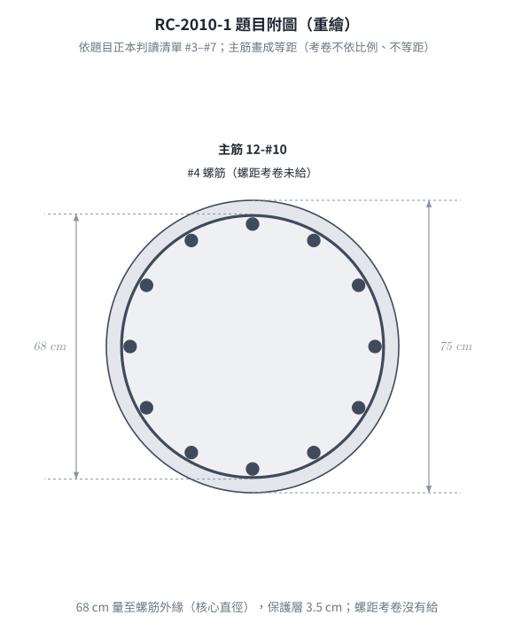
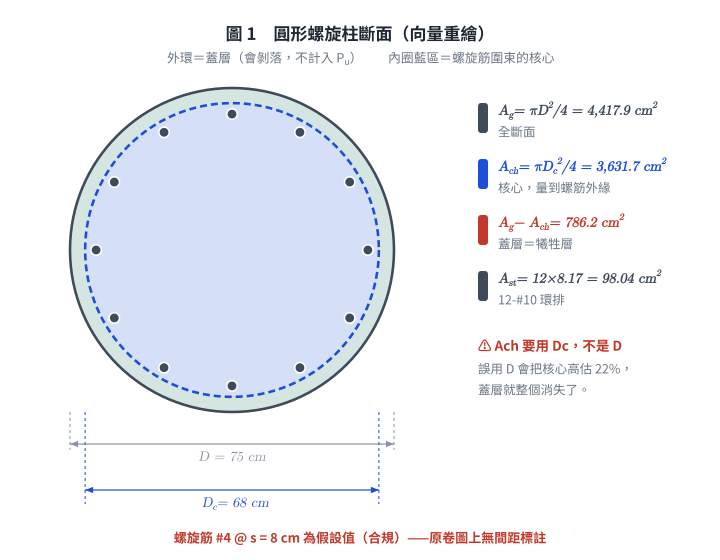
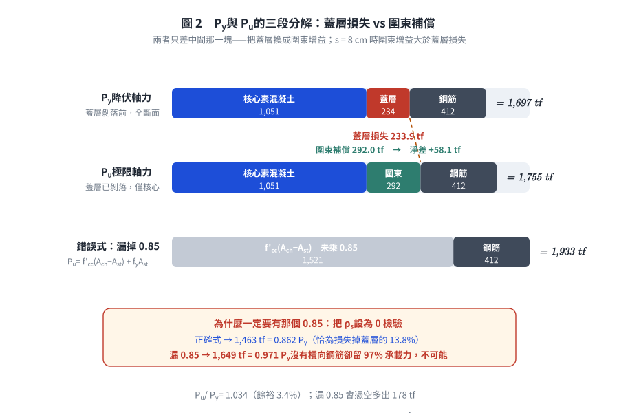
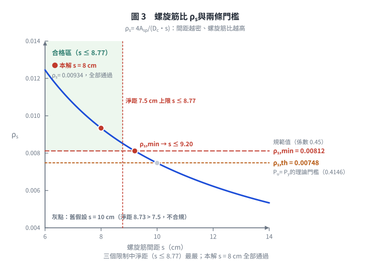

# 考題編號：RC-2010-1

**主分類：** `RC-U1-2` RC 柱強度分析與設計  
**副分類：** 無  
**設計法：** USD 強度設計法  
**標籤：** `圓形螺旋柱` `降伏軸力` `極限軸力` `螺旋筋圍束` `圍束混凝土強度` `ρs最小值` `f'cc` `fL側向圍束壓力` `Pu≥Py檢核` `12根主筋`

---

## 1. 題目（考卷原文見題目正本）

> 考卷原文、公式／附表、附圖與判讀清單（已確認）見 [`RC-2010-1-problem.md`](RC-2010-1-problem.md)。本節只列解題時最容易讀錯的地方與本解使用的記號；題意以題目正本為準。

*重繪自考卷附圖，依題目正本判讀清單；攔下把 68 cm 當鋼筋中心圓或全斷面、以及以為考卷給了螺距的錯誤。*

### 常見誤讀

| 項目 | 正確判讀 | 常見誤讀 |
|---|---|---|
| 68 cm 的基準 | 螺筋外緣至外緣＝核心直徑 $D_c$（判讀 #4），保護層 3.5 cm | 當成主筋中心圓直徑，或把 $A_{ch}$ 算成全斷面 |
| 螺距 $s$ | **考卷沒有給**（判讀 #1）；本解假設合規的 $s=8$ cm（須同時滿足 $\rho_{s,\min}$ 與螺筋淨距 ≤ 7.5 cm，2026-11-14 使用者定案） | 當成題給（同卷第二題標了「D13 @ 10 cm」，那是另一題）；或假設不合規的 $s=10$ cm 再判「不符規範」（舊版解析） |
| $P_y$、$P_u$ | $P_y$＝全斷面 $0.85f'_c(A_g-A_{st})+f_yA_{st}$；$P_u$＝保護層剝落後核心受螺筋圍束之極限軸力（判讀 #2 讀法①） | 把 $P_u$ 當成規範設計上限 $\phi P_{n,\max}$ |

**本解記號：** $D=75$ cm、$D_c=68$ cm；$A_g=\pi D^2/4$、$A_{ch}=\pi D_c^2/4$；$A_{st}=12\times8.17$ cm²；螺筋 $A_{sp}=1.27$ cm²、$s=8$ cm（**假設**，合規）；$f'_c=350$、$f_y=4200$ kgf/cm²。

### 判讀圖解（解析自繪）

*圖 1　圓形螺旋柱斷面（向量重繪）。$A_{ch}$ 用的是螺旋筋外緣直徑 $D_c = 68$ cm 而非全斷面 $D = 75$ cm——誤用 $D$ 會把核心高估 22%、蓋層直接消失，$P_u$ 與 $P_y$ 的比較就整個失去意義。*

---

## 2. 考題核心精神與出題者意圖 (Core Concepts & Examiner's Intent)

**核心觀念：** 螺旋柱的延性機制：
- **$P_y$（降伏／蓋層破壞）**：外圍蓋層混凝土達到極限應變後開始剝落，以全斷面計算
- **$P_u$（圍束極限）**：蓋層脫落後，螺旋筋提供側向圍束壓力 $f_L$，使核心混凝土強度提升至 $f'_{cc}$
- 設計要求：$P_u \ge P_y$（螺旋筋補償蓋層損失）；規範以 $\rho_s \ge \rho_{s,\min}$ 並加上螺筋淨距限制來保證

**出題者意圖：**
1. 測驗兩個不同強度（蓋層 vs. 圍束核心）的物理意義
2. 測驗螺旋筋體積比 $\rho_s$ 的計算與規範檢核（最小量、淨距）
3. 測驗圍束強度 $f'_{cc}$ 的計算
4. 考卷未給螺距 → 測驗能否**自行假設一個合規的螺距**再計算

---

## 3. 解題戰略地圖與陷阱分析 (Strategic Roadmap & Trap Analysis)

**作戰計畫：**
1. 計算各斷面幾何（$A_g$、$A_{ch}$、$A_{st}$）
2. 計算 $P_y$（全斷面，用 $0.85f'_c$）
3. 決定螺距：同時滿足 $\rho_s\ge\rho_{s,\min}$（$s\le9.20$）與淨距 $\le7.5$ cm（$s\le8.77$）→ 假設 $s=8$ cm
4. 計算 $\rho_s$、$f_L$、$f'_{cc}$、$P_u$（核心斷面，**同樣要乘 $0.85$**）
5. 比較 $P_u$ 與 $P_y$，作出結論

**關鍵陷阱：**

| 陷阱 | 說明 | 應對 |
|------|------|------|
| ❶ $\rho_s$ 的分母是**核心**，量到螺筋**外緣**（$D_c$） | 與 $A_{ch}$ 同一基準，才能和 $\rho_{s,\min} = 0.45(A_g/A_{ch}-1)f'_c/f_{yt}$ 對接，也才保得住 $f_L = \rho_s f_{yt}/2$ | $\rho_s = 4A_{sp}/(D_c\,s)$ |
| ❷ 不可把分母換成螺筋中心距 $D_c - d_b$ | 與量到外緣的 $A_{ch}$ 混用兩套基準，偏不保守 | 核心一律量到外緣 |
| ❸ $P_y$ 用 $0.85f'_c$ 的理由**不是** Whitney 應力塊 | $0.85$ 是「圓柱試體強度 → 構材內實際強度」的折減 | 純軸壓也要乘，**核心混凝土同樣要乘** |
| ❹ **$P_u$ 不可漏掉 $0.85$** | 寫成 $f'_{cc}(A_{ch}-A_{st}) + f_yA_{st}$ 時，$\rho_s = 0$ 會得 $0.97P_y$，物理上不可能 | 見 Step 4 |
| ❺ **假設的螺距本身要合規** | 只檢核 $\rho_{s,\min}$、漏了淨距 7.5 cm 上限；或假設一個不合規的 $s$ 再判「不符規範」——那是自己造成的 NG，不是題目的性質 | 先列出 $s$ 的規範上限，再取合規值 |

---

## 3.5 變數層次分析 (Variable Hierarchy Analysis)

> 複習提示：第一次解題後，在每個卡住的知識點旁標記 `⚠`；第二次複習時只看有 `⚠` 的項目。

### 最終目標

降伏軸力 $P_y$（全斷面）與極限軸力 $P_u$（蓋層剝落後、核心受螺筋圍束）。

### 本題關鍵公式（依計算順序）

$$\text{Step 1：} A_g = \frac{\pi D^2}{4},\quad A_{ch} = \frac{\pi D_c^2}{4},\quad A_{st} = 12\times8.17$$

$$\text{Step 2：} P_y = 0.85f'_c(\boxed{A_g} - \boxed{A_{st}}) + f_y \boxed{A_{st}}$$

$$\text{Step 3：} s \le \min\!\left(\frac{4A_{sp}}{\rho_{s,\min}D_c},\; 7.5 + d_b\right),\quad \rho_{s,\min} = 0.45\!\left(\frac{\boxed{A_g}}{\boxed{A_{ch}}} - 1\right)\!\frac{f'_c}{f_{yt}}$$

$$\text{Step 4：} \rho_s = \frac{4A_{sp}}{D_c\, s},\quad f_L = \frac{\rho_s f_{yt}}{2},\quad f'_{cc} = f'_c + 4.1\boxed{f_L}$$

$$\text{Step 5：} P_u = \underbrace{0.85f'_c(\boxed{A_{ch}} - \boxed{A_{st}})}_{\text{核心素混凝土}} + \underbrace{4.1\boxed{f_L}\,\boxed{A_{ch}}}_{\text{圍束增益}} + f_y \boxed{A_{st}}$$

### L1：題目直接給定

| 符號 | 數值 | 說明 |
|------|------|------|
| $D$ | 75 cm | 外徑 |
| $D_c$ | 68 cm | 螺筋外緣至外緣（判讀 #4） |
| $f'_c$ | 350 kgf/cm² | |
| $f_y=f_{yt}$ | 4200 kgf/cm² | |
| #10 $A_s$ | 8.17 cm² | 主筋 12 根 |
| #4 $A_s$ | 1.27 cm² | 螺筋 |
| 螺距 $s$ | **未給** | 本解假設 8 cm（合規） |

### L2：需知識點推導

| 符號 | 公式／來源 | 卡關? |
|------|-----------|-------|
| $A_g$、$A_{ch}$、$A_{st}$ | 4,417.9、3,631.7、98.04 cm² | |
| $P_y$ | 1,696.9 tf | |
| $\rho_{s,\min}$ | 0.00812 → $s\le9.20$ cm | |
| 淨距上限 | $7.5+1.27$ → $s\le8.77$ cm | ⚠ |
| $\rho_s$（$s=8$） | 0.00934 | |
| $f_L$、$f'_{cc}$ | 19.61、430.4 kgf/cm² | |
| $P_u$ | 1,755.0 tf | |

### L3：深層知識（不懂就卡住）

| 知識點 | 說明 | 卡關? |
|--------|------|-------|
| 螺筋淨距 | 現行規範（ACI 318-19 25.7.3.1）：淨距 ≥ 2.5 cm 且 ≤ 7.5 cm | ⚠ |
| $\rho_{s,\min}$ 的設計意圖 | 係數 0.45 讓 $P_u$ 略大於 $P_y$（理論門檻 0.4146） | |
| $4.1f_L$ | Richart 三軸實驗係數 | |
| 自行假設的參數也要合規 | 考卷沒給的量，取規範範圍內的合理值，並寫明 | ⚠ |

---

## 4. 步驟化詳細計算過程 (Step-by-Step Detailed Calculation)

### Step 1：斷面幾何

$$A_g = \pi\left(\frac{75}{2}\right)^2 = 4417.9 \text{ cm}^2,\qquad A_{ch} = \pi\left(\frac{68}{2}\right)^2 = 3631.7 \text{ cm}^2$$

$$A_{st} = 12\times8.17 = 98.04 \text{ cm}^2,\qquad A_g - A_{ch} = 786.2 \text{ cm}^2\ \text{（蓋層）}$$

---

### Step 2：降伏軸力 $P_y$（全斷面）

$$P_y = 0.85\times350\times(4417.9 - 98.04) + 4200\times98.04 = 1{,}285{,}150 + 411{,}768 = 1{,}696{,}918 \text{ kgf}$$

$$\boxed{P_y = 1{,}697 \text{ tf}}$$

---

### Step 3：決定螺距（考卷未給，自行假設合規值）

**規範最小螺旋筋比：**

$$\rho_{s,\min} = 0.45\times\left(\frac{4417.9}{3631.7}-1\right)\times\frac{350}{4200} = 0.45\times0.2165\times0.08333 = 0.00812$$

$$\Rightarrow\; s \le \frac{4A_{sp}}{\rho_{s,\min}D_c} = \frac{5.08}{0.00812\times68} = 9.20 \text{ cm}$$

**螺筋淨距上限 7.5 cm：**

$$s - d_b \le 7.5 \;\Rightarrow\; s \le 7.5 + 1.27 = 8.77 \text{ cm}$$

兩者取嚴：$s \le 8.77$ cm。**本解假設 $s = 8$ cm**（淨距 6.73 cm，介於 2.5 與 7.5 cm 之間 ✓）。

$$\rho_s = \frac{4A_{sp}}{D_c\, s} = \frac{4\times1.27}{68\times8} = 0.00934 \ge \rho_{s,\min} = 0.00812 \;✓$$

---

### Step 4：圍束混凝土強度 $f'_{cc}$ 與極限軸力 $P_u$

$$f_L = \frac{\rho_s f_{yt}}{2} = \frac{0.00934\times4200}{2} = 19.61 \text{ kgf/cm}^2$$

$$f'_{cc} = f'_c + 4.1 f_L = 350 + 4.1\times19.61 = 430.4 \text{ kgf/cm}^2$$

$$P_u = \underbrace{297.5\times3533.66}_{1{,}051{,}258} + \underbrace{80.40\times3631.7}_{291{,}995} + \underbrace{411{,}768}_{\text{鋼筋}} = 1{,}755{,}021 \text{ kgf}$$

$$\boxed{P_u = 1{,}755 \text{ tf}}$$

> **為什麼一定要有那個 $0.85$：** 把 $\rho_s$ 設為 0 檢驗。正確式給 $1{,}463$ tf $= 0.862P_y$，正好等於損失掉蓋層那 13.8%；漏掉 $0.85$ 的寫法給 $1{,}649$ tf $= 0.97P_y$——沒有橫向鋼筋的柱在蓋層剝落後還留 97% 承載力，不可能。

---

### Step 5：強度檢核彙整

| 項目 | 數值 |
|------|------|
| 蓋層剝落**損失** $0.85f'_c(A_g - A_{ch})$ | **233.9** tf |
| 螺旋圍束**補償** $4.1f_L A_{ch}$ | **292.0** tf |
| 淨差 | **+58.1** tf |

| 項目 | 數值 | 判定 |
|------|------|------|
| 降伏軸力 $P_y$ | **1,697 tf** | — |
| 極限軸力 $P_u$ | **1,755 tf** | — |
| $P_u \ge P_y$？ | $P_u/P_y = 1.034$ | ✅ 有 3.4% 餘裕 |
| $\rho_s \ge \rho_{s,\min}$？ | $0.00934 \ge 0.00812$ | ✅ |
| 螺筋淨距 | 6.73 cm（2.5–7.5） | ✅ |

$$\boxed{P_y = 1{,}697 \text{ tf},\quad P_u = 1{,}755 \text{ tf}\ (s = 8 \text{ cm 假設，合規})}$$

圍束補償大於蓋層損失：螺旋筋照規範配置，蓋層剝落後核心承載力不降反升，柱不會在蓋層破壞時驟然失去強度。

---

### 附：設計容量（φ 折減後）

符合規定的螺旋柱 $\phi = 0.75$、上限係數 $0.85$：

$$\phi P_{n,\max} = 0.85\times0.75\times P_y = 0.85\times0.75\times1{,}697 = \boxed{1{,}082 \text{ tf}}$$

---

*圖 2　$P_y$ 與 $P_u$ 的三段分解。兩者只差中間那一塊——把蓋層（233.9 tf）換成圍束增益（292.0 tf）；$s = 8$ cm 時 $P_u/P_y = 1.034$。第三條顯示漏掉 $0.85$ 會憑空多出 178 tf，且過不了 $\rho_s = 0$ 的檢驗。*

*圖 3　$\rho_s$ 與三個限制。淨距上限（$s \le 8.77$）比 $\rho_{s,\min}$（$s \le 9.20$）更嚴；本解 $s = 8$ cm 全部通過，舊版假設的 10 cm 兩者都不合格（灰點）。*

## 5. 關鍵爭議點與進階探討 (Critical Issues & Advanced Discussion)

**① 舊版解析的假設問題（2026-11-14 勘誤）**

舊版假設 $s = 10$ cm：淨距 8.73 cm 超過規範上限 7.5 cm（舊版沒有檢核這一條），$\rho_s = 0.00747 < \rho_{s,\min}$，於是得到「$P_u = 1{,}697$ tf、零餘裕、❌ 不符規範」。這個 NG 是假設出來的，不是題目的性質；考卷沒給螺距時，應先列出規範上限再取合規值。主線改為 $s = 8$ cm（2026-11-14 使用者定案）。

**② 螺距假設對 $P_u$ 的影響**

| 假設 | $\rho_s$ | $P_u$ (tf) | $P_u/P_y$ | 合規？ |
|---|---:|---:|---:|---|
| **$s = 8$ cm（本解）** | 0.00934 | **1,755.0** | 1.034 | ✅ |
| $\rho_s = \rho_{s,\min}$（$s = 9.20$） | 0.00812 | 1,716.9 | 1.012 | 淨距 7.93 > 7.5 ❌ |
| $s = 10$ cm（舊版） | 0.00747 | 1,696.6 | 1.000 | ❌ |

只依 $\rho_{s,\min}$ 反推（$s = 9.20$）時 $P_u$ 也壓得過 $P_y$，但那個螺距仍超過淨距上限——所以本題實際控制的是淨距。

**③ 圍束增益的兩種寫法**

本解用 Richart 式 $f'_{cc} = f'_c + 4.1f_L$，圍束增益 $4.1f_LA_{ch} = 2.05\rho_sf_{yt}A_{ch}$。ACI 解說常把它近似為 $2\rho_sf_{yt}A_{ch}$，$s = 8$ cm 時 $P_u = 1{,}747.9$ tf（差 0.4%），結論相同。

**④ $4.1f_L$ 圍束強度公式的來源**

Richart（1929）三軸實驗：$f'_{cc} = f'_c + 4.1f_L$。側向圍束壓力由螺旋筋環的平衡推得：切開半圓，螺筋跨過直徑面提供 $2A_{sp}f_{yt}$，抵抗 $f_L$ 作用在 $D_c\times s$ 上：

$$f_L = \frac{2A_{sp}f_{yt}}{D_c\, s} = \frac{\rho_s f_{yt}}{2}$$

**⑤ 矩形箍筋柱 vs. 螺旋柱**

| 比較項 | 矩形箍筋柱 | 螺旋柱 |
|--------|-----------|--------|
| $\phi$ | 0.65 | 0.75 |
| $\phi P_{n,\max}$ 係數 | 0.80 | 0.85 |
| 蓋層剝落後 | 承載力驟降 | 圍束補償，平緩 |

**⑥ 考場速解提示**

螺旋柱題必須含：
- $P_y$（$0.85f'_c$ 全斷面＋$f_yA_{st}$）
- 螺距沒給時：寫出 $\rho_{s,\min}$ 與淨距兩個上限，**明寫「假設 $s = \cdots$（合規）」**
- $f_L \to f'_{cc} \to P_u$（**核心混凝土的 $0.85$ 不可漏**）
- $P_u$ 與 $P_y$ 的比較結論

**⑦ 規範版本**

依現行建築物混凝土結構設計規範（2023，對應 ACI 318-19）：$\rho_{s,\min}$ 式、螺筋淨距 2.5–7.5 cm、螺旋柱 $\phi = 0.75$、$P_{n,\max} = 0.85P_o$。

*圖解補繪：2026-08-21（向量圖 3 張，腳本 `figs/gen_RC-2010-1.py`，可重跑；腳本檔尾對 §4 公佈值做 assert）*

*修正日期：2026-11-14（§1 改為指向題目正本，插入重繪附圖 figs/RC-2010-1-fig-1-problem.svg、改寫常見誤讀與本解記號；刪除舊附圖說明中「#4螺旋筋@10cm」的加字（螺距考卷未給）；本行非答案勘誤）*

*修正日期：2026-11-14（解析勘誤：假設螺距由 10 cm（淨距 8.73 cm 超過規範上限 7.5 cm）改為合規的 8 cm（使用者定案），補螺筋淨距檢核；$P_u$ 1,697 → 1,755 tf，結論由「零餘裕、不符規範」改為「$P_u/P_y = 1.034$、合規」，$P_y = 1{,}697$ tf 不變；改寫 §2–§5，重畫圖 2、3（gen 腳本對帳 15 項通過）。驗證：Python 重算 MISMATCHES: 0，$P_y$ 以兩種展開式交叉、$P_u$ 以 Richart 式與 $2.05\rho_s$ 改寫式交叉；依 RC-U1-2 批 1 盲解比對）*
