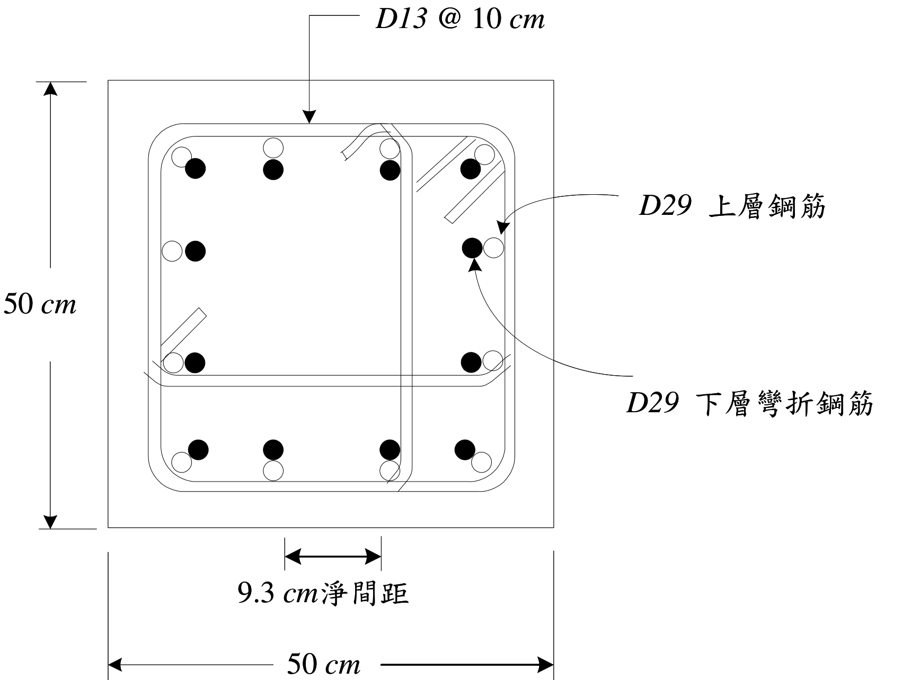

# RC-2010-2 題目正本

> 本檔只記錄**考卷上寫了什麼、圖上畫了什麼**，不含任何解法。解析見同資料夾 `RC-2010-2.md`。
> 判讀清單已經使用者確認（凍結）；本檔原則上不再修改（改動須回考卷原圖並記 log）。

| 項目 | 內容 |
|------|------|
| 考卷 | `raw/exams/RC-2010_鋼筋混凝土設計與預力.pdf` 第 1 頁（正面），第二題 |
| 考年 | 民國 99 年（2010） |
| 配分 | 20 分（㈠ 10 分＋㈡ 10 分） |
| 附圖 | `RC-2010-2-fig-2.png`（耐震柱斷面，無圖號；2026-11-14 由考卷 500 dpi 重新擷取）；既有 `RC-2010-2-fig-1.png` 為同一圖、解析度較低，保留不刪 |
| 判讀狀態 | **已確認**（2026-11-14 使用者確認；轉錄 2026-11-14；PyMuPDF 110 dpi 全頁目視＋抽出文字核對，附圖 500 dpi；盲讀後才比對既有解析） |

## 1. 考卷原文（逐字）

> 二、㈠請說明混凝土設計規範對耐震柱縱向搭接鋼筋面積與配置之要求。（10 分）
> ㈡下圖之耐震柱採用混凝土強度 $f_c'$ = 280 kgf/cm²，鋼筋 $f_y$ = 4,200 kgf/cm²，柱鋼筋比約 3%，試設計其抗拉搭接長度。（10 分）
> 註：D13 之 $d_b$ = 1.27 cm，$A_s$ = 1.267 cm²；D29 之 $d_b$ = 2.87 cm，$A_s$ = 6.469 cm²

## 2. 考卷給的公式、附表與參數

- 題文數值：$f'_c = 280$、$f_y = 4200$ kgf/cm²；柱鋼筋比約 3%；D13、D29 的 $d_b$、$A_s$（見原文註）。
- 卷首注意事項㈢：「以下各計算題依規範所需之公式或物理參數等，請自行推知或合理假設。」
- 考卷未印搭接或伸展長度公式。
- **沒有給**：保護層、搭接類別（甲／乙級）、搭接位置、柱高、規範版本、$\lambda$（視為常重混凝土）、是否有環氧塗層。
- 卷首注意事項：㈠可以使用電子計算器。㈡不必抄題，作答時請將試題題號及答案依照順序寫在試卷上，於本試題上作答者，不予計分。

## 3. 附圖

圖面文字照錄：`D13 @ 10 cm`、`D29 上層鋼筋`、`D29 下層彎折鋼筋`、`50 cm`（左）、`9.3 cm淨間距`、`50 cm`（下）。

## 4. 判讀清單

「把握」標**不確定**者請優先確認；解讀類項目（題目用字的意思）另標「解讀」。

| # | 項目 | 判讀 | 圖上／題文依據 | 把握 |
|---|------|------|---------------|------|
| 1 | 柱斷面 | $50 \times 50$ cm | 兩條外緣尺寸線 | 確定 |
| 2 | 縱筋 | D29，下層柱 12 根（實心，彎折後伸入上層）＋上層柱 12 根（空心），兩組在搭接區並排 | 引線：空心圓→「上層鋼筋」、實心圓→「下層彎折鋼筋」；數得實心 12、空心 12；$12 \times 6.469 / 2500 = 3.1\%$ 與題文「約 3%」相符 | 確定 |
| 3 | 淨間距 9.3 cm | 下排相鄰兩根（下層）主筋之間的**淨距** 9.3 cm | 尺寸線兩端對齊下排第 2、3 根實心圓的相鄰邊緣；文字「淨間距」 | 確定（解讀） |
| 4 | 橫向鋼筋 | D13 @ 10 cm：外圍閉合箍筋＋兩支內箍（有 135° 彎鉤） | 圖上箍筋線與彎鉤；引線 `D13 @ 10 cm` | 確定（解讀）（內箍形狀細節不影響 $K_{tr}$ 以外的計算） |
| 5 | 搭接類型 | 拉力搭接（題文「抗拉搭接長度」） | 題文㈡ | 確定 |
| 6 | 保護層 | 沒有給；圖未標 | 圖上只有 50、9.3 兩種尺寸 | 確定（考卷沒有給，作答須自行假設） |
| 7 | 考卷沒有給 | 保護層、搭接類別、柱高、規範版本 | 全題 | 確定 |

---

*轉錄：2026-11-14（RC-U3-3 題目正本推廣・批 1）*

*確認：2026-11-14 使用者確認（RC-U3-3 題目正本推廣・批 1，關卡一）*
