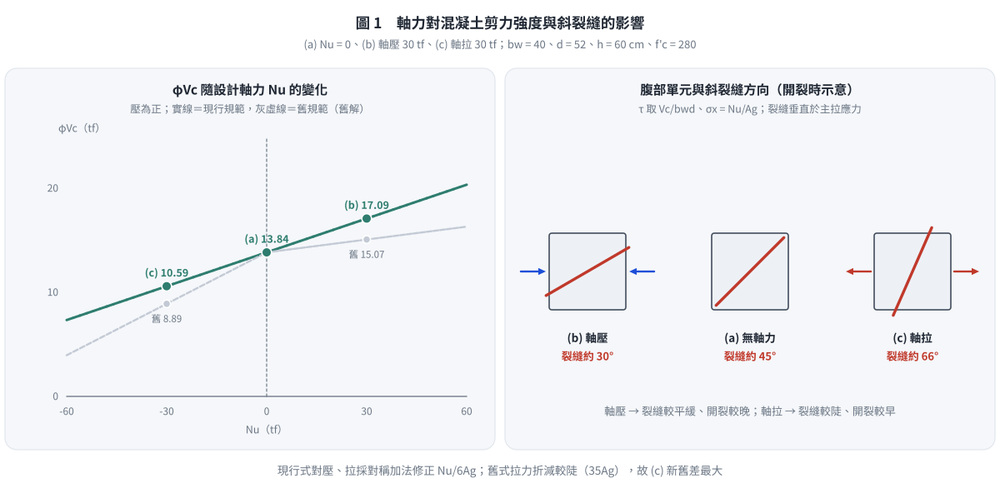

# 考題編號：RC-2010-3

**主分類：** `RC-U2-1` RC 剪力強度分析與設計  
**副分類：** 無  
**設計法：** USD 強度設計法  
**標籤：** `軸力` `剪力開裂強度` `裂縫形態` `簡化式Vc` `軸壓修正` `軸拉修正` `臨界斷面` `φVc計算` `概念題` `三種軸力`

---

## 1. 題目（考卷原文見題目正本）

> 考卷原文、公式／附表、附圖與判讀清單（已確認）見 [`RC-2010-3-problem.md`](RC-2010-3-problem.md)。本節只列解題時最容易讀錯的地方與本解使用的記號；題意以題目正本為準。

### 常見誤讀

| 項目 | 正確判讀 | 常見誤讀 |
|------|---------|---------|
| 所求 | $\phi V_c$（題文「設計強度」） | 標稱 $V_c$ |
| 公式 | 現行規範簡化式 $\left[0.53\lambda\sqrt{f'_c}+\dfrac{N_u}{6A_g}\right]b_wd$（軸力併入同一式） | 舊規範 $0.53(1+N_u/140A_g)$、$0.53(1+N_u/35A_g)$（本庫 2026-11-15 前舊解，(b)(c) 答 15.07／8.89 tf）；或含 $\rho_w V_ud/M_u$ 的詳細式 |
| 裂縫角度 | 軸壓 → 斜裂縫**較平緩**（與梁軸夾角變小）；軸拉 → 較陡、可貫穿 | 說反（舊解 ㈠ 寫軸壓裂縫較陡） |
| 跨度 | 考卷沒有給；跨中集中載重下半跨剪力相同，不影響臨界斷面剪力 | 自行假設跨度 |
| 軸力 | 30 tf 為設計（因數化）軸力 $N_u$ | 當使用載重再乘係數 |

**本解記號：** $N_u$＝設計軸力（壓為正、拉為負）；$A_g=b\,h$；$V_u$＝臨界斷面設計剪力（20 tf）。規範：建築物混凝土結構設計規範（內政部 2023 年版），假設 $A_v\ge A_{v,\min}$、常重混凝土 $\lambda$＝1。

---

## 2. 考題核心精神與出題者意圖 (Core Concepts & Examiner's Intent)

**核心觀念：**
- 軸壓力降低腹部主拉應力 → 斜裂縫較晚出現，$V_c$ 提升
- 軸拉力提高主拉應力 → 較早開裂，$V_c$ 降低，甚至歸零
- 現行規範把軸力效應寫成一項平均應力修正 $N_u/(6A_g)$，直接加在 $0.53\lambda\sqrt{f'_c}$ 上

**出題者意圖：**
1. **(一)** 測驗對軸力影響剪力的物理理解（主拉應力與主應力方向）
2. **(二)** 測驗三種情況下修正後 $\phi V_c$ 的數值計算

---

## 3. 解題戰略地圖與陷阱分析 (Strategic Roadmap & Trap Analysis)

**作戰計畫：**
1. 計算 $A_g$、$\sqrt{f'_c}$、$b_wd$
2. 三種情況各算 $N_u/(6A_g)$（拉力取負，上限 $0.05f'_c$），代入 $V_c=\left[0.53\sqrt{f'_c}+N_u/6A_g\right]b_wd$
3. 檢查 $0 \le V_c \le 1.33\sqrt{f'_c}\,b_wd$，乘 $\phi$＝0.75

**關鍵陷阱：**

| 陷阱 | 說明 | 應對 |
|------|------|------|
| ❶ 用舊規範修正係數 | 舊式壓、拉分別以 140、35 kgf/cm² 為分母的倍數修正；現行規範已改為 $N_u/6A_g$ 的加法項 | 用現行式 |
| ❷ 軸拉時 $N_u$ 代入為負值 | $N_u = -30{,}000$ kgf | 算出負值時取 $V_c$＝0 |
| ❸ $A_g$ 用**全斷面** | $A_g = b \times h = 40 \times 60 = 2400$ cm² | 不是 $b \times d$ |
| ❹ $\phi = 0.75$ | 剪力強度折減因數 | 不是 0.85 |
| ❺ 簡化式不需 $A_s$ 和載重 40 tf | 題目要求簡化式 | 不必用 $\rho_w^{1/3}$ 式 |

---

## 3.5 變數層次分析 (Variable Hierarchy Analysis)

### 最終目標

計算三種軸力條件下之 $\phi V_c$（臨界斷面最大混凝土剪力設計強度）。

### 本題關鍵公式

$$V_c = \left[0.53\lambda\sqrt{f'_c} + \frac{N_u}{6A_g}\right] b_w d,\qquad \frac{N_u}{6A_g}\le0.05f'_c,\qquad 0\le V_c\le1.33\lambda\sqrt{f'_c}\,b_wd$$

$$\phi V_c = 0.75\,V_c$$

### L1：題目直接給定

| 符號 | 數值 | 說明 |
|------|------|------|
| $b_w$ | 40 cm | 梁寬 |
| $d$ | 52 cm | 有效深度 |
| $h$ | 60 cm | 全高 |
| $f'_c$ | 280 kgf/cm² | |
| $N_u$ | 0 / +30 tf / −30 tf | 分三情況 |

### L2：需知識點推導

| 符號 | 計算 | 卡關? |
|------|------|-------|
| $A_g$ | $40\times60 = 2400$ cm²（全斷面） | |
| $0.53\sqrt{280}$ | $0.53\times16.733 = 8.868$ kgf/cm² | |
| $N_u/6A_g$ | $\pm30{,}000/14{,}400 = \pm2.083$ kgf/cm²（≤ $0.05f'_c$＝14） | |

### L3：深層知識（不懂就卡住）

| 知識點 | 說明 | 卡關? |
|--------|------|-------|
| $N_u/6A_g$ 的來源 | ACI 318-19 SI 式 $N_u/(6A_g)$（MPa），單位與 kgf/cm² 換算後係數不變（應力比值） | |
| 拉力修正取負 | 軸拉使 $V_c$ 線性下降；算出負值取 0 | |
| 簡化式不含 $A_s$、$V_u$、$M_u$ | 另一式 $2.1\lambda\rho_w^{1/3}\sqrt{f'_c}$ 才用到 $A_s$；本題指定簡化式 | |

---

## 4. 步驟化詳細計算過程 (Step-by-Step Detailed Calculation)

### Part (一)：軸力對剪力開裂強度與裂縫形態之影響

**▌ 主應力觀念**

腹部單元受剪應力 $\tau$ 與軸向正應力 $\sigma_x$（壓為負），主拉應力與其方向：
$$\sigma_{1} = \frac{\sigma_x}{2} + \sqrt{\left(\frac{\sigma_x}{2}\right)^2 + \tau^2},\qquad \tan2\theta_p=\frac{2\tau}{\sigma_x}$$

斜裂縫垂直於 $\sigma_1$ 方向發生。

**▌ 軸壓力**

① **開裂剪力增加**：$\sigma_x<0$ 使 $\sigma_1$ 變小，需要更大的 $\tau$ 才達到混凝土抗拉強度 → 斜裂縫較晚出現，$V_{cr}$、$V_c$ 增大；撓曲裂縫也被壓力抑制，不易發展為撓剪裂縫。

② **裂縫形態**：主拉應力方向轉向接近垂直，斜裂縫因此**較平緩**（與梁軸夾角小於 45°，如預力梁的腹剪裂縫）；裂縫較窄、較短。軸壓過大時破壞轉為斜壓（腹部壓碎）型態，延性降低。

**▌ 軸拉力**

① **開裂剪力降低**：$\sigma_x>0$ 使 $\sigma_1$ 增大，較小剪力即開裂；拉力大時斷面在無剪力下即可全斷面開裂，$V_c \to 0$。

② **裂縫形態**：主拉應力方向轉向梁軸，斜裂縫**較陡**；撓曲裂縫可貫穿全斷面高度（無壓力區），裂縫較寬、數量較多，骨材嵌合與壓力區剪力傳遞降低。

---

### Part (二)：三種軸力下 $\phi V_c$ 計算

**基本量：**
$$A_g = 40\times60 = 2400 \text{ cm}^2,\qquad b_wd = 40\times52 = 2080 \text{ cm}^2,\qquad 0.53\sqrt{280} = 8.868 \text{ kgf/cm}^2$$

上限 $1.33\sqrt{f'_c}\,b_wd = 1.33\times16.733\times2080 = 46{,}290$ kgf（三種情況均不控制）。

---

#### (a) 無軸力（$N_u = 0$）

$$V_c = 8.868\times2080 = 18{,}446 \text{ kgf}$$

$$\boxed{\phi V_c = 0.75\times18{,}446 = 13{,}834 \text{ kgf} = \mathbf{13.83 \text{ tf}}}$$

---

#### (b) 設計軸壓力 $N_u = +30{,}000$ kgf

$$\frac{N_u}{6A_g} = \frac{30{,}000}{6\times2400} = 2.083 \text{ kgf/cm}^2 \ (\le 0.05f'_c = 14)$$

$$V_c = (8.868 + 2.083)\times2080 = 10.951\times2080 = 22{,}778 \text{ kgf}$$

$$\boxed{\phi V_c = 0.75\times22{,}778 = 17{,}084 \text{ kgf} = \mathbf{17.08 \text{ tf}}}$$

> 軸壓使 $\phi V_c$ 增加 **+23.5%**

---

#### (c) 設計軸拉力 $N_u = -30{,}000$ kgf

$$\frac{N_u}{6A_g} = \frac{-30{,}000}{14{,}400} = -2.083 \text{ kgf/cm}^2$$

$$V_c = (8.868 - 2.083)\times2080 = 6.785\times2080 = 14{,}113 \text{ kgf}\ (>0)$$

$$\boxed{\phi V_c = 0.75\times14{,}113 = 10{,}585 \text{ kgf} = \mathbf{10.59 \text{ tf}}}$$

> 軸拉使 $\phi V_c$ 降低 **−23.5%**

---

### 彙整成果表

| 情況 | 軸力 $N_u$ | $N_u/6A_g$ (kgf/cm²) | $V_c$ (tf) | $\phi V_c$ (tf) |
|------|-----------|---------|-----------|----------------|
| (a) 無軸力 | 0 | 0 | 18.45 | **13.83** |
| (b) 軸壓 30 tf | +30,000 kgf | +2.083 | 22.78 | **17.08** |
| (c) 軸拉 30 tf | −30,000 kgf | −2.083 | 14.11 | **10.59** |

---

*圖 1　軸力對 $\phi V_c$ 與斜裂縫方向的影響（裂縫角度以開裂時 $\tau=V_c/b_wd$ 示意）。本圖攔下的錯：軸壓、軸拉的裂縫傾角寫反，以及沿用舊規範的 $N_u/140A_g$、$N_u/35A_g$ 式。*

## 5. 關鍵爭議點與進階探討 (Critical Issues & Advanced Discussion)

**① 舊規範簡化式對照（考試當年版本）**

| 情況 | 舊式 | $\phi V_c$（$\phi$＝0.75） | 現行 |
|------|------|------|------|
| 無軸力 | $0.53\sqrt{f'_c}b_wd$ | 13.83 | 13.83 |
| 軸壓 | $0.53(1+N_u/140A_g)\sqrt{f'_c}b_wd$ | 15.07 | 17.08 |
| 軸拉 | $0.53(1+N_u/35A_g)\sqrt{f'_c}b_wd$ | 8.89 | 10.59 |

舊式的 140、35 kgf/cm² 來自 ACI 英制 2000 psi、500 psi。現行式對壓、拉採對稱的加法修正；本題軸力不大時，現行式對軸壓給較高、對軸拉給較寬鬆的 $V_c$。（若當年規範剪力 $\phi$＝0.85，舊式答案為 15.68／17.08／10.08 tf。）

**② 軸拉趨近截止值（$V_c \to 0$）**

現行式：$0.53\sqrt{f'_c} + N_u/6A_g = 0 \Rightarrow N_u^* = -6A_g\times8.868 = -127.7$ tf；超過此拉力取 $V_c$＝0，剪力全由箍筋承擔。（舊式截止值為 −84 tf。）

**③ 軸壓的上限**

現行規範 $N_u/6A_g$ 不得超過 $0.05f'_c$（本題 14 kgf/cm²，對應 $N_u$＝201.6 tf），且 $V_c\le1.33\sqrt{f'_c}\,b_wd$。

**④ 本題 $A_s$ = 24.42 cm² 和載重 40 tf 的用途**

簡化式不需要。現行規範另一式 $V_c=\left[2.1\lambda\rho_w^{1/3}\sqrt{f'_c}+N_u/6A_g\right]b_wd$ 才用到 $\rho_w = 24.42/(40\times52) = 0.01174$：$2.1\times0.01174^{1/3}\times16.733 = 7.99$ kgf/cm² < 8.868，比簡化式還小。若 $A_v<A_{v,\min}$，此式須再乘尺寸效應因數 $\lambda_s$。

*修正日期：2026-11-15（§1 改為指向題目正本；舊 §1 重述改寫為常見誤讀與本解記號；本行非答案勘誤）*

*修正日期：2026-11-15（解析勘誤：改依現行台灣規範（建築物混凝土結構設計規範 2023 年版）簡化式 [0.53√f'c＋Nu/6Ag]bwd；(b) 15.07 → 17.08 tf、(c) 8.89 → 10.59 tf，(a) 13.83 tf 不變，舊式答案移 §5 對照；㈠ 裂縫角度改正（軸壓較平緩、軸拉較陡，原寫反）；驗證：盲解比對 + 勘誤腳本重算 MISMATCHES: 0）*

*修正日期：2026-11-15（圖解補繪（非勘誤）：新增 figs/RC-2010-3-fig-1-vc-axial.svg，腳本 figs/gen_RC-2010-3.py，可重跑；答案不變）*
