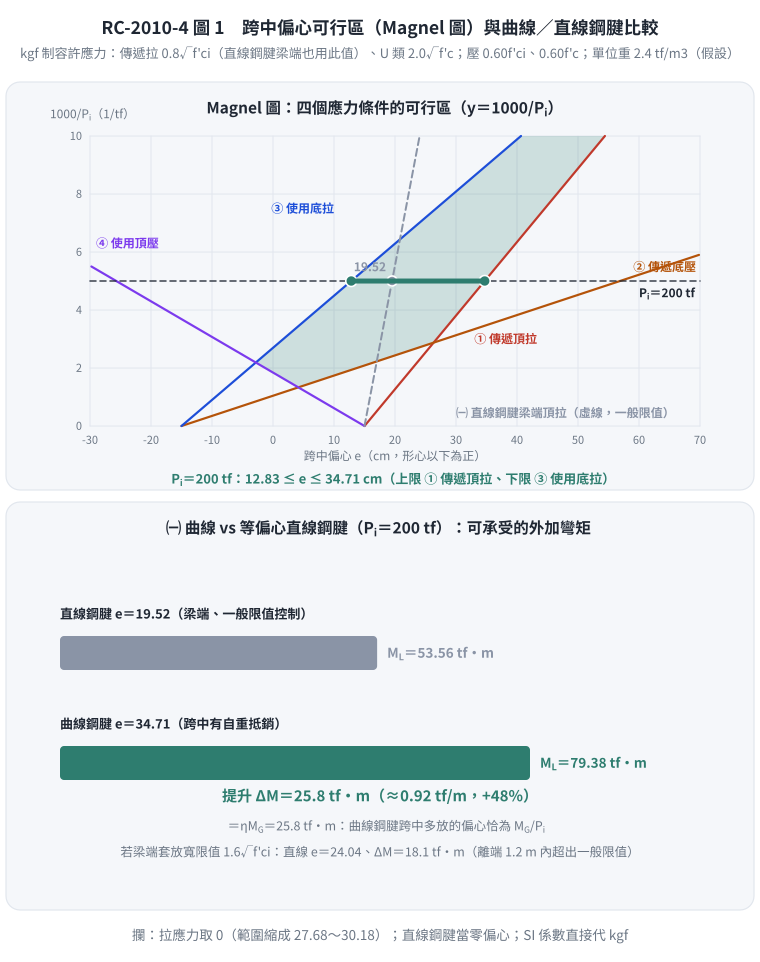

# 考題編號：RC-2010-4

**主分類：** `RC-U4-2` 預力量與偏心量設計  
**副分類：** `RC-U4-1` 預力梁斷面應力分析  
**設計法：** WSD 工作應力設計法  
**標籤：** `簡支預力梁` `偏心距限制` `四控制條件` `容許應力` `曲線型鋼腱` `直線型鋼腱` `等效載重法` `傳遞階段` `使用階段` `WG自重` `全斷面矩形` `端部應力` `U類拉應力`

---

## 1. 題目（考卷原文見題目正本）

> 考卷原文、公式／附表、附圖與判讀清單（已確認）見 [`RC-2010-4-problem.md`](RC-2010-4-problem.md)。本節只列解題時最容易讀錯的地方與本解使用的記號；題意以題目正本為準。

### 常見誤讀

| 項目 | 正確判讀 | 常見誤讀 |
|------|---------|---------|
| ㈠ 直線型鋼腱 | 考卷未說無偏心：採沿全長等偏心的直線鋼腱，偏心受梁端（無自重彎矩）應力控制，與曲線鋼腱比較可承受的外加載重（判讀 #1） | 直線鋼腱當成零偏心、只提供軸壓，答 $W_e=8P_ee_p/l^2$（本庫舊解） |
| ㈠ 比較基準 | 考卷沒給 ㈠ 的預力；本解沿用 ㈡ 的 $P_i$＝200 tf 比較（假設） | 不寫假設、直接給一個值 |
| 容許應力 | 考卷沒有給，依現行規範：傳遞拉 $0.8\sqrt{f'_{ci}}$（簡支端部 $1.6\sqrt{f'_{ci}}$）、使用 U 類 $2.0\sqrt{f'_c}$（kgf 制） | 拉應力一律取 0（本庫舊解）；或 SI 係數直接代 kgf |
| 自重 | 須計入（題文「除自重外」）；單位重考卷沒有給，假設 2.4 tf/m³ | 忽略自重 |
| 兩階段預力 | 傳遞 $P_i$、使用 $P_e=0.85P_i$ | 使用階段仍用 $P_i$ |

**本解記號：** $l$＝15 m；$b$＝50、$h$＝90 cm；$P_i$＝200 tf、$P_e$＝0.85$P_i$＝170 tf；$f'_{ci}$＝280、$f'_c$＝350 kgf/cm²；$W_l$＝1.5 tf/m；偏心 $e$ 由形心向下為正；應力壓為正、拉為負。

---

## 2. 考題核心精神與出題者意圖 (Core Concepts & Examiner's Intent)

**核心觀念：**
- **㈠** 簡支梁自重彎矩在跨中最大、梁端為零。曲線鋼腱可在跨中加大偏心（由自重彎矩抵銷傳遞時的頂拉），梁端偏心歸零；直線鋼腱全長同一偏心，偏心大小受**梁端**（沒有自重彎矩幫忙）的傳遞應力限制，跨中用不到那麼大的偏心 → 曲線鋼腱可多承受的使用載重約為 $\eta M_G$ 等級（容許拉應力在端部與跨中相同時恰為 $\eta M_G$）。
- **㈡** 偏心過大 → 傳遞時頂纖維拉應力超限；偏心過小 → 使用載重下底纖維拉應力超限；壓應力條件決定其餘界線。

**出題者意圖：**
1. 理解曲線鋼腱相對直線鋼腱的優點（跨中偏心不受梁端限制）
2. 列出傳遞、使用兩階段頂、底纖維的四個應力條件，求跨中偏心距的上下限

---

## 3. 解題戰略地圖與陷阱分析 (Strategic Roadmap & Trap Analysis)

**作戰計畫：**
1. 斷面性質 $A$、$S$；$P_i$、$P_e$；自重 $W_G$、$M_G$、$M_L$
2. 現行規範容許應力（kgf 制係數）
3. ㈡：跨中四條件 → 偏心上下限
4. ㈠：同一 $P_i$ 下，直線鋼腱 $e$ 受梁端限制、曲線鋼腱 $e$ 受跨中限制，各求可承受 $M_L$，取差值

**關鍵陷阱：**

| 陷阱 | 說明 | 應對 |
|------|------|------|
| ❶ 兩階段預力 | 傳遞用 $P_i$，使用用 $P_e=0.85P_i$ | 分清楚 |
| ❷ 初強度 vs 終強度 | 傳遞用 $f'_{ci}$，使用用 $f'_c$ | 不可混用 |
| ❸ 拉應力取 0 | 考卷未給容許值時應依現行規範：傳遞 $0.8\sqrt{f'_{ci}}$＝13.39、使用 U 類 $2.0\sqrt{f'_c}$＝37.42 kgf/cm² | 取 0 是「完全預力」條件，範圍過窄（見 §5 ③） |
| ❹ 端部限值 | 簡支構材端部傳遞拉應力 $1.6\sqrt{f'_{ci}}$、壓應力 $0.70f'_{ci}$ | 直線鋼腱的偏心由此控制 |
| ❺ 單位 | 1 tf·m＝100,000 kgf·cm | |

---

## 3.5 變數層次分析 (Variable Hierarchy Analysis)

> 複習提示：第一次解題後，在每個卡住的知識點旁標記 `⚠`；第二次複習時只看有 `⚠` 的項目。

### 最終目標

㈠ 曲線鋼腱比直線鋼腱多承受的載重；㈡ 跨中偏心距範圍 $e_{\min}\le e\le e_{\max}$。

### 本題關鍵公式（依計算順序）

$$\text{Step 1：} W_G = \gamma_c\,b\,h,\quad M_G = \frac{W_G l^2}{8},\quad M_L = \frac{W_l l^2}{8}$$

$$\text{Step 2（傳遞，跨中）：} \frac{P_i}{A}-\frac{P_ie}{S}+\frac{M_G}{S}\ge-f_{ti},\qquad \frac{P_i}{A}+\frac{P_ie}{S}-\frac{M_G}{S}\le f_{ci}$$

$$\text{Step 3（使用，跨中）：} \frac{P_e}{A}+\frac{P_ee}{S}-\frac{M_G+M_L}{S}\ge-f_t,\qquad \frac{P_e}{A}-\frac{P_ee}{S}+\frac{M_G+M_L}{S}\le f_c$$

$$\text{Step 4（直線鋼腱，梁端 } M=0\text{）：} \frac{P_i}{A}-\frac{P_ie}{S}\ge-1.6\sqrt{f'_{ci}}$$

### L1：題目直接給定

| 符號 | 數值 | 說明 |
|------|------|------|
| $l$ | 15 m = 1500 cm | 跨度 |
| $b$ | 50 cm | 梁寬 |
| $h$ | 90 cm | 梁高 |
| $f'_{ci}$ | 280 kgf/cm² | 混凝土初強度（傳遞時） |
| $f'_c$ | 350 kgf/cm² | 混凝土終強度（使用時） |
| $f_{pe}/f_{pi}$ | 0.85 | 有效預力比 |
| $W_l$ | 1.5 tf/m | 均佈活重 |
| $P_i$ | 200 tf | 初始預力（㈡；㈠ 沿用，假設） |

### L2：需知識點推導

**▌ 截面性質與載重**

| 符號 | 公式 | 值 |
|------|------|-----|
| $A$ | $50 \times 90$ | 4500 cm² |
| $S = S_t = S_b$ | $bh^2/6$ | 67,500 cm³ |
| $P_e$ | $0.85 \times 200$ | 170 tf |
| $W_G$ | $2.4 \times 0.5 \times 0.9$（假設 $\gamma$＝2.4 tf/m³） | 1.08 tf/m |
| $M_G$ | $1.08 \times 15^2/8$ | 30.375 tf·m |
| $M_L$ | $1.5 \times 15^2/8$ | 42.19 tf·m |

**▌ 容許應力（現行建築物混凝土結構設計規範 2023，kgf 制）**

| 條件 | 公式 | 值 (kgf/cm²) |
|------|------|-----|
| 傳遞壓（一般／簡支端部） | $0.60f'_{ci}$／$0.70f'_{ci}$ | 168／196 |
| 傳遞拉（一般／簡支端部） | $0.8\sqrt{f'_{ci}}$／$1.6\sqrt{f'_{ci}}$ | 13.39／26.77 |
| 使用壓（全部載重／持續載重） | $0.60f'_c$／$0.45f'_c$ | 210／157.5 |
| 使用拉（U 類，預壓拉力區） | $2.0\sqrt{f'_c}$ | 37.42 |

### L3：深層知識（不懂就卡住）

| 知識點 | 說明 | 卡關? |
|--------|------|-------|
| 傳遞頂拉決定偏心上限 | 傳遞時只有自重，偏心彎矩使頂纖維受拉 | |
| 使用底拉決定偏心下限 | 使用時 $P_e$ 較小、$M_G+M_L$ 最大 | |
| 直線鋼腱為何吃虧 | 梁端 $M_G=0$，偏心彎矩全靠端部拉應力限值承受 → 偏心受限；曲線鋼腱跨中多出的偏心 $\approx M_G/P_i$ | |
| U 類分類 | 現行規範依使用階段預壓拉力區拉應力分 U／T／C 類；U 類 $f_t\le2.0\sqrt{f'_c}$（kgf 制），可用全斷面性質 | |

---

## 4. 步驟化詳細計算過程 (Step-by-Step Detailed Calculation)

### Part ㈡：梁中央點偏心距限制（先算，㈠ 會用到）

#### Step 1：斷面與彎矩

$$A=4{,}500\ \text{cm}^2,\quad S=\frac{50\times90^2}{6}=67{,}500\ \text{cm}^3,\quad P_e=0.85\times200=170\ \text{tf}$$

$$M_G=\frac{1.08\times15^2}{8}=30.375\ \text{tf·m},\qquad M_L=\frac{1.5\times15^2}{8}=42.19\ \text{tf·m}$$

#### Step 2：跨中纖維應力（kgf/cm²，壓為正）

$$\frac{P_i}{A}=44.44,\quad\frac{P_i}{S}=2.963,\quad\frac{M_G}{S}=45.00,\quad\frac{P_e}{A}=37.78,\quad\frac{P_e}{S}=2.519,\quad\frac{M_G+M_L}{S}=107.50$$

| 階段 | 頂纖維 | 底纖維 |
|------|-------|-------|
| 傳遞（$P_i$＋$M_G$） | $89.44-2.963e$ | $-0.556+2.963e$ |
| 使用（$P_e$＋$M_G$＋$M_L$） | $145.28-2.519e$ | $-69.72+2.519e$ |

#### Step 3：四個控制條件

| 編號 | 條件 | 不等式 | 解 | 控制? |
|------|------|-------|----|------|
| ① | **傳遞頂拉** $\ge-13.39$ | $89.44-2.963e\ge-13.39$ | $e\le34.71$ | ✅ **上限** |
| ② | 傳遞底壓 $\le168$ | $-0.556+2.963e\le168$ | $e\le56.89$ | |
| ③ | 使用頂壓 $\le210$（全部載重） | $145.28-2.519e\le210$ | $e\ge-25.70$ | |
| ③' | 使用頂壓 $\le157.5$（即使把活載全當持續載重） | $145.28-2.519e\le157.5$ | $e\ge-4.85$ | |
| ④ | **使用底拉** $\ge-37.42$（U 類） | $-69.72+2.519e\ge-37.42$ | $e\ge12.83$ | ✅ **下限** |

#### Step 4：偏心距允許範圍

$$\boxed{12.83\ \text{cm}\le e\le34.71\ \text{cm}\quad（\text{形心以下}）}$$

幾何上：取鋼腱形心距底至少 10 cm，$e\le45-10=35$ cm，上限 34.71 可行。

**驗算：**

| $e$ | 傳遞頂 | 傳遞底 | 使用頂 | 使用底 |
|-----|-------|-------|-------|-------|
| 12.83（下限） | +51.44 | +37.45 | +112.97 | −37.42 ✓（＝限值） |
| 34.71（上限） | −13.39 ✓（＝限值） | +102.27 | +57.87 | +17.68 |

---

### Part ㈠：曲線型 vs 直線型鋼腱之載重能力

**比較基準（假設）：** 考卷沒給 ㈠ 的預力與直線鋼腱偏心；沿用 ㈡ 的 $P_i$＝200 tf，兩種鋼腱都取各自容許的最大跨中偏心，比較使用階段可承受的活載彎矩（底纖維 U 類拉應力控制）。

**曲線（拋物線）鋼腱：** 梁端偏心 0，跨中偏心取 ㈡ 上限 $e=34.71$ cm：

$$\frac{P_e}{A}+\frac{P_ee}{S}-\frac{M_G+M_L}{S}\ge-37.42\Rightarrow M_G+M_L\le(37.78+87.41+37.42)\times67{,}500$$

$$\Rightarrow M_L\le109.76-30.38=\mathbf{79.38\ \text{tf·m}}\quad（w_L\le2.822\ \text{tf/m}）$$

**直線鋼腱（全長等偏心）：** 梁端 $M=0$，傳遞時：

$$\text{端部頂拉：}44.44-2.963e\ge-1.6\sqrt{280}=-26.77\Rightarrow e\le\mathbf{24.04\ \text{cm}}$$

（端部底壓 $44.44+2.963e\le196$ → $e\le51.1$，跨中條件 $e\le34.71$，皆不控制。）

$$M_G+M_L\le(37.78+2.519\times24.04+37.42)\times67{,}500\Rightarrow M_L\le\mathbf{61.24\ \text{tf·m}}\quad（w_L\le2.178\ \text{tf/m}）$$

**提升量：**

$$\boxed{\Delta M=79.38-61.24=18.1\ \text{tf·m}\ \approx\ \Delta w=\frac{8\times18.14}{15^2}=0.645\ \text{tf/m}\ \ (\text{約 }+30\%)}$$

兩者都能承受題給 $W_l$＝1.5 tf/m；曲線鋼腱的活載容量多約 30%。

> 📌 直線鋼腱吃虧的原因：梁端沒有自重彎矩抵銷偏心彎矩，偏心只能到 24.04 cm；曲線鋼腱在跨中由 $M_G$ 抵銷，偏心可到 34.71 cm。

*圖 1　跨中偏心可行區（Magnel 圖）與曲線／直線鋼腱比較。上限由傳遞頂拉、下限由使用底拉控制；直線鋼腱的偏心受梁端（無自重彎矩）限制，只能放到 24.04 cm。本圖攔：拉應力取 0 使範圍縮成 27.68～30.18、把直線鋼腱當零偏心、SI 係數直接代 kgf。*

---

## 5. 關鍵爭議點與進階探討 (Critical Issues & Advanced Discussion)

**① ㈠ 的其他比較基準（題目未給條件，列出對照）**

| 基準 | 直線 | 曲線 | 提升 |
|------|------|------|------|
| 主線：$P_i$＝200 tf，各取最大容許偏心 | $e$＝24.04、$M_L$＝61.24 | $e$＝34.71、$M_L$＝79.38 | **18.1 tf·m（0.64 tf/m）** |
| 概念值：端部與跨中拉應力限值相同時，曲線鋼腱跨中可多偏心 $M_G/P_i$ | — | — | $\eta M_G=0.85\times30.375=25.8$ tf·m（0.92 tf/m） |
| 自由最佳化：$P_i$、$e$ 皆可選（線性規劃，$e\le35$） | $P_i$＝380.8 tf、$e$＝19.75、$M_L$＝107.34 | $P_i$＝347.9 tf、$e$＝26.33、$M_L$＝117.09 | 9.75 tf·m |

主線比概念值小，是因為現行規範簡支端部的傳遞拉應力限值（$1.6\sqrt{f'_{ci}}$）是一般位置的兩倍，部分抵銷了直線鋼腱的劣勢；自由最佳化時兩者都可提高預力，差距再縮小。作答時須寫明採用的基準。

**② 舊解（2026-11-15 勘誤前）與差異**

| 項目 | 舊解 | 本解 |
|------|------|------|
| 容許拉應力 | 傳遞、使用皆取 0 | 傳遞 $0.8\sqrt{f'_{ci}}$＝13.39（端部 26.77）、使用 U 類 $2.0\sqrt{f'_c}$＝37.42 |
| ㈡ 範圍 | 27.68～30.18 cm | **12.83～34.71 cm** |
| ㈠ 直線鋼腱 | 零偏心，只提供軸壓 | 等偏心，受梁端應力限制 |
| ㈠ 答案 | $W_e=8P_ee_p/l^2$≈1.75 tf/m（以 $e$≈29 代入） | $\Delta M$＝18.1 tf·m（≈0.64 tf/m） |

舊解 ㈠ 的 $8P_ee_p/l^2$ 是曲線鋼腱的等值向上載重（平衡載重），不是「比直線鋼腱多承受的載重」：直線鋼腱的偏心彎矩 $P_ee$ 同樣能抵抗載重彎矩，只是偏心大小受梁端限制。

**③ 照舊解拉應力取 0 的對照**

$f_{ti}=f_t=0$：上限 $(44.44+45.00)/2.963=30.19$、下限 $(107.50-37.78)/2.519=27.68$ cm → 27.68～30.19 cm（範圍僅 2.5 cm）。這是「完全預力、不允許拉應力」的設計條件，比現行 U 類嚴；考卷沒有指定，不採為主線。

**④ 為何上限由傳遞頂拉、下限由使用底拉控制**

| 控制條件 | 物理成因 |
|---------|---------|
| 傳遞頂拉（上限） | 傳遞時只有 $M_G$，$P_i$ 最大 → 偏心大時頂纖維被拉 |
| 使用底拉（下限） | 使用時 $P_e$ 已損失、$M_G+M_L$ 最大 → 偏心小時底纖維被拉 |

**⑤ 單位重假設**

考卷未給單位重；取 2.5 tf/m³ 時 $M_G$＝31.64 tf·m，㈡ 範圍變為 13.57～35.34 cm（上限超過幾何可行 35 cm，取 35），結論方向不變。

*修正日期：2026-11-15（§1 改為指向題目正本；舊 §1 重述改寫為常見誤讀與本解記號；本行非答案勘誤）*

*修正日期：2026-11-15（解析勘誤 FIX-RC-U4-2-B1，改依現行台灣規範（建築物混凝土結構設計規範 2023）：容許拉應力由 0 改為傳遞 $0.8\sqrt{f'_{ci}}$（簡支端部 $1.6\sqrt{f'_{ci}}$）、使用 U 類 $2.0\sqrt{f'_c}$：㈡ 27.68～30.18 → **12.83～34.71 cm**；㈠ 依題目正本 #1 改為等偏心直線鋼腱、沿用 $P_i$＝200 tf 比較：$W_e$≈1.75 tf/m → **$\Delta M$＝18.1 tf·m（≈0.65 tf/m，+30%）**，§5 列概念值 $\eta M_G$＝25.8 tf·m 與自由最佳化 9.75 tf·m 對照並寫明題目未給條件；撤除 §1 待勘誤提示；驗證：`.work/u4b1c/check_errata_U4_2_B1.py` 重算（含線性規劃交叉），MISMATCHES: 0）*

*圖解補繪：2026-11-15（DIAG-RC-U4-2-B1，向量圖 `figs/RC-2010-4-fig-1-magnel.svg`，腳本 `figs/gen_RC-2010-4.py`，數值取自本解 §4 並於腳本檔尾 assert，可重跑）*
