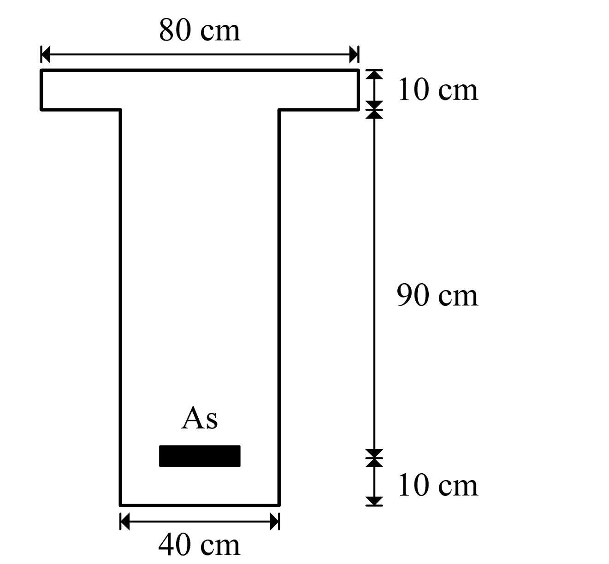

# RC-2011-2 題目正本

> 本檔只記錄**考卷上寫了什麼、圖上畫了什麼**，不含任何解法。解析見同資料夾 `RC-2011-2.md`。
> 判讀清單已經使用者確認（凍結）；本檔原則上不再修改（改動須回考卷原圖並記 log）。

| 項目 | 內容 |
|------|------|
| 考卷 | `raw/exams/RC-2011_鋼筋混凝土設計與預力.pdf` 第 1 頁（全一張之正面），第二題 |
| 考年 | 民國 100 年（2011） |
| 配分 | 25 分（㈠ 15、㈡ 10） |
| 附圖 | `RC-2011-2-fig-2.png`（圖 1：T 型梁斷面，500 dpi 重新擷取）；舊證據圖 `RC-2011-2-fig-1.png` 右側壓有滑鼠游標，保留不刪 |
| 判讀狀態 | **已確認**（2026-11-12 使用者確認；#5 使用者確認 h = 110、d = 100（推翻 2026-08-21 解析定案）；轉錄 2026-11-12，PyMuPDF 110 dpi 全頁目視＋抽出文字核對，附圖 450／500 dpi；盲讀後才比對既有解析） |

## 1. 考卷原文（逐字）

> 二、請針對圖 1 所示之 T 型鋼筋混凝土梁斷面，回答下列問題：
> ㈠若此 T 型梁斷面之 fc'＝350 kgf/cm²，fy＝4200 kgf/cm²，As＝0.9Asb，試求此梁斷面之設計彎矩強度，其中 Asb 為此梁斷面之平衡鋼筋量。（15 分）
> ㈡試求此梁斷面之斷面韌性容量 μφ，μφ＝φu/φy，其中 φu 及 φy 分別為此梁斷面之極限曲率及降伏曲率。（10 分）
>
> 圖 1：T 型鋼筋混凝土梁斷面

## 2. 考卷給的公式、附表與參數

- 題文數值：$f'_c=350$、$f_y=4200$ kgf/cm²；$A_s=0.9A_{sb}$。
- 斷面尺寸**只在圖上**（見 §3）。
- **沒有給**：$E_s$、$\varepsilon_{cu}$、$\beta_1$、$\phi$、鋼筋根數與號數（以 $A_{sb}$ 的倍數表示）。
- 卷首注意事項：㈠可以使用電子計算器；㈡不必抄題；㈢本試題之相關符號、公式、物理常數及設計參數未提及時，請依規範自行做合理推斷或假設。

## 3. 附圖

圖面文字照錄：`80 cm`、`10 cm`、`90 cm`、`10 cm`、`40 cm`、`As`、`圖 1：T 型鋼筋混凝土梁斷面`。

## 4. 判讀清單

「把握」標**不確定**者請優先確認；解讀類項目（題目用字的意思）另標「解讀」。

| # | 項目 | 判讀 | 圖上／題文依據 | 把握 |
|---|------|------|---------------|------|
| 1 | 翼板 | 寬 80 cm、厚 10 cm | 上方 80 cm 尺寸線兩端對齊翼板兩側；右側第一段 10 cm 夾翼板頂、底面 | 確定 |
| 2 | 腹板寬 | 40 cm | 底部 40 cm 尺寸線兩端對齊腹板兩側 | 確定 |
| 3 | 90 cm 段 | 由**翼板底面**量到 **As 形心**（不是到梁底） | 450 dpi：90 cm 尺寸線上端箭頭在翼板底面高度，下端箭頭對齊 As 長條中線（PDF 座標：90 段箭頭交點 y=481.3→590.0，As 長條 y=586.3–592.5） | 確定 |
| 4 | 下段 10 cm | As 形心到梁底 | 尺寸線上端接 90 cm 段下端、下端對齊梁底 | 確定 |
| 5 | 有效深度、全高 | $d = 10+90 = 100$ cm；$h = 110$ cm（不是 $h=100$、$d=90$） | 由 #1、#3、#4 相加；**圖是按比例畫的**：PDF 向量外框寬 99.06 pt＝80 cm（1.238 pt/cm），腹寬 49.56 pt＝40.0 cm、翼厚 12.36 pt＝10.0 cm，全高 135.96 pt＝**109.8 cm** | 確定（使用者選擇：採 h = 110、d = 100） |
| 6 | 鋼筋 | 只有單層拉力筋 As（長條表示，無根數），無壓力筋 | 圖上只有一個 As | 確定 |
| 7 | ㈠所求 | 「設計彎矩強度」＝$\phi M_n$，$A_s=0.9A_{sb}$（$A_{sb}$ 為**此 T 形斷面**的平衡鋼筋量） | 題文 | 確定（解讀） |
| 8 | ㈡所求 | $\mu_\phi=\phi_u/\phi_y$（曲率比），沿用㈠的 $A_s$ | 題文 | 確定 |
| 9 | 考卷沒有給 | $E_s$、$\varepsilon_{cu}$、$\beta_1$、$\phi$；卷首要求依規範自行合理推斷 | 卷首注意事項㈢ | 確定 |

---

*轉錄：2026-11-12（RC-U1-1 題目正本推廣・批 1）*

*確認：2026-11-12 使用者確認（RC-U1-1 題目正本推廣・批 1，關卡一）*
